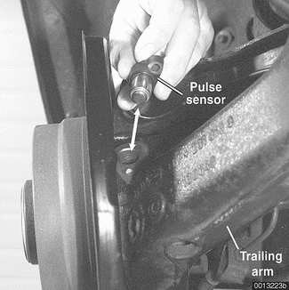
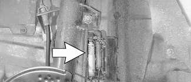
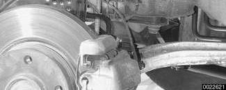
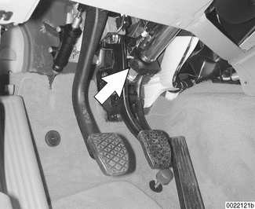
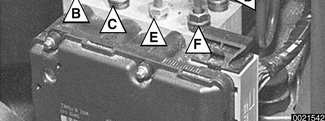
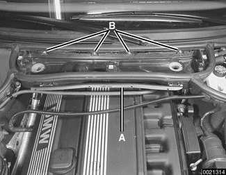
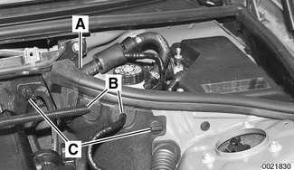
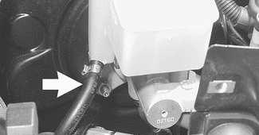
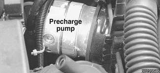

# ABS Component Replacement

> Source: BMW 3 Series (E46) Repair Manual, section 340-7, Brakes chapter (PDF pages 710–720 of 1252).

> **CAUTION!**
> - If the tires on the car are of different makes, the ASC system may over-react. Only fit tires of the same make and tread pattern.
> - In adverse conditions, such as trying to rock the car out of deep snow or another soft surface, or when snow chains are fitted, it is advisable to switch off ASC and allow the car's driveline to operate conventionally.

All E46 vehicles are equipped with an Antilock Braking System (ABS). Early production models featured ABS with Automatic Stability Control (ABS/ASC). Later models came equipped with ABS and Dynamic Stability Control (ABS/DSC). This manual will refer to these systems as ABS. ASC or DSC will be specified when necessary.

For ABS system and component descriptions, see [300 Suspension, Steering and Brakes-General].

## Wheel speed sensor, replacing

> **CAUTION!**
> - Magnetoresistive & Hall effect wheel speed sensors can be interchanged physically in the rear wheels, but function is not similar.

- Raise applicable end of car.

> **WARNING!**
> - Make sure the car is firmly supported on jack stands designed for the purpose. Place the jack stands beneath a structural chassis point. Do not place jack stands under suspension parts.

Front sensor: Unscrew mounting bolt at steering arm (arrow).

Rear sensor: Remove sensor from its bore (arrow) in the rear trailing arm.

> **Note:**
> - ABS wheel speed sensor application may vary depending on traction control system installed.

Disconnect and remove impulse sensor electrical harness (arrow) from retaining mounts. (Left front wheel shown).

- During installation, apply thin coat of Molykote® Longterm 2 or an equivalent grease to impulse sensor and housing.
- Installation is reverse of removal.

Tightening torque

| Component | Tightening torque |
|---|---|
| ABS wheel speed sensor to steering arm / trailing arm | 8 Nm (6 ft-lb) |

## ABS impulse wheel

ABS impulse wheel replacement may be needed in case of damage or impulse teeth corrosion.

### Front impulse wheel

- Rear wheel drive models: Impulse wheel is integral with front wheel bearing hub.
- All wheel drive models: Impulse wheel is integral with inner seal of front wheel bearing.

See [310 Front Suspension] for front wheel bearing replacement procedure.

> **Note:**
> - When installing the front wheel bearing on an all wheel drive car, be sure that the ridged bearing seal (ABS impulse wheel) is facing inboard.

### Rear impulse wheel

- All models: Impulse wheel is pressed on outer CV joint, but it is not replaceable separately.

See [331 Rear Axle Final Drive] for CV joint and drive axle replacement procedures.

## DSC lateral acceleration sensor, replacing

Rear wheel drive cars: The lateral acceleration sensor is located on the left side driver's footwell, under the panel trim on rear wheel drive vehicles.

All wheel drive cars: The lateral acceleration sensor is combined into one unit with the rotational rate (yaw) sensor. It is mounted under the driver's seat, in front of the left seat rail. See [DSC rotational rate (yaw) sensor, replacing].

> **CAUTION!**
> - After replacing the lateral acceleration sensor, perform sensor adjustment using either DIS or MoDiC under menu "Service Functions".

- Remove footwell trim on left side A-pillar. Fold foot trim panel and insulating mat to one side.

- Disconnect electrical harness connector. Remove mounting screw and nut. Remove lateral acceleration sensor.
- Installation is reverse of removal.

## DSC rotational rate (yaw) sensor, replacing

Rear wheel drive cars: The DSC rotational rate sensor is located on the left side of the car, under the driver's seat.

All wheel drive cars: The rotational rate sensor is combined into one unit with the lateral acceleration sensor. It is mounted under the driver's seat, in front of the left seat rail.

- Remove driver's seat. See [520 Seats].
- Remove plastic trim as necessary. Lift carpet for driver's footwell and fold toward center console. Move insulation forward to gain access to sensor.
- Remove sensor bracket mounting screws.
- Disconnect electrical harness connector at sensor.
- Remove sensor to bracket mounting screws. Lift sensor away from bracket.
- Installation is reverse of removal.

> **CAUTION!**
> - Be sure to tighten rotational rate sensor and mounting bracket to specified torques. The sensor is vibration sensitive and subject to cause DSC malfunctions if installed improperly.

Tightening torques

| Component | Tightening torque |
|---|---|
| Rotational rate sensor to bracket | 8 Nm (6 ft-lb) |
| Sensor bracket to body | 8 Nm (6 ft-lb) |

## DSC steering angle sensor

Vehicles equipped with DSC have a steering angle sensor (arrow) mounted to the steering column right above the pedal cluster. Replacement of this component requires special tools to properly align the steering column and sensor.

After removal or replacement the steering angle sensor requires calibration using BMW scan tools DIS or MoDiC. Once calibrated, the sensor sends a confirmation ID code to the DSC control module to indicate proper calibration.

For steering column removal see [320 Steering and Wheel Alignment].

## DSC pressure sensor

Rear wheel drive cars: Two DSC pressure sensors are used, mounted in the brake master cylinder.

All wheel drive cars: One DSC pressure sensor is used, mounted on the hydraulic unit.

Tightening torques

| Component | Tightening torque |
|---|---|
| Pressure sensor to hydraulic unit | 19 Nm (14 ft-lb) |
| Pressure sensor to master cylinder | 15 + 4 Nm (11 + 3 ft-lb) |

## Hydraulic unit/control module, removing and installing

> **CAUTION!**
> - E46 cars require special BMW service equipment to properly bleed the brakes. Removal of the hydraulic unit is not recommended unless this equipment is available. For safety reasons, the brake system on cars with ABS must be bled using the procedures described in this repair group.

> **Note:**
> - Before starting this procedure, read any fault codes from control module memory and print out diagnostic record.
> - After completing work, perform the function test on control module using either DIS or MoDiC.

The procedure for removing the ABS/ASC or ABS/DSC hydraulic unit/control module is similar for all models. The location of the units varies.

- On vehicles with hydraulic unit mounted beneath master cylinder, remove master cylinder as described earlier.
- Disconnect electrical harness connector at hydraulic unit/control module.

Mark brake lines in relation to their placement on hydraulic unit. (Teves MK 20 ASC hydraulic unit shown.)

A - Front from master cylinder
B - Left front
C - Right front
D - Rear from master cylinder
E - Right rear
F - Left rear

- Remove brake fluid input and output lines.
- Seal open brake fluid lines and bores with suitable plugs to prevent contamination.
- Carefully remove brake lines from any retainers or grommets that may be in the way of hydraulic unit/control module removal.

> **CAUTION!**
> - Make sure not to bend or kink brake lines while separating rubber grommet from retainer.

- Remove mounting screws of hydraulic unit housing and remove hydraulic unit/control module from engine bay.
- If necessary, separate hydraulic unit from control module.
- Installation is reverse of removal, noting the following:
  - Check rubber mount for hydraulic unit/control module. Replace if damaged.
  - Make sure all nuts, fluid couplings, thread bores and mating surfaces are clean.
  - Make sure brake lines are securely seated in grommets before installing brake lines in hydraulic unit bores.
  - Bleed brakes as described earlier.

Tightening torques

| Component | Tightening torque |
|---|---|
| Brake lines to hydraulic unit | 18 Nm (13 ft-lb) |
| Brake master cylinder to brake booster | 26 Nm (19 ft-lb) |
| Hydraulic unit to body | 8 Nm (6 ft-lb) |
| Mounting bracket to hydraulic unit | 8 Nm (6 ft-lb) |

## DSC precharge pump, removing and installing

> **CAUTION!**
> - E46 cars require special BMW service equipment to properly bleed the brakes. Removal of hydraulic components is not recommended unless this equipment is available. For safety reasons, the brake system on cars with ABS must be bled using the procedures described in this repair group.

> **Note:**
> - Before starting this procedure, read any fault codes from control module memory and print out the diagnostic record.

The precharge pump is mounted below the brake master cylinder on the left side of the engine compartment.

- Using a clean syringe, empty brake fluid reservoir.

> **WARNING!**
> - Brake fluid is highly corrosive and dangerous to the environment. Dispose of it properly.

Remove interior ventilation microfilter housing.

- Remove upper cover and microfilter.
- Open wiring harness loom (A) and remove wires.
- Unfasten screws (B) and remove lower microfilter housing.

Remove side trim panel from left rear of engine compartment:

- Remove rubber strip (A) from top of trim panel at brake booster.
- Remove vacuum line and positive battery cable with grommets (B) from trim panel.
- Release locking clips (C) on edges of trim panel and remove panel by pulling upwards.

Working at precharge pump beneath brake master cylinder:

- Remove brake fluid feed line (arrow) from brake fluid reservoir.
- Remove brake fluid intake and output lines from pump.

- Remove electrical harness connector.
- Lift pump to release from lower mounting pad.
- Slide pump out of retaining ring.
- Installation is reverse of removal, noting the following:
  - Be sure to replace rubber pump mounts if damaged or worn.
  - When installing vacuum hose and battery cable at trim panel, make sure isolating grommets are securely seated.
  - Bleed brakes as described earlier.
