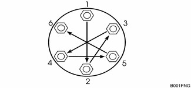
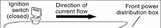
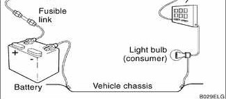

# Advice for the Beginner

> Source: BMW 3 Series (E46) Repair Manual, section 010-4 (PDF pages 5–9 of 1252).

The tips in the paragraphs that follow are general advice to help any do-it-yourself BMW owner perform repairs and maintenance tasks more easily and more professionally.

## Planning ahead

To prevent getting in too deep, know what the whole job requires before starting. Read the procedure thoroughly, from beginning to end, in order to know just what to expect and what parts will have to be replaced.

## Cleanliness

Keeping things organized, neat, and clean is essential to doing a good job. When working under the hood, fender covers will protect the finish from scratches and other damage. Make sure the car finish is clean so that dirt under the cover does not scratch the finish.

Any repair job will be less troublesome if the parts are clean. For cleaning old parts, there are many solvents and parts cleaners commercially available.

For cleaning parts prior to assembly, commercially available aerosol cans of parts cleaner or brake cleaner are handy to use, and the cleaner will evaporate completely.

> **WARNING!**
> - Most solvents used for cleaning parts are highly flammable as well as toxic, especially in aerosol form. Use with extreme care. Do not smoke. Do not use these products indoors or near any source of heat, sparks or flame.

## Non-reusable fasteners

Many fasteners used on the cars covered by this manual must be replaced with new ones once they are removed. These include but are not limited to: bolts, nuts (self-locking, nylock, etc.), cotter pins, studs, brake fittings, roll pins, clips and washers. Genuine BMW parts should be the only replacement parts used for this purpose.

Some bolts are designed to stretch during assembly and are permanently altered rendering them unreliable once removed. These are known as torque-to-yield fasteners. Always replace fasteners where instructed to do so. Failure to replace these fasteners could cause vehicle damage and personal injury. See an authorized BMW dealer for applications and ordering information.

## Tightening fasteners

When tightening the bolts or nuts that attach a component, it is always good practice to tighten the bolts gradually and evenly to avoid misalignment or over stressing any one portion of the component. For components sealed with gaskets, this method helps to ensure that the gasket will seal properly.

Where there are several fasteners, tighten them in a sequence alternating between opposite sides of the component. Repeat the sequence until all the bolts are evenly tightened to the proper specification.

For some repairs a specific tightening sequence is necessary, or a particular order of assembly is required. Such special conditions are noted in the text, and the necessary sequence is described or illustrated. Where no specific torque is listed, [Table a] can be used as a general guide for tightening fasteners.

> **WARNING!**
> - Table a is a general reference only. The values listed in the table are not intended to be used as a substitute for torques specifically called out in the text.

> **Note:**
> - Metric bolt classes or grades are marked on the bolt head.
> - Do not confuse wrench size with bolt diameter. For a listing of the common wrenches used on various bolt diameters, see [Basic tool requirements].

Table a. General bolt tightening torques in Nm (max. permissible)

**Bolt Class (according to DIN 267)**

| Bolt diameter | 5.6 | 5.8 | 6.8 | 8.8 | 10.9 | 12.9 |
|---|---|---|---|---|---|---|
| M5 | 2.5 | 3.5 | 4.5 | 6 | 8 | 10 |
| M6 | 4.5 | 6 | 7.5 | 10 | 14 | 17 |
| M8 | 11 | 15 | 18 | 24 | 34 | 40 |
| M10 | 23 | 30 | 36 | 47 | 66 | 79 |
| M12 | 39 | 52 | 62 | 82 | 115 | 140 |
| M14 | 62 | 82 | 98 | 130 | 180 | 220 |
| M16 | 94 | 126 | 150 | 200 | 280 | 340 |
| M18 | 130 | 174 | 210 | 280 | 390 | 470 |

## Gaskets and seals

Gaskets are designed to crush and become thinner as the mating parts are bolted together. Once a gasket has been used, it is no longer capable of making as good a seal as when new, and is much more likely to leak. For this reason, gaskets should not be reused.

Some gaskets—such as head gaskets—are directional. Make sure that these are installed correctly. This same logic applies to any part used for sealing, including rubber O-rings and copper sealing washers.

In places where a shaft must pass through a housing, flexible lip seals are used to keep the lubricating oil or grease from leaking out past the rotating shaft. Seals should never be reused once they have been removed. When removing a seal, be careful not to damage the metal surfaces.

The key to seal installation is to get the seal in straight without damaging it. Use a seal driver that is the same diameter as the seal housing to gently and evenly install into place. If a proper size seal driver is not available, a socket of the right size will do. Some seals are directional and special installation instructions apply. Make sure a seal is installed with the lip facing the correct way. Note the installation direction of the old seal before removing it.

## Electrical testing

Many electrical problems can be understood and solved with only a little fundamental knowledge of how electrical circuits function. Electric current only flows in a complete circuit. To operate, every electrical device in the car requires a complete circuit including a voltage source and a path to ground. The positive (+) side of the battery is the original voltage source, and ground is any return path to the negative (–) side of the battery, whether through the wiring harness or the car body. Except for portions of the charging system, all electrical current in the car is direct current (DC) and flows from positive (+) to negative (–).

Switches are used to turn components on or off by completing or interrupting the circuit. A switch is "open" when the circuit is interrupted, and "closed" when the circuit is completed. See [600 Electrical System–General] for electrical troubleshooting.

## Wire repairs

Repairs to a wiring harness require special care to make the repair permanent. The wire ends must be clean. If frayed or otherwise damaged, cut off the end. If the wire is too short, splice in a new piece of wire of the same size and make two connections.

Use connectors that are designed for the purpose. Crimped-on or soldered-on connectors are best. Crimp connectors and special crimping pliers are widely available. If soldering, use needlenose pliers to hold the wire near the solder joint and create a "heat dam". This keeps the heat and the solder from traveling up the wire. Always use a solder made specifically for electrical work (rosin core).

> **Note:**
> - Twisting wires together to make a repair is not recommended. Corrosion and vibration will eventually spoil the connection and may lead to irreparable damage to sensitive electronic components.
> - Insulate the finished connection. Electronics stores can supply heat-shrinkable insulating tubing that can be placed onto the wire before connecting, slid over the finished joint, and shrunk to a tight fit with a heat gun or hair dryer. The next best alternative is electrical tape. Make sure the wire is clean and free of solder flux or other contamination. Wrap the joint tightly to seal out moisture. See [600 Electrical System–General] for more information.
