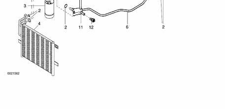
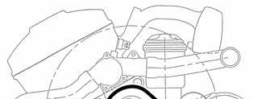
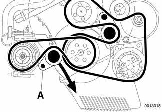
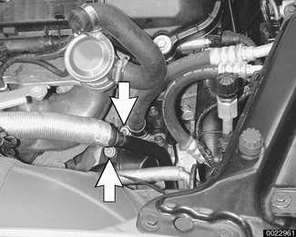
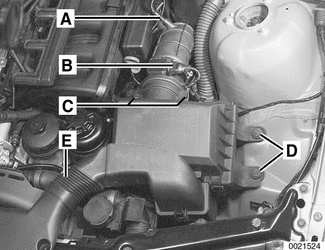
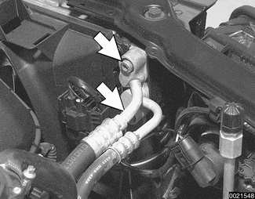
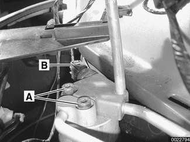
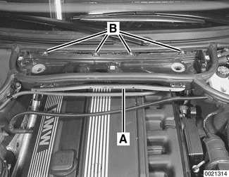

# Air Conditioning

> Source: Bentley *BMW 3 Series (E46) 1999–2005 (M3) Repair Manual*, section 640-6 (PDF pages 1158–1168 of 1252).

## Components

This section covers removal and installation of air conditioning refrigerant components. A/C testing and diagnosis, refrigerant discharge, evacuation and recharge are not covered here.

The A/C condenser, compressor, receiver dryer, pressure sensor, refrigerant lines and expansion valve are either installed in the engine compartment or accessible from the engine compartment.

The A/C evaporator is located in the IHKA housing. Removal of the IHKA housing involves dashboard removal. Before starting work, disconnect the battery negative (-) cable in the trunk. Be sure to read the battery disconnection cautions on page viii and the airbag warnings in [721 Airbag System (SRS)].

**Note:**

*The air conditioning system is filled with R-134a refrigerant.*

A/C system components

1 - High pressure line
2 - Sealing O-ring (always replace)
3 - Receiver-dryer
4 - Condenser
5 - Compressor
6 - Low pressure line
7 - Access port
8 - Double pipe
9 - Expansion valve
10 - Evaporator
11 - Access port
12 - Pressure sensor

## A/C compressor, replacing

- Following manufacturer's instructions, connect an approved refrigerant recovery/recycling /recharging unit to A/C system and discharge system.

> **WARNING!**
> - Do not discharge/charge the A/C system without proper equipment and training. Damage to the vehicle and personal injury may result.

- Remove splash shield from under engine.
- Mark A/C drive belt with direction of rotation.

Release tension on A/C belt:

- Use long-handled wrench to turn tensioner pulley release lug (**A**) clockwise (against spring tension).

- Remove drive belt.
- Detach and set aside front washer fluid reservoir. See [611 Wipers and Washers].
- Disconnect electrical harness connector from compressor.

Remove A/C pressure hose and suction hose flange bolts (arrows) from compressor. Plug hoses immediately.

- All-wheel-drive model: Unbolt and lower front stabilizer bar. See [310 Front Suspension].

Support compressor while removing compressor mounting bolts (arrows). Remove compressor.

- Installation is reverse of removal.

> **CAUTION!**
> - Always replace O-rings when reconnecting refrigerant lines.
> - When installing a new compressor always replace receiver/drier unit.

Tightening torque

| Component | Tightening torque |
|---|---|
| A/C line to A/C compressor | 20 Nm (15 ft-lb) |

- Recharge system following equipment manufacturer's instructions. See [Table e] for A/C system fluid specifications.

Table e. A/C system fluid specifications

| Fluid | Quantity |
|---|---|
| R-134a refrigerant | 740 ± 25 g (2 lb ± 1 oz.) |
| Refrigerant oil | PAG oil |

## A/C condenser, replacing

The A/C condenser is located in front of the radiator.

- Following manufacturer's instructions, connect an approved refrigerant recovery/recycling /recharging unit to A/C system and discharge system.

> **WARNING!**
> - Do not discharge/charge the A/C system without proper equipment and training. Damage to the vehicle and personal injury may result.

Remove complete air filter housing:

- Detach vacuum line at intake boot (**A**).
- Disconnect electrical harness connector on mass air flow sensor (**B**).
- Release mass air flow sensor clips (**C**).
- Remove filter housing mounting screws (**D**).
- Detach air duct connections (**E**) and lift complete air filter housing out of engine compartment, pulling it forward away from mass air flow sensor.

- Remove intake hood, cooling fan and shroud, and radiator, as described in [170 Radiator and Cooling System].

Detach A/C lines from upper right corner of condenser. Plug lines immediately.

- Remove fastener (expansion rivet) from top left corner of condenser.
- Remove Torx screw from top right corner of condenser, just below refrigerant line flange.
- Lift up condenser to disengage from plastic bracket and remove from above.
- Installation is reverse of removal.

> **CAUTION!**
> - Always replace O-rings when reconnecting refrigerant lines.
> - When installing a new condenser always replace receiver/drier unit.

- Recharge system following equipment manufacturer's instructions.

A/C system fluid specifications

| Fluid | Quantity |
|---|---|
| R-134a refrigerant | 740 ± 25 g (2 lb ± 1 oz.) |
| Refrigerant oil | PAG oil |

## A/C receiver/drier, replacing

The receiver/drier is mounted in the front right corner of the engine compartment behind and below the headlight assembly.

- Following manufacturer's instructions, connect an approved refrigerant recovery/recycling /recharging unit to A/C system and discharge system.

> **CAUTION!**
> - The receiver/drier must be replaced when
>     - There is dirt in the A/C system
>     - The compressor has seized or has been replaced for any reason
>     - The condenser or evaporator are replaced for any reason
>     - The A/C system is leaking and there is no more refrigerant
>     - The A/C system was open for 24 hours or more.

- Remove right headlight assembly. See [630 Lights].

Remove refrigerant pressure line mounting bolts (**A**) from receiver/drier. Plug lines immediately.

Disconnect high pressure switch harness connector (**B**).

- Working beneath right front of car, remove splash shield retaining screws. Remove splash shield.
- Loosen receiver/drier mounting strap bolts and slide receiver/dryer down and out.
- Installation is reverse of removal.

> **CAUTION!**
> - Always replace O-rings when reconnecting refrigerant lines.

- Recharge system following equipment manufacturer's instructions.

A/C system fluid specifications

| Fluid | Quantity |
|---|---|
| R-134a refrigerant | 740 ± 25 g (2 lb ± 1 oz.) |
| Refrigerant oil | PAG oil |

## A/C expansion valve, removing and installing

- Following manufacturer's instructions, connect an approved refrigerant recovery/recycling /recharging unit to A/C system and discharge system.

> **WARNING!**
> - Do not discharge/charge the A/C system without proper equipment and training. Damage to the vehicle and personal injury may result.

Remove housing for interior ventilation microfilter.

- Remove upper cover and microfilter.
- Open wiring harness loom (**A**) and remove wires.
- Unfasten screws (**B**) and remove lower housing.

To remove heater bulkhead cover:

- Remove engine compartment side trim panel. Turn locking clips (**A**) and slide trim panel up.
- Remove heater bulkhead cover mounting screws (**B**) and lift cover off bulkhead.

Working in right rear of engine compartment, detach A/C lines:

- Remove A/C recharging port bracket mounting nut (**A**).
- Remove allen bolts (**B**) at bulkhead.
- Release and plug open A/C lines.

Working inside right side of cowl, pull up on lever (arrow) and detach right air intake flap from blower housing.

- Working in right front of IHKA housing, detach double pipe (A/C line) from expansion valve.
    - Lay double pipe aside.
    - Plug up open A/C ports.
- Remove expansion valve mounting bolts and remove valve.
- Installation is reverse of removal.

> **CAUTION!**
> - Always replace O-rings when reconnecting refrigerant lines.

- Recharge system following equipment manufacturer's instructions.

A/C system fluid specifications

| Fluid | Quantity |
|---|---|
| R-134a refrigerant | 740 ± 25 g (2 lb ± 1 oz.) |
| Refrigerant oil | PAG oil |

## A/C evaporator, removing and installing

- Following manufacturer's instructions, connect an approved refrigerant recovery/recycling /recharging unit to A/C system and discharge system.
- Drain engine coolant. See [170 Radiator and Cooling System].
- Remove complete IHKA housing as described earlier.
- Remove heater core as described earlier.

Working on left side of IHKA housing:

- Detach evaporator temperature sensor electrical harness connector and pull out sensor.
- Detach wiring harness from housing.
- Detach linkage from fresh air distribution motor.

Working on right side of IHKA housing:

- Unclip and remove fresh air/recirculation motor.
- Remove evaporator cover mounting screw and remove cover.

- Detach and remove microswitch at side of IHKA housing.

Working in front of IHKA housing:

- Remove blower housing mounting screws. Lift out blower housing.

- Remove double coolant pipe.
- Pry off evaporator housing retaining clips and remove cover. Pull evaporator and expansion valve out of bottom of housing.
- If installing new evaporator, switch over expansion valve. Use new sealing O-rings.

> **CAUTION!**
> - Do not bend cooling fins on evaporator. If necessary, straighten with fin comb.

- Installation is reverse of removal.
    - Make sure electrical harnesses are routed as before.
    - Align guides and clips correctly.
- Recharge system following equipment manufacturer's instructions.

A/C system fluid specifications

| Fluid | Quantity |
|---|---|
| R-134a refrigerant | 740 ± 25 g (2 lb ± 1 oz.) |
| Refrigerant oil | PAG oil |
