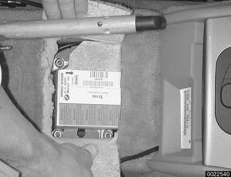
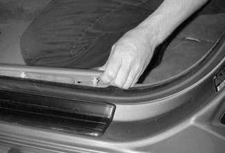
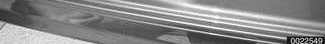
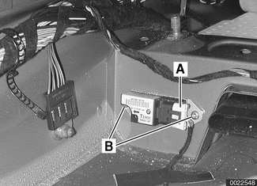

# Airbag Electronics

> Source: Bentley BMW 3 Series (E46) 1999–2005 (M3) Repair Manual, section 721-2 (PDF pages 1211–1213 of 1252).

## Airbag harnesses and connectors

If airbag connection harnesses show visible signs of wear or damage, they must be replaced or repaired.

To repair airbag harness:

- Disconnect negative (-) cable from battery and cover negative terminal with insulating material.
- Disconnect harness connector at airbag module or on intermediate plug.
- Cut through one cable, then the other, and repair.

> **CAUTION!**
>
> - Do not under any circumstances cut through both wires of an airbag harness at the same time.
> - Perform only one repair on an airbag harness wire. If more than one spot is damaged, replace the entire section of harness.

## MRS control module, replacing

- Disconnect negative (-) cable from battery and cover negative terminal with insulating material.

> **CAUTION!**
>
> - Prior to disconnecting the battery, read the battery disconnection cautions given at the front of this manual on page viii.

- Remove center utility tray between front seats. See [513 Interior Trim].

- Cut open carpet on top of center tunnel to access MRS II module.
- Remove module mounting nuts and lift up control module. Detach electrical harness connector.
- Installation is reverse of removal.
    - Be sure that MRS module ground cable is attached to the module mounting stud.

## Side-impact crash sensor, removing and installing

- Make sure ignition key is OFF.
- Remove front seat. See [520 Seats].
- Remove plastic door sill trim by lifting to release clips at one end, then sliding off. Fold up carpet towards rear seat floor. If necessary, remove floor level heater duct.

- Remove electrical harness connector from crash sensor (A). Remove sensor retaining screws (B) and remove sensor. Note direction of sensor arrow before removing.
- Installation is reverse of removal.

**Note:**

*Arrow on sensor must point to door sill.*
