# Airbags

> Source: Bentley BMW 3 Series (E46) 1999–2005 (M3) Repair Manual, section 721-3 (PDF pages 1214–1221 of 1252).

## Driver airbag, removing and installing

- Disconnect negative (-) cable from battery and cover negative terminal with insulating material.

> **WARNING!**
>
> - After disconnecting the battery, wait 5 seconds before beginning work on airbag components.

> **CAUTION!**
>
> - Prior to disconnecting the battery, read the battery disconnection cautions given at the front of this manual on page viii.

**Multifunction (MFL) steering wheel:**

- Working behind steering wheel, completely loosen Torx screws (T30) while holding airbag in place.

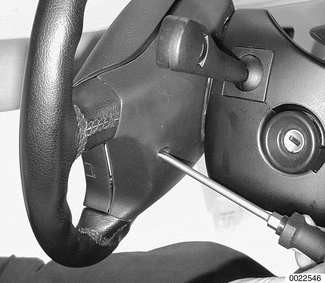

- Support airbag unit to prevent it from falling out.

- Carefully lift airbag unit off steering wheel and disconnect harness connector (**arrow**) from rear of airbag unit.

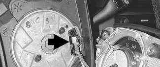

**Sport steering wheel:**

- Insert screwdriver through opening in rear of steering wheel and push against spring tension to release airbag unit lock.
- Repeat procedure on other side of steering wheel.

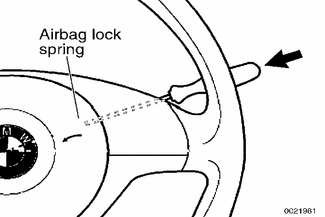

- Lift off airbag unit and detach electrical harness connectors.

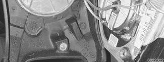

> **WARNING!**
>
> - Store the removed airbag unit with the horn pad facing up. If stored facing down, accidental deployment could propel it violently into the air, causing injury.
> - Once an airbag is removed, the car must not be driven.
> - Do not connect the battery with the airbag disconnected. A fault code will be stored, setting off the airbag indicator light. Special tools are needed to reset the fault memory.
> - Once the airbag unit is installed and all other service procedures have been completed, start the engine and check that the airbag indicator light goes out. If the indicator light stays on, the airbag system will not function as designed. Have the system diagnosed and repaired by an authorized BMW dealer.

- Installation is reverse of removal.
    - MFL steering wheel: Torque airbag using specification listed below.
    - Sport steering wheel: Press airbag unit mounting pins into spring locks in steering wheel until they snap in firmly.

> **CAUTION!**
>
> - Do not pinch airbag harness in center of steering wheel when installing airbag.

Tightening torque

| Component | Tightening torque |
|---|---|
| Airbag to steering wheel (MFL) | 8 Nm (71 in-lb) |

## Passenger airbag, removing and installing

- Disconnect negative (-) cable from battery and cover negative terminal with insulating material.

> **WARNING!**
>
> - After disconnecting the battery, wait 5 seconds before beginning work on airbag components.

> **CAUTION!**
>
> - Prior to disconnecting the battery, read the battery disconnection cautions given at the front of this manual on page viii.

- Pry gently at right dashboard trim to remove.

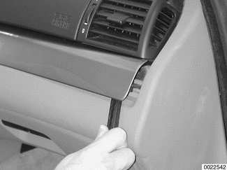

> **CAUTION!**
>
> - To avoid marring interior trim, work with a plastic prying tool.

- Remove right dashboard fresh air outlet mounting screws and pull outlet out of dash.

- Lift cover from top of passenger side airbag on dashboard.

- Remove cover strap retaining bolts (**arrows**) to detach cover completely from dashboard.

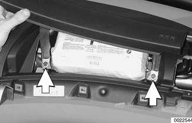

> **CAUTION!**
>
> - The plastic retainer at the right end of the cover may snap during removal. Be sure to have extra retainers on hand for reassembly.

- Remove airbag mounting bolts (**arrows**).

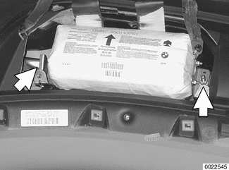

- Lift airbag and disconnect electrical harness connector. Remove airbag.

> **WARNING!**
>
> - Store the removed airbag unit with the soft pad facing up. If stored facing down, accidental deployment could propel it violently into the air, causing injury.
> - Early E46 cars (through production date 9/1999) were equipped with a single stage airbag, identified by having only one wire loom in the harness connector. Later production two stage airbags are supplied by two wire looms in the connector plug. The two kinds of airbags are NOT interchangeable.

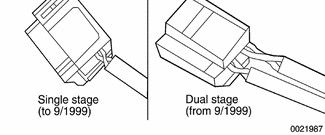

- Installation is reverse of removal. Make sure wiring harness is not pinched when installing airbag unit in dashboard.

Tightening torques

| Component | Tightening torque |
|---|---|
| Airbag cover strap to dashboard (M6) | 9 Nm (7 ft-lb) |
| Passenger air bag to dashboard (M8) | 22 Nm (16 ft-lb) |

## Door mounted side-impact airbag, removing and installing

- Disconnect negative (-) cable from battery and cover negative terminal with insulating material.

> **CAUTION!**
>
> - Prior to disconnecting the battery, read the battery disconnection cautions given at the front of this manual on page viii.

- Remove inside door panel as described in [411 Doors].

**Front door airbag:**

- Remove airbag mounting bolts (**arrows**).

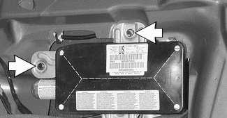

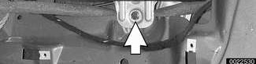

- Turn over airbag unit and cut off electrical harness wire tie.
- Detach harness connector.

> **CAUTION!**
>
> - When removing and installing the airbag unit, pay attention to the routing of the electrical harness to avoid kinks or breaks in the wire.

**Rear door airbag:**

- Detach electrical harness connector.
- Remove mounting bolts and remove airbag from door.

- Installation is reverse of removal.
    - Route electrical harnesses as they were before.
    - Use new wire ties as necessary.
    - Use new self-locking mounting bolts.

Tightening torque

| Component | Tightening torque |
|---|---|
| Side-impact airbag to door | 8.5 Nm (75 in-lb) |

## Head protection airbag (HPS) components

Replacement of a head protection airbag (HPS) is an extensive operation. Replacement includes removal of the following components:

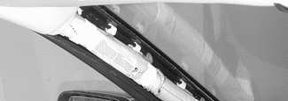

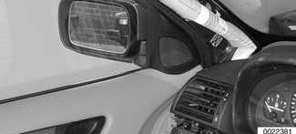

- Complete dashboard
- Complete headliner
- Windshield pillar (A-pillar) trim
- Door pillar (B-pillar) trim

- Before starting work on the HPS airbag, disconnect negative (-) cable from battery and cover negative terminal with insulating material.

> **CAUTION!**
>
> - Prior to disconnecting the battery, read the battery disconnection cautions given at the front of this manual on page viii.

Tightening torque

| Component | Tightening torque |
|---|---|
| HPS airbag to body | 11 Nm (8 ft-lb) |
| HPS airbag mounting bracket to A or B-pillar | 2.5 Nm (22 in-lb) |
| HPS gas generator to dashboard reinforcement M6 self-tapping screw | 4 Nm (35 in-lb) |

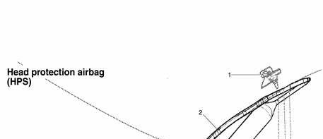

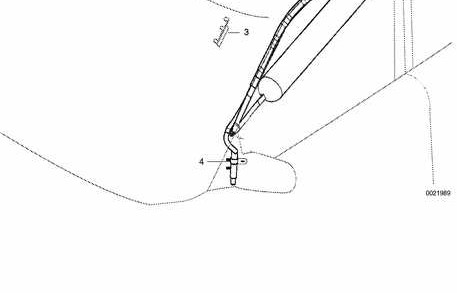

Head protection airbag (HPS)

1. B-pillar deflection plate
2. Head protection airbag
3. Cable holder
4. Gas generator
5. Self-tapping screw M6 — tighten to 4 Nm (35 in-lb)
