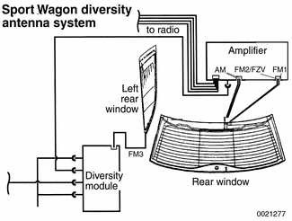
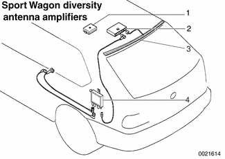
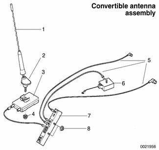
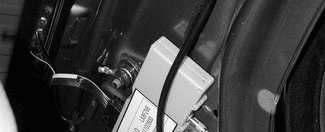
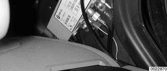
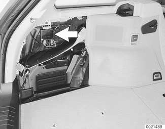

# Antenna

> Source: Bentley *BMW 3 Series (E46) 1999–2005 (M3) Repair Manual*, section 650-4 (PDF pages 1178–1182 of 1252).

## Antenna and diversity

The antenna used for the radio, telephone and FZV remote entry system is integrated with the rear window defogger in the Sedan and Coupe models.

Convertible and Sport Wagon models feature a diversity antenna system to provide the strongest possible radio station signal to the sound system.

In this system there are two (or more) antennas. Both the main and the auxiliary antenna(s) receive radio signals and both signals are amplified in separate amplifiers. The signals are then transmitted to the diversity switching module, which locks onto the strongest signal and sends it to the radio receiver.

## Sport Wagon antenna system

The diversity antenna system on the E46 Sport Wagon consists of the following;

- FM1 antenna in rear window (right half)
- FM2 antenna in rear window (center)
- FM3 antenna in left rear side window
- AM antenna in rear spoiler

**FZV (keyless entry) antenna combined with FM2 antenna**

The FM1/FM2 antenna amplifier is located beneath the rear spoiler. The signal from this amplifier is transmitted to the diversity module in the cargo compartment behind the left trim panel.

1 - Suppression filter
2 - Antenna amplifier
3 - AM antenna
4 - Diversity module

The FM3 antenna has a separate amplifier integrated into the diversity module. The module will select the clearest signal from the three antennas and transmit that to the sound system.

The AM antenna is glued to the bottom of the rear spoiler.

## Convertible antenna system

The diversity antenna system on the E46 Convertible consists of the following:

- Main antenna mast on left rear fender
- Auxiliary antenna in convertible top storage cover
- Main antenna amplifier, mounted directly below the antenna mast
- Auxiliary antenna amplifier, mounted on convertible top storage cover and powered through antenna lead
- Diversity switching module, mounted below antenna mast in trunk

More information on the rear window defogger/antenna system is in [640 Heating and Air Conditioning].

**Note:**

*The telephone antenna is wound around the main antenna mast.*

## Antenna, removing (Convertible models)

Unscrew and remove antenna mast.

1 - Antenna mast
2 - Antenna head
3 - Antenna base
4 - Nut (M5)
5 - Antenna cable
6 - Antenna FM amplifier
7 - Antenna diversity amplifier
8 - Nut (M6)

- Detach and remove wheel housing trim liner in left side of trunk.
- Through elongated hole of antenna retaining bracket, unscrew M5 nut.
    - This releases antenna head from base.
    - Place antenna base down on bracket.
    - Remove antenna head from above fender.
- To remove base, slide toward rear of car, then detach cable connections.
- When installing, make sure the offset of antenna head points toward back of car.

## Antenna amplifier, accessing

**Convertible main antenna amplifier:**

- Detach and remove wheel housing trim liner in left side of trunk.
- Antenna amplifier is mounted below antenna bracket.

**Convertible auxiliary antenna amplifier:**

- Open convertible top compartment lid.
- Auxiliary amplifier is attached to left rear corner of lid.

**Sedan or Coupe antenna amplifier:**

- Remove left roof pillar (C-pillar) trim panel as described in [513 Interior Trim] to access amplifier.

**Sedan or Coupe antenna suppressor:**

- Remove right roof pillar (C-pillar) trim panel to access suppressor.

**Sport Wagon FM3 antenna/diversity module:**

- Remove left cargo compartment trim cover to gain access to module (arrow).

**Sport Wagon FM1/FM2 antenna amplifier:**

- Remove rear spoiler. See [412 Trunk Lid, Tailgate].
- Amplifier is in center of rear window beneath spoiler.
