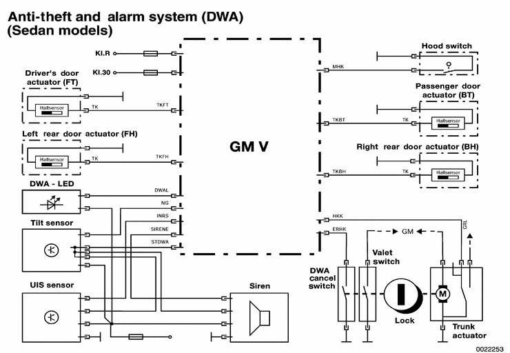
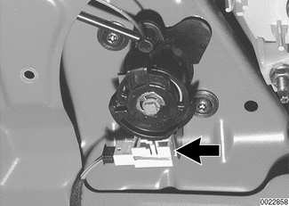
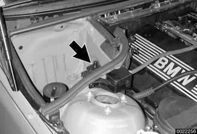
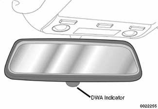
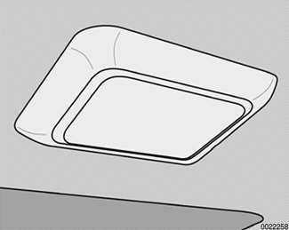
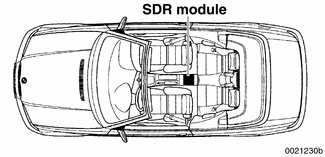
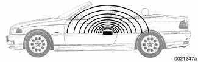
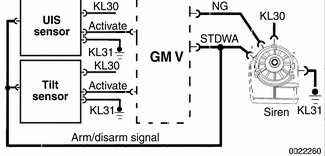

# Anti-Theft Alarm (DWA)

> Source: BMW 3 Series (E46) Repair Manual, section 515-5, Central Locking and Anti-Theft chapter (PDF pages 889–899 of 1252).

The DWA anti-theft system is a dealer installed accessory option. All E46 vehicles are factory prepared to provide the DWA function. This means that the vehicle is prewired and the General Module (GM V) is preprogrammed for the system. However, once the DWA system components are installed the GM V must be coded, using the DIS or MoDiC, to recognize the installed components and carry out DWA functions.

The GM V utilizes existing components and/or circuits as part of the DWA system:

- Door lock hall effect sensor contacts
- Trunk lid switch contact
- Trunk lock key position switch
- Hood switch
- DWA status (LED)

The DWA accessory kit includes the following:

- Tilt sensor in right trunk area
- UIS (interior monitoring sensor) in center of headliner
- Siren in cowl area next to IHKA housing

## DWA alarm arming/disarming

The DWA alarm is armed every time the vehicle is locked from the outside with the door lock cylinder or FZV key.

The LED in the rear view mirror flashes as an acknowledgment, along with flashing exterior lights and a momentary chirp from the siren.

The GM V monitors all required input signals for CLOSED status (door closed, trunk closed, etc.) The inputs must be in CLOSED status for a minimum of 3 seconds for the GM V to include them as an activation component. If after 3 seconds any input signal not in CLOSED status is excluded (this is acknowledged by the DWA LED) preventing false alarm activation.

If the DWA is armed a second time within 10 seconds, the tilt sensor and interior protection sensor are also excluded as alarm activation components. This function is useful for preventing false alarm activation if the vehicle is transported on a train or flat bed truck.

While armed the trunk can be opened without the alarm being triggered as follows:

- If opened with the trunk remote button via the FZV, the GM V prevents the alarm from activating. (This feature is customizable under the Car Memory function.)
- If opened with the key at the trunk lock cylinder, the trunk key position switch signals the GM V and in the same manner prevents the alarm from activating.

In either case, when the trunk is returned to the CLOSED position, it will no longer activate the alarm.

## Alarm operation

When the alarm is triggered, the siren will sound for 30 seconds. At the same time the headlight low beams and hazard lights will flash for 5 minutes. The GM V signals the Light Center Switch (LSZ) via the K-bus to flash the lights. Following an alarm trigger, the system will reset and trigger again if further tampering is done to the vehicle.

## Door contacts

The door lock Hall effect sensors provide status of door OPEN/CLOSED:

- When the door latch is CLOSED, current flow through the sensor is <5 mA.
- When the door is OPEN, current flow through the sensor is >12 mA.

With the DWA armed, the GM V will activate the siren if it receives a door OPEN signal.

## Trunk lid switch contact

The trunk switch contact is located in the trunk lock assembly. When closed, the trunk contact provides a ground signal to the GM V signifying a CLOSED trunk. With the DWA armed, the GM V will activate the siren if it receives a trunk OPEN signal.

## Trunk lock key position switches

There are two switches mounted in one block (arrow) on the trunk lock cylinder:

- Valet position switch. With the key lock in the valet position, this switch provides a ground signal to the GM V. The GM V locks out the interior trunk release button preventing the trunk from being opened.
- DWA deactivation switch. When the trunk is opened mechanically with the key, this switch provides a ground signal to the GM V preventing the DWA from activating if armed.

## Hood contact switch

Located on the right side engine compartment, the hood contact switch (arrow) provides a ground signal to the GM V signifying an open hood. The plunger of this switch can be pulled up past a detent causing the switch contact to open. This feature can be used to simulate a CLOSED hood with the hood open when diagnosing the DWA system.

## DWA LED

The DWA indicator is located in the rear view mirror. All E46 vehicles are equipped with the LED. It is not part of the retailer installed accessory DWA system.

The LED is provided with constant battery voltage (KL 30). The GM V provides a switched ground signal providing the various blinking signals used to convey DWA status to the vehicle operator. DWA LED status is summarized in [Table a].

Table a. DWA LED status

| DWA status | DWA LED condition |
|---|---|
| Disarmed | OFF |
| Armed | Continual slow flash |
| Armed with one or more monitored inputs not in CLOSED position (trunk not closed, etc.) | Rapid flash for 10 seconds, then continual slow flash |
| Alarm activated | Rapid flash for 5 minutes, then continual slow flash |
| Rearmed in less than 10 seconds | ON for 1 second |
| Disarmed after activated alarm | Rapid flash for 10 seconds, then OFF |

## Tilt sensor

Located in the right trunk area above the battery, the solid state tilt sensor monitors the vehicle parked angle when DWA is armed. The sensor requires three signal wires to perform its function:

- KL 30. Constant battery voltage
- STDWA signal. Switched ground input signal provided by the GM V indicating DWA armed/disarmed status. The tilt sensor is used as a splice location for the STDWA signal to the siren and interior protection sensor.
- NG signal. Switched ground output signal provided to the GM V. This signal is used for two purposes: a. As a momentary acknowledgment that the tilt sensor received STDWA and is currently monitoring the vehicle angle. b. If the tilt sensor detects a change in the vehicle angle when DWA is armed, the NG signal is switched to inform the GM V to activate the siren.

When the tilt sensor receives the STDWA signal from the GM V, the angle of the vehicle is memorized and monitored by the solid state electronics. Once armed, if the angle changes, the tilt sensor provides a switched ground signal to the GM V to activate DWA.

## Interior protection (UIS)

The combined ultrasonic transmitter and receiver in UIS monitors the vehicle interior for motion.

The UIS is mounted in the center of the headliner panel even with the door (B) pillar. Due to the design of the vehicles interior, the sensor is unidirectional and must be installed in the proper direction to ensure proper operation of the system (trim cover ensures directional installation).

Every time the DWA system is armed (STDWA signal), the sensor adapts to whatever objects are stationary in the interior. The sensor emits ultrasonic waves in a programmed timed cycle. It receives echoes of the emitted signals. The UIS amplifies the received sound wave signals and compares them with the transmitted waves. The UIS also checks the incoming echoes for background hiss (wind noise through a partially open window) and adapts for this.

If the echoes are consistently similar, no movement is detected. If the echoes are altered or inconsistent, the UIS changes to a constant cycle and the echo is compared again. If the inconsistency is still present the UIS sends the activate siren signal (INRS) to the GM V.

As with the tilt sensor, the UIS is also switched OFF when the vehicle is locked two times within ten seconds. This allows the sensor to be switched OFF for transportation purposes.

## Convertible interior protection (SDR)

In Convertible models, the interior motion detector for the alarm system is a short distance radar (SDR) detector located on the center tunnel, under the center console next to the parking brake handle. The central position allows the most effective monitoring of the vehicle interior.

The SDR detector consists of two printed circuit boards, one being the transmitter/receiver and the other the processing electronics. The module housing is highly conductive material for high frequency transmission.

The SDR sensor transmits an electromagnetic field in a hemispherical pattern within the vehicle interior. The monitoring radius is preset in the module. The receiving antenna monitors reflected signals from the interior. The module evaluates these signals as a base line for vehicle security. Any objects that come into this monitoring radius will be detected and evaluated by the SDR module.

The module operates in pulse mode. The radar unit transmits a signal, then pauses for the reflected signals to be received by the module.

The detection range of the radar is adjusted by rapid switching when the system is armed. This allows the sensor to adjust its range to either the windshield with the top lowered or to the soft top when it is raised.

The module will signal the GM V to trigger the alarm if a new object is detected within its sensing hemisphere. However, false alarms may be triggered by objects falling into the interior when the system is armed with the top lowered. Also, large metal objects, such as the seat backrests, will shield the microwave pulse and create a sensor "shadow" effect in the interior.

As with the tilt sensor and the UIS, the SDR sensor can be switched OFF by activating the central locking system twice within 10 seconds.

## Alarm siren

The DWA siren is installed in the right rear engine compartment. This location provides a secure position with loud acoustic output.

The siren contains electronic circuitry for producing the warning tone when the alarm is triggered. The siren also contains a rechargeable battery that is used to power the siren when the alarm is triggered. The rechargeable battery will allow the siren to sound if it or the vehicle battery is disconnected. The siren battery is recharged from the vehicle battery when DWA is not in the armed state.

The siren has four wires connecting it to the alarm system:

- KL 30 (power)
- KL 31 (ground)
- STDWA signal (arm/disarm signal from GM V)
- NG signal (activate siren output signal to the GM V)

The arm/disarm output signal from the GM V (STDWA) is provided to the tilt sensor, UIS sensor and the siren simultaneously. The arm/disarm signal is a switched ground that signals the components of DWA armed/disarmed status.

To activate the siren, the NG signal is high whether DWA is armed or disarmed. If a monitored input activates the alarm, the high signal to the siren is switched to a 50% duty cycle at the GM V. The control circuitry in the siren activates the siren. If the DWA is armed and the battery is disconnected, the siren circuitry recognizes the normally high NG signal as suddenly going low. In this case the siren is also activated.

## Panic mode operation

When the trunk button on an FZV key is pressed and held, the GM V activates the siren for the panic mode. The panic mode is functional with either an armed or disarmed DWA system.

## Emergency disarming

Emergency disarming occurs automatically if a key is used to turn the ignition switch ON and EWS accepts it. The EWS signals the GM V to unlock the doors and to deactivate the DWA.
