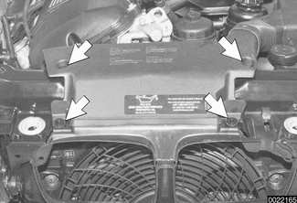
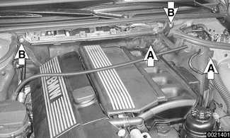
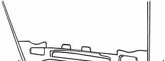
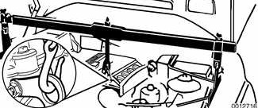
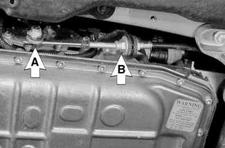
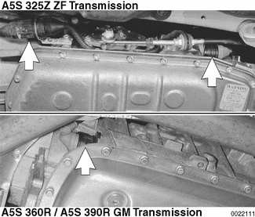
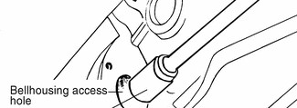
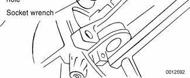
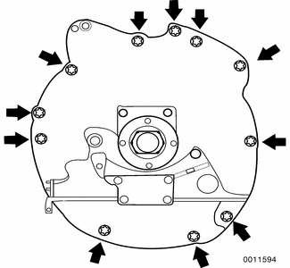

# Transmission Removal and Installation

> Source: BMW 3 Series (E46) Repair Manual, section 240-3, Automatic Transmission chapter (PDF pages 434–440 of 1252).

Removal and installation of the transmission is best accomplished on a lift using a transmission jack. Use caution and safe workshop practices when working beneath car and lowering transmission.

> **CAUTION!**
> - Be sure the vehicle is properly supported. The removal of the transmission may upset the balance of the vehicle on a lift.
> - Tilting the engine to remove the transmission can lead to damage to various components due to lack of clearance.
> - On cars with AST remove throttle body.
> - Remove brake fluid reservoir if necessary.

Torx-head bolts are used to mount the transmission to the bellhousing. Be sure to have appropriate tools on hand before starting the job.

## Transmission, removing and installing

- Disconnect negative (-) cable from battery.

> **CAUTION!**
> - Prior to disconnecting the battery, read the battery disconnection cautions given at the front of this manual on page viii.

- Remove engine cooling intake hood fasteners (arrows) at front of engine compartment.

- Remove engine driven cooling fan, unfasten cooling fan cowl and pull slightly upwards. See [170 Radiator and Cooling System].

- Remove housing for interior ventilation microfilter.
    - Remove upper cover and microfilter.
    - Open wiring harness loom cover (A) and remove wires.
    - Unfasten screws (B) and remove lower microfilter housing.

- Remove heater bulkhead cover.
    - Remove engine compartment side trim panel. Turn locking knobs (A) and slide trim panel from mounting lip.
    - Remove heater bulkhead cover mounting screws (B) and lift cover up and out from firewall.

- Install engine support across engine bay. Raise and safely support vehicle.

> **CAUTION!**
> - Make sure the car is stable and well supported at all times. Use a professional automotive lift or jack stands designed for the purpose. A floor jack is not adequate support.
> - Removal of transmission will cause engine to tip unless engine support is used.

- Remove engine splash guard from underside of vehicle.
- Remove front suspension reinforcement at lower control arms and front subframe.
- Drain ATF from transmission as described earlier.
- Remove exhaust system and exhaust heat shield. See [180 Exhaust System].
- Remove driveshaft(s). See [260 Driveshaft].
- On all wheel drive equipped vehicles: Remove transfer case. See [270 Transfer Case].
- With selector lever in Park, disconnect shift selector lever cable from lever and remove cable bracket. Hold linkage clamping bolt (A) stationary when loosening selector lever cable clamping nut (B).
- Loosen cable clamping nut and remove cable from bracket. (A5S 325Z transmission shown.)

- Disconnect electrical harness connector(s) from transmission by turning bayonet lock ring(s) (arrows) counterclockwise.
    - On A5S 325Z disconnect two connectors on the left side of the transmission.
    - On A5S 360R / A5S 390R disconnect the harness connector at the right rear of the transmission.

- Remove wiring harness(s) from transmission housing.
- Disconnect transmission cooler line clamps from engine. Disconnect cooler lines from transmission.
- Attach BMW special tool 11 8 022 to lower control arms.
- Support transmission with transmission jack. Remove transmission support crossmember.
- Lower transmission until engine cylinder head touches firewall. Tighten knurled screws of BMW special tool 11 8 022 until tool supports engine oil pan securely.

- Remove access plug in cover plate on right side of engine block and remove torque converter bolts. Turn crankshaft to access bolts.

- Remove bellhousing-to-engine mounting bolts (arrows).

- Install BMW special tools 24 4 131 and 24 4 135 to secure torque converter in place during transmission removal.

> **CAUTION!**
> - Do not allow the torque converter to fall off the transmission input shaft.

- Remove transmission by pulling back and down. Lower jack to allow transmission to clear vehicle.

- Installation is reverse of removal, noting the following:
    - Blow out oil cooler lines with low-pressure compressed air and flush cooler with clean ATF twice before reattaching lines to transmission.

> **CAUTION!**
> - Wear safety glasses when working with compressed air.
> - Do not reuse ATF after flushing.

    - Install new sealing washers on hollow bolts.
    - Install new O-rings on transmission cooler lines, where applicable.
    - Inspect engine drive plate for cracks or elongated holes. Replace if necessary.
    - Check to be sure torque converter is seated correctly in transmission during final installation. When mounting transmission to engine, the three mounting tabs on torque converter must be aligned with indentations on drive plate. Use an alignment dowel to line up bolt holes, if necessary.
    - Fill transmission with clean ATF until oil level is even with fill hole. Then check fluid level as described earlier.
    - Adjust gearshift mechanism. See [250 Gearshift Linkage].

> **Note:**
> - Torx-head mounting bolts should always be used with washers to prevent difficult removal in the future.

Tightening torques

| Component | Tightening torque |
|---|---|
| ATF drain plug to ATF sump, A5S 325Z | 35 Nm (26 ft-lb) |
| ATF drain plug to ATF sump, A5S 360R | 20 Nm (15 ft-lb) |
| ATF fill plug to ATF sump, A5S 325Z | 30 Nm (22 ft-lb) |
| ATF fill plug to ATF sump, A5S 360R | 20 Nm (15 ft-lb) |
| Front suspension reinforcement to chassis (M10) | 42 Nm (30 ft-lb) |
| Torque converter to drive plate (M10) | 45 Nm (33 ft-lb) |
| Transmission support crossmember to chassis | 23 Nm (17 ft-lb) |
| Transmission to engine (Torx-head with washer), M8 | 21 Nm (15 ft-lb) |
| Transmission to engine (Torx-head with washer), M10 | 42 Nm (31 ft-lb) |
| Transmission to engine (Torx-head with washer), M12 | 72 Nm (53 ft-lb) |
