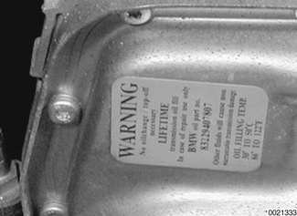
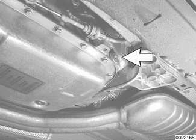
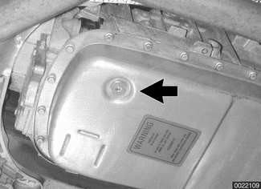
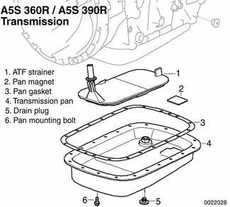

# Transmission Service

> Source: BMW 3 Series (E46) Repair Manual, section 240-2, Automatic Transmission chapter (PDF pages 429–433 of 1252).

The automatic transmissions installed in the 3 Series are filled with either Dexron III ATF, or Texaco 8072B, a special life-time oil.

> **CAUTION!**
> - Mixing different types of transmission fluids will lead to transmission failure.

> **Note:**
> - The transmission lubricant installed can be found on a sticker on the transmission pan. Dexron III ATF (black sticker) reads "ATF-Oil!". Special life-time oil (green sticker) reads "Life-Time Oil". In addition, a sticker may be located on the fluid sump indicating the type of transmission lubricant used. If in doubt, consult an authorized BMW dealer for alternate fluid use and current information regarding transmission operating fluids.

## Automatic transmission fluid (ATF) level, checking

The automatic transmission is not equipped with a dipstick. Checking the ATF level requires measuring and maintaining a specified ATF temperature within a narrow range during the checking procedure. The checking temperature is not fully warm or cold (the ATF pan should be approximately warm to the touch).

- Raise and safely support vehicle to access ATF fill plug.

> **CAUTION!**
> - Make sure the car is stable and well supported at all times. Use a professional automotive lift or jack stands designed for the purpose. A floor jack is not adequate support.

- Warm up drivetrain by running engine until ATF reaches specified temperature. Apply brake and, while idling engine, shift through all gears several times. Turn engine off.

ATF level checking

| Fluid temperature | 30° - 50°C (85° - 120°F) |
|---|---|

- Connect vehicle to BMW diagnostic scan tool DIS or MoDiC using the Data Link Connector (DLC) in the engine compartment, or under driver's side of dash (model year 2000 and later cars) in order to read transmission temperature.
- Remove ATF fill plug (arrow). Place transmission in neutral and restart engine. (A5S 360R transmission shown.)

> **Note:**
> - Make sure ATF temperature is greater than 30°C, before releasing fill plug.

- With ATF between 30° - 50°C (85° - 120°F), add fluid until it spills from fill hole.

> **WARNING!**
> - Hot ATF can scald. Wear eye protection and protective clothing and gloves during the check. If the transmission was overfilled, hot ATF will spill from the filler hole when the fill plug is removed.

- Reinstall fill plug using new sealing ring.

Tightening torques

| Component | Tightening torque |
|---|---|
| ATF drain plug to ATF sump, A5S 360R / A5S 390R (M14) | 20 Nm (15 ft-lb) |
| ATF drain plug to ATF sump, A5S 325Z | 35 Nm (26 ft-lb) |
| ATF fill plug to ATF sump, A5S 360R / A5S 390R (M14) | 20 Nm (15 ft-lb) |
| ATF fill plug to ATF sump, A5S 325Z | 30 Nm (22 ft-lb) |

## ATF, draining and filling

The procedure given here includes removal and installation of the ATF fluid strainer (filter).

- Remove ATF drain plug (arrow) and drain fluid into container. (A5S 360R transmission shown.)

> **WARNING!**
> - The ATF must not be hot when draining. Do not drain the ATF if the engine and/or transmission is hot. Hot ATF can scald. Wear eye protection, protective clothing and gloves.

- Remove transmission pan mounting bolts and remove pan.
- Remove pan gasket and clean gasket sealing surface.
- Pull ATF fluid strainer from transmission pump housing. If strainer sealing ring remains in pump housing remove using a seal puller.
- Installation is reverse of removal.
    - Always replace seal for drain plug and all gasket(s) and O-rings.
    - Clean sump and sump magnet(s) using a lint-free cloth.
    - Tighten transmission pan bolts in sequential order.
    - Fill transmission with approved fluid.
    - Check fluid level as described under [Automatic transmission fluid (ATF) level, checking].

> **Note:**
> - Use new sump bolts purchased from BMW. Alternatively, clean old bolts and coat with Loctite® thread locking compound or equivalent.

| No. | Part |
|---|---|
| 1 | ATF strainer |
| 2 | ATF cleaner |
| 3 | Transmission pan |
| 4 | Transmission gasket |
| 5 | Drain plug |

Automatic transmission fluid capacity

| Transmission | Capacity |
|---|---|
| A5S 360R / A5S 390R with torque converter | 9 liters (9.5 qt) |
| A5S 360R / A5S 390R without torque converter | 4 liters (4.2 qt) |
| A5S 325Z (2.5 liter) with torque converter | 8.9 liters (9.4 qt) |
| A5S 325Z (2.5 liter) without torque converter | 6.2 liters (6.5 qt) |
| A5S 325Z (3.0 liter) with torque converter | 8.7 liter (9.2 qt) |
| A5S 325Z (3.0 liter) without torque converter | 6.1 liter (6.4 qt) |

Group labels merged in print; repeated here.

Tightening torques

| Component | Tightening torque |
|---|---|
| ATF drain plug to ATF sump, A5S 360R / A5S 390R (M14) | 18 Nm (14 ft-lb) |
| ATF drain plug to ATF sump, A5S 325Z | 35 Nm (26 ft-lb) |
| ATF fill plug to ATF sump, A5S 360R / A5S 390R (M14) | 18 Nm (14 ft-lb) |
| ATF fill plug to ATF sump, A5S 325Z | 30 Nm (23 ft-lb) |
| ATF sump to transmission, A5S 360R / A5S 390R (M14) | 10 Nm (7 ft-lb) |
| ATF sump to transmission, A5S 325Z | 6 Nm (4 ft-lb) |
