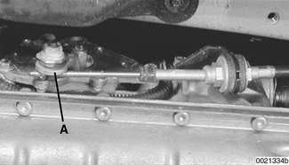
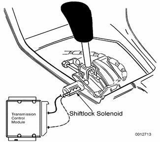
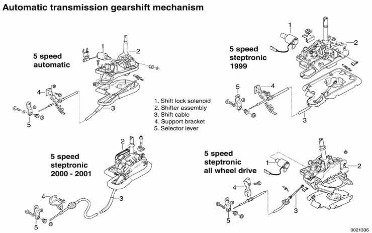
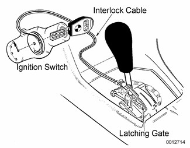

# Automatic Transmission Gearshift

> Source: BMW 3 Series (E46) Repair Manual, section 250-3, Gearshift Linkage chapter (PDF pages 446–449 of 1252).

In E46 models, the electronic immobilizer (EWS) prevents starter operation unless the gear position is Park or Neutral.

## Gearshift mechanism, adjusting (automatic transmission)

- Position gearshift lever in Park.
- Raise vehicle to gain access to shift linkage.

> **WARNING!**
> - Make sure the car is stable and well supported at all times. Use a professional automotive lift or jack stands designed for the purpose.

- Loosen selector clamping nut (A). Counterhold clamping bolt when loosening nut.

- Push shift lever of transmission forward toward engine (Park position) while applying light pressure on cable end. Tighten cable clamping nut.

> **Note:**
> - Do not overtighten the nut so that it twists the cable.

Tightening torque

| Component | Tightening torque |
|---|---|
| Shift cable clamping nut | 10 - 12 Nm (7.5 - 9 ft-lb) |

## Automatic shiftlock, checking function (automatic transmission)

The automatic shiftlock uses an electric solenoid to lock the selector lever in Park or Neutral. Depressing the foot brake with the ignition on energizes the solenoid, allowing the lever to be moved into a drive gear. The solenoid is energized only when the engine speed is below 2,500 rpm and the vehicle speed is below 3 mph. The solenoid is mounted in the right-hand side of the selector lever housing. Automatic shiftlock prevents drive gear selection until the brake pedal is depressed.

- With engine running and car stopped, place selector lever in Park or Neutral.
- Without depressing brake pedal, check that selector lever is locked in position Park or Neutral.
- Depress brake pedal firmly. Solenoid should be heard to energize.
- Check that selector lever can now be moved out of Park or Neutral.

> **Note:**
> - The next test should be performed in an open area with the parking brake on and with extreme caution.

- With selector lever in Park or Neutral and brake pedal depressed, raise engine above 2,500 rpm. Check that selector lever cannot be moved out of Park or Neutral.
- If any faults are found check the electrical operation of the shiftlock solenoid and check for wiring faults to or from the transmission control module (TCM). See [610 Electrical Component Locations and Electrical Wiring Diagrams].

> **Note:**
> - The solenoid is controlled via the TCM, using brake pedal position, engine speed, and road speed as controlling inputs.

Automatic transmission gearshift mechanism

## Shift interlock, checking function (automatic transmission)

The shift interlock uses a cable between the ignition switch and the shift lever to lock the shift lever in the park position when the key is in the off position or removed. This feature also prevents the key from being removed from the ignition lock until the selector lever is in Park.

- Shift selector lever to Park position and turn ignition key to the off position.
- Remove ignition key. Check that selector lever cannot be shifted out of Park position.

> **Note:**
> - It must only be possible to remove ignition key with selector lever in Park position.
> - Shift interlock cable must not be kinked.

- Turn ignition key on and depress brake pedal. Check that selector lever moves freely from gear to gear.
- With selector lever in a gear position other than Park, attempt to turn key to off position and remove. Key should not go into off position.

If any faults are found check cable for kinks and check cable attachment points for damage or faults.
