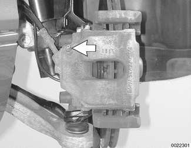

# Bleeding brakes

> Source: BMW 3 Series (E46) Repair Manual, section 340-2, Brakes chapter (PDF pages 684–686 of 1252).

Brake bleeding is usually done for one of two reasons: Either to replace old brake fluid as part of routine maintenance or to expel trapped air in the system that resulted from opening the brake hydraulic system during repairs.

Always use new brake fluid from an unopened container. It is important to bleed the entire system when any part of the hydraulic system has been opened. Be sure to have the special equipment needed before beginning the job.

> **WARNING!**
> - E46 cars require special BMW service equipment to properly bleed either the ABS/ASC or the ABS/DSC system. For safety reasons, the brake system on these cars must not be bled without the use of a factory diagnostic computer.

When bleeding the brakes, start at the wheel farthest from the master cylinder and progress in the following order:

- right rear brake
- left rear brake
- right front brake
- left front brake

## Pressure bleeding brakes

- Top off brake fluid in reservoir and connect BMW Diagnosis and Information System (DIS) to 20 pin Data Link Connector (DLC) under hood (1999 models), or 16 pin DLC/OBD II connector under dash (2000- 2001 models). Call up service function Bleeding ABS/ASC or service function Bleeding ABS/DSC, depending on which system the vehicle is equipped with.
- Connect pressure bleeding device to brake fluid expansion tank and pressurize.

> **CAUTION!**
> - Do not exceed a pressure of 2 bar (29 psi) when pressure bleeding the brake system. Excessive pressure will damage the brake fluid reservoir.

Attach bleed hose and fluid receptacle to bleeder screw (arrow). Open bleeder screw. Allow DIS bleeding procedure to cycle hydraulic control module valves with bleed screw open.

- After bleeding procedure is completed, slowly depress brake pedal (12 times on ABS/ASC vehicles, 5 times on ABS/DSC vehicles) with bleeder screw open, holding pedal down on the last pump. When escaping fluid is free of air bubbles, close bleeder screw and release brake pedal.

> **CAUTION!**
> - Bleeder hose must always remain submersed in clean brake fluid whenever the bleeder valve is open.

- Refill brake fluid reservoir and proceed to rear left wheel.
- Proceed with remaining wheels in order as listed earlier.

Tightening torques

| Component | Tightening torque |
|---|---|
| **Bleeder screws (wrench size):** | |
| 7 mm screw | 3.5 - 5 Nm (2.5 - 3.7 ft-lb) |
| 11 mm screw | 12 - 16 Nm (9 - 12 ft-lb) |
