# Blower Components

> Source: Bentley *BMW 3 Series (E46) 1999–2005 (M3) Repair Manual*, section 640-4 (PDF pages 1145–1148 of 1252).

## Blower motor, removing and installing

Remove housing for interior ventilation microfilter.

- Remove upper cover and microfilter.
- Open wiring harness loom (**A**) and remove wires.
- Unfasten screws (**B**) and remove lower housing.

Remove heater bulkhead cover:

- Remove engine compartment side trim panel. Turn locking clips (**A**) and slide trim panel up.
- Remove heater bulkhead cover mounting screws (**B**) and lift cover off bulkhead.

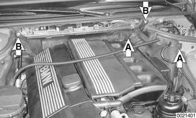

Remove intake manifold cover:

- Remove plastic trim covers (arrows).
- Remove cover hold down bolts and lift off cover.

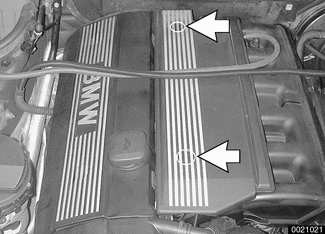

Working inside right side of cowl, pull up on lever (arrow) and detach right air intake flap from blower housing.

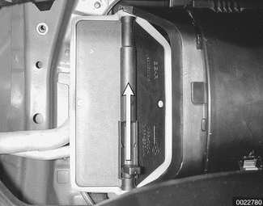

Pry off blower cover retaining clips (**A**). Remove screw (**B**) and lift off outer blower housing cover.

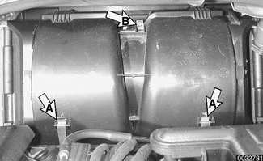

Remove blower cover retaining screws (arrows). Lift off cover.

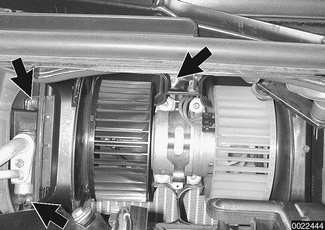

Detach electrical harness connector (arrow).

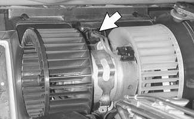

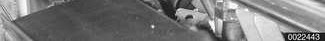

Pry off blower motor retaining strap.

- Pull blower motor forward to remove.

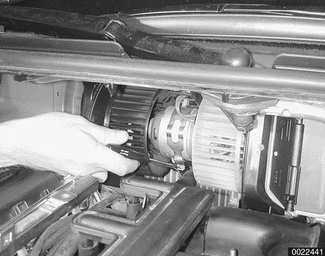

- Installation is reverse of removal:
    - Align slot in blower motor with mounting tab in blower motor housing.

## Blower motor resistor pack, replacing

**Note:**

*The blower motor resistor pack is also referred to as the final stage unit.*

- Remove right footwell air duct as described earlier.

Working under right side of dashboard at side of IHKA housing, unhook linkage, then remove air distribution motor (arrow).

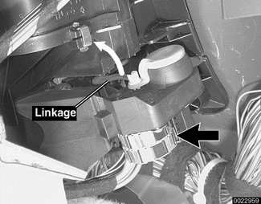

To remove blower resistor pack from IHKA housing:

- Remove mounting screws (arrows).
- Detach electrical harness connector.
- Press retaining clip away from switch to release switch.

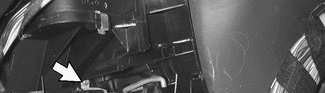

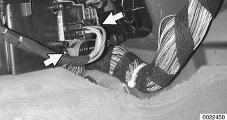

- Installation is reverse of removal.
    - Make sure electrical harness is routed as before.
    - Align guides and clips correctly.
