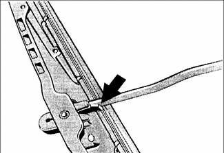
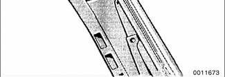

# Body and Interior Maintenance

> Source: BMW 3 Series (E46) Repair Manual, section 020-7, Maintenance chapter (PDF pages 73–77 of 1252).

## Body and hinges, lubricating

The door locks and lock cylinders can be lubricated with an oil that contains graphite.

The body and door hinges, the hood latch, and the door check rods should be lubricated with SAE 30 or SAE 40 engine oil. Lubricate the seat runners with multipurpose grease. Do not apply any oil to rubber parts. If door weatherstrips are sticking, lubricate them with silicone spray or talcum powder. The hood release cable should be lubricated as well.

The use of winter lock de-icer sprays should be kept to an absolute minimum, as the alcohol in the de-icer will wash the grease out of the lock assemblies, and may cause the locks to corrode internally, or become difficult to operate.

## Exterior washing

The longer dirt is left on the paint, the greater the risk of damaging the glossy finish, either by scratching or by the chemical effect dirt particles may have on the painted surface.

Do not wash the car in direct sunlight. If the engine hood is warm, allow it to cool. Beads of water not only leave spots when dried rapidly by the sun or heat from the engine, but also can act as small magnifying glasses and burn spots into the finish. Wash the car with a mixture of lukewarm water and a car wash product. Rinse using plenty of clear water. Wipe the body dry with a soft cloth towel or chamois to prevent water-spotting.

## Interior care

Dirt spots can usually be removed with lukewarm soapy water or a dry foam cleaner. Use spot remover for grease and oil spots. Do not pour the liquid directly on the carpet or fabric, but dampen a clean cloth and rub carefully, starting at the edge of the spot and working inward. Do not use gasoline, naphtha, or other flammable substances.

## Leather upholstery and trim

Leather upholstery and trim should be periodically cleaned using a slightly damp cotton or wool cloth. The idea is to get rid of the dirt in the creases and pores that can cause brittleness and premature aging. On heavily soiled areas, use a mild detergent (such as Woolite®) or other specially formulated leather cleaners. Use two tablespoons to one quart of cold water. Dry the trim and upholstery completely using a soft cloth. Regular use of a good quality leather conditioner will reduce drying and cracking of the leather.

## Polishing

Use paint polish only if the finish assumes a dull look after long service. Polish can be used to remove tar spots and tarnish, but afterwards a coat of wax should be applied to protect the clean finish. Do not use abrasive polish or cleaners on aluminum trim or accessories.

## Seat belts

Dirt and other abrasive particles will damage seat belt webbing. If it is necessary to clean seat belts, use a mild soap solution. Bleach and other strong cleaning agents may weaken the belt webbing and should be avoided.

> **WARNING!**
> - Do not clean the seat belt webbing using dry cleaning or other chemicals. Allow wet belts to dry before allowing them to retract.

The condition of the belt webbing and the function of the retractor mechanisms should be inspected.

> **Note:**
> - See [720 Seat Belts] for seat belt inspection information.

## Special cleaning

Tar spots can be removed with a bug and tar remover. Never use gasoline, kerosene, nail polish remover, or other unsuitable solvents. Insect spots also respond to tar remover. A bit of baking soda dissolved in the wash water will facilitate their removal. This method can also be used to remove spotting from tree sap.

## Washing chassis

Periodic washing of the underside of the car, especially in winter, will help prevent accumulation of road salt and rust. The best time to wash the underside is just after the car has been driven in wet conditions. Spray the chassis with a powerful jet of water. Commercial or self-service car washes may not be best for this, as they may recycle the salt-contaminated water.

## Waxing

For a long-lasting, protective, and glossy finish, apply a hard wax after the car has been washed and dried. Use carnauba or synthetic based products. Waxing is not needed after every washing. You can tell when waxing is required by looking at the finish when it is wet. If the water coats the paint in smooth sheets instead of forming beads that roll off, a new coat of wax is needed. Wax should not be applied to black trim pieces, rubber, or other plastic parts.

## Windshield wiper blade maintenance

Common problems with the windshield wipers include streaking or sheeting, water drops after wiping, and blade chatter. Streaking is usually caused when wiper blades are coated with road film or car wash wax. Clean the blades using soapy water. If cleaning the blades does not cure the problem, they should be replaced. BMW recommends replacing the wiper blades twice a year, before and after the cold season.

To replace wiper blade, depress retaining tab (arrow) and slide blade out of arm.

On older cars, check the tension spring that holds the wiper to the glass. Replace the wiper arm if the springs are weak.

Drops that remain behind after wiping are caused by oil, road film, or diesel exhaust coating the windshield. Use an alcohol or ammonia solution, or a non-abrasive cleanser to clean the windshield.

Wiper blade chatter may be caused by dirty or worn blades, by a dirty windshield, or by bent or twisted wiper arms. Clean the blades and windshield as described above. Adjust the wiper arm so that there is even pressure along the blade, and so that the blade is perpendicular to the windshield at rest. Lubricate the wiper linkage with a light oil. The linkage is located under the hood on the driver's side. If the problem persists, the blades are excessively aged or worn and should be replaced.

> **Note:**
> - See [611 Wipers and Washers] for more information.
