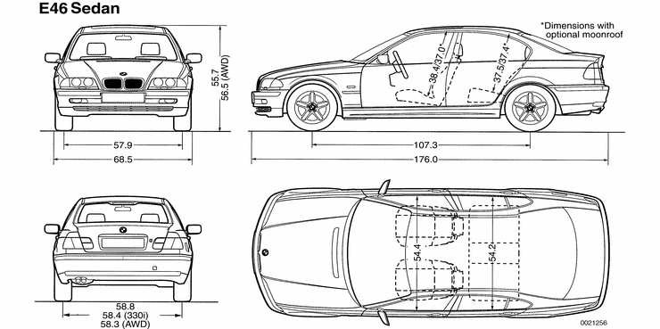
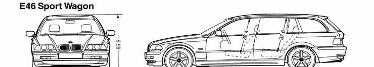
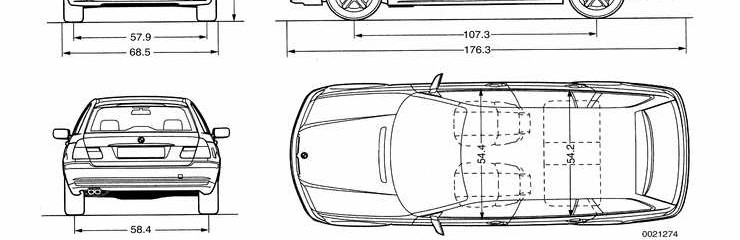
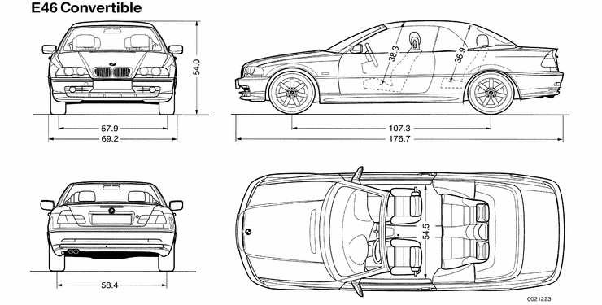
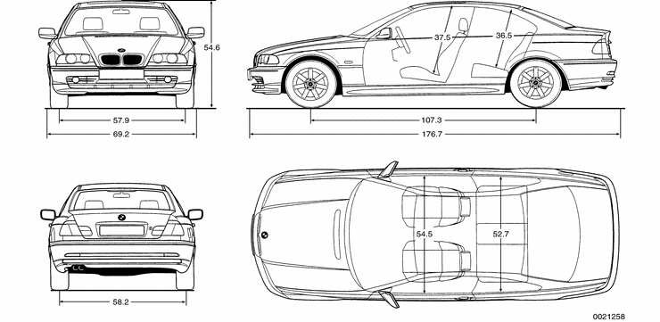
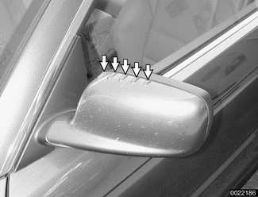
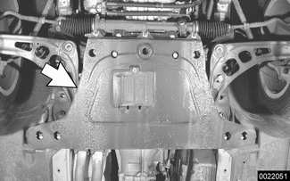

# Body Assembly

> Source: BMW 3 Series (E46) Repair Manual, section 400-2, Body — General chapter (PDF pages 722–729 of 1252).

The body styles of E46 cars covered by this manual are the 4-door Sedan, 4-door Sport Wagon, 2-door Coupe and 2-door Convertible. Body dimensions vary slightly among models. Dimensions are given in inches.

## Body shell

The BMW 3 Series chassis is a unibody design constructed of high strength steel. Attaching parts, such as the front fenders, rear quarter panels, doors, trunk lid and hood are also constructed of steel.

Computer aided design (CAD) techniques have been used in refining E46 body models to reduce vehicle weight while retaining strength and increasing torsional rigidity. For good handling purposes, the more rigid the structure the more precisely the suspension can operate. High strength steels now account for 50% of the body shell weight. The body shell's resistance to twisting forces has been almost doubled over the previous 3 series models. To help insure long-lasting strength, 85% of the body (in surface area) is made of galvanized steel. This resists corrosion and maintains body strength over time.

The E46 body shell was designed so that the vibrations of torsional twisting and bending are separated into discrete components and in the inaudible range. The current Sedan design ensures that the body twists at 29 hertz and bends at 26 hertz.

## Exterior and aerodynamics

With its traditional styling features, such as the kidney grille, circular headlights behind a glass cover (for reasons of streamlining), and the "kick" in the rearmost roof pillar (C-pillar), the E46 can be immediately recognized as a BMW.

Wind resistance. Windows bonded flush to the body and the guided flow of cooling air into the engine compartment provide a good coefficient of drag (Cd). E46 cars have been designed for balanced aerodynamics but not necessarily an extremely low Cd.

A low coefficient of lift (Cl) promotes stability at high speeds. The current design has a front Cl of 0.08 and a rear Cl of 0.10.

Windshield wipers are designed for effectiveness at speeds up to and beyond 200 kph (124 mph).

Body, window and exterior mirror shapes have been refined for lower wind noise and reduced soiling of mirrors and windows. The Coupe's side mirrors are specially shaped and include five ribs (arrows) on the top edge for further wind noise reduction.

All this has resulted in a Cd of approximately 0.31 for the Sedan and 0.32 for the Coupe models.

Fenders. The exterior panels are corrosion-resistant zinc coated (galvanized) steel. The front fenders are bolted on. For front fender replacement information, see [410 Fenders, Engine Hood].

Bumpers. The front and rear bumpers are clad in high quality deformable plastic and provide protection with virtually no damage to the bumper or the vehicle at solid barrier impact speeds of 4 kph (2.5 mph). In addition to hydraulic dampeners, which absorb the initial impact energy, these bumpers are backed by compressible tubes. These deform in a controlled manner at impact speeds greater than that for which bumpers and hydraulic dampeners are designed. This helps avoid expensive damage to the body at impact speeds up to 14 kph (9 mph).

## Coupe models

The E46 Coupe is similar to the 4-door Sedan, but has a more stretched and sleeker appearance. Thus, with the same wheelbase and identical length, it looks different but still familiar.

The 2-door Coupe differs from the 4-door (2-wheel drive) Sedan by a longer front end, a flatter hood line with air slits, and a roof 2.7 cm (1.1 in.) lower. Additional differences include wider doors with frameless windows, glass-covered door-posts (B pillars) and a shorter and lower trunk lid in the Coupe.

## Convertible models

The E46 Convertible is an all-season vehicle with a high level of functionality, excellent interior comfort and acoustic refinement. Interior materials and colors, the soft top and the light-alloy wheels have been carefully matched.

Although the automatic Convertible roof is standard, a hard-top in body color with heated rear window is available as an option for the cold season.

The Convertible body structure includes many passive safety refinements over its fixed-top counterparts.

- To achieve a more rigid underbody, an aluminum reinforcement plate (arrow) is bolted to the front undercarriage and reinforcing struts are bolted to the rear undercarriage.

> **Note:**
> - The aluminum reinforcement plate is used in all rear wheel drive E46 models produced from December 2000.

- Transverse seat support reinforcements in the floor pan accommodate the new seat-integrated seat belts (SGS).
- The windshield frame is reinforced with stepped reinforcing tubes which allow it to act as roll-over protection.
- The windshield is bonded into its frame.
- There are tubular door reinforcements.
- The rollover protection system is tripped into position in a fraction of a second. With this feature, two bars fully independent of each other come up behind each rear-seat backrest when the vehicle is in danger of turning over.

A Convertible body normally flexes and vibrates, transferring oscillations to the passenger compartment. In the E46 Convertible, BMW utilizes a unique battery tray in the trunk as a vibration dampening system to counteract this oscillation.

> **CAUTION!**
> - The E46 Convertible requires a special battery which is designed for constant vibration.

Information for the Convertible top and its related mechanisms can be found in [541 Convertible Top].

## Sport Wagon

Introduced in 2000, the E46 Sport Wagon is identical to the E46 Sedan from the front bumper to the B pillar (middle door-post). From the B pillar back the Sport Wagon features:

- Remodelled rear doors
- Tail gate and hinge mechanism
- Rear (tail gate) window that flips up to open, independent from the tailgate, held open by compact torsional coil springs
- New rear bumper
- Roof rails (optional equipment)

Structural, safety and comfort features in the Sport Wagon are comparable to the E46 Sedan and Coupe.

## Sport Wagon capacities

| | |
|---|---|
| **Cargo capacity:** | |
| Rear seat backrest up | 435 liters (15.4 cu. ft.) |
| Rear seat backrest folded down | 1345 liters (47.5 cu. ft.) |
| **Load capacity:** | |
| In cargo compartment | 540 Kg (1191 lb.) |
| On roof | 75 Kg (165 lb.) |
