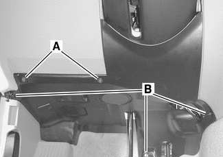
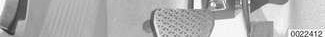
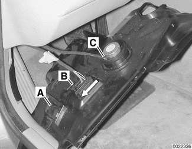
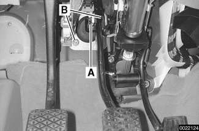

# Brake booster

> Source: BMW 3 Series (E46) Repair Manual, section 340-5, Brakes chapter (PDF pages 700–703 of 1252).

The brake booster is mounted to the bulkhead on driver's side of engine compartment, directly behind brake master cylinder.

A is vacuum hose from intake manifold. B is one-way valve. Intake manifold vacuum acts on a large diaphragm in brake booster to reduce brake pedal effort.

## Brake booster, removing and installing

> **CAUTION!**
> - On cars with Automatic Stability Control (ASC) or Dynamic Stability Control (DSC), special BMW service equipment is required to properly bleed the brakes. Removal of the hydraulic unit is not recommended unless this equipment is available. For safety reasons, the brake system on cars with electronic stability control must be bled using the procedures described in this repair group.
> - Do not mix up the fluid lines at the hydraulic unit. Label all connections before disconnecting.

- Disconnect negative (-) cable from battery.

> **CAUTION!**
> - Prior to disconnecting the battery, read the battery disconnection cautions given at front of this manual on page viii.

- Using a clean syringe, empty brake fluid reservoir.

> **WARNING!**
> - Brake fluid is highly corrosive and dangerous to the environment. Dispose of it properly.

- Remove brake master cylinder as described earlier. Make sure to plug openings at brake fluid lines.
- Disconnect engine vacuum hose from brake booster.
- Remove hydraulic unit or precharge pump below master cylinder as described later in this repair group.

Working in interior, remove left footwell (pedal cluster) trim panel.

- Remove screws (A).
- Remove fasteners (B).

Disconnect electrical harness connectors at left footwell trim panel and remove panel:

- Unplug connector at footwell interior light (A), if equipped.
- Slide lock at OBD II connector (B) in direction of arrow.
- Unplug connector at speaker (C).

Remove clip (A) and slide brake booster pushrod off brake pedal pin. Remove brake booster mounting nuts (B).

- Working in engine compartment, carefully separate brake booster from engine compartment bulkhead.

> **CAUTION!**
> - Do not use force on booster when separating from bulkhead. This can damage booster and pushrod.

- Remove booster by tilting brake booster out in direction of engine. Lift booster up and out from engine compartment.
- Installation is reverse of removal noting the following:
  - Make sure all nuts, fluid couplings, thread bores and mating surfaces are clean.
  - Replace brake booster self-locking mounting nuts.
  - Replace sealing O-ring between master cylinder and brake booster.
  - Bleed brake system as described earlier.

> **CAUTION!**
> - Do not over-torque the master cylinder mounting bolts. This could damage the brake booster and prevent proper vacuum build-up.

Tightening torques

| Component | Tightening torque |
|---|---|
| Brake master cylinder to brake booster | 26 Nm (19 ft-lb) |
| Brake booster to bulkhead | 22 Nm (16 ft-lb) |
| Brake fluid line to master cylinder or hydraulic unit | 18 Nm (13 ft-lb) |

> **Note:**
> - When replacing the brake booster one-way valve or vacuum hose, install the valve so that the molded arrow is pointing toward the intake manifold. Use new hose clamps.
