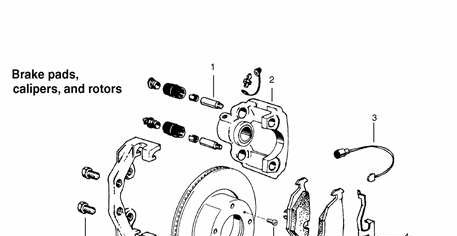
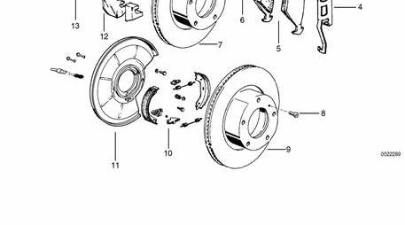
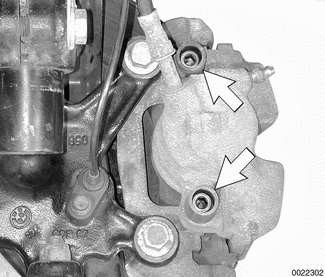
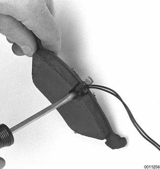
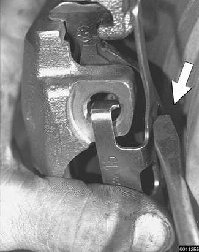
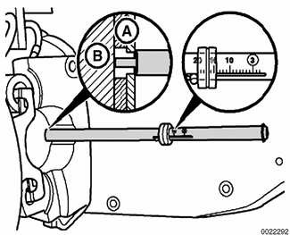
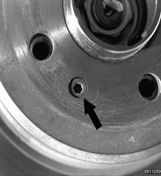
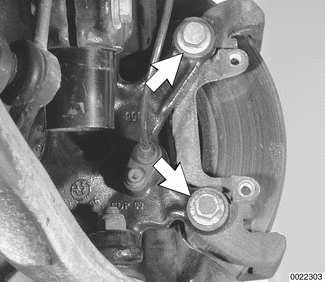

# Brake Pads, Calipers, and Rotors

> Source: BMW 3 Series (E46) Repair Manual, section 340-3, Brakes chapter (PDF pages 687–695 of 1252).

Brake pads can be replaced without disconnecting the brake fluid hose from the caliper or having to bleed the brakes. The rotors can be replaced without disassembling wheel hub and bearing. Always machine or replace rotors in pairs. Replace pads in sets.

Refer to the accompanying illustration (previous page) and the detail notes below during replacement procedures.

> **WARNING!**
> - Although semi-metallic and metallic brake friction materials in brake pads or shoes no longer contain asbestos, they produce dangerous dust. Treat all brake dust as a hazardous material.
> - Do not create dust by grinding, sanding, or cleaning brake friction surfaces with compressed air.

## Brake pads, calipers and rotors, assembly

1. Brake caliper guide bolts 7 mm Allen head — torque to 30 Nm (22 ft-lb)
2. Brake caliper — brake line: torque to 18 Nm (13 ft-lb). See [Caliper removal]
3. Brake pad wear sensor — see [Brake pad wear sensor]
4. Brake pad anti-rattle clip — see [Brake pad anti-rattle clip]
5. Brake pads — replacement warning at 3.0 mm (0.11 in.). See [Brake pads]
6. Front brake rotor retaining screw — torque to 16 Nm (12 ft-lb)
7. Front brake rotor — make sure contact surfaces are clean and free from grease. See [Front brake rotor]
8. Rear brake rotor retaining screw — torque to 16 Nm (12 ft-lb)
9. Rear brake rotor — make sure contact surfaces are clean and free from grease. Parking brake drum dia. 160 mm (6.3 in.). See [Rear brake rotor]. For brake rotor specifications see [Table c] and [Table d]
10. Parking brake shoes with hardware — min. lining thickness 1.5 mm (0.06 in.)
11. Rear brake dust shield
12. Brake pad carrier — make sure contact surfaces are clean and free from grease. See [Brake pad carrier]
13. Brake pad carrier retaining bolts — front: torque to 110 Nm (81 ft-lb); rear: torque to 65 Nm (48 ft-lb). Oil bolts lightly. Make sure contact surfaces are clean and free from grease.

## Caliper removal

Remove plastic caps from caliper mounting bolts and remove caliper mounting bolts (arrows). Remove caliper from pad carrier.

Brake caliper hydraulic line only needs to be removed when replacing brake caliper with a new unit. If removing brake caliper to service brake pads or rotors, leave hydraulic line connected.

If there is a ridge on rotor edge, caliper piston will have to be pressed back into caliper before caliper can be removed.

> **CAUTION!**
> - Pressing caliper piston in may cause brake fluid reservoir to overflow. To prevent this, use a clean syringe to first remove some fluid from reservoir. Open caliper bleeder screw only when applying force to the piston. Do not allow air to be drawn in through bleeder screw. Catch expelled fluid in appropriate container.
> - Do not let brake caliper hang from brake hose. Suspend it from chassis using stiff wire.

Inspect brake caliper for signs of leakage. Check that caliper piston slides smoothly into caliper. Replace caliper if any faults are found.

Thoroughly clean all contact points on caliper and brake pad carrier. Clean guide bolts and make sure they slide freely. Do not lubricate guide bolts.

Bleed brake system if hydraulic line to caliper has been removed or replaced. See [Bleeding brakes].

Tightening torque

| Component | Tightening torque |
|---|---|
| Caliper to brake pad carrier mounting bolts | 30 Nm (22 ft-lb) |

## Brake pad wear sensor

Carefully pry pad wear sensor from brake pad.

Insert brake pad wear sensor into cutout in new pad where applicable. If brake lining indicator light illuminated prior to brake pad replacement, replace wear sensor.

Route pad wear sensor wiring through caliper opening and bleeder dust cap.

## Brake pad anti-rattle clip

Remove anti-rattle clip by unhooking at top and bottom. Use screwdriver as an aid (arrow).

## Brake pad lining thickness

To measure brake pad lining thickness:

- Insert BMW special tool 34 1 260 at either front right wheel or left rear wheel
- Move wheel until notch for brake wear indicator can be seen through wheel opening.
- Insert tip of tool into notch so that the body of tool rests on brake pad backing plate (A), and tip touches brake disc (B).

- Replace pads if thickness is 3.0 mm (0.12 in.) or less.

## Brake rotor removal

- Remove brake rotor mounting screw (arrow).

- Inspect rotor for cracks, signs of overheating and scoring.
- On original equipment rotors, the minimum allowable thickness is stamped on rotor hub. Measure rotor braking surface with a micrometer at eight to ten different points and use the smallest measurement recorded [Table c].
- If rotor does not pass minimum thickness requirements or is damaged replace rotor.

Table c. Brake rotor reconditioning specifications

| | Front | Rear |
|---|---|---|
| Vented rotor wear limit (min. thickness) | 20.4 mm (0.80 in.) | 17.4 mm (0.68 in.) |
| Max. machine limit per friction ring side | 0.8 mm (0.03 in.) | 0.8 mm (0.03 in.) |

> **WARNING!**
> - Confirm rotor wear limit specifications given in [Table c] with specifications stamped on rotor shell and identified with "MIN TH".

Table d. Brake rotor sizes

| Model | Front brake rotor | Rear brake rotor |
|---|---|---|
| 323 i / Ci | 286 x 22 mm (11.3 x 0.9 in.) | 276 x 19 mm (10.8 x 0.7 in.) |
| 325 i / Ci / xi | 300 x 22 mm (11.8 x 0.9 in.) | 294 x 19 mm (11.6 x 0.7 in.) |
| 328 i / Ci | 300 x 22 mm (11.8 x 0.9 in.) | 294 x 19 mm (11.6 x 0.7 in.) |
| 330 i / Ci / xi | 325 x 25 mm (12.8 x 1.0 in.) | 320 x 22 mm (12.6 x 0.9 in.) |

Brake rotors should always be replaced in pairs.

Clean rotor with brake cleaner before installing.

When installing new rear brake rotors, the parking brake should be adjusted. See [Parking brake].

Tightening torque

| Component | Tightening torque |
|---|---|
| Brake rotor to hub mounting screw | 16 Nm (12 ft-lb) |

## Brake pad carrier removal

Remove brake pad carrier mounting bolts (arrows) and remove pad carrier from steering arm or trailing arm.

Tightening torques

| Component | Tightening torque |
|---|---|
| Pad carrier to front steering arm | 110 Nm (81 ft-lb) |
| Pad carrier to rear trailing arm | 65 Nm (48 ft-lb) |
