# Bumpers

> Source: BMW 3 Series (E46) Repair Manual, section 510-3, Exterior Trim, Bumpers chapter (PDF pages 786–793 of 1252).

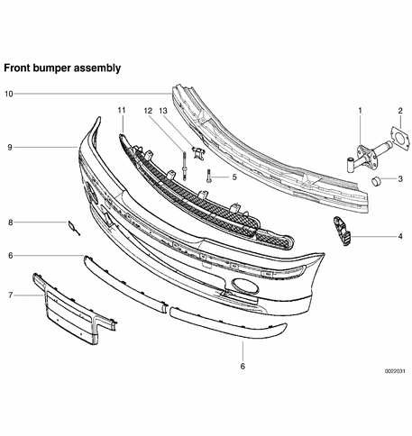

Front bumper assembly

| Front bumper assembly | |
|---|---|
| 1 | Impact absorber |
| 2 | Spacer |
| 3 | Cap |
| 4 | Support bracket |
| 5 | Bumper bracket bolt, tighten to 41 Nm (30 ft-lb) |
| 6 | Protective rubber strip |
| 7 | License plate bracket |
| 8 | Tow eye cover |
| 9 | Bumper cover |
| 10 | Carrier bumper |
| 11 | Grill |
| 12 | ASA bolt, tighten to 41 Nm (30 ft-lb) |
| 13 | Mounting sleeve |

## Front bumper, removing and installing

- Raise and properly support vehicle.

> **WARNING!**
> - Make sure that the car is firmly supported on jack stands designed for the purpose. Place the jack stands beneath a structural chassis point. Do not place jack stands under suspension parts.

- Working underneath car, remove screws from left and right side corner trim, then remove trim.

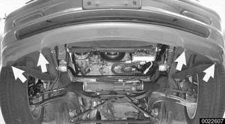

- Remove bumper cover retaining screws (**arrows**).

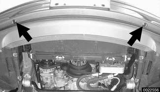

- Remove screws (**arrows**) retaining bumper bar to impact absorbers on left and right sides.
- Slide bumper assembly out a few inches and disconnect the following connections, if applicable:
    - Electrical harness connectors at fog light assemblies.
    - Electrical harness connector at signal horn.
    - Electrical harness connectors at outside temperature sensor at rear of left side of bumper and temperature switch at rear of right side of bumper.
- Slide bumper straight off side brackets.

- Installation is reverse of removal, noting the following:
    - Slide side brackets on bumper and body carefully together.
    - Make sure gap between body and bumper is set to specifications, adjust height as necessary. See [Bumper height, adjusting].

Tightening torque

| Tightening torque | |
|---|---|
| Bumper to impact absorber (M10) | 41 Nm (30 ft-lb) |

## Front bumper impact absorber, replacing

The bumper mounting bracket and impact absorber mounting hardware are accessible with the front bumper removed, as described above.

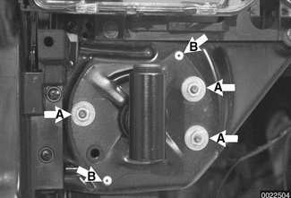

- Front bumper impact absorber mounting nuts (**A**) and drill out pop rivets (**B**).

> **Note:**
> - Install the bumper bracket bolt with thread locking compound such as Loctite®270 or equivalent.

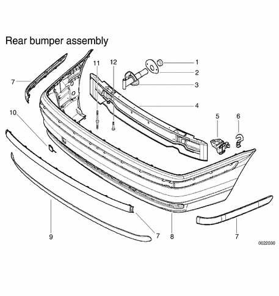

Rear bumper assembly

| Rear bumper assembly | |
|---|---|
| 1 | Cap |
| 2 | Casket |
| 3 | Impact absorber |
| 4 | Carrier bumper |
| 5 | Support bracket |
| 6 | Bracket |
| 7 | Protective rubber strip |
| 8 | Bumper cover |
| 9 | Lower part cover |
| 10 | Tow eye cover |
| 11 | ASA bolt, tighten to 41 Nm (30 ft-lb) |
| 12 | Bumper bracket bolt, tighten to 41 Nm (30 ft-lb) |

## Rear bumper, removing and installing

- Raise and properly support vehicle.

> **WARNING!**
> - Make sure that the car is firmly supported on jack stands designed for the purpose. Place the jack stands beneath a structural chassis point. Do not place jack stands under suspension parts.

- Remove bumper support bolts using special BMW tool 00 2 150.

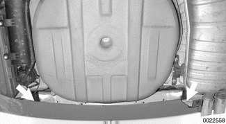

- Remove nut from bumper cover retaining bracket at rear of left and right rear wheel wells.

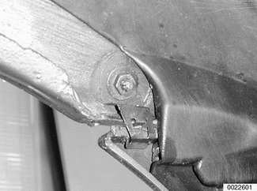

- Remove expansion pin from lower rear wheel well. Remove wheel well liner from left and right sides.

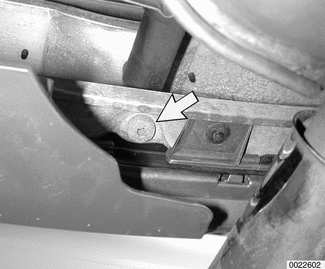

- Release bumper bar retaining bolt (**arrow**) from impact absorber using BMW special tool 00 2 150, or similar Torx head socket.

> **CAUTION!**
> - Protect possible contact areas to prevent damage or scratches to vehicle bumper and paint.

- Installation is reverse of removal.

> **Note:**
> - Install the bumper bracket bolt with thread locking compound such as Loctite®270 or equivalent.

Tightening torque

| Tightening torque | |
|---|---|
| Bumper bracket to impact absorber (M10 bolt) | 41 Nm (30 ft-lb) |

## Rear bumper impact absorber, replacing

- Remove bumper as described above.

- Remove luggage compartment floor covering.

- Remove battery and battery tray on right side and trunk trim panel on left side.

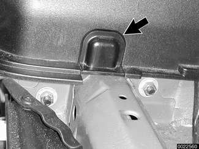

- Remove trim caps (**arrow**) at rear of frame rails.

- Release nuts on inside of vehicle trunk and remove absorber.

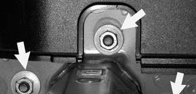

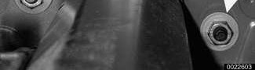

- Installation is reverse of removal. Replace body seal and protective cap if necessary. Make sure to check bumper height. See [Bumper height, adjusting].

Tightening torques

| Tightening torques | |
|---|---|
| Bumper bracket to impact absorber (M10 bolt) | 41 Nm (30 ft-lb) |
| Impact absorber to chassis (M8 nut) | 22 Nm (16 ft-lb) |

## Bumper height, adjusting

The adjustment procedure applies to either front or rear bumpers. A 14 mm allen socket is needed to make adjustments.

- Raise and properly support vehicle.

> **WARNING!**
> - Make sure that the car is firmly supported on jack stands designed for the purpose. Place the jack stands beneath a structural chassis point. Do not place jack stands under suspension parts.

- Front bumper:
    - Remove bumper as described earlier.
    - Remove bumper bracket bolt.

- Rear bumper:
    - Remove lower bumper panel as described in [Rear bumper, removing and installing].
    - Remove bumper bracket mounting bolt at impact absorber.
- Using a 12-inch extension and a 14 mm Allen socket, turn adjusting collar clockwise or counterclockwise as needed to change height of adjusting collar.

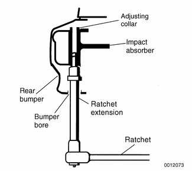

- Reinstall mounting bolts and check bumper height. Refit front bumper.

Tightening torques

| Tightening torques | |
|---|---|
| Front bumper to bumper bracket (M8 nut) | 22 Nm (16 ft-lb) |
| Front bumper bracket to impact absorber (M10 bolt) | 55 Nm (41 ft-lb) |
| Rear bumper bracket to impact absorber (M10 bolt) | 42 Nm (31 ft-lb) |
