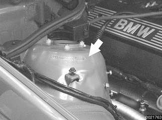

# Buying Parts

> Source: BMW 3 Series (E46) Repair Manual, section 010-5 (PDF pages 10–12 of 1252).

Many of the maintenance and repair tasks in this manual call for the installation of new parts, or the use of new gaskets and other materials when reinstalling parts. Most often, the parts that will be needed should be on hand before beginning the job. Read the introductory text and the complete procedure to determine which parts will be needed.

> **Note:**
> - For some bigger jobs, partial disassembly and inspection are required to determine a complete parts list. Read the procedure carefully and, if necessary, make other arrangements to get the necessary parts while your car is disassembled.

## Genuine BMW parts

Genuine BMW replacement parts from an authorized BMW dealer are designed and manufactured to the same high standards as the original parts. They will be the correct material, manufactured to the same specifications, and guaranteed to fit and work as intended by the engineers who designed the car. Some genuine BMW parts have a limited warranty.

Many independent repair shops make a point of using genuine BMW parts, even though they may at times be more expensive. They know the value of doing the job right with the right parts. Parts from other sources can be as good, particularly if manufactured by one of BMWs original equipment suppliers, but it is often difficult to know.

BMW is constantly updating and improving their cars, often making improvements during a given model year. BMW may recommend a newer, improved part as a replacement, and your authorized dealer's parts department will know about it and provide it. The BMW parts organization is best equipped to deal with any BMW parts needs.

## Non-returnable parts

Some parts cannot be returned, even for credit. The best example is electrical parts, which are almost universally considered non-returnable. Buy electrical parts carefully, and be as sure as possible that a replacement is needed, especially for expensive parts such as electronic control units. It may be wise to let an authorized BMW dealer or other qualified shop confirm your diagnosis before replacing an expensive non-returnable part.

## Information you need to know

- **Model.** When ordering parts it is important that you know the correct model designation for your car. Models covered in this E46 manual are 323i/Ci, 325i/Ci, 325Xi, 328i/Ci, 330i/Ci, 330Xi in Sedan, Coupe, Convertible and Sport Wagon body styles.
- **Model year.** This is not necessarily the same as date of manufacture or date of sale. A 1999 model may have been manufactured in late 1998, and perhaps not sold until early 2000. It is still a 1999 model. Model years covered by this manual are 1999 to 2001.
- **Date of manufacture.** This information is necessary when ordering replacement parts or determining if any of the warranty recalls are applicable to your car. The label on the driver's door below the door latch will specify the month and year that the car was built.
- **Vehicle Identification Number (VIN).** This is a combination of letters and numbers that identify the particular car. The VIN appears on the state registration document, and on the car itself. One location is on the right front strut tower in the engine compartment (arrow), another in the lower left corner of the windshield.

- **Engine code.** 3 Series cars covered in this manual are powered by 6-cylinder engines. For information on engine codes and engine applications, see [100 Engine–General].
- **Transmission code.** The transmission type with its identifying code may be important when buying clutch parts, seals, gaskets, and other transmission-related parts. For information on transmission codes and applications, see [200 Transmission–General].
