# Camshaft timing chains, Installing

> Source: BMW 3 Series (E46) Repair Manual, section 117-4, Camshaft Timing Chain chapter (PDF pages 241–251 of 1252).

> **CAUTION!**
> - The procedure outlined below assumes that the camshafts and the crankshaft are locked in the TDC installation position with special locking tools as shown earlier.

- Inspect timing chain sprockets. Inspect guide rail and tensioner rail for deep grooves caused by chain contact. Replace any part that is worn or damaged.

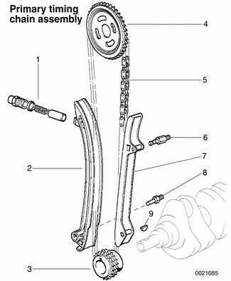

1. Primary chain tensioner
2. Chain tensioner rail
3. Crankshaft sprocket
4. Exhaust camshaft sprocket
5. Primary chain
6. Anchor bolt
7. Guide rail
8. Anchor bolt
9. Woodruff key

> **Note:**
> - If any sprockets are being replaced due to wear, the chain should also be replaced. If the crankshaft sprocket requires replacement, the oil pump drive sprocket and chain must be removed. See [119 Lubrication System] for oil pump removal information.

- Install primary timing chain to crankshaft sprocket and hang upper end from exhaust camshaft.
- If necessary, replace crankshaft seal as described earlier.

- To install lower timing case cover:
    - Clean cover and cylinder block sealing surfaces.
    - Use new gaskets and coolant pipe O-ring.
    - Drive timing cover dowels in until they just protrude slightly from sealing surface.
    - Apply a small bead of silicon sealer (3-Bond 1209® or equivalent) to corners of cylinder head where timing cover meets cylinder head and engine block.
    - Tap cover into position to engage dowels.
    - Install all bolts hand tight, including two Torx bolts from above.
    - Install secondary chain lower guide.
    - Drive dowels in flush to front of cover.
    - Tighten cover mounting bolts alternately and in stages.

Tightening torques

| Component | Tightening torque |
|---|---|
| Lower timing cover to cylinder block (M6) | 10 Nm (89 in-lb) |

- Install oil pan with new gasket. See [119 Lubrication System].

Tightening torque

| Component | Tightening torque |
|---|---|
| Oil pan to engine block (M6), 8.8 grade | 10 Nm (89 in-lb) |
| Oil pan to engine block (M6), 10.9 grade | 12 Nm (9 ft-lb) |

- Install crankshaft hub or vibration damper to crankshaft. Install crankshaft center bolt finger tight. Make sure hub is fully seated, noting alignment dowel (arrow), where applicable.

> **Note:**
> - Cars built up to January 2000 are fitted with a 2-piece vibration damper and hub assembly. Cars built from January 2000 use an integral vibration damper and hub assembly. If the early vibration damper needs to be replaced, only the single piece with integral hub is available from BMW.

Tightening torque

| Component | Tightening torque |
|---|---|
| Vibration damper to crankshaft hub (M8) | 22 Nm (16 ft-lb) |

- Fit top sprocket to primary timing chain and install on exhaust camshaft so that pointer (arrow) on sprocket lines up with cylinder head sealing surface.

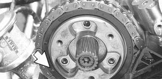

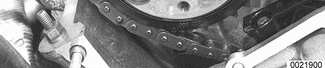

- Insert BMW special tool 11 4 220 in cylinder head and screw in adjustment screw by hand just until it contacts tensioning rail.

> **Note:**
> - BMW special tool 11 4 220 is a dummy primary chain tensioner and simulates the function of the tensioner.

- Make sure arrow on top primary sprocket is still lined up with upper edge of cylinder head. Reposition sprocket if necessary.
- Install and tighten down threaded locating studs (arrows) in end of exhaust camshaft.

Tightening torques

| Component | Tightening torque |
|---|---|
| Exhaust camshaft locating stud | 20 Nm (15 ft-lb) |

- Install secondary chain tensioner on cylinder head.
- Make sure tensioner is locked in compressed position as described earlier.

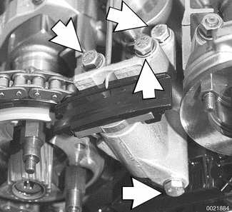

- Fit exhaust camshaft splined sleeve, aligning gap in sleeve splines with corresponding gap on camshaft splines (arrows).

- Slide splined shaft onto exhaust camshaft, aligning larger tooth with corresponding gap of splined sleeve.
- Slide splined shaft in further until 3 small slots in splined sleeve are centered on 3 threaded holes in sprocket.

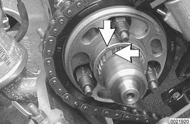

- Place intake and exhaust sprockets in BMW special tool 11 6 180. Position spline gap on intake sprocket (arrow) as shown and place secondary chain on sprockets.

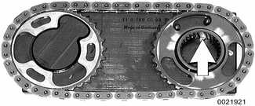

- Carefully remove chain and sprockets from tool and slide onto camshafts. Align gap in intake sprocket splines with corresponding gap in camshaft splines (arrow).

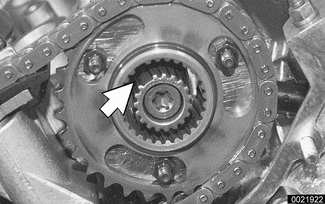

> **CAUTION!**
> - Do not alter position of sprockets with respect to chain when removing from special tool 11 6 180.

- Slide splined shaft onto intake camshaft until approx. 1 mm (0.04 in.) of splines can still be seen.

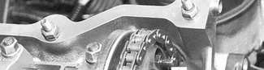

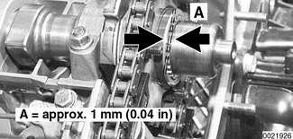

- Install intake camshaft spring plate so that FRONT mark is visible. Install mounting nuts (arrows) finger tight.

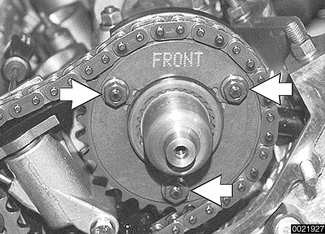

- Working at exhaust side, insert sprocket mounting Torx screws into threaded holes (arrows).
- Initially tighten screws to approx. 5 Nm (44 in-lb). Back off half a turn.

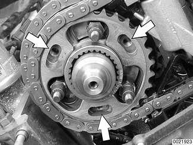

- Fit thrust spacer (A) on exhaust camshaft.

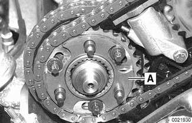

- Install spring plate (A) to exhaust camshaft. Make sure that F marking is visible.

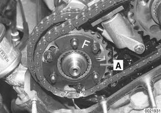

> **Note:**
> - If F marking is no longer visible, install spring plate so that convex side points forward (toward front of car).

- Install exhaust camshaft impulse wheel, aligning mark (B) with top edge of cylinder head (A). Install mounting nuts (arrows) finger tight.

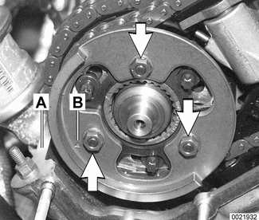

- Pull out exhaust splined shaft until it stops.

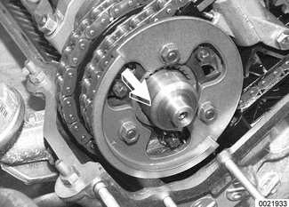

- Press down on secondary chain tensioner and remove tensioner lock-down tool.
- Preload primary chain: Tighten adjusting screw on BMW special tool 11 4 220 to specified torque.

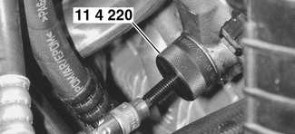

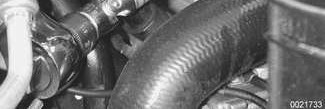

Tightening torque

| Component | Tightening torque |
|---|---|
| Primary chain tensioner preload | 0.7 Nm (6 in-lb) |

- Preload exhaust camshaft spring plate by pressing on impulse wheel while tightening mounting nuts (arrows) finger tight.

- Install BMW special tool 11 6 150 (VANOS setup bracket) to front of cylinder head timing case.
- Tighten tool mounting nuts (arrows) by hand, and then tighten down uniformly until special tool is firmly contacting cylinder head.

> **CAUTION!**
> - Make sure all gasket material is removed from face of cylinder head. Clean sealing face and keep free of oil. If any foreign material is present on the sealing surface, the camshaft timing will be incorrect.

- Secure camshaft sprockets and impulse wheels:
    - Tighten mounting screws (A) on exhaust camshaft impulse wheel to approx. 5 Nm (44 in-lb).
    - Tighten mounting nuts (B) on exhaust and intake sprocket assemblies to approx. 5 Nm (44 in-lb).
    - Torque down mounting screws (A) and nuts (B) to final specifications.

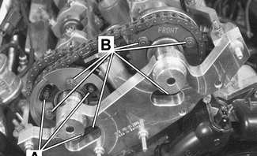

Tightening torques

| Component | Tightening torque |
|---|---|
| Sprocket assembly to camshaft initial torque | 5 Nm (44 in-lb) |
| Sprocket assembly to camshaft, M7 Torx screw (A) | 20 Nm (15 ft-lb) |
| Sprocket assembly to camshaft, M6 mounting nut (B) | 10 Nm (89 in-lb) |

- Remove flywheel locking tool from transmission bellhousing so that crankshaft is no longer secured.
- Remove camshaft locking tools from rear of camshafts.
- Crank engine over by hand twice in direction of rotation until cylinder 1 intake and exhaust camshaft lobes (arrows) face each other.

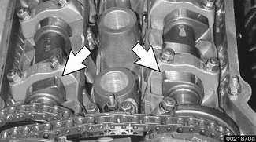

- Secure crankshaft in TDC position with BMW special tool 11 2 300.
- Place BMW special tool 11 3 240 over camshaft ends and measure clearance of tool to cylinder head surface.

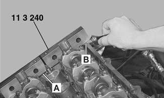

> **Note:**
> - If the exhaust side of the tool is not flush with the head (gap A), retime the camshafts as described later in this repair group.
> - Due to flexible sprocket design, VANOS unit tolerances, and play in the VANOS splines, when the camshaft timing is set correctly, the intake side of special tool 11 3 240 may be up to 1 mm (0.04 in) above the surface of the cylinder head (gap B). This is normal. Otherwise, retime the camshafts as described later in this repair group.

- Remove VANOS setup bracket from front of cylinder head.
- Install VANOS unit. See [VANOS control unit], given later.
- Install intake camshaft oil baffle

- Install cylinder head cover.
    - Check for correct seating of half-moon seals (A) in back of cylinder head cover.
    - Use a small amount of 3-Bond® 1209 or equivalent sealant at corners (B) of half-moon cutouts. Seal corners in front of cylinder head at VANOS unit.

Tightening torque

| Component | Tightening torque |
|---|---|
| Cylinder head cover to cylinder head | 10 Nm (89 in-lb) |

- Reassemble remainder of engine:

- Torque crankshaft hub center bolt, using special tools 11 2 150/11 2 410 (to 1/2000) or 11 8 190/11 8 200 (from 1/2000).

> **CAUTION!**
> - Do not use BMW special tool 11 2 300 (flywheel locking tool) to hold crankshaft stationary to loosen or tighten crankshaft hub center bolt. Use only the special tools specified, or equivalent hub holding tool.

- Reinstall air filter housing, engine covers, interior ventilation microfilter housing.
- Secure all coolant hoses, thermostat housing, engine coolant drains.
- Reinstall engine oil drain plug.
- Refill engine oil and coolant before running engine. Check for leaks.

Tightening torques

| Component | Tightening torque |
|---|---|
| Coolant drain plug to cylinder block | 25 Nm (18 ft-lb) |
| Radiator cooling fan (viscous clutch) to coolant pump | 40 Nm (30 ft-lb) |
| Radiator drain screw to radiator | 2.5 Nm (22 in-lb) |
| Vibration damper hub to crankshaft | 410 Nm (302 ft-lb) |

- Use scan tool to check VANOS operation with engine idling.
