# Camshaft Timing Chains, Removing
> Source: BMW 3 Series (E46) Repair Manual, section 117-3, Camshaft Timing Chain chapter (PDF pages 225–240 of 1252).

Camshaft timing chain removal requires that the engine oil pan be removed. This requires raising the engine and/or lowering the front suspension subframe. See [119 Lubrication System]. Also required is removal of the VANOS unit and disassembly of the intake and exhaust camshaft sprocket assemblies as described later in this repair group.

Special BMW service tools are needed for timing chain removal and installation procedures. The special tools assure proper timing of the valvetrain. Precise marks to set the timing on the camshafts are not provided for reassembly. Read the procedures through before beginning the job.

> **CAUTION!**
> - If the camshafts are not properly timed, the pistons can contact the valves.

- Disconnect negative (-) cable from battery.

> **CAUTION!**
> - Disconnecting the battery may erase fault code(s) stored in control module memory. Check for fault codes using special BMW diagnostic equipment.
> - Prior to disconnecting the battery, read the battery disconnection cautions given at the front of this manual on page viii.

- Remove microfilter for interior ventilation.

- Remove microfilter housing:
    - Open wiring harness loom (A), remove harness and lay aside.
    - Unfasten screws (B) and take off lower microfilter housing.

- Remove complete air filter housing:
    - Release mass air flow sensor clips (A).
    - Remove filter housing mounting screws (B).
    - Disconnect air duct connections (C) and lift complete air filter housing out of engine compartment, pulling it forward away from mass air flow sensor.

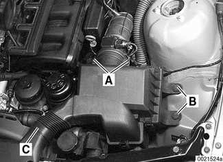

> **Note:**
> - Mass air flow sensor remains attached to air duct in above step.

- Remove engine covers:
    - Remove plastic trim covers (arrows).
    - Remove cover hold down bolts.

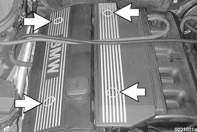

- Drain engine coolant and remove coolant hoses.
    - Remove expansion tank cap on radiator.
    - Place a 3-gallon pail beneath engine to capture coolant.
    - Remove engine block drain plug on exhaust side near cylinder 2 (arrow).

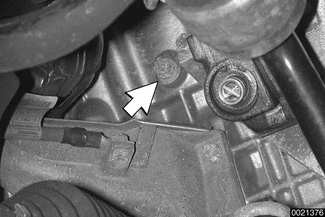

> **WARNING!**
> - Allow engine to cool before opening or draining cooling system.
> - Use caution when draining and disposing of engine coolant. Coolant is poisonous and lethal to humans and pets. Pets are attracted to coolant because of its sweet smell and taste. Consult a veterinarian immediately if ingested by an animal.
> - Drain radiator into 3-gallon pail by removing plastic drain plug at lower left corner of radiator.

- Remove radiator cooling fan shroud and viscous clutch cooling fan (cars with automatic transmission) or electric cooling fan (cars with manual transmission). See [170 Radiator and Cooling System]

> **CAUTION!**
> - On cars with viscous clutch, 32 mm cooling fan mounting nut has left hand threads.

- Release locking clips and pull hoses from thermostat housing (arrows). Unbolt and remove thermostat houses.

- Remove drive belts:
    - Use long-handled wrench to turn A/C belt tensioner hex (A) clockwise (against spring tension). Remove A/C belt.

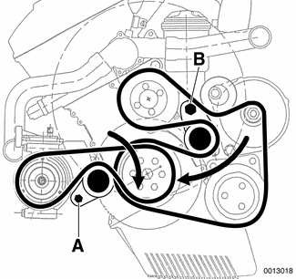

    - Similarly, turn main engine drive belt tensioner hex (B) clockwise and remove belt.

- Remove coolant pump pulley.
- Remove alternator cooling duct at radiator support.
- Drain engine oil and remove oil pan as described in [119 Lubrication System].

- On cars produced up to 1/2000 with 2-piece vibration damper: Remove vibration damper mounting bolts and separate vibration damper and pulley from crankshaft hub.

> **Note:**
> - Cars built up to January 2000 are fitted with a 2-piece vibration damper and hub assembly. Cars built from January 2000 use an integral vibration damper and hub assembly.

- Using BMW special holding tool, secure crankshaft hub to prevent crankshaft from turning. Loosen but do not remove crankshaft hub center bolt.

> **CAUTION!**
> - Do not use BMW special tool 11 2 300 (flywheel locking tool) to hold crankshaft stationary to loosen or tighten crankshaft hub center bolt. Use only the special tools specified, or equivalent hub holding tool.

> **Note:**
> - The crankshaft hub center bolt is tightened to a torque of 410 Nm (300 ft-lb). BMW special tools 11 2 150 and 11 2 410 (up to 1/2000 models) or 11 8 190 and 11 8 200 (1/2000 and later models) should be used to hold the crankshaft stationary while the bolt is loosened.

- Working at top center of engine, disconnect vent hose by squeezing at fitting (arrows).

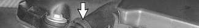

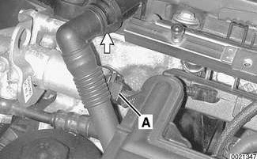

- Disconnect electrical connection at intake camshaft position sensor (A).
- Remove ignition coils and spark plugs:
    - Pull up on retaining clips to disconnect ignition coil harness connectors.
    - Remove grounding straps at coil mounting studs.
    - Remove all ignition coils.
    - Remove spark plugs.

- Remove cylinder head cover mounting fasteners and remove cylinder head cover.

> **Note:**
> - The cylinder head cover mounting bolt insulators, gaskets and coil grounds should be reinstalled in their original locations.

- Remove oil baffle cover from intake camshaft.

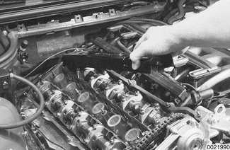

- Working at left front of cylinder head, disconnect electrical connections at exhaust camshaft position sensor and exhaust camshaft VANOS control valve (arrows).

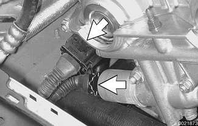

- Remove banjo bolt from VANOS control unit oil pressure line. Use banjo bolt to attach BMW special tool 11 3 450 (compressed air fitting) (arrow) to VANOS unit.

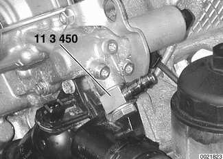

- Cover oil hole in VANOS unit (arrow) with shop towel to capture oil which will spray when compressed air line is connected.

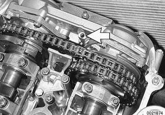

- Connect compressed air line to air fitting. Apply air pressure set to 2 - 8 bar (30 - 110 psi).
- With compressed air line connected, rotate engine in direction of rotation (clockwise) at least two full rotations, leaving cylinder 1 intake and exhaust camshaft lobes facing each other, as shown (arrows).

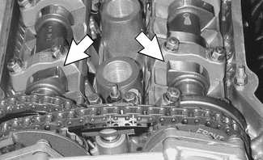

> **CAUTION!**
> - Do not rotate engine counterclockwise to reach the top dead center position. Instead, complete another two complete rotations.

- Remove sealing plug from bore on lower left side of engine block below starter. Secure crankshaft in TDC position with BMW special tool 11 2 300 (arrow).

- Unscrew and remove threaded studs (arrows) at rear of cylinder head.

- Secure camshafts in TDC position using BMW special tools 11 3 240 and 11 3 244.

- Detach compressed air line, leaving compressed air fitting attached to VANOS unit.

> **Note:**
> - Oil will drain from pressure line. Have a container and rags ready.

- Unscrew sealing plugs from VANOS unit (arrows).

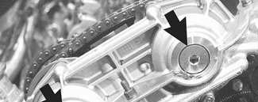

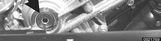

> **Note:**
> - Oil will drain from sealing plug bores. Have a container and rags ready.

- Pull sealing caps straight out of VANOS unit with BMW special tool 11 6 170, or with short nose pliers.

> **Note:**
> - Additional oil may drain from VANOS unit.

- Remove set screws (left hand thread) on ends of intake and exhaust camshafts.

> **CAUTION!**
> - Set screws have left hand threads. Remove with a clockwise motion.

- Remove VANOS unit:
    - Remove fasteners from engine support eye.
    - Remove VANOS mounting nuts (arrows) from cylinder head. Slide VANOS unit and metal gasket off.

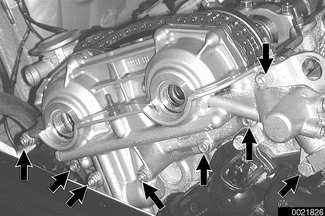

> **CAUTION!**
> - Do not crank or turn over engine with VANOS unit removed. Piston/valve interference is possible.

> **Note:**
> - The VANOS unit will contain residual oil. Place shop towels beneath adjustment unit when removing.
> - If the VANOS control unit is replaced, or if repair operations are completed that may change camshaft timing, the camshaft timing must be checked as described later in this chapter.

- Remove primary camshaft chain tensioner (arrow) from timing chain cover.

> **CAUTION!**
> - Primary camshaft chain tensioning piston is under spring pressure.

- Press down on secondary chain tensioner and lock into place using BMW special tool 11 3 292 or a similar size rod.

- Remove exhaust camshaft impulse wheel mounting nuts (arrows). Remove impulse wheel (A).

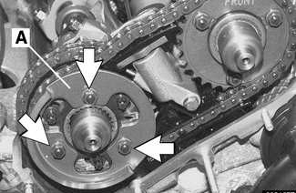

- Remove spring plate (A).

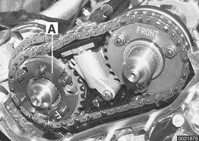

- Remove intake camshaft sprocket mounting nuts (arrows) and remove spring plate (labelled FRONT).

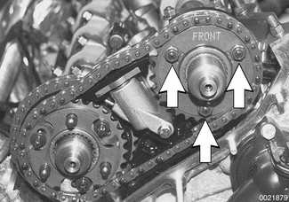

- Remove torx screws from exhaust camshaft sprocket (arrows).

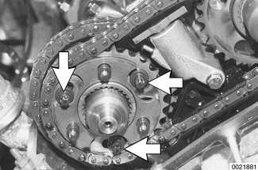

- Lift off exhaust and intake sprockets together with secondary chain, thrust spacer (A) and splined shaft (B).

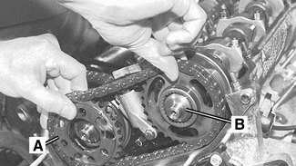

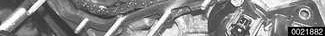

> **CAUTION!**
> - Splined shafts for both intake and exhaust camshafts share the same part number. Remove and mark used splined shafts in order to reinstall in original locations.

- Remove exhaust camshaft splined sleeve (A) and shaft (B).

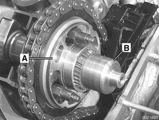

- Remove secondary chain tensioner mounting bolts (arrows). Remove tensioner while keeping locking pin in place.

- Remove primary chain sprocket mounting studs (arrows) on exhaust camshaft.

- Lift primary chain sprocket off exhaust camshaft. Remove sprocket from chain.

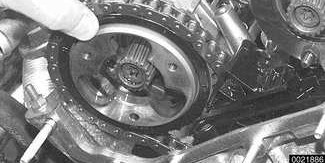

- Set timing chain on exhaust camshaft end.

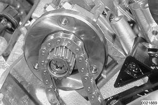

- Working in cylinder head cavity, remove timing chain cover bolts (arrows).

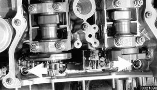

- Remove secondary chain lower guide bolts (arrows). Remove chain guide.

> **Note:**
> - Bolt on intake camshaft side is long and extends into timing chain cover.

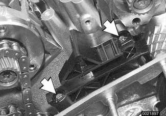

- Remove crankshaft hub center bolt and remove crankshaft hub (to 1/2000 models) or vibration damper (models from 1/2000).

> **CAUTION!**
> - The crankshaft must not be allowed to rotate when the timing chains are loosened or removed. The pistons can contact the valves.

- Using a drift of less than 5 mm diameter, drive two locating dowels (A) in left and right sides of lower timing chain cover toward rear of car. Remove cover mounting bolts (arrows) and carefully lift cover off.

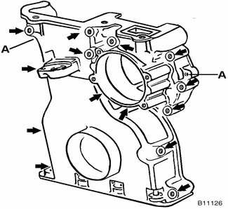

> **CAUTION!**
> - Use care when removing the cover from the cylinder head gasket. If the cover is stuck, use a sharp knife to separate it from the head gasket.

> **Note:**
> - The chain cover can be removed with the coolant pump installed.
> - Use care when removing the cover from the coolant pipe at rear.

- Push primary chain tensioner guide rail aside and remove chain.

## Double VANOS components (M52 TU, M54 engine)

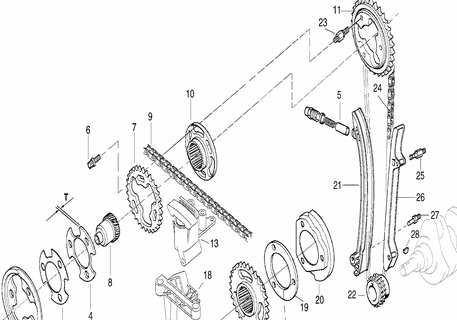

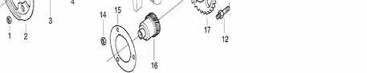

1. Impulse wheel mounting nut
2. Camshaft impulse wheel (exh.)
3. Spring plate
4. Thrust spacer (T = 3.5 mm)
5. Primary chain tensioner
6. Torx screw
7. Exhaust secondary sprocket
8. Splined shaft
9. Secondary timing chain
10. Splined sleeve
11. Primary sprocket
12. Threaded stud
13. Secondary chain tensioner
14. Sprocket mounting nut
15. Spring plate
16. Splined shaft
17. Intake camshaft sprocket
18. Secondary chain lower guide
19. Thrust spacer
20. Camshaft impulse wheel (intake)
21. Chain tensioner rail
22. Crankshaft sprocket
23. Threaded stud
24. Primary chain
25. Threaded stud
26. Guide rail
27. Threaded stud
28. Woodruff key
