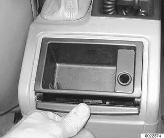
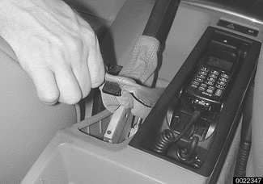
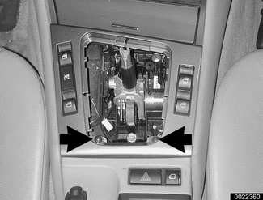
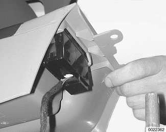
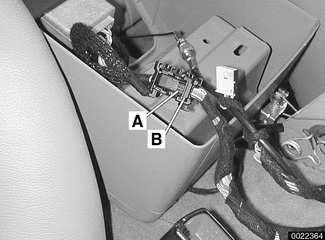

# Center Console

> Source: BMW 3 Series (E46) Repair Manual, section 513-2, Interior Trim chapter (PDF pages 835–836 of 1252).

The console between the two front seats starts behind the shifter housing. It houses the parking brake handle, optional telephone and oddments storage tray. The rear portion of the console houses the ashtray and covers the emergency brake cable ends.

The optional front seat armrest is part of this console.

## Center console, removing and installing

Press rolling cover of rear ashtray down. Depress cover fully to pop ashtray out of console. Remove ashtray.

- Remove retaining screws and bracket.

- Remove ashtray cover and housing. Disconnect electrical harness connector for ashtray courtesy light.

- Remove screws at base of ashtray compartment in console.

Unclip trim boot for parking brake lever and pull boot and handle forward off brake lever.

- Gently pry up boot or trim at transmission selector. On automatic transmission vehicles, unplug connector for gear indicator light.

Remove trim panel retaining screws (arrows) under transmission selector boot/trim.

Slide center console back and lift up. Disconnect electrical harness connector from hazard light and central locking switch.

If applicable disconnect wiring for factory installed cellular telephone. To release phone connector, press catch (A) and slide lock (B) forward. Disconnect antenna connection.

- On vehicles with center armrest: Tilt armrest upright. Lift parking brake lever upwards. Feed center console panel out over armrest and brake lever.

- Installation is reverse of removal. Make sure to securely fasten all electrical harness connectors during reassembly.
