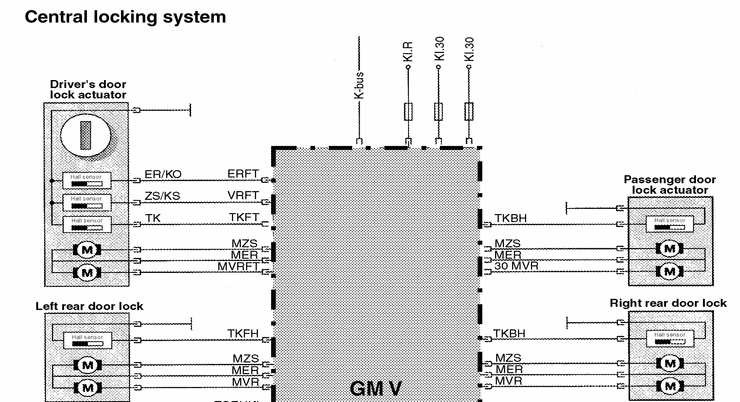
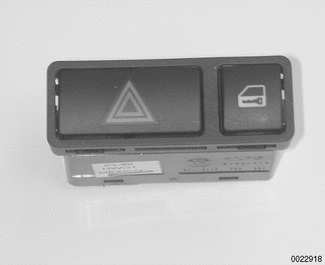
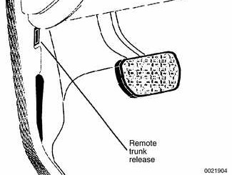
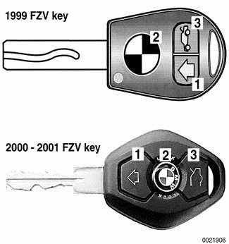
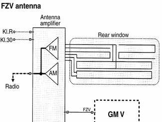
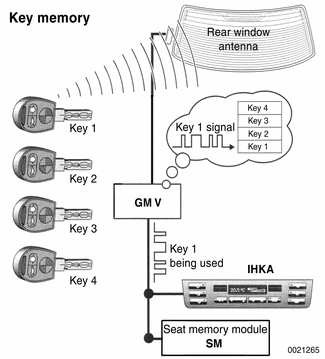
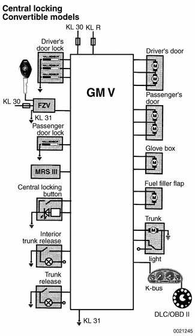
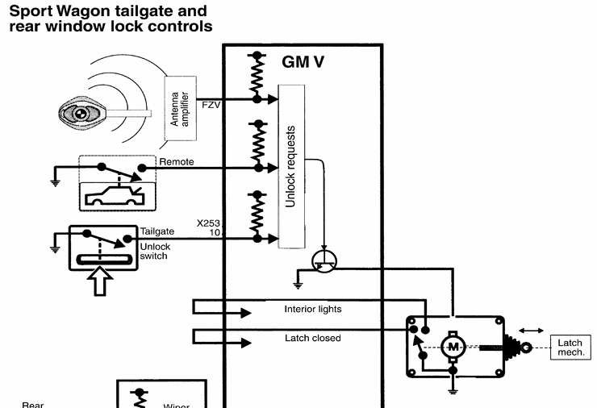
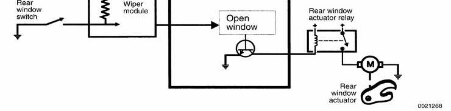

# Central Locking

> Source: BMW 3 Series (E46) Repair Manual, section 515-2, Central Locking and Anti-Theft chapter (PDF pages 849–862 of 1252).

> **Note:**
> - There is a door lock key cylinder on the driver's door only.

Central locking in E46 vehicles controls the door locks, trunk or cargo compartment lock and fuel filler flap lock. The Central Body Electronics (ZKE V) control module, known as the General Module (GM V), controls central locking.

The door lock actuators are sealed, self contained units with no replaceable parts. The actuators use Hall effect sensors in place of pin contacts and microswitches to provide door OPEN/CLOSED status signal. Each door lock-button only affects the actuator it controls. There is no effect on the central lock control of other doors.

The automatic locking feature can activate the door lock actuators when a road speed signal of 2.5 MPH is detected via the K-Bus. The factory default coding for this feature is OFF, but can be coded ON for individual users with the Key Memory function. See [Car Memory/Key Memory] later in this section.

The driver's door lock location is the only point outside of the vehicle where the key can mechanically control all of the central locking system functions. The outside locks (driver's door and trunk) incorporate an overrunning lock cylinder that breaks away and freewheels if an attempt is made to destroy either with a screwdriver or dent puller.

The rear doors are equipped with the child lock-out lever preventing the door from being opened from the inside regardless of lock-button position.

The General Module (GM V) and Electronic Immobilization (EWS 3.3) interface via the K-bus to monitor double lock status and to initiate double lock override. This feature allows the doors to be opened from the inside if a key accepted by EWS is switched on in the ignition when the doors are double locked.

Continuous locking/unlocking will initiate a timed arrest of the locking system. The GM V counts each time the locks are actuated. After approximately 12 cycles, the timed arrest is active. The timed arrest is deactivated one actuator cycle for every 8 seconds until the counter is reset to 0. The timed arrest is overridden if a crash signal is received from the multiple restraint system (MRS).

Central locking system

## Central locking switch

The central locking switch is housed in a combined housing with the hazard flasher switch. The central switch locks all vehicle locks except for the fuel filler flap.

The switch provides a momentary ground input signal to the GM V. This input signal locks each door and the trunk. The fuel filler flap remains unlocked for refueling purposes. If a door is manually unlocked and opened while centrally locked, the remaining doors stay locked. The opened door can be re-locked when closed by manually locking or pushing the central switch twice. This allows the locks of the remaining doors to be resynchronized.

## Single lock and double lock function

Each door lock actuator incorporates two motors:

Single lock motor controls the mechanical lock mechanism when the central lock switch is pressed to single lock the vehicle. The lock mechanism is fully locked at this point but can still be opened from the interior by pulling the appropriate interior door handle twice or by pressing the central lock switch again. When single lock function is activated, the fuel filler flap actuator is not locked.

Double lock motor, also known as central arrest, is activated only when the vehicle is locked from the outside at the driver's door lock with a key or when the General Module (GM V) receives a lock request from the remote entry (FZV) system. In this case the double lock motor is activated simultaneously with the single lock motor. The function of the double lock motor is to mechanically offset an internal rod in the lock actuator, disabling it from unlocking the vehicle from the interior. This prevents the doors from being unlocked by any means except from an unlock request at the driver's door or via the FZV remote key.

## Trunk lock

The trunk lock can be operated with the key but does not lock or unlock the entire vehicle. When unlocked, the trunk can be opened by pressing the trunk release switch pad located above the license plate or from the remote trunk button in the left kick panel.

The trunk can also be opened from inside the vehicle by pressing the remote trunk lid release button in driver's footwell area. The button provides the GM V with a ground signal when pressed.

The vehicle must be unlocked or single locked from the central lock switch for the remote unlock to work. The remote trunk release is locked out when the trunk is locked in the valet setting or when the GM V detects a vehicle speed over 4 mph via the K-bus.

Pressing the trunk release button on an FZV key also opens the trunk.

The trunk lid position (open/closed) and trunk lock key positions are input signals to the General Module (GM V). The trunk lid OPEN/CLOSED signals come from the trunk lid switch contact located in the trunk lock motor. When closed, the trunk contact provides a ground signal to the GM V signifying a CLOSED trunk. This contact also serves as the trunk light switch when the trunk is OPEN.

The actuator motor only operates in one direction to release the latch mechanism. The latch mechanism can also be manually unlocked with the key.

Located on the trunk lock are two additional microswitches for key position status signalling to the GM V:

Valet position switch: With the key lock in the valet position, this switch provides a ground signal to the GM V. The GM V locks out the interior trunk release button preventing the trunk from being opened.

DWA cancel switch: When the trunk is opened with the key, this switch provides a ground signal to the GM preventing the DWA alarm system from activating, if armed.

## Remote entry (FZV)

The E46 remote (keyless) entry system (usually called FZV) uses a tiny radio transmitter in the vehicle key to lock and unlock the doors and the trunk by remote control.

Button 1 — Press once: unlock driver's door, DWA disarmed, interior lights on. Press twice: total unlocking. Hold: convenience opening.

Button 2 — Press once: lock, DWA armed, interior lights ON when vehicle is locked. Press twice within 10 seconds: deactivate interior and tilt monitoring.

Button 3 — Press momentarily: trunk lid opens. Press and hold: panic mode (alarm if equipped).

There are a number of other features incorporated in FZV:

- Locking/unlocking of fuel filler lid
- Selective unlocking of driver's door (as with key in lock)
- Arming/disarming of DWA alarm system (if equipped)
- Remote unlocking of the trunk only
- Comfort opening of windows, sunroof, and convertible top.
- Interior lighting activation (search mode)
- Panic mode alarm activation (if equipped)
- Automatic correction for up to 1000 erroneous activation signals.
- Low transmitter battery fault code storage in the GM V
- 3 volt lithium battery (commercially available CR 2016) used as power supply for key transmitters
- An EEPROM stores key data. Data is no longer lost when key battery is replaced; reinitialization is not required.
- Key incorporates an LED that signals operator of signal transmitting, key initialization status and key self-test indication
- Keys delivered with four different colored labels. This is helpful to differentiate FZV keys during initialization, preventing possibility of misassigning key ID which would change coded Key Memory functions.

> **Note:**
> - A single unlock request from the driver's door with the FZV key unlocks the driver's door only. A second unlock request unlocks the remaining doors and trunk. This feature can be modified for individual users with the Key Memory capabilities to activate all lock actuators simultaneously. Car Memory/Key Memory is covered later in this section.

Starting with 2000 models, the battery in the FZV ignition key is recharged while the key is in the ignition switch. Therefore there is no need to replace the key battery.

The remote key receiver is part of the antenna amplifier and is installed in the left "C" pillar. The receiver produces a digital signal based on the transmitter command and sends it to the GM V for processing. The GM V then carries out all remote lock system, window/sunroof convenience closing features and DWA arming/disarming functions. The frequency of the FZV key radio signal to the antenna amplifier is 315 MHz. The system is also used to convey the key identification number being used to lock/unlock the vehicle. This is a requirement of the Key Memory feature, covered below.

## Car Memory/Key Memory

A number of features and functions can be customized to the driver(s) preference. The identity of the vehicle user is provided by a signal from the keyless entry system (FZV).

Car Memory and Key Memory are actually two separate functions, although they are marketed as a combined feature.

### Car Memory

The owner is provided with a list of systems that can be customized. Prior to vehicle delivery, the BMW scan tool DIS or MoDiC is used to code the driver preferences into the appropriate control modules. Thereafter these choices cannot be changed without recoding with a BMW scan tool.

The functions that can be set using Car Memory include:

- Alarm system (DWA) features such as arming/disarming with keyless entry (FZV), activation of tilt sensor or interior sensor
- Interior light activation when central locking is used
- Convenience opening of windows/sunroof
- Interior and external lighting preferences
- Heating/A/C preferences (IHKA)
- Seat and mirror preferences (triggered by Key Memory)
- Instrument cluster display units (for example: km vs. miles)

### Key Memory

Whenever one of the FZV keys is used to lock or unlock the car, the user is identified by the GM V. A maximum of four keys can be programmed with the Key Memory feature. The use of the personalized key then triggers Car Memory functions such as heating/A/C (IHKA) settings or memory seat position adjustment.

Most programming of Key Memory requires the use of BMW scan tools DIS or MoDiC. However, features such as IHKA blower speed and temperature store automatically without the use of scan tools.

Available Key Memory functions vary based on vehicle equipment. The functions that can be set include:

- Automatic locking after start off
- Selective locking
- Heating/A/C blower speed, heated or cooled air distribution, automatic blower setting.

> **Note:**
> - Key Memory is only activated when using keyless entry. If the driver's door is unlocked manually, no electronic input is received at the GM V. Therefore Car Memory/Key Memory features will not be activated.

## Remote key initialization

Initialization of FZV keys is required to establish lock/unlock signal synchronization with the GM V. The initialization procedure provides the GM V with a key identification number and a "rolling code" for each key. If initialization is not performed, the GM V will not respond to the key signals.

Up to 4 remote keys can be initialized. They must be initialized at the same time. Key initialization is only possible with the vehicle unlocked.

- Close all doors and have all keys available.

- Using key number 1, turn the ignition switch to KL R (accessory position), then switch off within 5 seconds and remove the first key.

- Within 30 seconds of turning the ignition switch to OFF, press and hold button #2.

- While holding button #2, press and release ("tap") button #1 three times within 10 seconds.

- Release both buttons.

> **Note:**
> - The Key Memory function of the GM responds to the key identification number of each key. If the keys are not initialized in the same order prior to initialization, the key memory functions activated by the keys will not be assigned correctly. Always initialize the keys in the same order.

## Convertible central locking

In Convertible models, the glove compartment lock is integrated into central locking functions. An additional lock actuator is positioned above the glove compartment lock, locking it whenever central locking is activated.

A microswitch on the glove compartment lock cylinder signals the GM V to lock the trunk electrically. This is the equivalent of valet key position. The trunk can only be opened with either the remote (FZV) key or the wallet key.

Also, the trunk is locked whenever the top storage compartment is unlocked while the top is raised or lowered. The top storage cover motor Hall sensor signals the GM V whenever the cover is unlocked.

The Convertible Top Module (CVM II) receives a signal from the GM V over the K-bus to lock out convertible top operation whenever the trunk is OPEN. The FZV antenna for the Convertible is incorporated into the rear view mirror.

## Tailgate and rear window locking

The Sport Wagon tailgate can be opened from:

- Remote key (FZV)
- Interior tailgate release button at driver's kickpanel
- Unlock microswitch above rear license plate

Any of these input requests to the GM V activate the tailgate latch motor. The GM V will also switch on the interior lights with a tailgate unlock request.

The rear window is opened with the release switch on the rear wiper arm cover. Pressing the switch signals the GM V to activate the rear window release relay.

