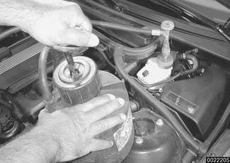
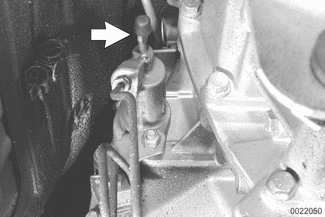
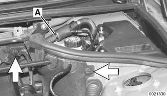
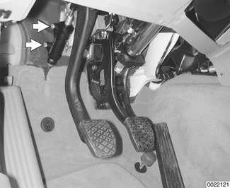
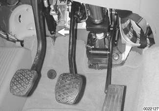
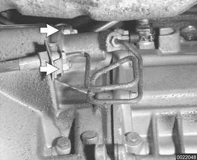

# Clutch Hydraulics

> Source: BMW 3 Series (E46) Repair Manual, section 210-2, Clutch chapter (PDF pages 393–399 of 1252).

The clutch is hydraulically actuated by the master and slave cylinders. Clutch disc wear is automatically taken up through the self adjusting pressure plate springs, making periodic adjustments unnecessary.

A soft or spongy feel to the clutch pedal, long pedal free-play, or grinding noises from the gears while shifting can all indicate problems with the clutch hydraulics. In these circumstances it is best to start with a clutch fluid flush, followed, if necessary, by replacement of the hydraulic parts.

> **Note:**
> - The clutch hydraulic system shares the fluid reservoir and fluid with the brake hydraulic system.

## Clutch hydraulic system, bleeding and flushing

If the clutch/brake fluid is murky or muddy, or has not been changed within the last two years, the system should be flushed. Flushing the old fluid from the clutch lines is done using a brake system pressure bleeder.

- Raise and safely support vehicle.
- Remove under transmission splash guard if applicable.
- Remove brake fluid reservoir cap. Using a clean syringe, remove brake fluid from reservoir. Refill reservoir with clean DOT 4 brake fluid.
- Attach pressure brake bleeder to fluid reservoir and pump bleeder a few times to pressurize hydraulic fluid system.

> **CAUTION!**
> - Do not exceed 2 bar (29 psi) pressure at the fluid reservoir when bleeding or flushing the hydraulic system.
> - Brake fluid is poisonous, highly corrosive and dangerous to the environment. Wear safety glasses and rubber gloves when working with brake fluid. Do not siphon brake fluid with your mouth. Immediately clean away any fluid spilled on painted surfaces and wash with water, as brake fluid will remove paint.
> - Always use new brake fluid from a fresh, unopened container. Brake fluid will absorb moisture from the air. This can lead to corrosion problems in the hydraulic systems, and will also lower the brake fluid's boiling point. Dispose of brake fluid properly.

- Connect a length of hose from clutch slave cylinder bleeder valve (arrow) to a container.

- Open bleeder valve and allow brake fluid to expel until clean fluid comes out free of air bubbles.
- Close bleeder valve and disconnect pressure bleeding equipment from fluid reservoir. Hose on bleeder valve remains connected.
- Slowly operate clutch pedal about 10 times. Fill reservoir with clean fluid as necessary.
- Unbolt slave cylinder from transmission. Fit BMW special tool 21 5 030. Press slave cylinder pushrod completely into slave cylinder.
- Hold slave cylinder so that bleeder valve is at the highest point.
- Open bleeder valve.
    - Once brake fluid appears without air bubbles, withdraw pushrod completely.
    - Press slave cylinder pushrod all the way in.
    - If brake fluid appears without air bubbles close bleeder valve and slowly release pushrod. Repeat procedure until fluid runs out clear and without bubbles.
- Disconnect bleeder hose. Install slave cylinder to transmission. Add clean brake fluid to reservoir as necessary. Check clutch operation.

Tightening torque

| Component | Tightening torque |
|---|---|
| Clutch slave cylinder to transmission | 22 Nm (16 ft-lb) |

## Clutch master cylinder, replacing

The clutch master cylinder is mounted to the pedal assembly directly above the clutch pedal.

- Disconnect negative (-) cable from battery.

> **CAUTION!**
> - Prior to disconnecting the battery, read the battery disconnection cautions given at the front of this manual on page viii.

- Raise and safely support vehicle.
- Remove under transmission splash guard if applicable.
- Remove brake fluid reservoir cap. Using a clean syringe, remove brake fluid from reservoir.
- Disconnect fluid supply hose from brake master cylinder. Place a pan under hose to catch any excess fluid.
- Working in engine compartment, disconnect fluid line fitting from master cylinder.
- Working at left rear of engine compartment:
    - Peel rubber edge seal off top of panel.
    - Twist plastic panel retainers (arrows) 90° and pull out to remove.
    - Disengage panel from hoses and wiring harnesses and remove from engine compartment.
    - Separate brake booster vacuum hose at one way valve (A). Plug hose ends.

- Disconnect clutch pedal from clutch master cylinder push rod by removing securing pin.
- Remove master cylinder mounting bolts (arrows).

- Remove clip (arrow) retaining hydraulic line to master cylinder. Be prepared to catch any excess brake fluid remaining in hydraulic line.

> **Note:**
> - Wrap clutch master cylinder with shop rags when removing hydraulic fluid lines from master cylinder to prevent brake fluid spill.

- Pull hydraulic line from master cylinder. Remove master cylinder with supply hose.
- Installation is reverse of removal.
    - Fill fluid reservoir with clean fluid.
    - Bleed clutch hydraulics as described earlier. Connect negative cable to battery last.

Tightening torques

| Component | Tightening torque |
|---|---|
| Clutch master cylinder to pedal cluster | 22 Nm (16 ft-lb) |
| Fluid line to master cylinder or slave cylinder | 20 + 5 Nm (15 + 4 ft-lb) |

## Clutch slave cylinder, replacing

- Pinch off brake fluid supply hose to clutch master cylinder using BMW special tool 13 3 010 or equivalent fuel line clamp tool.
- Remove transmission splash guard if applicable.
- Disconnect fluid hose from slave cylinder. Place a pan under hose to catch any excess fluid.
- Remove mounting nuts (arrows) from slave cylinder on left side of transmission.

- Installation is reverse of removal, noting the following:
    - Check for wear on slave cylinder. Any other wear except on tip is caused by misalignment of clutch components.
    - Lightly coat pushrod tip with molybdenum disulfide grease (Molykote® Longterm 2 or equivalent).
    - During installation be sure pushrod tip engages recess in clutch release lever.
    - Fill fluid reservoir with clean fluid.
    - Bleed clutch hydraulics as described earlier.

Tightening torques

| Component | Tightening torque |
|---|---|
| Clutch slave cylinder to transmission | 22 Nm (16 ft-lb) |
| Fluid line to slave cylinder | 20 + 5 Nm (15 + 4 ft-lb) |
