# Clutch Mechanical

> Source: BMW 3 Series (E46) Repair Manual, section 210-3, Clutch chapter (PDF pages 400–407 of 1252).

The transmission must be removed from the engine to access the clutch mechanical components. It is recommended that the clutch disc, pressure plate and release bearing be replaced during a clutch overhaul. Be sure to check the bottom of the bellhousing for oil. If engine oil is found, check for a faulty rear crankshaft oil seal.

Due to the construction of the self adjusting clutch (SAC) disc special tools must be used when removing the SAC style clutch. The pressure plate of the SAC clutch uses a wedge ring which rotates against the diaphragm springs to accommodate for clutch disc wear. The wedge ring adjusts by means of spring tension, so special tools must be used to apply and relieve spring tension as the clutch pressure plate is removed and installed. For special tools needed for clutch replacement procedures refer to the [Special tools].

Table a. Clutch disc diameter

| Model | Diameter |
|---|---|
| 323i/Ci | 228 mm (8.98 in.) |
| 325i/Ci/xi | 228 mm (8.98 in.) |
| 328i/Ci | 240 mm (9.45 in.) |
| 330i/Ci/xi | 240 mm (9.45 in.) |

Diameter cells are merged across model pairs in print; values repeated here.

## Clutch, removing

- On all wheel drive vehicles: Remove transfer case. See [270 Transfer Case].
- Remove transmission from engine. See [230 Manual Transmission].
- Remove release bearing from transmission input shaft.
- Remove clutch release lever by pulling away from spring clip in direction of arrow.

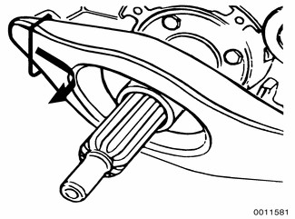

- Lock flywheel in position using BMW special tool 11 2 170 or equivalent.

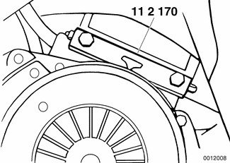

- Install BMW special tool 21 2 160 or 21 2 170 with feet (arrows) clamping on to pressure plate at openings for self-adjusting springs. Tighten down head nut (A) to lock feet into position.

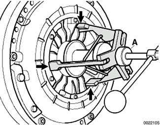

> **CAUTION!**
> - Self adjusting clutch tool feet must engage in the openings for adjusting springs to safely remove the SAC pressure plate.

- Turn tool handle in until clutch diaphragm spring is fully tensioned.
- Remove six bolts from perimeter of pressure plate. Remove self adjusting clutch unit and clutch disk.

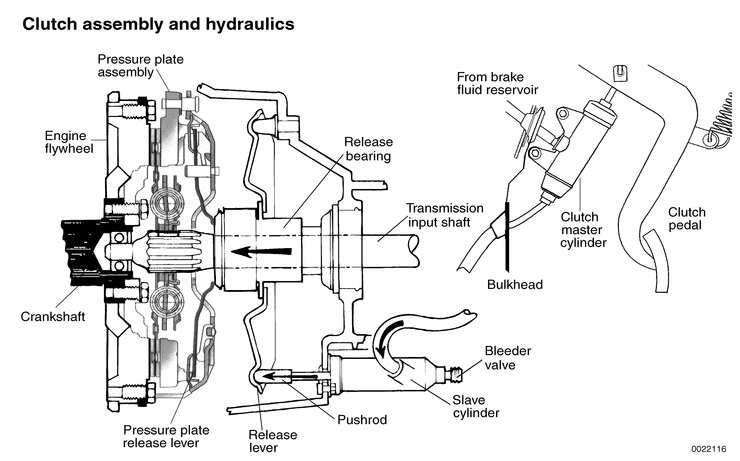

## Clutch, inspecting

- Inspect clutch disc for wear, cracks, loose rivets, contamination or excessive runout (warping). Replace if necessary.

> **Note:**
> - Measure the depth of clutch lining at lining rivets. If shallowest rivet depth is less than 1 mm (0.04 in.), replace clutch disk.

- Inspect flywheel for scoring, hot spots, cracks or loose or worn guide pins. Replace flywheel if any faults are found.

> **WARNING!**
> - If flywheel is removed from vehicle, use new bolts during installation. The old stretch-type bolts should not be reused.

- Inspect transmission pilot bearing in end of crankshaft. The bearing should rotate smoothly without play. If necessary, replace as described later.
- Inspect and clean release bearing lever. Apply a thin coat of grease to release bearing lever lubrication points (arrows). Also, lightly lubricate clutch disc splines and transmission input shaft splines.

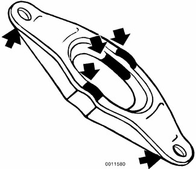

## Clutch, installing new pressure plate

New self adjusting clutch (SAC) pressure plates come with a locking plate installed that maintains spring tension on the self adjusting springs. This locking ring must not be removed until the pressure plate is securely installed on the flywheel with the clutch disk in place.

- Center clutch disk on flywheel using BMW special tool 21 2 142, or an equivalent clutch alignment tool.

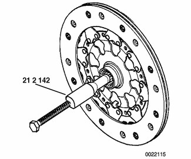

> **Note:**
> - The sides of a replacement clutch disk are labelled engine side and transmission side. Be sure to install clutch disk orientated in the proper direction.

- Install self adjusting clutch pressure plate onto dowel pins at flywheel. Tighten each bolt one turn at a time until pressure plate is fully seated, and then torque to specification.

Tightening torque

| Component | Tightening torque |
|---|---|
| Clutch to flywheel, M8 (8.8 grade) | 24 Nm (18 ft-lb) |
| Clutch to flywheel, M8 (10.9 grade) | 34 Nm (25 ft-lb) |

- Using a 14 mm allen wrench, carefully screw out locking plate in a clockwise direction.
- Remove BMW special tool 21 2 142 with bolt or screw enclosed with replacement clutch disk.
- Clean and inspect release bearing guide sleeve on transmission. Install release lever and release bearing. Bearing tabs (A) align with contact points (B) on release lever.

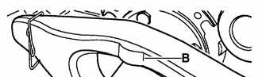

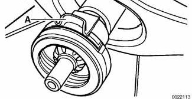

- Install transmission. See [230 Manual Transmission].

Tightening torques

| Component | Tightening torque |
|---|---|
| Transmission to engine (Torx bolts), M8 | 22 Nm (16 ft-lb) |
| Transmission to engine (Torx bolts), M10 | 43 Nm (32 ft-lb) |
| Transmission to engine (Torx bolts), M12 | 72 Nm (53 ft-lb) |

## Clutch, installing used pressure plate

> **Note:**
> - Before installing a used Self Adjusting Clutch (SAC) pressure plate, be sure to reset self adjusting ring to the new position.

- Locating hooks of BMW special tool 21 2 180 must engage in openings of SAC pressure plate.
- Place self adjusting clutch pressure plate on clean work surface. Install special tool 21 2 180 onto pressure plate.
- Squeeze handles of 21 2 180 together. Tighten down knurled knobs of 21 2 180. SAC adjustment ring is now in installation position.
- Install special tool 21 2 170 over 21 2 180 on SAC pressure plate. Screw in handle of 21 2 170 until diaphragm spring of SAC pressure plate is pretensioned.
- Center clutch disk with BMW special tool 21 2 142. A comparable clutch alignment tool may be used. Remove threaded handle of clutch alignment tool.

> **WARNING!**
> - Be sure clutch disc is facing the correct way. The disc should be marked engine side or transmission side.

- Mount self adjusting clutch assembly on flywheel, noting location of alignment pins.
- Tighten each bolt one turn at a time until pressure plate is fully seated, and then torque to specification.

Tightening torque

| Component | Tightening torque |
|---|---|
| Clutch to flywheel, M8 (8.8 grade) | 24 Nm (17 ft-lb) |
| Clutch to flywheel, M8 (10.9 grade) | 34 Nm (25 ft-lb) |

- Unscrew handle of special tool until load is removed from diaphragm. Remove BMW special tool 21 2 180 from pressure plate.
- Remove clutch alignment tool from disk.
- Clean and inspect release bearing guide sleeve on transmission. Install release lever and release bearing. Make sure bearing tabs (A) align with contact points (B) on release lever.

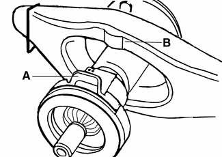

- Install transmission. See [230 Manual Transmission].

Tightening torques

| Component | Tightening torque |
|---|---|
| Transmission to engine (Torx bolts), M8 | 22 Nm (16 ft-lb) |
| Transmission to engine (Torx bolts), M10 | 43 Nm (32 ft-lb) |
| Transmission to engine (Torx bolts), M12 | 72 Nm (53 ft-lb) |

## Transmission pilot bearing, replacing

- Remove clutch as described earlier.
- Remove transmission pilot bearing from end of crankshaft using BMW special tool 11 2 340 or equivalent puller.

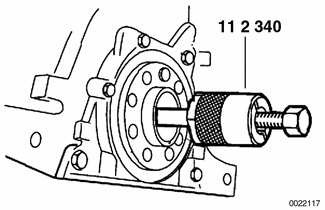

- Press new bearing into place using BMW special tool 11 2 350 or equivalent driver.

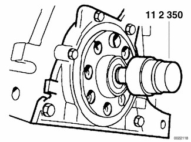
