# Component Locations

> Source: Bentley *BMW 3 Series (E46) 1999–2005 (M3) Repair Manual*, section 610-4 (PDF pages 986–1025 of 1252).

On the following pages are photos and illustrations showing the location of major electrical components in E46 vehicles.

> **Note:**
>
> - Every component is not installed in every car.
> - Due to changes in production, component locations may vary from what is illustrated. Consult your BMW dealer for the latest information.
> - The automatic transmission range switch is also sometimes referred to as the gear-position switch.
> - The EWS 3.3 system is also known as the driveaway protection system or the electronic immobilization system.
> - All-Season Traction (AST) is a marketing term that refers to ABS/ASC.

## Main relay panel

- To access main relay panel, located under right side of dashboard, remove glove compartment as described in [513 Interior Trim].

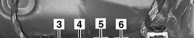

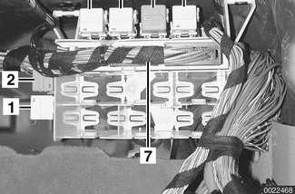

Fig. 14 Behind glove compartment (no headlight cleaning system)

1 - A/C relay
2 - Secondary air pump relay
3 - Fuel pump relay
4 - A/C relay
5 - Foglight relay
6 - Horn relay
7 - General module (GM V)

Fig. 15 Behind glove compartment (with headlight cleaning system)

1 - Headlight cleaning relay
2 - Secondary air pump relay
3 - A/C relay
4 - Fuel pump relay
5 - A/C relay
6 - Foglight relay
7 - Horn relay

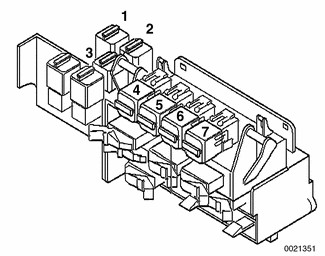

## Electronics box (E-box)

To access E-box components:

- Working in left rear of engine compartment, remove M6 Allen head bolts (arrows).
- Lift off E-box cover.

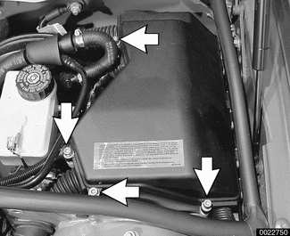

Fig. 16 E-box

1 - Engine control module (ECM)
2 - Automatic transmission control module (TCM)
3 - DME main relay
4 - Windshield washer double relay
5 - E-box temperature sensor
6 - B+ connector
7 - Engine electronics fuse pack
8 - 1999 - 2000 models: Unloader relay 2001 models: fuel injector relay
9 - Back-up light relay (automatic transmission only)

## Component location table

Table e. E46 component locations is a cross-referenced listing of electrical components in E46 vehicles. Where available, photos of components in this repair group are referred to in the fourth column.

> **Note:**
>
> - Every attempt has been made in this repair manual to standardize component names. Nevertheless, in some cases, the same component may appear with different names.
> - No E46 vehicle is equipped with all components illustrated. Where necessary, year and model applications are given in the component location table and the illustrations.

Table e. E46 component locations

| Component | Year, model | Location | Refer to |
|---|---|---|---|
| 12 volt auxiliary power socket |  | see [Power socket, 12-volt] |  |
| 3/2-way valve | 1999 - 2000 | Under car ahead of fuel filter, under protective cover |  |
| A/C blower final stage (resistor pack) | 1999 - 2001 | Right side of IHKA housing below glove compartment | Fig. 40 |
| A/C blower relay | 1999 - 2001 | Main relay panel behind glove compartment | Fig. 14, Fig. 15 |
| A/C blower | 1999 - 2001 | Behind engine compartment rear bulkhead |  |
| A/C compressor | 1999 - 2001 | Right front lower engine compartment |  |
| A/C compressor clutch relay | 1999 - 2001 | Main relay panel behind glove compartment | Fig. 14, Fig. 15 |
| A/C control module | 1999 - 2001 | Center of dashboard |  |
| A/C evaporator temperature sensor | 1999 - 2001 | Left side of IHKA housing below instrument cluster | Fig. 39 |
| A/C pressure sensor | 1999 - 2001 | Behind right headlight on top of receiver/drier | Fig. 32 |
| ABS wheel speed sensor connector, front (right/left) | 1999 -2001 | In wheel housing (right/left) | Fig. 62 |
| ABS wheel speed sensor connector, rear (right/left) | 1999 - 2001 | Ahead of rear wheel housing (right/left) |  |
| ABS wheel speed sensor, front (right/left) | 1999 - 2001 | In front wheel bearing housing(right/left) | Fig. 60 |
| ABS wheel speed sensor, rear (right/left) | 1999 - 2001 | In rear wheel bearing housing (right/left) | Fig. 61 |
| ABS/ASC control module/hydraulic unit | 1999 | Left rear engine compartment, below brake master cylinder |  |
| ABS/ASC/DSC warning lights | 1999 - 2001 | In instrument cluster |  |
| ABS/DSC charge pressure sensor | 1999 - 200 rear wheel drive with DSC | Base of master cylinder, left side | Fig. 18 |
| ABS/DSC charge pressure sensor | 2001 rear wheel drive | In ABS/DSC hydraulic unit, right rear engine compartment |  |
| ABS/DSC control module/hydraulic unit | 1999 - 2000; 2001 all wheel drive | Right rear of engine compartment | Fig. 19 |
| ABS/DSC control module/hydraulic unit | 2001 rear wheel drive | Left rear of engine compartment |  |
| ABS/DSC lateral acceleration sensor | 1999 - 2001 rear wheel drive | Behind driver kickpanel |  |
| ABS/DSC lateral acceleration sensor | 200 all wheel drive | Combined with rotational rate (yaw) sensor under driver side carpet |  |
| ABS/DSC precharge pump | 1999 - 2001 | Left rear engine compartment, below brake master cylinder | Fig. 18 |
| ABS/DSC rotational rate (yaw) sensor | 1999 - 2001 | Under driver side carpet |  |
| ABS/DSC steering angle sensor | 1999 -2001 | Base of upper steering column | Fig. 35 |
| ABS/DSC switch |  | see ASC/DSC switch |  |
| Accelerator pedal sensor (PWG) | 1999 - 2000 | At throttle housing |  |
| Accelerator pedal sensor (PWG) | 2001 | Above accelerator pedal |  |
| AGS (adaptive transmission control) |  | see Automatic transmission control module |  |
| Air distribution motors | 1999 - 2001 | In IHKA housing under dashboard (see [640 Heating and Air Conditioning]) |  |
| Air flow sensor |  | see Mass air flow sensor |  |
| Air quality sensor (AUC) (for automatic recirculation system) | 2000 - 2001 | Right side of radiator | Fig. 17, Fig. 29 |
| Airbag connector, passenger side | 1999 - 2001 | Right side dashboard support | Fig. 41 |
| Airbag connector, steering wheel | 1999 - 2001 | Under steering wheel airbag | Fig. 34 |
| Airbag control module (MRS module) | 1999 - 2001 | Under parking brake lever console, under carpet | Fig. 9 |
| Airbag crash sensor, side-impact airbag (left/right) | 1999 - 2001 | Front seat crossmember under carpet (left/right) |  |
| Airbag warning light | 1999 - 2001 | In instrument cluster |  |
| Airbag, driver side | 1999 - 2001 | Steering wheel center pad |  |
| Airbag, head protection (HPS), electrical connector (left/right) | 1999 - 2001 | At bottom of windshield pillar (A pillar) behind dashboard (left/right) | Fig. 42 |
| Airbag, passenger side | 1999 - 2001 | Right side dashboard | Fig. 41 |
| Airbag, side-impact (left/right front/rear) | 1999 - 2001 | Inside door (left/right, front/rear) |  |
| Alarm control module (DWA) | 1999 - 2001 | Above main fuse box behind glove box |  |
| Alarm indicator LED (DWA) | 1999 - 2001 | Attached to rear view mirror |  |
| Alarm siren (DWA) | 1999 - 2001 | Right side rear of engine compartment near wipers |  |
| Alarm siren battery (DWA) | 1999 - 2001 | Inside alarm siren |  |
| All season traction (AST) |  | see ABS/ASC entries |  |
| Alternator (generator) | 1999 -2001 | Left front of cylinder block |  |
| Amplifier, radio | 1999 - 2001 | Left side trunk or cargo compartment behind trim panel | Fig. 54, Fig. 57 |
| Antenna amplifier, diversity | Convertible | On convertible top storage cover |  |
| Antenna amplifier, diversity | Sport Wagon | Behind left side cargo area storage cover | Fig. 57 |
| Antenna amplifier, main | Convertible | Below mast antenna in trunk |  |
| Antenna amplifier, main | Sedan, Coupe | Behind left rear roof pillar (C-pillar) trim panel | Fig. 44 |
| Antenna amplifier, main | Sport Wagon | Below rear spoiler |  |
| Antenna diversity switching module | Convertible | Below mast antenna in trunk |  |
| Antenna, AM | Sport Wagon | In rear spoiler |  |
| Antenna, diversity | Convertible | In convertible top storage cover |  |
| Antenna, diversity | Sport Wagon | Left rear side window |  |
| Antenna, FZV (keyless entry) | Convertible | Interior rear view mirror |  |
| Antenna, FZV (keyless entry) | Sedan, Coupe | Rear window, lower antenna grid |  |
| Antenna, FZV (keyless entry) | Sport Wagon | Center rear window, combined with FM2 antenna |  |
| Antenna, main | Convertible | Mast on left rear fender |  |
| Antenna, main (FM1 and FM2) | Sport Wagon | Rear window center and right |  |
| Antenna, telephone | Convertible | Wound around mast antenna |  |
| Antenna, telephone | Coupe, Sedan, Sport Wagon | In roof above rear window |  |
| Anti-slip (traction) |  | see ABS/ASC entries |  |
| Anti-slip (traction) control switch |  | see ASC/DSC switch |  |
| Anti-theft |  | see Alarm entries |  |
| ASC |  | see ABS/ASC entries |  |
| ASC+T |  | see ABS/ASC entries |  |
| ASC/DSC switch | 1999 - 2001 | Bottom of center console, left of shifter |  |
| AST |  | see ABS/ASC entries |  |
| Automatic climate control (IHKA) |  | see A/C entries |  |
| Automatic transmission control module (TCM) | 1999 - 2001 | Left rear engine compartment in E-box | Fig. 16 |
| Automatic transmission range switch (gear position/neutral safety switch) | GM trans. | Left side of transmission, inside transmission case |  |
| Automatic transmission range switch (gear position/neutral safety switch) | ZF trans. | Left side of transmission | Fig. 64 |
| Automatic transmission range switch harness connector | ZF trans. | Left side of transmission | Fig. 64 |
| B+ jumper connector | 1999 - 2001 | Next to right front strut tower, right rear engine compartment | Fig. 17, Fig. 19 |
| B+ supply, E-box |  | Left side of E-box | Fig. 16 |
| Back-up light switch (automatic transmission) |  | see Automatic transmission range switch |  |
| Back-up light switch (manual transmission) | 1999 - 2000 | Top left side of transmission housing |  |
| Back-up light relay (automatic transmission) | 1999 - 2001 | Left rear engine compartment, in E-box | Fig. 16 |
| Battery | 1999 - 2001 | Right side trunk or cargo compartment, under tray |  |
| Battery safety terminal (BST) | 1999 - 2001 | On positive battery terminal |  |
| Blower |  | see A/C blower |  |
| Body electronics control module |  | see General module (GM V) |  |
| Brake fluid level sensor | 1999 - 2001 | Top of brake fluid reservoir, left rear engine compartment | Fig. 17, Fig. 18 |
| Brake fluid pressure sensor |  | see ABS/DSC charge pressure sensor |  |
| Brake light switch | 1999 -2001 | At pedal cluster | Fig. 37 |
| Brake pad sensor, left front | 1999 - 2001 | Left front brake pad |  |
| Brake pad sensor, right rear | 1999 - 2001 | Right rear brake pad |  |
| Brake pad wear sensor connector, left front | 1999 - 2001 | In left front wheel housing | Fig. 62 |
| Brake pad wear sensor connector, right rear | 1999 - 2001 | Ahead of right rear wheel housing |  |
| Camshaft actuator (VANOS) |  | see VANOS |  |
| Camshaft position sensor, exhaust | 1999 - 2001 | Right front of cylinder head | Fig. 29 |
| Camshaft position sensor, intake | 1999 - 2001 | Left front of cylinder head | Fig. 28 |
| Carbon canister valve | 1999 - 2000 | Right side of spare tire well under floor pan |  |
| CD changer | 1999 - 2001 | Left side of trunk |  |
| Center brake light | Sedan, Coupe | Rear of headliner |  |
| Central locking switch |  | see Hazard warning/central locking switch |  |
| Changeover valve, intake manifold |  | see Resonance valve, intake manifold |  |
| Changeover valve, running losses |  | see 3/2-way valve |  |
| Charge pressure sensor |  | see ABS/DSC charge pressure sensor |  |
| Child protection window control |  | see Window lock-out switch, rear |  |
| Chime module, park distance control (PDC) | 1999 - 2001 | In left footwell top trim |  |
| Clock | 1999 - 2001 | In on-board computer display of instrument cluster |  |
| Clutch pedal position switch | 1999 - 2001 | On pedal cluster |  |
| Combination (stalk) switch |  | see Turn-signal/headlight dimmer switch (stalk switch) see also Wiper/washer switch (stalk switch) |  |
| Convertible top control module (CVM II) | Convertible | Left rear quarter panel behind trim panel | Fig. 66 |
| Convertible top hydraulic motor | Convertible | In left side of trunk behind trim cover | Fig. 66 |
| Convertible top main pillar Hall sensor | Convertible | Behind rear seat in C pillar position | Fig. 66 |
| Convertible top solenoid valves | Convertible | Left and right rear main pillar, behind quarter panel windows | Fig. 66 |
| Convertible top storage compartment floor microswitch | Convertible | Right side storage compartment hinge in trunk | Fig. 66 |
| Convertible top storage cover Hall sensor | Convertible | Left rear of convertible top cover | Fig. 66 |
| Convertible top storage cover lock Hall sensor | Convertible | Center of cover, between rear seat backrests | Fig. 66 |
| Convertible top storage cover lock motor Hall sensor | Convertible | Center of cover, between rear seat backrests | Fig. 66 |
| Convertible top storage cover motor | Convertible | Center of cover, between rear seat backrests | Fig. 66 |
| Convertible top switch | Convertible | Bottom of center console, ahead of shifter | Fig. 66 |
| Convertible top tension bow Hall sensor | Convertible | Top rear of convertible top | Fig. 66 |
| Convertible top visor latch Hall sensor | Convertible | Top of windshield | Fig. 66 |
| Coolant level sensor | 1999 - 2001 | At bottom of coolant expansion tank |  |
| Coolant temperature sensor, radiator outlet | 1999 - 2001 | In lower radiator hose, right front of engine | Fig. 31 |
| Coolant temperature sensor |  | see Engine coolant temperature (ECT) sensor |  |
| Coolant thermostat | 1999 - 2001 | Front of cylinder head |  |
| Cooling fan |  | see Engine cooling fan entries |  |
| Crankshaft position sensor | 1999 - 2001 | Left rear of engine block, under starter motor | Fig. 22 |
| Cruise control cut-off switch | 1999 -2001 | At pedal cluster | Fig. 37 |
| Cruise controls (steering wheel) | 1999 - 2001 | Steering wheel right side keypad |  |
| Data link connector (20-pin DLC) | 1999 - 2000 | Right rear engine compartment (see also OBD II connector) | Fig. 17 |
| Diagnosis module tank leakage (DMTL) | 2001 | see Fuel tank leakage diagnosis pump (LDP or DMTL) |  |
| Digital motor electronics control module |  | see Engine control module (ECM) |  |
| Directional switch (stalk switch) |  | see Turn signal/headlight dimmer switch (stalk switch) |  |
| DLC |  | see Data link connector see also OBD II connector |  |
| DME control module |  | see Engine control module (ECM) |  |
| DME main relay | 1999 - 2001 | Left rear engine compartment in E-box | Fig. 16 |
| DMTL | 2001 | see Fuel tank leakage diagnosis pump (LDP or DMTL) |  |
| Door lock | 1999 - 2001 | In door |  |
| Door lock Hall sensor | 1999 - 2001 | In door lock mechanism |  |
| Door lock microswitch | 1999 - 2001 | In door lock mechanism |  |
| Drive-away protection |  | see EWS |  |
| DSC |  | see ABS/DSC entries |  |
| DSC switch |  | see ASC/DSC switch |  |
| DWA |  | see Alarm entries |  |
| Dynamic stability control |  | see ABS/DSC entries |  |
| E-box | 1999 - 2001 | Left rear engine compartment, under plastic cover | Fig. 16 |
| E-box cooling fan | 1999 - 2001 | Bottom rear of E-box |  |
| E-box temperature sensor | 1999 - 2001 | Rear of E-box | Fig. 16 |
| ECT sensor |  | see Engine coolant temperature (ECT) sensor |  |
| Electric coolant thermostat |  | see Coolant thermostat |  |
| Electronic immobilizer |  | see EWS entries |  |
| Electronics box |  | see E-box entries |  |
| Engine compartment light switch |  | see Engine hood contact switch |  |
| Engine control module (ECM) | 1999 - 2001 | Left rear engine compartment in E-box | Fig. 16 |
| Engine coolant temperature (ECT) sensor | 1999 - 2001 | Under rear of intake manifold at rear of cylinder block | Fig. 21 |
| Engine cooling fan (electric) | 1999 - 2001 | Models with automatic transmission: In front of radiator Models with standard transmission: In back of radiator | Fig. 17 |
| Engine cooling fan final stage (resistor) | 1999 - 2001 | In engine cooling fan housing |  |
| Engine electronics fuse pack |  | see Fuses, engine electronics |  |
| Engine hood contact switch | 1999 - 2001 | Right rear engine compartment | Fig. 19 |
| Evaporative control valve | 1999 - 2001 | Left front of engine mounted on intake manifold |  |
| Evaporator temperature sensor |  | see A/C evaporator temperature sensor |  |
| EWS control module | 1999 - 2001 | On passenger compartment bulkhead, above pedal cluster | Fig. 38 |
| EWS ring antenna | 1999 - 2001 | Around ignition switch | Fig. 36 |
| EWS transmitter module | 1999 - 2001 | In ignition key |  |
| Exhaust camshaft position sensor | 1999 - 2001 | Right front of engine, top | Fig. 29 |
| Exhaust camshaft VANOS solenoid | 1999 - 2001 | Right front of engine, top | Fig. 29 |
| Fog light relay | 1999 - 2001 | Main relay panel behind glove compartment | Fig. 14, Fig. 15 |
| Footwell light, left | 1999 - 2001 | In left footwell top trim (pedal cluster trim) |  |
| Footwell light, right | 1999 - 2001 | In right footwell top trim |  |
| Fresh air distribution motor |  | see Air distribution motors |  |
| Fuel filler door lock motor | 1999 - 2001 | In right side of trunk or cargo compartment, behind trim |  |
| Fuel injector relay | 2001 | Left rear engine compartment in E-box | Fig. 16 |
| Fuel injectors electrical harness | 1999 - 2001 | Top of engine, under plastic cover |  |
| Fuel level sensor, left | 1999 - 2001 | Top of fuel tank, under left rear seat cushion | Fig. 52 |
| Fuel level sensor, right | 1999 - 2001 | Top of fuel tank, under right rear seat cushion, combined with fuel pump | Fig. 52 |
| Fuel pump | 1999 - 2001 | Top of fuel tank, under right rear seat cushion, combined with right fuel level sensor | Fig. 52 |
| Fuel pump relay | 1999 - 2001 | Main relay panel behind glove compartment | Fig. 14, Fig. 15 |
| Fuel tank leakage diagnosis pump (LDP or DMTL) | 1999 - 2001 | Under right rear of vehicle, right side of trunk, under protective cover | Fig. 65 |
| Fuel tank vent valve |  | see Evaporative control valve |  |
| Fuse for main harness F108 (200 amp) | 1999 - 2001 | Right wheel housing in trunk | Fig. 1 |
| Fuse panel, main | 1999 - 2001 | Above glove compartment | Fig. 14, Fig. 15 |
| Fuses, additional high amperage | 1999 - 2001 | Above main fuse panel | Fig. 4 |
| Fuses, engine electronics | 1999 - 2001 | Left rear engine compartment in E-box | Fig. 2 |
| FZV antenna |  | see Antenna, FZV (keyless entry) |  |
| Gas generator, airbag |  | see Airbag entries |  |
| Gear position indicator light | 1999 - 2001 | Under shifter bezel | Fig. 47 |
| Gear position/neutral safety switch |  | see Automatic transmission range switch |  |
| General module (GM V) | 1999 - 2001 | Main relay panel behind glove compartment | Fig. 14 |
| Generator |  | see Alternator (generator) |  |
| Glove compartment lock motor |  | Above glove compartment lock |  |
| GM V |  | see General module (GM V) |  |
| GPS receiver module | 1999 - 2001 | In trunk, mounted behind left rear well |  |
| Ground jumper connection | 1999 - 2001 | Right rear engine compartment | Fig. 19 |
| Grounds: |  |  |  |
| X1108 | 1999 - 2001 | Under driver seat carpet on door sill | Fig. 9 |
| X13016 | 1999 - 2001 | Left side trunk | Fig. 13, Fig. 54 |
| X165 | 1999 - 2001 | Left front, engine compartment | Fig. 5 |
| X166 | 1999 - 2001 | Right front, engine compartment | Fig. 6 |
| X173 | 1999 - 2001 | Under left front carpet on door sill | Fig. 8 |
| X217 | 1999 - 2001 | Under right side dashboard |  |
| X218 | 1999 - 2001 | Under right side tunnel carpet |  |
| X490 | 1999 - 2001 | Under right front seat carpet on door sill | Fig. 10 |
| X494 | 1999 - 2001 | Behind rear seat backrest | Fig. 11 |
| X498 | 1999 - 2001 | Right side trunk | Fig. 12, Fig. 53 |
| X6454 | 1999 - 2001 | On bulkhead, left rear engine compartment | Fig. 7 |
| Hazard warning/central locking switch | 1999 - 2001 | On center console, behind shifter |  |
| Head protection airbag (HPS) |  | see Airbag listings |  |
| Headlight dimmer relay | 1999 - 2001 | In light control center (LSZ) |  |
| Headlight flasher |  | see Turn-signal/headlight dimmer switch (stalk switch) |  |
| Headlight vertical aim actuator (left/right) (models with xenon headlights) | 1999 - 2001 | In headlight assembly (left/right) |  |
| Headlight vertical aim load sensor, front | 1999 - 2001 | Front subframe, right side | Fig. 59 |
| Headlight vertical aim load sensor, rear | 1999 - 2001 | Rear subframe, right side |  |
| Headlight washer pump | 1999 - 2001 | Front of washer tank, right front engine compartment |  |
| Heater blower |  | see A/C blower entries |  |
| Heater core temperature sensor | 1999 - 2001 | Behind center console below radio | Fig. 45 |
| Heater recirculation distribution motor |  | see Air distribution motors |  |
| Heater regulator air distribution motor |  | see Air distribution motors |  |
| Heater valve assembly | 1999 - 2001 | Mounted on inner side of left strut tower | Fig. 27 |
| Heating-A/C |  | see A/C entries |  |
| High beam switch |  | see Turn signal/headlight dimmer switch (stalk switch) |  |
| Hood switch |  | see Engine hood security switch |  |
| Horn button | 1999 - 2001 | On steering wheel pad |  |
| Horn relay | 1999 - 2001 | Main relay panel behind glove compartment | Fig. 14, Fig. 15 |
| Horn (left/right) | 1999 - 2001 | Next to front bumper impact absorber (left/right) |  |
| Hot-film mass air flow sensor |  | see Mass air flow sensor |  |
| Idle speed control valve | 1999 - 2001 | Under intake manifold | Fig. 23 |
| Ignition coils | 1999 - 2001 | Top of cylinder head, under plastic cover | Fig. 25 |
| Ignition relay |  | see Unloader relay |  |
| Ignition switch | 1999 - 2001 | Right side steering column |  |
| IHKA |  | see A/C entries |  |
| Individual control intake system valve |  | see Resonance valve, intake manifold |  |
| Inflator assembly, airbag |  | see Airbag entries |  |
| Instrument cluster control unit | 1999 - 2001 | In instrument cluster |  |
| Intake air temperature (IAT) sensor | 1999 - 2001 | Center top of engine, between intake manifold and cylinder head | Fig. 25 |
| Intake manifold resonance valve |  | see Resonance valve, intake manifold |  |
| Interior protection control module (SDR) | Convertible | On center tunnel below console |  |
| Interior protection control module (UIS) | Sedan, Coupe, Sport Wagon | In headliner |  |
| Interior temperature intake fan | 1999 - 2001 | In A/C control module in center console |  |
| Keyless entry antenna |  | see Antenna, FZV (keyless entry) |  |
| Kickdown switch, automatic transmission |  | see Accelerator pedal sensor (PWG) |  |
| Knock sensors | 1999 - 2001 | Under intake manifold | Fig. 24 |
| Lateral acceleration sensor |  | see ABS/DSC lateral acceleration sensor entries |  |
| LDP |  | see Fuel tank leakage diagnosis pump (LDP or DMTL) |  |
| Leakage diagnosis pump (LDP) |  | see Fuel tank leakage diagnosis pump (LDP or DMTL) |  |
| Light control module | 1999 -2001 | In light switch center (LSZ) |  |
| Light switch assembly | 1999 - 2001 | In light switch center (LSZ) |  |
| Light switch center (LSZ) | 1999 - 2001 | In dashboard, left of steering wheel |  |
| Load-reduction relay |  | see Unloader relay |  |
| Lumbar support air compressor | 1999 - 2001 | Under each seat equipped with support system |  |
| Lumbar support control switch | 1999 - 2001 | Below seat base trim |  |
| Lumbar support switch | 1999 - 2001 | Four-way toggle switch at base of seat, near seat control switches |  |
| Main fuse panel |  | see Fuse panel, main |  |
| Main relay panel |  | see Relay panel, main |  |
| Main harness fuse |  | see Fuse for main harness F108 (200 amp) |  |
| Mass air flow sensor | 1999 - 2001 | Left side engine compartment | Fig. 17 |
| Mixing actuators |  | see Air distribution motors |  |
| MRS module |  | see Airbag control module |  |
| Multi-function clock | 1999 - 2001 | In dash cluster below speedometer and tachometer |  |
| Multiple restraint system (MRS) module |  | see Airbag control module |  |
| Navigation computer | 1999 - 2001 | Left side of trunk |  |
| Neutral safety switch |  | see Automatic transmission range switch |  |
| OBD II connector (16-pin DLC) | 1999 - 2001 | In left footwell top trim, under left side of instrument cluster (see also Data link connector) |  |
| Oil pressure switch | 1999 - 2001 | Left front of engine at oil filter housing | Fig. 26 |
| Oil temperature sensor | 1999 - 2001 | Left front of engine at oil filter housing | Fig. 26 |
| On-board computer | 1999 - 2001 | In instrument cluster |  |
| On-board monitor | 1999 - 2001 | In center of dashboard |  |
| Outside air temperature sensor | 1999 - 2001 | Under left side of front bumper |  |
| Outside mirror control switch | 1999 - 2001 | On left front door arm rest |  |
| Oxygen sensor connector, post-catalyst | 1999 - 2001 | Top of engine, between intake manifold and cylinder head cover | Fig. 25 |
| Oxygen sensor connector, precatalyst | 1999 - 2001 | Top of engine, between exhaust manifold and cylinder head cover | Fig. 25 |
| Oxygen sensor, post-catalyst | 1999 - 2001 | Bottom of exhaust manifold (access from below) | Fig. 58 |
| Oxygen sensor, precatalyst | 1999 - 2001 | Top of exhaust manifold | Fig. 25 |
| Park angle/tilt sensor | 1999 - 2001 | In right side trunk behind trim |  |
| Park distance control (PDC) module | 1999 -2001 | In right side trunk above battery |  |
| Park distance control sensors | 1999 - 2001 | Rear bumper trim strip | Fig. 67 |
| Park distance control warning speaker | 1999 - 2001 | Right rear speaker, rear parcel shelf |  |
| Parking brake warning switch | 1999 -2001 | Under center console, rear of parking brake handle | Fig. 49 |
| Pedal position sensor |  | see Accelerator pedal sensor (PWG) |  |
| Pinch protection, window |  | see Window anti-trap strip |  |
| Power socket, 12-volt | Sport Wagon | Cargo compartment behind left rear seat | Fig. 57 |
| Power window motors |  | see Window motors |  |
| Power window switches |  | see Window switches |  |
| Pressure sensitive finger guard |  | see Window anti-trap strip |  |
| Radiator fan |  | see Engine cooling fan (electric) |  |
| Radio antenna |  | see Antenna entries |  |
| Radio controls (steering wheel) | 1999 - 2001 | On steering wheel left keypad |  |
| Radio speaker: front tweeter (left/right) | 1999 - 2001 | Front door window frame (left/right) | Fig. 33 |
| Radio/cassette/CD player | 1999 - 2001 | Center of dashboard |  |
| Rain sensor | 1999 - 2001 | Top center of interior windshield surface, directly ahead of rear view mirror |  |
| Rain sensor control module (AIC) | 1999 - 2001 | Attached to rain sensor at top of windshield |  |
| Rear power window lock-out switch |  | see Window lock-out switch, rear |  |
| Rear window defogger relay | Convertible | Right rear quarter panel behind trim panel |  |
| Rear window defogger relay | Sedan, Coupe | Right trunk wall, behind trim liner | Fig. 53 |
| Rear window defogger relay | Sport Wagon | Right rear cargo area behind trim panel |  |
| Rear window washer pump | Sport Wagon | Behind panel in right rear cargo area | Fig. 56 |
| Relay panel, main | 1999 - 2001 | Behind glove compartment |  |
| Resonance valve, intake manifold | 1999 - 2001 | Left of intake manifold | Fig. 17 |
| Reversing light switch |  | see Back-up light entries |  |
| Ride level sensor |  | see Headlight vertical aim sensor entries |  |
| Ring antenna (EWS) |  | see EWS ring antenna |  |
| Rollover cassette | Convertible | Rear seat headrest |  |
| Rollover sensor | Convertible | Rear seat headrest |  |
| Rotational rate (yaw) sensor |  | see ABS/DSC rotational rate (yaw) sensor |  |
| Seat backrest motor | 1999 -2001 | Bottom of seat backrest | Fig. 51 |
| Seat control switch module | 1999 - 2001 | At base of seat, on side of seat cushion | Fig. 50 |
| Seat cushion tilt motor | 1999 - 2001 | Bottom of seat cushion | Fig. 50 |
| Seat forward-back motor | 1999 -2001 | Bottom of seat cushion | Fig. 50 |
| Seat headrest motor | 1999 - 2001 | Top of front seat backrest | Fig. 51 |
| Seat heater | 1999 - 2001 | In front seat cushion and backrest |  |
| Seat heater switch | 1999 - 2001 | Center console, below IHKA control panel |  |
| Seat heater temperature sensor | 1999 - 2001 | Front of front seat cushion |  |
| Seat height motor | 1999 - 2001 | Back of seat cushion | Fig. 50 |
| Seat load sensor | 2000 - 2001 | Under passenger seat cushion |  |
| Seat memory module (SM) | 1999 - 2001 | Front of seat cushion | Fig. 50 |
| Seat belt lock Hall sensor | 1999 - 2001 | In seat belt lock |  |
| Seat belt tensioner, pyrotechnic (left/right) | 1999 - 2001 | Base of seat belt lock (left/right) |  |
| Secondary air injection pump | 1999 - 2001 | Right side engine compartment, above exhaust manifold | Fig. 17, Fig. 30 |
| Secondary air injection pump relay | 1999 - 2001 | Main relay panel behind glove compartment | Fig. 14, Fig. 15 |
| Secondary air injection pump valve | 1999 - 2001 | Left front of engine | Fig. 30 |
| Shift interlock cable | 1999 - 2001 | Under shifter bezel | Fig. 46 |
| Shiftlock solenoid | 1999 - 2001 | Under shifter bezel |  |
| Side-impact airbag |  | see Airbag entries |  |
| Slip control |  | see ABS/ASC or ABS/DSC entries |  |
| Socket, 12 volt |  | see [Power socket, 12-volt] |  |
| Solar sensor | 2000 - 2001 | Right defroster outlet at base of windshield |  |
| Sound system amplifier |  | see Amplifier, radio |  |
| Speed sensor |  | see ABS wheel speed sensor entries |  |
| Spiral spring |  | see Volute spring |  |
| Starter | 1999 - 2001 | Left rear of engine, under intake manifold |  |
| Starter immobilization switch (manual transmission) |  | On clutch pedal |  |
| Starter terminals 30, 50 | 1999 - 2001 | Left rear of engine, under intake manifold | Fig. 22 |
| Steering angle sensor |  | see ABS/DSC steering angle sensor |  |
| Stepper motors |  | see Air distribution motors |  |
| Steptronic switch | 2000 - 2001 | Under shifter bezel |  |
| Stop light switch |  | see Brake light switch |  |
| Sunroof motor | 1999 - 2001 | In headliner | Fig. 43 |
| Sunroof/sunshade switch | 1999 - 2001 | In center console ahead of shifter |  |
| Supplemental restraint system (SRS) |  | see Airbag entries |  |
| Tailgate lock (central locking) | Sport Wagon | In tailgate lock |  |
| Tailgate emergency release actuator | Sport Wagon | Rear deck sill, under trim panel, integrated with lock mechanism |  |
| Tailgate unlock switch, exterior | Sport Wagon | Above license plate |  |
| Tailgate unlock switch, interior | Sport Wagon | Left kick panel |  |
| Telephone connector | 1999 - 2001 | Under center console | Fig. 48 |
| Telephone antenna |  | see Antenna entries |  |
| Telephone controls (steering wheel) | 1999 - 2001 | Steering wheel left keypad |  |
| Telephone speaker | 1999 - 2001 | In left footwell top trim |  |
| Telephone transceiver | Sedan, Coupe | In trunk below parcel shelf |  |
| Thermostat, characteristic map cooling |  | see Coolant thermostat |  |
| Throttle housing (MDK/EDK) | 1999 - 2001 | Under intake manifold | Fig. 23 |
| Throttle position sensor |  | see Accelerator pedal sensor (PWG) |  |
| Tilt sensor |  | see Park angle/tilt sensor |  |
| Tire pressure control system (RDC) control unit | 1999 - 2001 | Behind glove compartment |  |
| Toroidal coil |  | see EWS ring antenna |  |
| Traction control |  | see ABS/ASC or ABS/DSC entries |  |
| Trailer module | 1999 - 2001 | Right side trunk |  |
| Transmission control module |  | see Automatic transmission module |  |
| Transmission range switch |  | see Automatic transmission range switch |  |
| Transverse acceleration sensor |  | see ABS/DSC lateral acceleration sensor entries |  |
| Trunk lid microswitch | Sedan, Coupe, Convertible | In trunk lid lock |  |
| Trunk light switch | Sedan, Coupe, Convertible | In trunk lid lock |  |
| Trunk lock (central locking) | Sedan, Coupe, Convertible | In trunk lid lock |  |
| Turn-signal/headlight dimmer switch (stalk switch) | 1999 - 2001 | Left side of steering column |  |
| Ultrasonic sensor (motion detector) (UIS) | Coupe, Sedan, Sport Wagon | In headliner |  |
| Unloader relay | 1999 - 2001 | Left rear engine compartment in E-box, | Fig. 16 |
| Valet position switch | 1999 - 2001 | On trunk lock cylinder |  |
| VANOS solenoid, exhaust side | 1999 - 2001 | Right front of cylinder head | Fig. 29 |
| VANOS solenoid, intake side | 1999 - 2001 | Left front of cylinder head | Fig. 17 |
| Variable camshaft control |  | see VANOS |  |
| Volute spring | 1999 - 2001 | In center of steering wheel under driver airbag |  |
| Washer fluid level sensor | 1999 - 2001 | Bottom of windshield washer tank |  |
| Wheel speed sensor |  | see ABS wheel speed sensor entries |  |
| Window anti-trap strip | Sedan, Sport Wagon | Top of window frame in door |  |
| Window lock-out switch, rear | Sedan, Sport Wagon | Left side shifter bezel |  |
| Window motors | 1999 - 2001 | Inside doors |  |
| Window switches | 1999 - 2001 | On shifter bezel |  |
| Windshield washer nozzle heaters | 1999 - 2001 | In nozzles at rear of engine hood |  |
| Windshield washer pump | 1999 - 2001 | At rear of washer tank, right front engine compartment |  |
| Windshield washer relay | 1999 - 2001 | Left rear engine compartment in E-box | Fig. 16 |
| Wiper motor | 1999 - 2001 | Rear of engine compartment, behind bulkhead | Fig. 20 |
| Wiper/washer switch (stalk) | 1999 - 2001 | Right side steering column |  |
| Yaw sensor |  | see ABS/DSC rotational rate (yaw) sensor |  |
| ZKE V control module |  | see General Module (GM V) |  |

## Engine compartment electrical components

Fig. 17 Engine compartment (1999 323i)

1 - Data link connector (DLC) (1999 mid-2000 models)
2 - Hood contact switch
3 - B+ jumper connector
4 - DSC control module/hydraulic unit
5 - Secondary air pump
6 - Interior microfilter housing
7 - Resonance valve, intake manifold (changeover valve)
8 - Mass air flow sensor
9 - Brake fluid level sensor
10 - Ground lug X6454
11 - Electronics box (E-box)
12 - Air quality sensor (AUC) (for automatic recirculation control)
13 - Intake camshaft VANOS solenoid
14 - Engine cooling fan (electric)

Fig. 18 Left rear corner of engine compartment (near E-box)

1 - Brake fluid level sensor
2 - DSC precharge pump (Teves DSC MK 20/60)
3 - Brake fluid pressure sensor

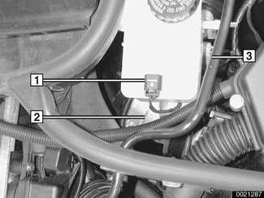

Fig. 19 Right rear corner of engine compartment (Teves DSC MK 20/60)

1 - DSC hydraulic unit
2 - Ground jumper connection
3 - Hood contact switch
4 - B+ jumper connection
5 - DSC control module

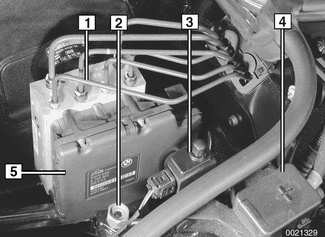

Fig. 20 Rear of engine compartment, behind bulkhead

1 - Wiper assembly electrical harness connector

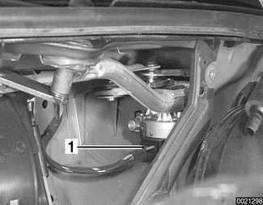

Fig. 21 Under rear of intake manifold

1 - Engine coolant temperature (ECT) sensor

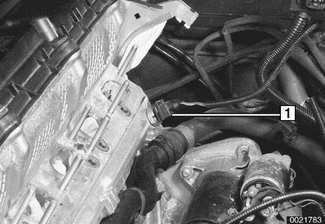

Fig. 22 Left rear of engine block, under intake manifold

1 - Starter motor terminal 50
2 - Starter motor terminal 30
3 - Crankshaft position sensor
4 - Bore hole for crankshaft locking tool

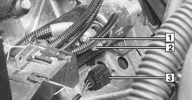

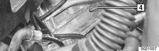

Fig. 23 Under intake manifold

1 - Idle speed control valve
2 - Throttle housing (MDK/EDK)

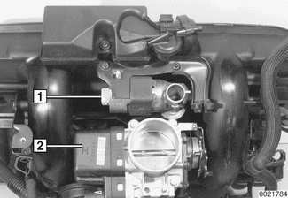

Fig. 24 Under intake manifold, at cylinder head

1 - Knock sensor cylinder 1 - 3
2 - Knock sensor harness connector
3 - Knock sensor cylinder 4 - 6

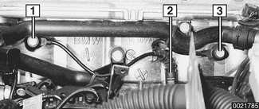

Fig. 25 Center top of engine, under covers

1 - Intake air temperature (IAT) sensor
2 - Ignition coils
3 - Post-catalyst oxygen sensor connectors
4 - Precatalyst oxygen sensor connectors
5 - Precatalyst oxygen sensors

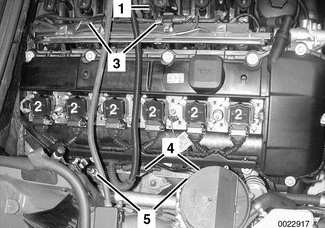

Fig. 26 Left front of engine, at oil filter housing

1 - Oil/coolant temperature sensor
2 - Oil pressure switch

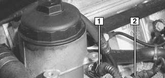

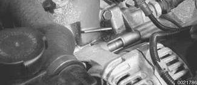

Fig. 27 Left side of engine compartment

1 - Heater control valve

Fig. 28 Cylinder head, left front

1 - Intake camshaft position sensor

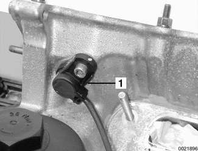

Fig. 29 Right front of engine, top

1 - Exhaust camshaft position sensor
2 - Exhaust camshaft VANOS solenoid
3 - Air quality sensor (AUC) (for automatic recirculation control)

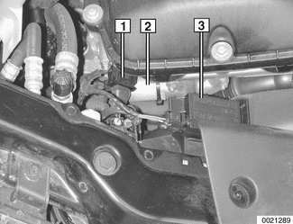

Fig. 30 Right front of engine

1 - Secondary air injection pump
2 - Secondary air injection pump valve

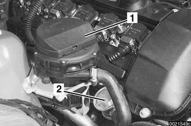

Fig. 31 Right front of engine, low

1 - Exhaust camshaft position sensor
2 - Coolant outlet temperature sensor

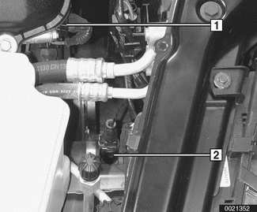

Fig. 32 Top of A/C receiver/drier, right front engine compartment

1 - A/C pressure sensor

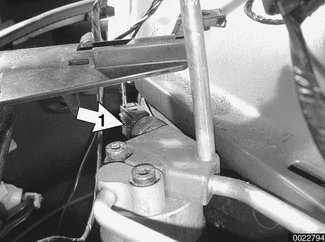

## Car interior electrical components

Fig. 33 Front door window frame

1 - Door mounted tweeter

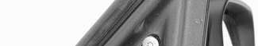

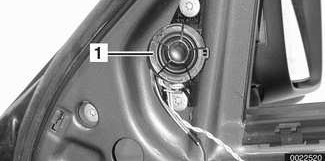

Fig. 34 Underneath horn pad at steering wheel

1 - Airbag connector

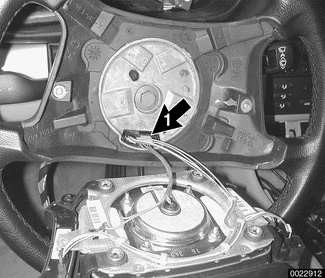

Fig. 35 Left side of steering column, below dashboard

1 - Steering angle sensor

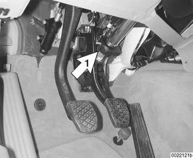

Fig. 36 At ignition switch

1 - EWS (electronic immobilizer) ring antenna

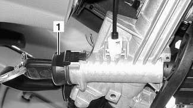

Fig. 37 At pedal cluster

1 - Cruise control cut-off switch (if equipped)
2 - Brake light switch

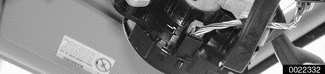

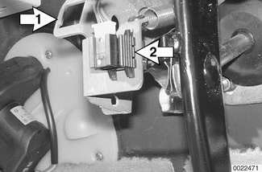

Fig. 38 Above pedal cluster

1 - EWS control module

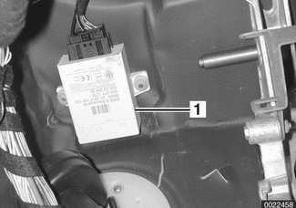

Fig. 39 Left side IHKA housing, below instrument cluster

1 - A/C evaporator temperature sensor

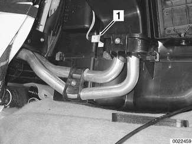

Fig. 40 Right side IHKA housing, below glove compartment

1 - Blower motor resistor pack

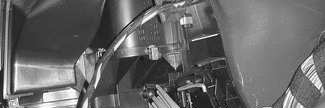

Fig. 41 Right side dashboard

1 - Passenger airbag
2 - Passenger airbag connector

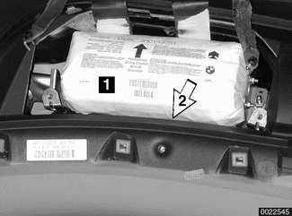

Fig. 42 In windshield pillar (A-pillar)

1 - Head protection airbag (HPS) electrical connector

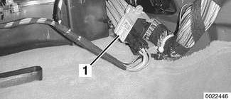

Fig. 43 In headliner

1 - Sunroof motor

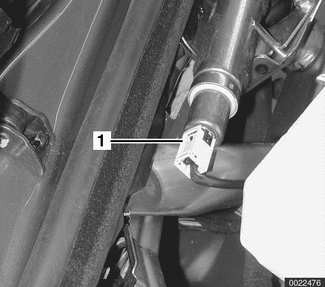

Fig. 44 In left rear roof pillar (C pillar)

1 - Antenna amplifier

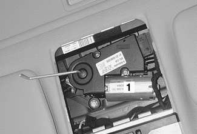

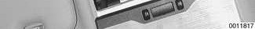

Fig. 45 Behind center console utility bin

1 - Heater core temperature sensor

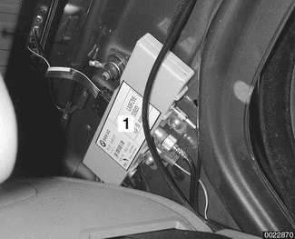

Fig. 46 Under shifter bezel

1 - Shiftlock solenoid

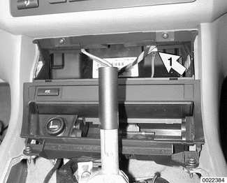

Fig. 47 At shifter bezel

1 - Gear position indicator light

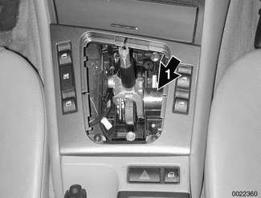

Fig. 48 Under center console

1 - Telephone connector

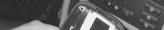

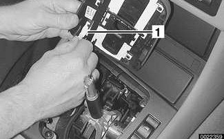

Fig. 49 Under center console, rear of parking brake handle

1 - Parking brake warning switch

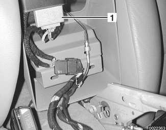

Fig. 50 Driver seat (Convertible seat front view)

1 - Seat memory module
2 - Seat control switch module
3 - Seat tilt motor
4 - Seat forward-back motor
5 - Seat height motor

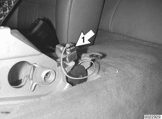

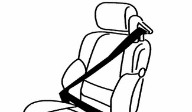

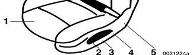

Fig. 51 Passenger seat (Convertible seat rear view)

1 - Headrest motor
2 - Comfort entry switch
3 - Backrest motor

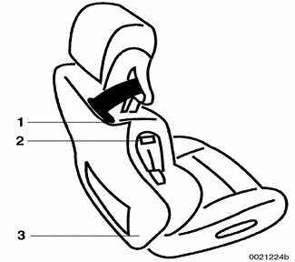

Fig. 52 Below rear seat cushion, under access covers (top of fuel tank)

1 - Right side: Electric fuel pump and fuel level sender connector
2 - Left side: Fuel level sender connector

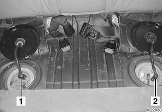

## Electrical components in luggage/cargo compartment

Fig. 53 Right side trunk

1 - Rear window defogger relay
2 - F108 (200 amp fuse) in main harness
3 - Battery safety terminal (BST) (explosive charge)
4 - Ground X498

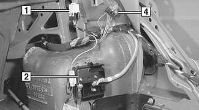

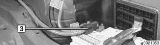

Fig. 54 Left side trunk

1 - Sound system amplifier
2 - Ground X13016

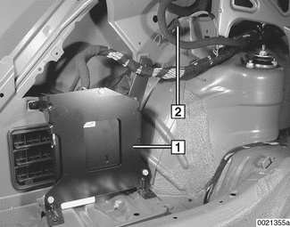

Fig. 55 Trunk, below parcel shelf

1 - Telephone transceiver

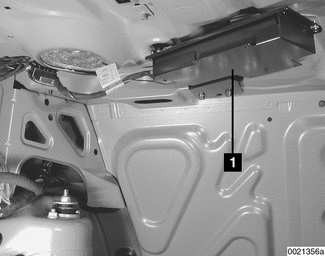

Fig. 56 Right cargo area, behind trim panel (Sport Wagon)

1 - Rear window washer pump

Fig. 57 Left cargo area (Sport Wagon)

1 - Antenna diversity amplifier
2 - Sound system components
3 - Power socket, 12 volt

## Electrical components underneath car

Fig. 58 Underneath right side of engine, at lower end of front exhaust pipes

1 - Post-catalyst oxygen sensors

Fig. 59 At front subframe, right side

1 - Front ride level sensor

Fig. 60 Right front steering arm (rear wheel drive model shown)

1 - ABS wheel speed sensor, front

> **Note:** Left front wheel speed sensor is similar.

Fig. 61 Right rear wheel bearing housing (1999 rear wheel drive model shown)

ABS wheel speed sensor, rear

> **Note:** Left rear wheel speed sensor is similar.

Fig. 62 In left front wheel housing

1 - ABS wheel speed sensor connector (2-pin grey)
2 - Brake pad wear sensor connector (2-pin black)

> **Note:** Right rear wheel speed sensor connector is similar.
>
> The right front and left rear brake pads lack the wear sensor.

Fig. 63 Rear of automatic transmission (GM)

1 - Transmission control (AGS) connector

Fig. 64 Left side of automatic transmission (ZF)

1 - Transmission range switch/back-up light switch harness connector
2 - Transmission range switch/back-up light switch
3 - Transmission control (AGS) harness connector

Fig. 65 Underneath trunk

1 - LDP/DMTL fuel tank diagnosis pump

## Convertible top electrical components

Fig. 66 Convertible

1 - Visor latch hall sensors
2 - Solenoid valves
3 - Tension bow hall sensor
4 - Main pillar hall sensor
5 - Convertible top module (CVM II)
6 - Hydraulic motor
7 - General module (GM V)
8 - Top storage cover lock motor
9 - Rear window defogger relays
10 - Storage cover lock hall sensor
11 - Roll-over cassettes and sensors
12 - Storage compartment floor microswitch
13 - Convertible top switch
14 - Cover lock motor hall sensor
15 - Convertible top module (CVM II)
16 - Storage cover and hard top lock hall sensor
17 - Storage cover hall sensor

## Exterior electrical components

Fig. 67 Rear bumper

1 - Park distance control (PDC) ultrasonic sensors

