# Component Replacement (Fuel Injection)

> Source: BMW 3 Series (E46) Repair Manual, section 130-3, Fuel Injection chapter (PDF pages 332–350 of 1252).

After diagnosing and replacing a faulty engine management component, be sure to use a BMW-compatible scan tool to check and clear the fault memory in the ECM. Diagnostic trouble codes are given in [OBD On Board Diagnostics] at the back of this book.

## Fuel rail and injectors, removing and installing

- Disconnect negative (-) battery cable.

> **CAUTION!**
> - Prior to disconnecting the battery, read the battery disconnection cautions given at the front of this manual on page viii.

- Remove housing for microfilter for interior ventilation.
    - Remove upper cover and microfilter.
    - Open wiring harness loom (A) and remove wires.
    - Unfasten screws (B) and remove lower microfilter housing.

- Remove fuel rail cover by prying off nut covers (arrows) and removing nuts.

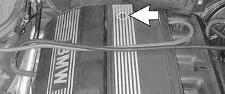

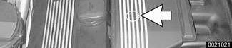

- Working above engine, disconnect electrical harness connectors:
    - VANOS control unit harness connector (A)
    - Connectors for oxygen sensors (B)
    - Connector for intake air temperature sensor (C)

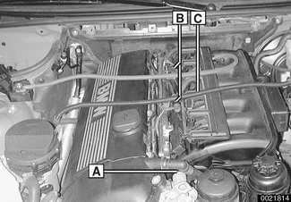

> **CAUTION!**
> - Mark oxygen sensor harness connectors in order to avoid reversing them during installation. Incorrect reconnection can cause serious engine damage.

- Disconnect fuel injector electrical connectors from injectors:
    - Use small screwdriver to pry one corner of wire lock clip on fuel injector 1 connector.
    - Repeat for all injectors.
    - Lift off connector loom and set aside.

- Unscrew schraeder valve cap (arrow) from fuel rail. Unscrew fuel tank cap to release pressure to vent tank.

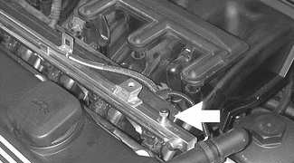

- Using a brief burst of compressed air (maximum of 3 bar or 43.5 psi) blow fuel back through return line into fuel tank.

> **WARNING!**
> - Do not smoke or work near heaters or other fire hazards. Keep a fire extinguisher handy. Before disconnecting fuel hoses, wrap a cloth around fuel hoses to absorb any leaking fuel. Catch and dispose of escaped fuel. Plug all open fuel lines.
> - Always unscrew the fuel tank cap to release pressure in the tank before working on the tank or lines.

- Raise car and support in a safe manner.

> **CAUTION!**
> - Make sure the car is stable and well supported at all times. Use a professional automotive lift or jack stands designed for the purpose. A floor jack is not adequate support.

- Remove protective engine splash guard.
- Working beneath car (on left side under driver seat), remove fuel filter cover and clamp off fuel hose(s).

> **Note:**
> - MS 42.0 vehicle shown. Fuel line arrangement on MS 43.0 vehicles varies from that shown. The MS 43.0 system uses a non-return fuel rail. Only a single fuel line leads to the engine compartment.

- Disconnect fuel hose(s) from fuel line(s) (arrows) using special fuel line removal tool 16 1 050 or equivalent. Seal off fuel line(s) with BMW special tools 13 5 281/13 5 282.

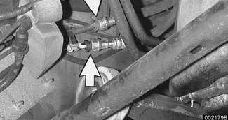

> **CAUTION!**
> - Fuel may be expelled under pressure. Do not smoke or work near heaters or other fire hazards. Keep a fire extinguisher handy. Before disconnecting fuel hoses, wrap a cloth around fuel hoses to absorb any leaking fuel. Plug all open fuel lines.

- Remove fuel rail mounting bolts (arrows).

- Carefully pry fuel rail off manifold.
- Separate fuel line support bracket at rear of intake manifold.
- Guide fuel line(s) out of rear of engine compartment while lifting fuel rail out.
- Remove individual injectors:
    - Pry retaining clip from injector (1).
    - Pull injector from rail (2).

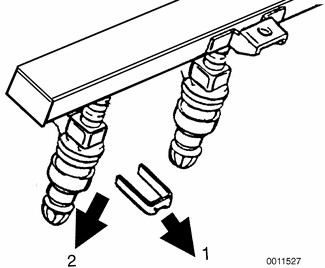

- Installation is reverse of removal.
    - Fit new O-rings when installing injectors. For ease of installation, lightly lubricate all fuel system O-rings with assembly lubricant.
    - Check that injector electrical connections are correctly fitted and that injectors are fully seated prior to installing fuel rail mounting bolts.
    - Replace any wire ties removed during removal procedure.

> **CAUTION!**
> - Replace any flexible fuel lines which were pinched shut during testing.

## Fuel pressure regulator, replacing

E46 fuel pressure regulator location

| DME system | Location |
|---|---|
| DME MS 42.0 | under left side of car, in 3/2-way valve |
| DME MS 43.0 | under left side of car, in fuel filter |

On models with DME MS 43.0, the fuel pressure regulator (arrow) is an integral part of the fuel filter. Fuel filter replacement procedure is covered in [020 Maintenance].

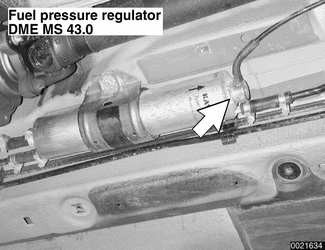

- DME MS 42.0: Working under car below driver's seat, remove protective cover from below fuel pressure regulator (arrow).

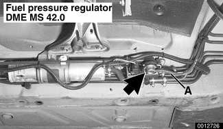

- Disconnect vacuum hose (A) from fuel pressure regulator.
- Remove locking spring clip retaining fuel pressure regulator.
- Wrap a shop rag around regulator, then remove regulator from 3/2 way valve by pulling straight down.
- Installation is reverse of removal.
    - Replace sealing O-rings.

## Mass air flow (MAF) sensor, removing and installing

> **CAUTION!**
> - Be sure the ignition is OFF before replacing DME system components.

- Loosen hose clamp (A) and pull intake air duct from mass air flow (MAF) sensor.
- Disconnect electrical harness connector (B) and unclip fasteners (C).

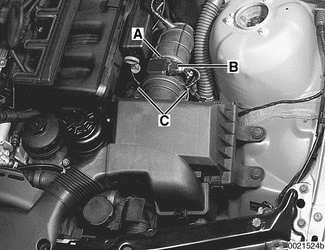

- Remove sensor. Inspect protective screen in sensor housing. Replace sensor if screen is damaged.
- Inspect air intake ducting for damage and cracks. Replace rubber parts as necessary.
- Installation is reverse of removal.
    - Replace sealing O-ring between sensor and air filter housing.

> **Note:**
> - No adjustment to air flow sensor is possible.

## Engine coolant temperature (ECT) sensor, replacing

The engine coolant temperature (ECT) sensor is located toward the rear of the cylinder head below intake runner no. 6. Intake manifold removal is required to access the ECT sensor.

> **CAUTION!**
> - Be sure the ignition is OFF before replacing DME system components.

- Remove intake manifold as described in [110 Engine Removal and Installation].

> **WARNING!**
> - Due to risk of personal injury, be sure the engine is cold before beginning the removal procedure.

- Working at rear of cylinder head, disconnect harness connector (arrow) from ECT sensor.

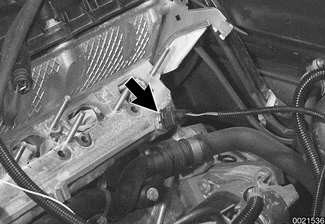

- Remove sensor. Catch any coolant that leaks out with shop rags.
- Installation is reverse of removal.
    - Use a new copper sealing washer when installing new sensor.
    - Replace lost coolant.

Tightening torque

| Component | Tightening torque |
|---|---|
| ECT sensor to cylinder head | 13 Nm (10 ft-lb) |

## Intake air temperature (IAT) sensor, replacing

The intake air temperature (IAT) sensor is located at the top center of the intake manifold. The intake air temperature sensor functions to adapt or fine tune the fuel mixture and engine timing based on varying intake air temperatures.

- Remove housing for microfilter for interior ventilation.
    - Remove upper cover and microfilter.
    - Open wiring harness loom (A) and remove wires.
    - Unfasten screws (B) and remove lower microfilter housing.

- Remove fuel rail cover by prying off plastic covers (arrows) and removing nuts.

- Remove electrical harness connector (arrow) from IAT sensor.

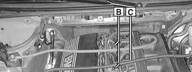

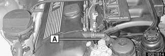

> **CAUTION!**
> - Be sure the ignition is OFF.

- Depress locking clip on side of temperature sensor and pull straight out of intake manifold.
- Installation is reverse of removal.
    - Use a new sealing O-ring at base of sensor and lubricate with assembly lubricant for ease of installation.

## Throttle assembly, removing and installing

Some throttle assembly faults will reset the engine control module (ECM) adaptation values. BMW's diagnostic tool (DIS or MoDiC) or aftermarket equivalent tool is necessary to reset ECM adaptations after throttle assembly replacement.

> **CAUTION!**
> - After replacement of the throttle valve assembly, and/or on MS 43.0 systems the pedal position sensor, an adaption procedure must be performed using the factory scan tool or equivalent. The vehicle will not start unless this adaption procedure is carried out.

- Disconnect battery negative (-) cable in luggage compartment.

> **CAUTION!**
> - Prior to disconnecting the battery, read the battery disconnection cautions given at the front of this manual on page viii.

- Remove complete air filter housing:
    - Disconnect vacuum line at intake boot (A).
    - Disconnect electrical harness connector on mass air flow sensor (B).
    - Release mass air flow sensor clips (C).
    - Remove filter housing mounting screws (D).
    - Disconnect air duct connections (E) and lift complete air filter housing out of engine compartment, pulling it forward away from mass air flow sensor.

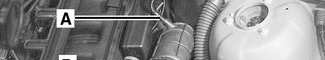

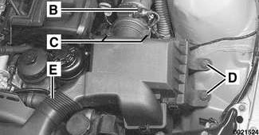

> **Note:**
> - In this step, mass air flow sensor remains attached to rubber air duct.

- Loosen clamps 2 and 8 and remove mass air flow sensor and air ducts.

| No. | Part |
|---|---|
| 1 | Throttle assembly |
| 2 | Hose clamp 77 - 84 mm |
| 3 | Y-duct |
| 4 | Air duct |
| 5 | Hose clamp 83 - 90 mm |
| 6 | Mass air flow sensor |
| 7 | Idle control valve |
| 8 | Hose clamp 28 - 33 mm |
| 9 | Hose clamp 77 - 84 mm |

- On MS 42.0 vehicles: Pull throttle cable upwards out of rubber retainer (A) and unhook ball end of cable (B) from throttle actuator.

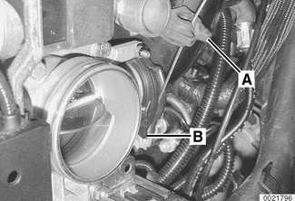

- Remove nuts and bolt (arrows) retaining wiring harness conduit to throttle body.

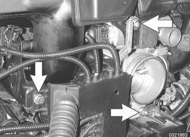

- Working at throttle housing: Turn harness plug (arrow) counterclockwise and remove.

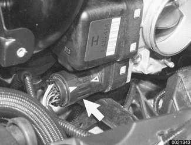

- Working at side of intake manifold, disconnect electrical harness connectors:
    - Idle control valve (A)
    - Intake manifold resonance valve (B)

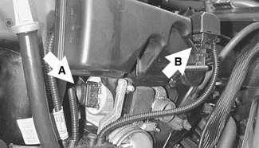

- Disconnect electrical harness connectors (arrows) at oil pressure sender and oil temperature sender at base of oil filter housing.

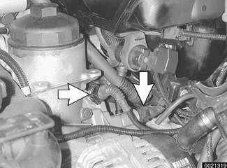

- Remove dipstick guide tube:
    - Disconnect wiring harness brackets from tube (A).
    - Unclip fuel lines from tube (B).
    - Remove lower guide tube mounting bolt (C). Pull out dipstick guide tube.

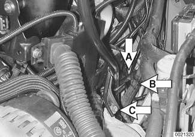

- If necessary, disconnect electrical harness connector at fuel tank venting valve (A). Disconnect hose at quick disconnect fitting (arrow).

- Remove throttle assembly mounting screws at all corners and pull assembly off manifold.
- Installation is reverse of removal.
    - Replace sealing ring between throttle assembly and intake manifold.
    - Reattach throttle assembly harness connector with care. Arrow on fully tightened connector must line up with corresponding arrow on throttle assembly housing.
    - On DME MS 42.0: Reattach throttle cable and adjust as described later.
    - Use BMW scan tool to reset ECM adaptation values.

## Throttle cable, adjusting (MS 42.0)

Models with DME MS 42.0 are equipped with a throttle cable. Cable adjustment should be adjusted any time it is disconnected or replaced. This procedure requires the factory scan tool or an equivalent to read and adjust throttle angle. It is recommended that procedure be done by an authorized BMW dealer service department.

Basic adjustment:

- Ensure that at idle (accelerator pedal in rest position) throttle cable has detectable play at throttle lever attaching point. Play must not exceed maximum allowable.
- Adjust by turning knurled adjustor (arrow) on end of throttle cable sheath at throttle housing.

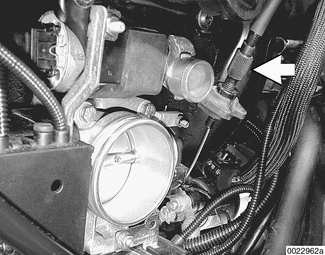

Throttle cable clearance

| Max. play at throttle plate lever | 3 mm (0.125 in.) |
|---|---|

- Full throttle adjustment (manual transmission):
    - With ignition key on press pedal fully to stop. Check throttle angle using scan tool. Adjust pedal stop if necessary.

Throttle angle specifications

| Manual transmission | |
|---|---|
| Full throttle | 80° - 84° |

- Full throttle adjustment (automatic transmission):
    - With ignition key on, press accelerator until pedal touches kickdown stop. Check throttle angle. Press accelerator pedal down beyond kickdown stop pressure point. Check throttle angle. Adjust kickdown stop if necessary, recheck.
    - Press accelerator down fully against stop. Check throttle angle.
    - Use scan tool diagnostic program or road test vehicle to confirm transmission downshifts when kickdown is actuated.

Throttle angle specifications

| Automatic transmission | |
|---|---|
| Kickdown stop contacted | 76° - 80° |
| Kickdown pressure point range | 84° - 88° |
| Full-load downshift | 100% |

## Idle speed control valve, replacing

The idle speed control valve is mounted under the intake manifold adjacent to the dipstick tube bracket. The valve can be removed with the manifold in place, although the job is easier if the manifold is first removed. Intake manifold removal is described in [113 Cylinder Head Removal and Installation].

- Disconnect battery negative (-) cable in trunk.

> **CAUTION!**
> - Prior to disconnecting the battery, read the battery disconnection cautions given at the front of this manual on page viii.

- Remove complete air filter housing:
    - Disconnect vacuum line at intake boot (A).
    - Disconnect electrical harness connector on mass air flow sensor (B).
    - Release mass air flow sensor clips (C).
    - Remove filter housing mounting screws (D).
    - Disconnect air duct connections (E) and lift complete air filter housing out of engine compartment, pulling it forward away from mass air flow sensor.

> **Note:**
> - In this step, mass air flow sensor remains attached to intake duct.

- Loosen clamps 2 and 8 and remove mass air flow sensor and air ducts.

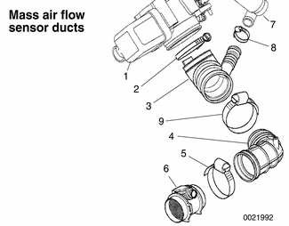

| No. | Part |
|---|---|
| 1 | Throttle assembly |
| 2 | Hose clamp 77 - 84 mm |
| 3 | Y-duct |
| 4 | Air duct |
| 5 | Hose clamp 83 - 90 mm |
| 6 | Mass air flow sensor |
| 7 | Idle control valve |
| 8 | Hose clamp 28 - 33 mm |
| 9 | Hose clamp 77 - 84 mm |

- DME MS 42.0: Pull throttle cable upwards out of rubber retainer (A) but leave attached to throttle actuator (B).

- Working at side of intake manifold, disconnect electrical harness connectors:
    - Idle control valve (A)
    - Intake manifold resonance valve (B)

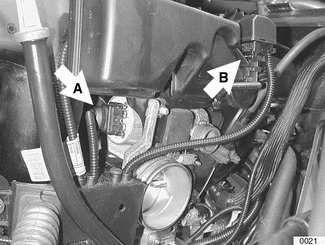

- Disconnect bypass hose from idle control valve.
- Remove idle control valve:
    - Remove idle control valve bracket mounting fasteners.
    - Slide control valve with bracket out from between intake manifold and throttle assembly.
    - Pull control valve from rubber retainer.
- Installation is reverse of removal.
    - Use new gaskets and O-ring seals when installing. Use assembly lubricant to facilitate reassembly. Install idle control valve rubber seal in intake manifold first, then insert control valve.
    - Similarly, install mass air flow sensor into intake duct, then install to throttle assembly.

## Engine control module (ECM), removing and installing

> **Note:**
> - Replacement ECMs must be coded with application information (i.e. engine code, transmission type, etc.) prior to installation. Consult an authorized BMW dealer before replacing the ECM. Alternatively, coded ECMs may be available at an additional cost.

- Disconnect negative (-) battery cable. Wait at least three minutes.

> **CAUTION!**
> - Prior to disconnecting the battery, read the battery disconnection cautions given at the front of this manual on page viii.

- Remove E-box cover at left rear of engine compartment. Cover is retained with four captive screws.
- ECM (arrow) is located in right rear of E-box, as identified with five electrical harness connectors.

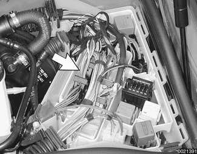

- Disconnect ECM harness connectors by releasing lock on each plug and pivoting lever. Pull all five connectors up and off ECM.

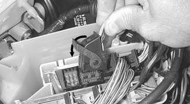

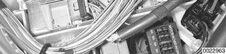

- Remove ECM from retaining brackets and pull from its holder.
- Installation is reverse of removal.
