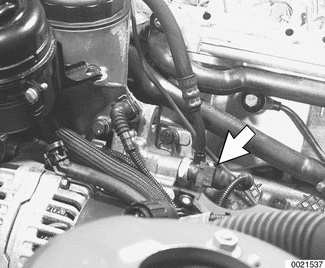
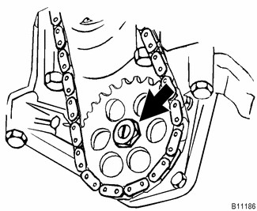
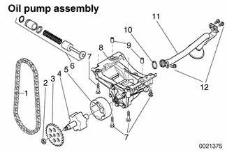
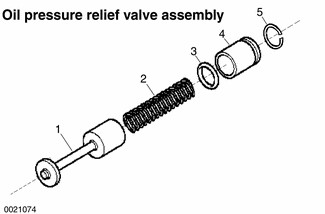

# Component Replacement

> Source: BMW 3 Series (E46) Repair Manual, section 119-3, Lubrication System chapter (PDF pages 293–296 of 1252).

## Oil pressure warning switch

The pressure warning switch is located under the intake manifold, in the rear of the oil filter housing.

> **Note:**
> - Switch removal may require intake manifold removal.

Tightening torque

| Component | Tightening torque |
|---|---|
| Oil pressure switch to oil filter housing | 27 Nm (20 ft-lb) |

## Oil level warning switch

The oil level warning switch is located at the bottom of the engine oil pan.

> **Note:**
> - Anytime the oil level warning switch is removed, be sure to replace the sealing O-ring between switch and oil pan.

## Oil pump, removing and installing

> **Note:**
> - Oil pump removal requires lowering the front suspension subframe to remove the oil pan.

- Drain oil as described in [020 Maintenance].
- Remove oil pan as described earlier.
- Remove oil pump sprocket mounting nut (left-hand thread) (arrow). Lift sprocket off together with drive chain.

- Remove mounting bolts from oil pump (7) and oil pump pickup tube (12). Withdraw pump.

| No. | Part |
|---|---|
| 1 | Drive chain |
| 2 | Nut M10x1 left-hand thread - tighten to 25 Nm (18 ft-lb) |
| 3 | Oil pump sprocket |
| 4 | Inner rotor |
| 5 | Outer rotor |
| 6 | Oil pressure relief valve assembly |
| 7 | Bolt M8 - tighten to 22 Nm (16 ft-lb) |
| 8 | Oil pump housing |
| 9 | Locating dowels |
| 10 | Sealing O-ring |
| 11 | Oil pick-up pipe |
| 12 | Bolt M6 - tighten to 10 Nm (89 in-lb) |

- On engines with integrated oil pump and oil scraper: Remove oil pump with scraper.
- On engines with separate oil pump and scraper:
    - First remove mounting bolts and withdraw oil pump intake pipe.
    - Remove oil pump mounting bolts.
    - Remove oil pump assembly.

> **Note:**
> - Note any spacers between pump and engine block.
> - Note positions of locating dowels.

- Remove cover from oil pump and check for wear or scoring. Spin oil pump shaft and check that gears turn smoothly. Replace pump if gears spin with difficulty or any wear is present.
- Installation is reverse of removal, noting the following:
    - Align sprocket splines to oil pump shaft splines before tightening sprocket nut.

Tightening torques

| Component | Tightening torque |
|---|---|
| Oil drain plug to oil pan (M12) | 25 Nm (18 ft-lb) |
| Oil pan to engine block, M6, 8.8 grade | 10 Nm (89 in-lb) |
| M6, 10.9 grade | 12 Nm (106 in-lb) |
| M8, 8.8 grade | 22 Nm (16 ft-lb) |
| Oil pump to engine block (M8) | 22 Nm (16 ft-lb) |
| Oil pump sprocket to oil pump shaft, M10x1 left-hand thread | 25 Nm (18 ft-lb) |
| Transmission bellhousing to oil pan, M8 Allen | 24 Nm (17 ft-lb) |
| M8 Torx | 21 Nm (15 ft-lb) |

## Oil pump pressure relief valve

The oil pump pressure relief valve is held in the side of the oil pump with a circlip.

| No. | Part |
|---|---|
| 1 | Control plunger |
| 2 | Spring |
| 3 | Sealing O-ring |
| 4 | Sleeve |
| 5 | Circlip |
