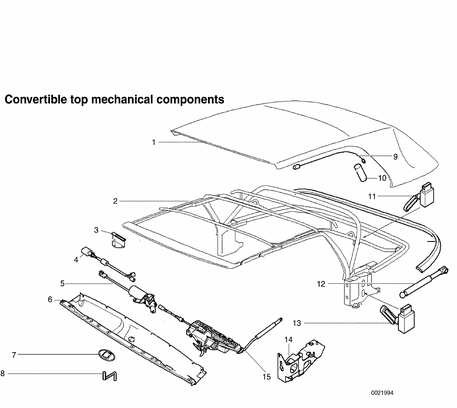
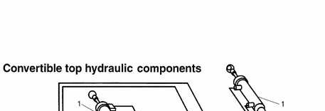
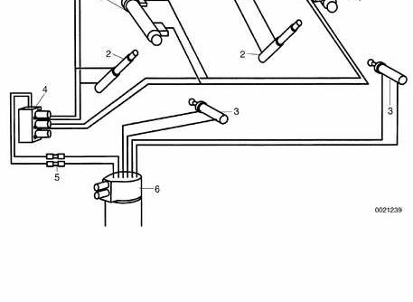
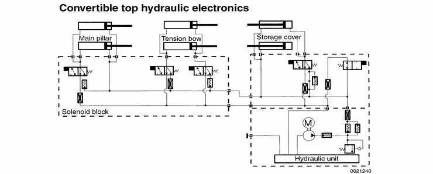

# Convertible Top Components

> Source: Bentley *BMW 3 Series (E46) 1999–2005 (M3) Repair Manual*, section 541-2 (PDF pages 931–938 of 1252).

## Mechanical top components

The metal folding frame of the top is bolted to the sides of the car behind the door pillars (B-pillars).

The three layer soft top consists of:

- Fabric outer layer
- Middle fleece liner
- Inner liner

Refer to the accompanying illustration for mechanical component locations.

**Convertible top mechanical components**

1. Folding top
2. Folding top frame
3. Base plate
4. Windshield frame lock microswitch
5. Windshield frame lock drive motor
6. Windshield frame cover
7. Emergency mechanism cover
8. Emergency operation crank
9. Tension rope Insulation
10. Tension bow
11. Hall sensor
12. Gas pressurized spring
13. Main pillar Hall sensor
14. Console
15. Windshield latch (left side)

## Hydraulic system repairs

> **CAUTION!**
> - When working on hydraulic system, system must be at zero pressure.
> - Disconnect supply and return lines with convertible top stowed and in untensioned state.
> - Once hydraulic system has been opened, a function test must be carried out after work has been completed.
> - Once hydraulic lines have been disconnected from hydraulic components, top must not be moved. Fluid will leak from separated coupling.
> - Avoid scratching hydraulic piston rods. Even paint mist and welding spots are harmful.
> - When working around hydraulic cylinders, cover with a protective cloth.

Working in the trunk at the convertible top hydraulic unit, disconnect the supply and return lines and connect them to each other (short circuit). The system is thus closed and the couplings are protected against damage. The hydraulic system cannot build up high pressure and convertible top can be moved manually.

Hydraulic system components and electronics are shown in the accompanying illustrations.

Terms and definitions used in diagnosing and repairing the convertible top hydraulic system are listed in [Table a. Definition of hydraulic system terms]. Basic repair procedures for hydraulic system repair are listed in [Table b. Convertible top hydraulic system repair procedures].

**Convertible top hydraulic components**

1. Tension bow (rear of top) hydraulic cylinders:
    - Operate on top frame linkage to raise and lower bow
    - Located on two sides of tension bow, at sides of rear window
    - Angle Hall sensor on left tension bow linkage detects bow position
    - Hydraulic lines for right tension bow cylinder routed under top fabric along tension bow
2. Main pillar hydraulic cylinders:
    - Actuate soft top frame
    - Located on two sides of top frame linkage
    - Angle hall sensor detects position of main top linkage
    - Hydraulic lines for right main pillar cylinder routed under top fabric along tension bow
3. Top storage compartment cover hydraulic cylinders:
    - Open and close storage compartment cover
    - Located in trunk
    - Left cylinder equipped with Hall sensor to detect fully opened position of cover
4. Solenoid valve block on left side of top frame:
    - Solenoid V1 controls operation of main pillar hydraulic cylinder
    - Solenoid V2 controls tension bow cylinders for raising top
    - Solenoid V3 controls tension bow cylinders for lowering top
5. Quick disconnect in trunk
6. Hydraulic pump unit:
    - In left side of trunk behind trim
    - Mounted on rubber bushings and covered by sound insulation
    - Unit consists of:
        - Hydraulic motor and pump, Storage cover solenoid valve, Drain solenoid valve, Hydraulic fluid reservoir, Hydraulic fluid temperature sensor
    - Operates at pressures of up to 200 bar (2900 lb/in²).

**Convertible top hydraulic electronics**

Table a. Definition of hydraulic system terms

| Term | Action | Notes |
|---|---|---|
| Hydraulic system at zero pressure | Turn ignition to 0 position. Wait 15 seconds. | Hydraulic system has no or very low pressure. |
| Untensioned state | Turn ignition to 0 position. Wait 15 seconds. | Hydraulic system has no or very low pressure. |
| Mechanical (emergency) actuation | Open or close top by hand. | See [Emergency operation] |
| Closed system | All hydraulic lines connected. | Even short-circuiting of lines is possible. |
| Function test | Open and close top several times (min. 3 times). Check hydraulic unit fluid level and top up if necessary. | Refer to Operating Instructions. |
| Short circuit | Unfasten quick release coupling. Connect supply and return lines to each other. | Hydraulic system cannot build up pressure. Convertible top can be moved. |

Table layout: "Hydraulic system at zero pressure" and "Untensioned state" occupy separate Term rows with merged Action and Notes cells in the source; the Action/Notes values are repeated here for each term.

Table b. Convertible top hydraulic system repair procedures

| Operation | Procedures |
|---|---|
| Mechanical (manual) operation of top | - Ignition must be turned off - Hydraulic lines must be disconnected. (Reconnect when finished) - After repeated actuation, system fluid is pumped into supply tank of hydraulic unit. If hydraulic components are replaced, there will be too much fluid in system. |
| Fluid level check | Stow convertible top and close storage compartment lid. |
| Fluid topping up or draining | Follow directions in [Hydraulic fluid level, checking or filling], earlier in this group. |
