# Cooling System Service

> Source: BMW 3 Series (E46) Repair Manual, section 170-3, Radiator and Cooling System chapter (PDF pages 371–386 of 1252).

## Coolant, draining and filling

> **WARNING!**
> - Allow the cooling system to cool before opening or draining the cooling system.

- Raise front of car and support safely.

> **CAUTION!**
> - Make sure the car is stable and well supported at all times. Use a professional automotive lift or jack stands designed for the purpose. A floor jack is not adequate support.

- Remove splash shield from under engine.
- Loosen radiator bleed screw at top radiator fitting (arrow).

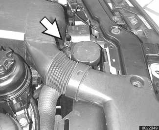

- Remove cap from radiator expansion tank. Set temperature controls to full warm.
- Place 3-gallon pail underneath radiator.
- Remove drain plug (arrow) on bottom of radiator.

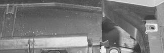

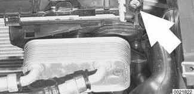

> **WARNING!**
> - Coolant is poisonous. It is especially lethal to pets. Clean up spills immediately and rinse the area with water.

- Place empty 3-gallon pail underneath exhaust side of engine block. Loosen and remove engine block coolant drain plug (arrow).

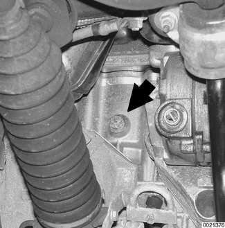

> **Note:**
> - The block drain plug is located on the exhaust side of the engine block at cylinder 2.

- Reinstall radiator and engine block drain plugs using new sealing washers.
- Before refilling radiator:
    - Switch ignition to ON.
    - Set temperature controls to full warm.
    - Set blower control to low.
- Using a coolant mixture of 50% antifreeze and 50% distilled water, fill expansion tank slowly. Continue until coolant emerges from bleed screw. Cooling system capacity is listed in [Table c].

> **Note:**
> - Be sure radiator bleed screw is loose when filling cooling system.
> - Tap water may cause corrosion of radiator, engine and coolant hoses.
> - Coolant can often be reused provided it is clean and less than two years old. Do not reuse coolant when replacing damaged engine parts. Contaminated coolant may damage the engine or cooling system.

Table c. Cooling system capacity

| Engine | Capacity |
|---|---|
| M52 TU/M54 | 8.4 liters (8.8 qt.) |

Tightening torques

| Component | Tightening torque |
|---|---|
| Engine block drain plug to block | 25 Nm (18 ft-lb) |
| Radiator drain plug to radiator | 2 - 3 Nm (18 - 27 in-lb) |

## Cooling system, bleeding

Air may become trapped in the system during cooling system service. Trapped air can prevent proper coolant circulation. Whenever the coolant is drained and filled, the system should be bled of trapped air.

- Loosen bleed screw (arrow) on radiator expansion tank.

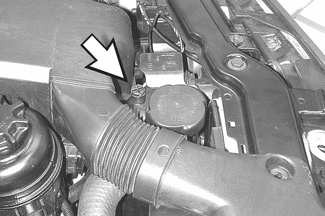

- Set temperature controls in passenger compartment to full warm, set blower to low setting and turn ignition to ON position (do not start engine).
- Slowly add coolant until it spills from bleed screw. When coolant spilling from bleed screws is free of air bubbles, tighten screw.
- Run engine until it reaches operating temperature.
- After engine has cooled, recheck coolant level.
- Top up so that coolant level indicator is at MAX.

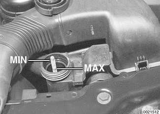

> **CAUTION!**
> - Always use genuine BMW coolant or its equivalent to avoid the formation of harmful, clogging deposits in the cooling system. Use of other antifreeze solutions may be harmful to the cooling system.

Tightening torque

| Component | Tightening torque |
|---|---|
| Radiator bleed screw | 2.5 Nm (22 in-lb) |

## Viscous clutch cooling fan, replacing (models with automatic transmission)

To gain access to viscous clutch fan or electric fan at front of the engine:

- Remove expansion rivets (arrows) and remove intake duct.

- Working at top of fan shroud, remove screw and expansion rivet (arrows) holding fan shroud to radiator. Unclip or disconnect electrical connector(s) from right side of shroud.

> **Note:**
> - Shroud is detached from radiator at this point but can only be removed later when fan and clutch assembly is removed.

- Using 32 mm wrench (BMW special tool 11 5 040) on fan clutch nut (arrow), turn wrench quickly in a clockwise direction (working from front of car) to loosen. Spin fan off coolant pump.

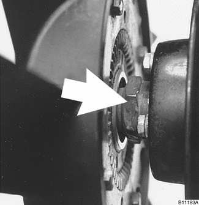

> **Note:**
> - The radiator cooling fan nut (32 mm wrench) has left-hand threads.
> - If fan nut is difficult to loosen, use BMW special tool 11 5 030 to counterhold coolant pump pulley.

- Lift fan and shroud together out of engine compartment.
- To replace fan clutch, remove fan mounting bolts and separate viscous clutch from fan.
- Installation is reverse of removal.

Tightening torques

| Component | Tightening torque |
|---|---|
| Clutch nut to coolant pump (left-hand threads), without BMW tool 11 5 040 | 40 Nm (29 ft-lb) |
| with BMW tool 11 5 040 | 30 Nm (22 ft-lb) |
| Fan to viscous clutch | 10 Nm (89 in-lb) |

## Electric cooling fan, replacing (models with manual transmission)

On models with manual transmission, the primary cooling fan is electrically operated and is mounted on the engine side of the radiator.

- Remove air intake duct as described above.
- Working at top of fan shroud, remove screw and expansion rivet (arrows) holding fan shroud to radiator. Unclip or disconnect electrical connector(s) from right side of shroud.

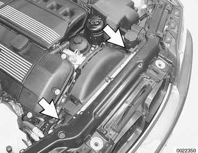

- Lift fan assembly straight up and off radiator. If necessary, push center top area of fan shroud toward engine to unhook shroud from radiator crossmember.
- Fan can be separated from shroud on bench.

> **CAUTION!**
> - Do not carry fan by the blades; it may disturb the balance.

- Installation is reverse of removal.

## Electric cooling fan, replacing (models with automatic transmission)

The electric cooling fan on cars with automatic transmission is mounted behind the front bumper, in front of the A/C condenser.

- Remove air intake duct as described above.
- Remove front bumper. See [510 Exterior Trim, Bumpers].
- Disconnect fan electrical connector (arrow) on right side of radiator shroud
- Pull out plastic expansion rivets (arrows) and remove cover from front of fan.

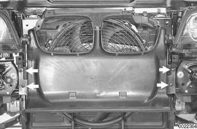

- Remove fan mounting nuts (arrows) and lift out fan.

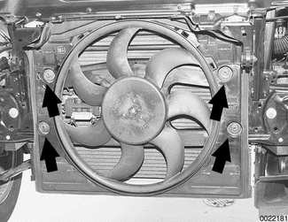

- Installation is reverse of removal. Install front bumper. See [510 Exterior Trim, Bumpers].

## Thermostat, replacing

The electrically-heated thermostat is an integral part of the thermostat housing. The operation of the thermostat is monitored by the DME control module. If a faulty thermostat is suspected, the DME control module should be interrogated for stored fault codes using an appropriate scan tool.

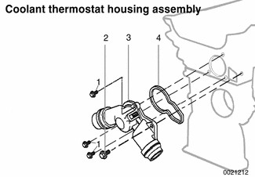

| No. | Part |
|---|---|
| 1 | Bolt M6 |
| 2 | Bolt M8 |
| 3 | Housing with heated thermostat |
| 4 | Gasket |

- Drain radiator and engine block as described above under [Coolant, draining and filling].

> **WARNING!**
> - Allow cooling system to cool before opening or draining the system.

- Remove air intake duct, cooling fan and fan shroud as described earlier.
- Disconnect electrical harness connector from thermostat housing.
- Lever out retaining clips (arrows) and pull hose fittings off housing.

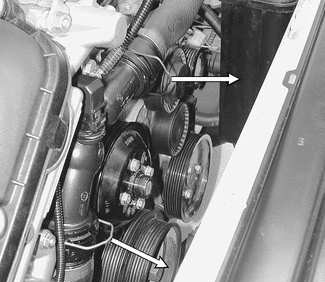

- Unbolt and remove thermostat housing from front of engine. Loosen nut at top of engine lifting eye to facilitate removal.
- Installation is reverse of removal, noting the following:
    - Keep sealing faces free of oil.
    - Use new sealing gasket.
    - Fill system with coolant as described under [Coolant, draining and filling]

Tightening torques

| Component | Tightening torque |
|---|---|
| Engine block drain plug to block | 25 Nm (18 ft-lb) |
| Radiator drain plug to radiator | 2 - 3 Nm (18 - 27 in-lb) |

## Coolant pump, replacing

The engine coolant pump is mounted in the front of the engine in the timing chain cover.

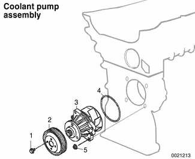

| No. | Part |
|---|---|
| 1 | Bolt M6, tighten to 10 Nm (89 in-lb) |
| 2 | Drive pulley |
| 3 | Coolant pump |
| 4 | O-ring seal |
| 5 | Nut M6, tighten to 10 Nm (89 in-lb) |

- Drain cooling system as described earlier.

> **WARNING!**
> - Allow cooling system to cool before opening or draining system.

- Remove air intake duct, cooling fan and fan shroud as described earlier.
- Remove engine drive belt: Lever tensioner hex (large arrow) in clockwise direction (facing engine) and slip belt off coolant pump pulley.

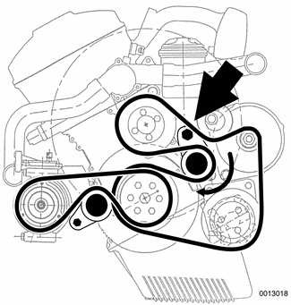

> **Note:**
> - Mark direction of drive belt rotation if reusing belt.

- Remove coolant pump pulley bolts and remove pulley from pump.
- Remove pump mounting nuts (qty. 4).

> **Note:**
> - The coolant pump is mounted on studs and retained by nuts.

- Insert two M6 screws (arrows) in tapped bores and tighten uniformly until pump is free from timing chain cover. (Thermostat and hoses have been removed for visual access.)

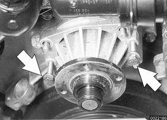

- Installation is reverse of removal, noting the following:
    - Be sure to replace sealing O-ring and gaskets.
    - Coat O-ring with lubricant during installation.

Tightening torques

| Component | Tightening torque |
|---|---|
| Coolant pump to timing chain cover | 10 Nm (89 in-lb) |
| Coolant pump pulley to coolant pump | 10 Nm (89 in-lb) |
| Engine block drain plug to block | 25 Nm (18 ft-lb) |
| Radiator drain plug to radiator | 2-3 Nm (18-27 in-lb) |

## Radiator, removing and installing

- Raise front of car and support safely.

> **CAUTION!**
> - Make sure the car is stable and well supported at all times. Use a professional automotive lift or jack stands designed for the purpose. A floor jack is not adequate support.

- Remove splash shield from under engine.
- Drain radiator and engine block as described earlier.

> **WARNING!**
> - Allow cooling system to cool before opening or draining system.

- Remove complete air filter housing.
- Remove air intake duct, cooling fan and fan shroud as described earlier.
- Working on left side of radiator, lever out hose retaining clips and disconnect coolant hose fittings from radiator (A) and radiator expansion tank (B).

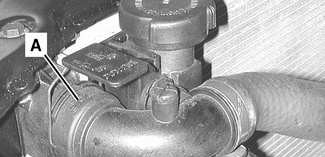

- Working on right side of radiator, release hose retaining clips (A) and disconnect lower coolant hose fitting from radiator (B).

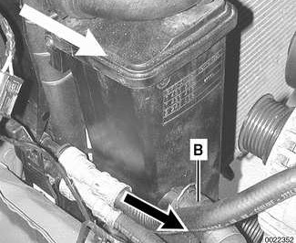

- Working underneath radiator, disconnect harness connector from coolant level sensor.

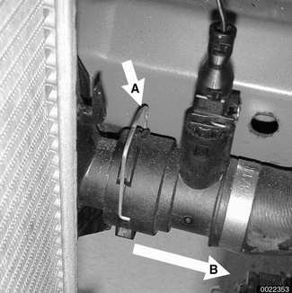

- Where applicable, disconnect automatic transmission fluid (ATF) cooler lines from ATF cooler at quick disconnect unions (arrows) as follows:
    - Push hose toward oil cooler.
    - Press black locking ring into hose fitting while pulling hose off cooler.

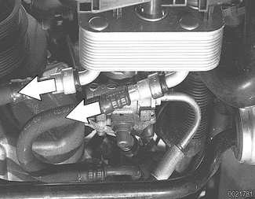

> **CAUTION!**
> - Be sure to have a drain pan ready to catch spilled ATF.

> **Note:**
> - Alternatively, detach ATF cooler from radiator by pulling up on quick release clips and pulling cooler from radiator tank.

- Remove plastic bolts at top of radiator (arrows). Pull radiator up and out of car.

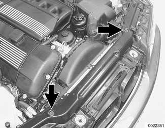

- Installation is reverse of removal, noting the following:
    - Do not coat sealing O-rings with anti-seize paste.
    - Fill radiator and cooling system as described under [Coolant, draining and filling]
    - Check ATF level and, if necessary, top up. See [240 Automatic Transmission].

Tightening torques

| Component | Tightening torque |
|---|---|
| Engine block drain plug to block | 25 Nm (18 ft-lb) |
| Radiator drain plug to radiator | 2 - 3 Nm (18 - 27 in-lb) |

## Coolant expansion tank, removing and installing

- Raise front of car and support safely.

> **CAUTION!**
> - Make sure the car is stable and well supported at all times. Use a professional automotive lift or jack stands designed for the purpose. A floor jack is not adequate support.

- Remove splash shield from under engine.
- Drain radiator and engine block as described earlier.

> **WARNING!**
> - Allow cooling system to cool before opening or draining system.

- Remove complete air intake filter housing.
- Working at front of engine compartment, remove expansion rivets (arrows) retaining air intake duct to radiator support and remove intake duct.

- Release hose retaining clips and disconnect coolant hose fittings (A and B) from expansion tank.

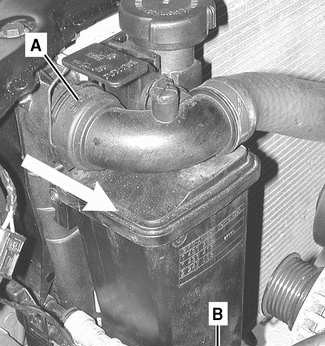

- Working underneath radiator, disconnect harness connector from coolant level sensor.

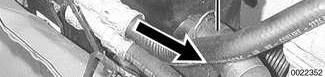

- Remove coolant level sensor (9) by twisting counterclockwise and pulling out of bottom of tank.

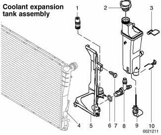

| No. | Part |
|---|---|
| 1 | Thermostat (ATF heat exchanger) |
| 2 | Expansion tank cap |
| 3 | Label |
| 4 | Radiator |
| 5 | Mounting bracket |
| 6 | Sealing O-ring |
| 7 | Self-tapping screw |
| 8 | Connector (ATF heat exchanger) |
| 9 | Coolant level sensor |
| 10 | Locking clip |

- Pull out expansion tank by detaching from radiator at top. Then pull up from mounting bracket at bottom.
- Installation is reverse of removal.
    - Do not coat O-rings with anti-seize paste.
    - Fill radiator and cooling system as described under [Coolant, draining and filling]

Tightening torques

| Component | Tightening torque |
|---|---|
| Engine block drain plug to block | 25 Nm (18 ft-lb) |
| Radiator drain plug to radiator | 2 - 3 Nm (18 - 27 in-lb) |
