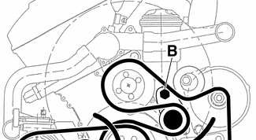
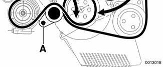
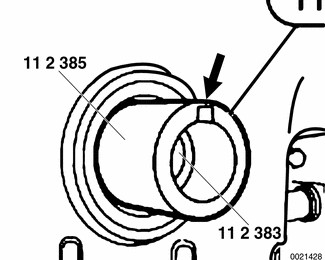
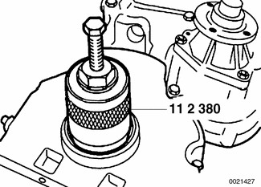
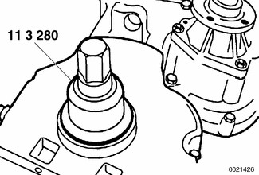
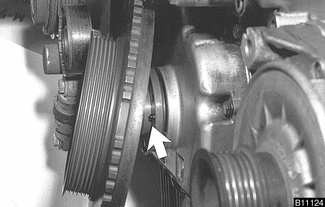

# Crankshaft Front Oil Seal

> Source: BMW 3 Series (E46) Repair Manual, section 117-2, Camshaft Timing Chain chapter (PDF pages 221–224 of 1252).

The crankshaft front seal is located in the lower timing cover on the front of the engine, behind the vibration damper.

> **Note:**
> - Cars built up to January 2000 are fitted with a 2-piece vibration damper and hub assembly. Cars built from January 2000 use an integral vibration damper and hub assembly. If the early vibration damper needs to be replaced, only the single piece with integral hub is available from BMW.

- Disconnect negative (-) cable from battery.

> **CAUTION!**
> - Disconnecting the battery may erase fault code(s) stored in control module memory. Check for fault codes using special BMW diagnostic equipment.
> - Prior to disconnecting the battery, read the battery disconnection cautions given at the front of this manual on page viii.

- Remove drive belts:
    - Use long-handled wrench to turn A/C belt tensioner hex (A) clockwise (against spring tension). Remove A/C belt.

    - Similarly, turn main engine drive belt tensioner hex (B) clockwise and remove belt.

- Secure crankshaft hub using special holding tools:
    - Up to 1/2000 production: use special tools 11 2 150 and 11 2 410.
    - From 01/2000 production: use special tools 11 8 190 and 11 8 200.

> **CAUTION!**
> - Do not use BMW special tool 11 2 300 to hold crankshaft stationary to loosen or tighten crankshaft hub center bolt. Use only the special tools specified, or equivalent hub holding tool.

> **Note:**
> - The crankshaft hub center bolt is tightened to a torque of 410 Nm (300 ft-lb).

- On cars built up to 1/2000 (2-piece vibration damper assembly), remove vibration damper mounting bolts and remove vibration damper and pulley from hub.
- Remove crankshaft hub (up to 1/2000 production) or vibration damper (1/2000 and later production).

> **Note:**
> - If necessary, use BMW special tool 11 8 219 or equivalent puller to remove hub from crankshaft.

- Place special tool 11 2 383 on end of crankshaft to cover threaded hole, and fit special tool 11 2 385, aligning groove in 11 2 385 with keyway on crankshaft (arrow).

- Put special tool 11 2 380 over tools installed on crankshaft, and screw in until it makes firm contact with the seal. Tighten screw in end of 11 2 380 to draw out seal.

- To install new seal, coat with oil, and use special tool 11 3 280 and crankshaft center bolt to draw seal in flush with timing case cover.

- Install crankshaft hub (up to 1/2000) or vibration damper (from 1/2000) to crankshaft. Install new crankshaft center bolt finger tight.
- Torque crankshaft hub center bolt, using special tools 11 2 150/11 2 410 (up to 1/2000) or 11 8 190/11 8 200 (from 1/2000).

Tightening torque

| Component | Tightening torque |
|---|---|
| Vibration damper hub to crankshaft | 410 Nm (302 ft-lb) |

> **CAUTION!**
> - Do not use BMW special tool 11 2 300 to hold crankshaft stationary to loosen or tighten crankshaft hub center bolt. Use only the special tools specified, or equivalent hub holding tool.

- Install vibration damper mounting bolts, where applicable. Note hub locating dowel (arrow).

Tightening torque

| Component | Tightening torque |
|---|---|
| Vibration damper to crankshaft hub (M8) | 22 Nm (16 ft-lb) |
