# Cylinder Head Installation

> Source: BMW 3 Series (E46) Repair Manual, section 113-3, Cylinder Head Removal and Installation chapter (PDF pages 177–197 of 1252).

Clean cylinder head and gasket surfaces of cylinder block and all timing chain covers. Remove foreign matter and liquid from bolt holes.

> **CAUTION!**
> - Do not use a metal scraper or wire brush to clean the aluminum cylinder head or pistons. If necessary, use a hard wooden or plastic scraper. Also available are abrasive discs to be used in conjunction with an electric drill. Be sure to use the correct disc for the type of metal being cleaned.

- Evaluate cylinder head as shown in [116 Cylinder Head and Valvetrain].

> **Note:**
> - If the cylinder head has been machined, a special 0.3 mm (0.011 in.) thicker gasket should be installed. The thicker gasket is available from an authorized BMW dealer.
> - Cylinder head and valve specifications are covered in [116 Cylinder Head and Valvetrain].

Lubricate camshafts, camshaft carriers, bearing caps, hydraulic lifters, friction washers, splined shafts and spline hubs with assembly lubricant before installation.

To assist the technician in cylinder head installation, the procedure has been organized as separate operations. Please be advised that these individual jobs must be accomplished in the order in which they appear:

- Cylinder head assembly, installing
- Camshafts and valvetrain, installing
- VANOS control unit, installing
- Cylinder head cover, manifolds, cooling system, installing

## Cylinder head assembly, installing

- Check that two cylinder head locating aligning sleeves (arrows) are correctly positioned in block and are not damaged.

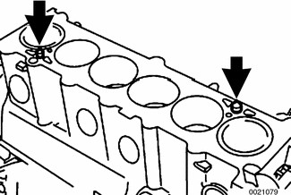

- Apply permanently elastic sealing compound 3 Bond® 1209 to joints with timing belt cover.
- Place new cylinder head gasket on cylinder block.

> **Note:**
> - The word OBEN, printed on the gasket, should face up. The cylinder head gasket will fit correctly in only one orientation.

- Set cylinder head in position, guiding primary chain through cylinder head opening.

> **CAUTION!**
> - Make sure the crankshaft, which had been rotated approximately 30° opposite the direction of engine rotation from TDC, is still in that position before lowering the cylinder head into position. All pistons must be out of TDC position to prevent valve/piston interference when the camshafts are installed.

- Lightly lubricate new cylinder head bolts. Install bolts and washers finger tight. Install cylinder head-to-lower timing chain cover bolts finger tight.

> **Note:**
> - Cylinder head bolts should not be reused. They are stretch-type bolts and must always be replaced whenever loosened.
> - Check that all washers for the head bolts are in place before installing the bolts. Some of the washers may be staked to the cylinder head.

- Tighten cylinder head bolts in correct sequence (1-14).

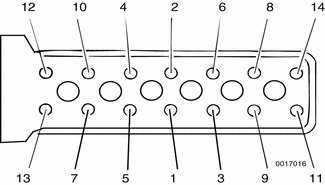

> **CAUTION!**
> - The bolts should be tightened in three stages as listed below. The final stages require the use of a BMW special tool 11 2 110 or a suitable protractor to tighten the bolts to a specified torque angle.

- Secure cylinder head bolts by torquing an additional 90° each for Stage 2 and 3.

Tightening torques

| Component | Tightening torque |
|---|---|
| Cylinder head to engine block (Torx E12 M10 bolts), Stage 1 | 40 Nm (30 ft-lb) |
| Cylinder head to engine block, Stage 2 | +90° |
| Cylinder head to engine block, Stage 3 | +90° |

- Install intake camshaft position sensor (arrow).

- Install exhaust manifolds. See [180 Exhaust System].

- Install lower secondary chain guide. Tighten Torx bolts (arrows) to specifications. The bolt on the intake camshaft side is long and extends into the engine block.

Tightening torque

| Component | Tightening torque |
|---|---|
| Secondary chain guide to cylinder head | 10 Nm (89 in-lb) |

- Install and tighten cylinder head-to-lower timing chain cover bolts (arrows). (Photo shows camshafts in place)

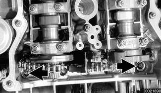

## Camshafts and valvetrain, installing

> **CAUTION!**
> - A minimum waiting time is required for the hydraulic lifters to "bleed down" after installing the camshafts into the cylinder head, but before synchronizing the crankshaft and valve train timing. When the camshafts are removed, the hydraulic lifters can expand. This expansion can cause increased valve lift when the camshafts are bolted down, possibly resulting in piston interference.

- Before installing camshaft carriers, examine bearing points (arrows) on hydraulic lifter bores for signs of wear.

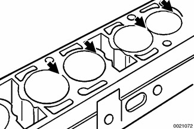

- Install camshaft carriers with hydraulic lifters into cylinder head. Note marks on carriers: (E) for intake side and (A) for exhaust side.

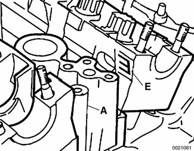

- Center camshaft carrier on pins (arrows) at bearing positions 2 and 7.

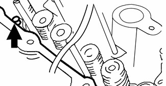

- Lift timing chain and place exhaust camshaft onto exhaust camshaft carrier. Place intake camshaft on intake camshaft carrier.
- Rotate camshafts so that intake and exhaust lobes for cylinder 1 face each other (arrows).

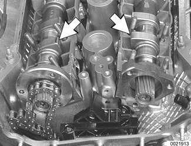

> **CAUTION!**
> - Be sure that crankshaft is still positioned at least 30° back from TDC.

- Place bearing caps on cams, but do not install retaining nuts.
- Fit BMW special tools 11 3 260 (A) and 11 3 270 (B) to cylinder head over intake camshaft and screw long bolts (arrows) into spark plug threads.

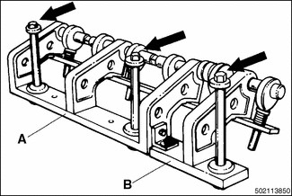

> **CAUTION!**
> - Do not overtighten bolts into spark plug holes.

- Turn eccentric shaft of special tool to pretension bearing caps. Install and torque nuts on intake camshaft bearing caps.

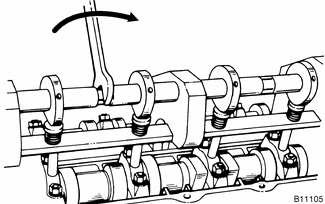

Tightening torque

| Component | Tightening torque |
|---|---|
| Camshaft bearing cap to cylinder head (M7) | 14 Nm (10 ft-lb) |

- Release tension on eccentric shaft and remove BMW special tool 11 3 260/270.
- Repeat procedure for exhaust camshaft.

> **Note:**
> - Before the next step, observe waiting time for lifter bleed down before continuing with camshaft installation.

Crankshaft / valve timing waiting times

| Temperature | Waiting time |
|---|---|
| 68°F (20°C) and higher | 4 minutes |
| 50 - 68°F (10 - 20°C) | 11 minutes |
| 32 - 50°F (0 - 10°C) | 30 minutes |

- Secure camshafts in TDC position using BMW special tools 11 3 240 and 11 3 244.

- If necessary, turn camshaft so that special tools are squarely seated on cylinder head.

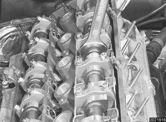

- Lift timing chain and hold under tension.

- While maintaining tension on timing chain, rotate crankshaft from 30° before TDC in direction of rotation up to cylinder 1 TDC position (0\|T on front pulley lined up with pointer on lower timing chain cover).

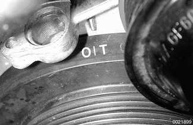

- Secure crankshaft in TDC position with BMW special tool 11 2 300 (arrow).

- Slide impulse wheel on intake camshaft, aligning boss with raised portion on camshaft (arrow).

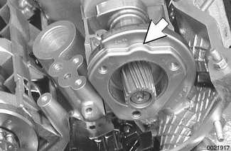

- Fit thrust spacer to intake camshaft and tighten down with threaded locating studs (place longer threaded portion of studs into camshaft).

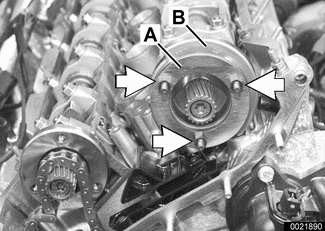

Tightening torque

| Component | Tightening torque |
|---|---|
| Impulse wheel studs to intake camshaft (M7) | 20 Nm (15 ft-lb) |

- Fit top sprocket to primary timing chain and install on exhaust camshaft so that pointer on sprocket (arrow) lines up with cylinder head sealing surface.

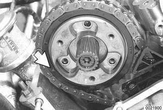

- Insert BMW special tool 11 4 220 into timing chain tensioning piston bore and bring adjustment screw into contact with tensioning rail, but do not pretension timing chain.

> **Note:**
> - BMW special tool 11 4 220 is a dummy primary chain tensioner and simulates the function of the tensioner.

- Recheck that arrow on top primary sprocket is aligned with upper edge of cylinder head. Reposition sprocket if necessary.
- Insert and tighten down threaded locating studs (arrows) in end of exhaust camshaft.

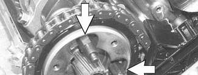

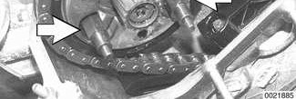

Tightening torques

| Component | Tightening torque |
|---|---|
| Exhaust camshaft locating stud | 20 Nm (15 ft-lb) |

- Install secondary chain tensioner on cylinder head (arrows). Keep tensioner compressed using BMW special tool 11 3 292 or suitable pin.

- Fit exhaust camshaft splined sleeve. Confirm that gap in sleeve splines aligns with corresponding gap in camshaft splines (arrows).

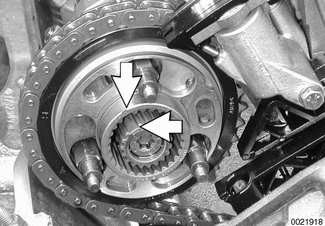

- Slide splined shaft onto exhaust camshaft. Be sure that locating tooth of shaft (arrow) fits into spline gaps of camshaft and splined sleeve.
- Slide splined shaft in further until three small slots on splined sleeve are centered on three threaded holes in primary chain sprocket.

- Place intake and exhaust sprockets in BMW special tool 11 6 180. Position spline gap on intake sprocket (arrow) as shown and place secondary chain on sprockets.

- Remove chain and sprockets from tool and slide sprockets on camshafts. Confirm that gap in intake sprocket splines lines up with corresponding gap in camshaft splines (arrow).

> **CAUTION!**
> - Do not alter position of sprockets with respect to chain when removing from special tool 11 6 180.

- Slide splined shaft onto intake camshaft until approx. 1 mm (0.04 in.) of splines (arrows) are visible. Confirm that locating tooth of shaft fits into spline gaps on camshaft and sprocket.

- Install intake camshaft spring plate so that FRONT mark is visible. Install mounting nuts (arrows) finger tight.

- Insert sprocket mounting bolts (arrows) on exhaust side camshaft assembly.

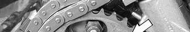

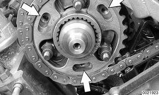

- Initially tighten to approx. 5 Nm (44 in-lb) and then back off by half a turn.
- Fit thrust spacer (A) on exhaust camshaft.

- Install spring plate (A) to exhaust camshaft. Make sure that F mark is visible.

> **Note:**
> - If F mark is no longer visible, install spring plate so that convex side points forward (toward front of car).

- Install exhaust camshaft impulse wheel, aligning pointer (B) with top edge of cylinder head (A). Install mounting nuts (arrows) finger tight.

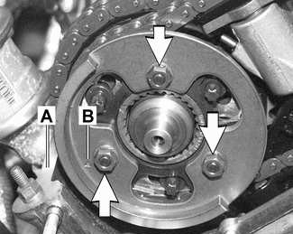

- Pull out exhaust camshaft splined shaft to stop.

- Press down on secondary chain tensioner and remove tensioner lock-down tool.
- Preload primary chain: Tighten adjusting screw on BMW special tool 11 4 220 to specified torque.

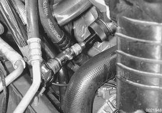

Tightening torque

| Component | Tightening torque |
|---|---|
| Primary chain tensioner preload | 0.7 Nm (6 in-lb) |

- Preload exhaust camshaft spring plate by pressing on impulse wheel while tightening mounting nuts (arrows) finger tight.

- Install BMW special tool 11 6 150 (VANOS setup bracket) to front of cylinder head timing case. Install nuts (arrows) finger tight, then tighten down uniformly until special tool is in full contact with cylinder head.

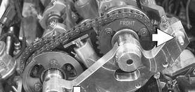

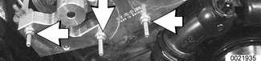

> **CAUTION!**
> - Make sure all gasket material is removed from face of cylinder head. Clean sealing face and keep free of oil. If any foreign material is present on the sealing surface, the camshaft timing will be incorrect.

- Secure camshaft sprockets and impulse wheels:
    - Tighten mounting screws (A) on exhaust camshaft impulse wheel to approx. 5 Nm (44 in-lb).
    - Tighten mounting nuts (B) on exhaust and intake sprocket assemblies to approx. 5 Nm (44 in-lb).
    - Torque down mounting screws (A) and nuts (B) to final specifications.

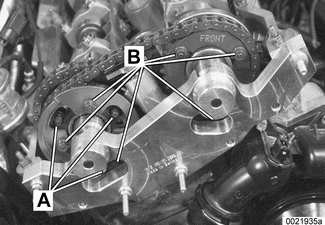

Tightening torques

| Component | Tightening torque |
|---|---|
| Sprocket assembly to camshaft initial torque | 5 Nm (44 in-lb) |
| Sprocket assembly wheel to camshaft, M7 Torx screws (A) | 20 Nm (15 ft-lb) |
| Sprocket assembly wheel to camshaft, M6 mounting nut (B) | 10 Nm (8 ft-lb) |

- Remove flywheel locking tool from transmission bellhousing so that crankshaft is no longer secured.
- Remove camshaft locking tools from cylinder head.
- Turn engine over twice in direction of rotation until cylinder 1 intake and exhaust camshaft lobes (arrows) face each other.

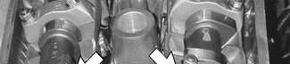

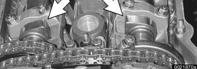

- Secure crankshaft in TDC position with BMW special tool 11 2 300.
- Place BMW special tool 11 3 240 over camshafts and measure clearances.

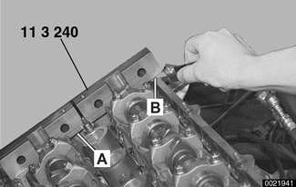

> **Note:**
> - If the exhaust side of the tool (A) is not flush with the head, camshaft timing is incorrect. Reset camshaft timing as described in [117 Camshaft Timing Chains].
> - Due to flexible sprocket design, VANOS unit tolerances and play in the VANOS splines, when the camshaft timing is set correctly, the intake side of special tool 11 3 240 (B) may be up to 1 mm (0.04 in) above the surface of the cylinder head. This is normal. Reassemble engine. Otherwise, reset camshaft timing as described in [117 Camshaft Timing Chains]

- Remove BMW special tool 11 6 150 from front of cylinder head.

## VANOS control unit, installing

- Clean contact edges of cylinder head face and VANOS unit and apply a thin coat of sealing compound 3-Bond® 1209 or equivalent to surfaces.

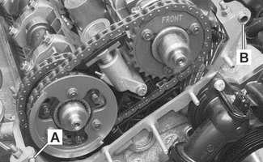

> **CAUTION!**
> - Make sure all gasket material is removed from face of cylinder head. Clean sealing face and keep free of oil. If any foreign material is present on the sealing surface, the camshaft timing will be incorrect.

- Check locating dowel (A) and dowel sleeve (B) at top of cylinder head for damage or incorrect installation.
- Replace steel gasket.
- Install VANOS unit to front of cylinder head.

> **Note:**
> - If Double VANOS control unit is being replaced, be sure to check and adjust camshaft timing as described in [117 Camshaft Timing Chains].

- Reinstall engine support hook.

Tightening torque

| Component | Tightening torque |
|---|---|
| VANOS unit to cylinder head, M6 nut | 10 Nm (89 in-lb) |
| VANOS unit to cylinder head, M7 nut | 14 Nm (10 ft-lb) |

- Reconnect electrical harness connectors to camshaft position sensors and VANOS solenoid valves.
- Insert and tighten down VANOS hydraulic piston set screws (arrows) in splined shafts on intake and exhaust camshafts.

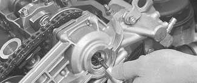

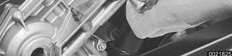

> **CAUTION!**
> - Set screws have left hand thread. Tighten counterclockwise.

Tightening torque

| Component | Tightening torque |
|---|---|
| Hydraulic piston to splined shaft M6 set screw | 10 Nm (89 in-lb) |

- Replace sealing caps inside VANOS unit with BMW special tool 11 6 170, or short flat nosed pliers.

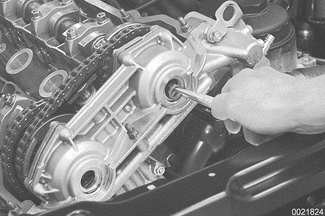

- Insert and secure VANOS sealing plugs (arrows) with new sealing O-rings.

Tightening torque

| Component | Tightening torque |
|---|---|
| Sealing plug to VANOS unit | 50 Nm (37 ft-lb) |

- Install coolant pipe fasteners at base of cylinder head and tighten fasteners (arrows).

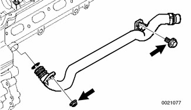

> **Note:**
> - Use new sealing O-ring on coolant pipe.

- Install VANOS oil line banjo bolt with new seals. Attach oil line to VANOS unit.

Tightening torque

| Component | Tightening torque |
|---|---|
| Oil line to VANOS unit (banjo bolt) | 32 Nm (24 ft-lb) |

- Remove BMW special tool 11 4 220 and reinstall chain tensioner cylinder.

Tightening torque

| Component | Tightening torque |
|---|---|
| Primary chain tensioner cylinder to cylinder head | 70 Nm (52 ft-lb) |

- Remove flywheel locking tool from transmission bellhousing. Replace special tool bore sealing plug.
- Remove camshaft locking tools from cylinder head.

## Cylinder head cover, manifolds, cooling system, installing

- Install intake camshaft cover and cylinder head cover.
    - Check for correct seating of half-moon seals (A) in back of cylinder head cover.
    - Use a small amount of 3-Bond® 1209 or equivalent sealant at corners (B) of half-moon cutouts.
    - Seat gasket and seal corners in front of cylinder head at VANOS unit.

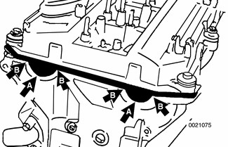

Tightening torque

| Component | Tightening torque |
|---|---|
| Cylinder head cover to cylinder head (M6) | 10 Nm (89 in-lb) |

- Install exhaust manifolds using new gaskets and nuts. Coat manifold studs with copper paste prior to installing nuts.

Tightening torque

| Component | Tightening torque |
|---|---|
| Exhaust manifold to cylinder head (M7) | 20 Nm (15 ft-lb) |

- Install electrical harness connectors for oil pressure sender and coolant temperature sensor before installing intake manifold.
- Intake manifold Installation is reverse of removal.

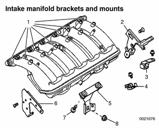

1. Manifold mounting nuts - tighten to 15 Nm (11 ft-lb)
2. Fuel pipe bracket
3. Fuel pipe bracket
4. Vacuum pump bracket
5. Manifold mounting bracket
6. Tank venting valve bracket
7. Mounting bracket to manifold bolt (M6) - tighten to 10 Nm (7 ft-lb)
8. Mounting bracket to cylinder block nut (M10) - tighten to 47 Nm (33 ft-lb)

- Use new fuel injector seals.
- Carefully check intake manifold gasket and replace if necessary.
- Inspect O-ring seal between mass air flow sensor and air filter housing. To facilitate reassembly, coat seal with acid-free grease.

> **CAUTION!**
> - When reattaching throttle assembly harness connector, connector is fully tightened when arrows on connector and plug line up.

Tightening torques

| Component | Tightening torque |
|---|---|
| Intake manifold to cylinder head M7 | 15 Nm (11 ft-lb) |
| Intake manifold to cylinder head M8 | 22 Nm (16 ft-lb) |
| Mounting bracket to cylinder block (M10) | 47 Nm (33 ft-lb) |
| Mounting bracket to intake manifold (M6) | 10 Nm (7 ft-lb) |

- Installation of remaining parts is reverse of removal, noting the following:
    - Refill cooling system as described in [170 Radiator and Cooling System].
    - Change engine oil and filter as described in [020 Maintenance].
    - If necessary, adjust accelerator cable.

- Reconnect battery.

> **CAUTION!**
> - To prevent damaging engine electronic systems, install all ground wires previously removed, including the ground wires for the ignition coils.

Tightening torques

| Component | Tightening torque |
|---|---|
| Coolant drain plug to cylinder block | 25 Nm (18 ft-lb) |
| Radiator cooling fan to coolant pump | 40 Nm (30 ft-lb) |
| Radiator drain screw to radiator | 2.5 Nm (22 in-lb) |
| Spark plug to cylinder head | 25 Nm (18 ft-lb) |
