# Cylinder Head Removal

> Source: BMW 3 Series (E46) Repair Manual, section 113-2, Cylinder Head Removal and Installation chapter (PDF pages 152–176 of 1252).

> **WARNING!**
> - Due to risk of personal injury, be sure the engine is cold before beginning the removal procedure.

Cylinder head removal and installation is a complicated repair procedure. VANOS control unit, timing chain, and camshaft removal and installation all require special tools. Read the entire procedure before beginning the repair.

> **CAUTION!**
> - Cover all painted surfaces before beginning the removal procedure. As an aid to installation, label all components, wires, and hoses before removing them. Do not reuse gaskets, O-rings or seals during reassembly.

To assist the technician in this repair, the procedure has been organized into discrete jobs. Please be advised that these individual jobs must be accomplished in the order in which they appear:

- Intake manifold, removing
- Cylinder head cover, removing
- VANOS control unit, removing
- Camshafts and valvetrain, removing
- Cylinder head assembly, removing

## Intake manifold, removing

- Disconnect negative (-) battery cable in trunk.

> **CAUTION!**
> - Prior to disconnecting the battery, read the battery disconnection cautions given at the front of this manual on page viii.
> - Disconnecting the battery may erase fault code(s) stored in control module memory. Check for fault codes using special BMW diagnostic equipment.

- Remove microfilter for interior ventilation.

- Remove housing for interior ventilation microfilter:
    - Open wiring harness loom cover (A) and remove wires.
    - Unfasten screws (B) and remove lower microfilter housing.

- Remove intake manifold cover:
    - Remove plastic trim covers (arrows).

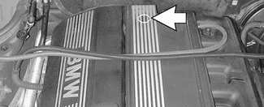

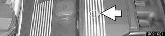

    - Remove cover hold down bolts from intake cover and lift off cover.
- Working above engine, disconnect the following:

    - A Positive engine lead at B+ terminal
    - B Manifold vacuum line
    - C Oxygen sensor connectors (label connectors before disconnecting)
    - D Electrical harness connector for intake air temperature sensor
    - E Positive lead hold-down bracket
    - F Intake manifold resonance valve electrical connector
- Working at left rear of engine compartment:
    - Peel rubber edge seal off top of panel.
    - Separate brake booster vacuum hose at intake jet pump (A). Plug hose ends.
    - Twist plastic panel retainers (arrows) 90° and pull out to remove.
    - Disengage panel from hoses and wiring harnesses and remove from engine compartment.

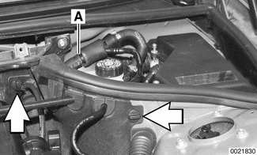

- Disconnect engine vent hose from cylinder head cover by squeezing sides of spring clip (arrows). Disconnect VANOS solenoid electrical harness connector (A).

- Disconnect fuel injector electrical connectors from injectors:
    - Use small screwdriver to pry one corner of wire lock clip on fuel injector 1 connector.
    - Repeat for all injectors.
    - Lift off connector loom and lay aside.

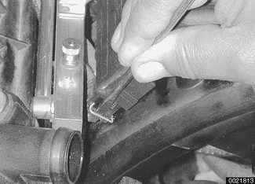

- Remove complete air filter housing:
    - Disconnect vacuum line at intake boot (A).
    - Disconnect electrical harness connector on mass air flow sensor (B).
    - Release mass air flow sensor clips (C).
    - Remove filter housing mounting screws (D).
    - Disconnect air duct connection (E) and lift complete air filter housing out of engine compartment, pulling it forward away from mass air flow sensor.

> **Note:**
> - In this step, mass air flow sensor remains attached to rubber air duct.

- Loosen clamps 2 and 8 and remove mass air flow sensor and air duct.

1. Throttle assembly
2. Hose clamp 77 - 84 mm
3. Y-duct
4. Air duct
5. Hose clamp 83 - 90 mm
6. Mass air flow sensor
7. Idle control valve
8. Hose clamp 28 - 33 mm
9. Hose clamp 77 - 84 mm

- Where applicable: Pull throttle cable upwards out of rubber retainer (A) and unhook ball end of cable (B) from throttle actuator.

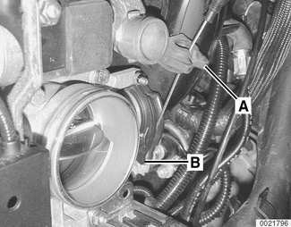

> **Note:**
> - Models with M54 engines do not use a throttle cable.

- Remove nuts and bolt (arrows) retaining wiring harness conduit to throttle body.

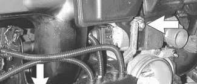

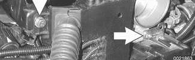

- Working at throttle housing: Turn harness plug (arrow) counterclockwise and remove.

- Disconnect electrical harness connector at idle speed control valve (arrow) directly above throttle housing.

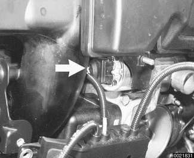

- Working under front corner of intake manifold, disconnect electrical harness connector at fuel tank venting valve (A). Disconnect vent hose at quick disconnect fitting (arrow).

- Remove dipstick guide tube:
    - Disconnect wiring harness brackets from tube (A).
    - Disconnect fuel lines from retaining clips (B).
    - Remove lower dip stick guide tube mounting bolt (C). Pull out guide tube.

- Remove schrader valve cap (arrow). Using a tire chuck, blow fuel back through feed line using a brief burst of compressed air (maximum of 3 bar or 43.5 psi).

> **WARNING!**
> - Fuel in fuel line is under pressure (approx. 3 - 5 bar or 45 - 75 psi) and may be expelled under pressure. Do not smoke or work near heaters or other fire hazards. Keep a fire extinguisher handy. Before disconnecting fuel hoses, wrap a cloth around fuel hoses to absorb any leaking fuel. Catch and dispose of escaped fuel. Plug all open fuel lines.
> - Always unscrew fuel tank cap to release pressure in the tank before working on the tank or lines.

- Raise car and support in a safe manner.

> **WARNING!**
> - Make sure the car is stable and well supported at all times. Use a professional automotive lift or jack stands designed for the purpose. A floor jack is not adequate support.

- Remove protective engine splash guard from beneath engine compartment.

- Working beneath car (on left side under driver seat), remove fuel filter cover and clamp off fuel hose(s) (arrows).

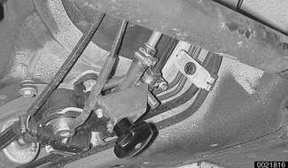

> **Note:**
> - M54 engines equipped with a non-return fuel rail use only a single supply line.

- Disconnect fuel hose(s) from fuel line(s) (arrows) using special fuel line removal tool 16 1 050 or equivalent. Plug open fuel line(s) with BMW special tools 13 5 281/13 5 282.

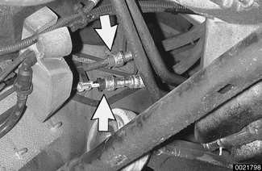

- Working underneath car, remove lower intake manifold support mounting bolt (arrow), located adjacent to left (driver's side) engine mount.

- Remove fuel rail mounting bolts (arrows).
- Carefully pry fuel rail off manifold.

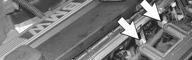

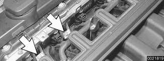

- Separate fuel line support bracket at rear of intake manifold.
- Thread fuel line(s) out of rear of engine compartment while lifting fuel rail out.

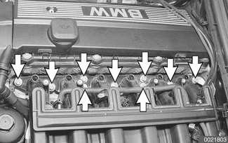

- Remove intake manifold mounting nuts (arrows).

- Lift up manifold enough to disconnect positive cables from starter motor terminal (arrow).
- Remove intake manifold from cylinder head while carefully checking for any remaining electrical connections or hoses.

> **CAUTION!**
> - Stuff clean lint free rags into open intake ports to prevent any foreign matter from falling into the ports.

- Drain engine coolant from engine block:
    - Remove expansion tank cap on radiator.
    - Place 3-gallon pail beneath engine to capture coolant.
    - Remove coolant drain plug located on exhaust side of cylinder 2 of engine block (arrow).
- Drain radiator into a 3-gallon pail by removing plastic drain plug at lower left end of radiator (arrow).

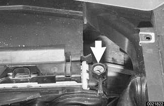

> **WARNING!**
> - Use caution when draining and disposing of engine coolant. Coolant is poisonous and lethal to humans and pets. Pets are attracted to coolant because of its sweet smell and taste. Consult a veterinarian if coolant is ingested by an animal.
> - Dispose of drained coolant according to local, state, and federal laws.

- Remove hoses from thermostat housing by releasing locks (arrows).

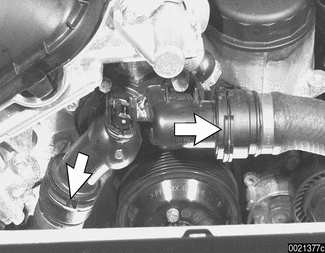

- Disconnect electrical harness at thermostat housing.
- Remove radiator cooling fan and shroud as described in [170 Radiator and Cooling System]

> **CAUTION!**
> - On cars with viscous clutch cooling fan, radiator fan mounting nut (32 mm) has left-hand threads.

- Remove fasteners (arrows) from heater bypass tube and set tube to side leaving heater hose connected.

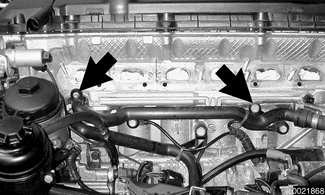

- Unbolt power steering fluid reservoir and pull aside without disconnecting hoses. Tie to fender with cord or stiff wire.
- Remove windshield and headlight washer reservoir:
    - Remove bolt on top of reservoir.
    - Lift tank and disconnect electrical connections to pump and to washer fluid level sensor.
    - Disconnect hoses to windshield washer and headlight washer. Tilt reservoir to prevent fluid from leaking out.
- Remove secondary air pump:
    - Disconnect hose at one-way valve (A).
    - Remove bolts at support bracket on strut tower (arrows).
    - Lift up pump and disconnect electrical harness from bottom of pump. Remove pump.
    - Unbolt and remove pump bracket from strut tower.

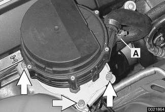

## Cylinder head cover, removing

- Remove cylinder head top cover:
    - Remove plastic trim covers (arrows).
    - Remove cover hold down nuts and lift off cover.

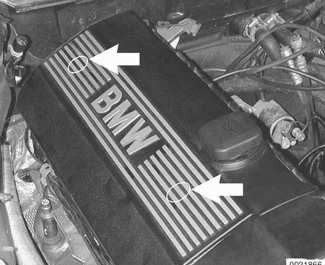

- Remove ignition coils.
    - Disconnect ignition coil harness connectors.
    - Remove coil mounting fasteners.
    - Remove coils.
- Remove ground straps.
- Set coil harness to left side of engine compartment.

- Remove cylinder head cover mounting fasteners and remove cylinder head cover.

> **Note:**
> - The cylinder head cover mounting bolt insulators and gaskets should be reinstalled in their original locations. The three grounds mount to the first, second and fourth central studs. Make note of their arrangement during removal.

- Remove spark plugs.

> **CAUTION!**
> - Stuff clean lint free rags into open intake ports to prevent any foreign matter from falling into the ports.

- Remove oil baffle cover from above intake camshaft.

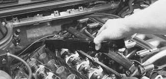

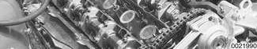

## Double VANOS components (M52 TU, M54 engine)

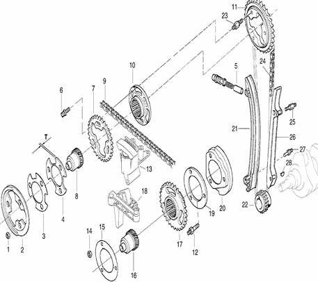

1. Impulse wheel mounting nut
2. Exhaust camshaft impulse wheel
3. Spring plate
4. Thrust spacer (T = 3.5 mm)
5. Splined shaft
6. Torx screw
7. Exhaust secondary sprocket
8. Secondary timing chain
9. Splined sleeve
10. Primary sprocket
11. Threaded locating stud
12. Secondary chain tensioner
13. Secondary chain lower guide
14. Sprocket mounting nut
15. Spring plate
16. Splined shaft
17. Intake camshaft sprocket
18. Locating stud
19. Thrust spacer
20. Intake camshaft impulse wheel
21. Chain tensioner rail
22. Crankshaft sprocket
23. Primary chain tensioner
24. Primary chain
25. Locating stud
26. Guide rail
27. Locating stud
28. Woodruff key

## VANOS control unit, removing

- Disconnect electrical connections at exhaust camshaft position sensor and exhaust camshaft VANOS control valve (arrows).

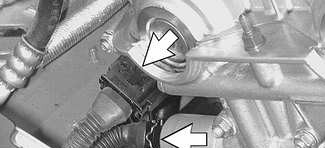

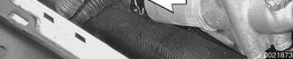

- Remove banjo bolt from VANOS unit oil pressure line. Use banjo bolt to attach BMW special tool 11 3 450 (compressed air fitting) to VANOS control unit.

- Cover oil hole (arrow) in VANOS unit with shop towel to capture oil which will spray when compressed air is applied.

- Connect compressed air line to air fitting. Apply air pressure set to 2 - 8 bar (30 - 110 psi).
- With compressed air line connected, rotate engine in direction of rotation (clockwise) until cylinder 1 intake and exhaust camshaft lobes face each other (arrows) in the top dead center (TDC) position for cylinder 1.

- Rotate engine at least twice, leaving the cylinder 1 intake and exhaust camshaft lobes facing each other, as shown.

> **CAUTION!**
> - Do not rotate engine counterclockwise to reach the top dead center position. Instead, complete another two complete rotations.

- Remove sealing plug from special tool bore on lower left side of engine block near flywheel. Secure crankshaft in TDC position with BMW special tool 11 2 300 (arrow).

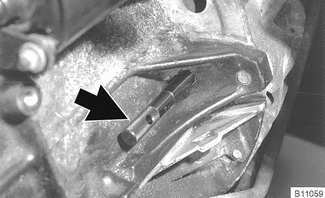

- Unscrew and remove two cylinder head cover studs (arrows) at rear of cylinder head.

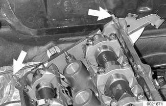

- Secure camshafts in TDC position using BMW special tools 11 3 240 and 11 3 244.

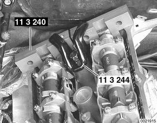

- Disconnect compressed air line, leaving compressed air fitting attached to VANOS unit.

> **CAUTION!**
> - Oil will drain from pressure line. Have a drain container and rags ready. Do not allow oil to run onto drive belts.

- Unscrew sealing plugs (arrows) from VANOS unit.

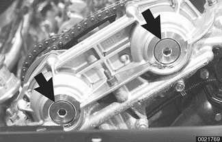

- Oil will drain from plugs (arrows) when removed. Have a container and rags ready. Do not allow oil to run onto drive belts.

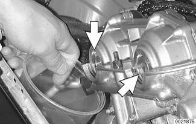

- Pull sealing caps straight out of VANOS unit with BMW special tool 11 6 170, or with short nose pliers.

> **Note:**
> - Additional oil may drain from VANOS unit.

- Remove set screws (left-hand thread) on ends of intake and exhaust camshafts.

> **CAUTION!**
> - Set screws have left hand threads. Remove in clockwise motion.

- Remove VANOS unit:
    - Remove engine support eye fasteners from side of VANOS unit.
    - Remove VANOS mounting nuts (arrows) from cylinder head and pull VANOS unit and metal gasket off.

> **CAUTION!**
> - Do not crank the engine with VANOS unit removed. The splined shaft on the intake camshaft might slip out of the VANOS spline teeth, causing the intake cam to no longer be positively connected to the timing chain, allowing for possible piston/valve interference.

> **Note:**
> - The VANOS unit will contain a small quantity of oil. Place shop towels to catch oil as unit is removed or tilted.

> **CAUTION!**
> - If the VANOS adjustment unit is replaced, or if operations are completed that may change the timing of the camshafts, the camshaft timing must be checked as described later in this chapter.

## Camshafts and valvetrain, removing

- Remove primary camshaft chain tensioner cylinder (arrow).

> **CAUTION!**
> - Primary camshaft chain tensioning piston is under spring pressure.

- Press down on secondary chain tensioner and lock into place using BMW special tool 11 3 292 or a similar size pin.

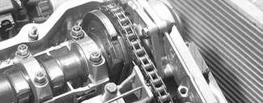

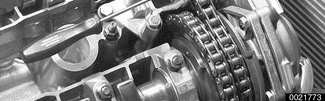

- Remove exhaust camshaft impulse wheel mounting nuts (arrows). Remove impulse wheel (A).

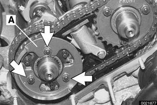

- Remove spring plate (A).

- Remove intake camshaft sprocket mounting nuts (arrows) and remove spring plate (labelled FRONT).

- Remove torx screws from exhaust camshaft sprocket (arrows).

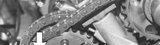

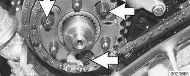

- Lift off exhaust and intake sprockets together with secondary chain, thrust spacer (A) from exhaust camshaft, and splined shaft (B) from intake camshaft.

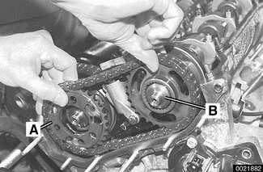

> **CAUTION!**
> - Splined shafts share the same part number for both intake and exhaust camshafts. Remove and mark used splined shafts in order and reinstall in original locations.

- Remove exhaust camshaft splined sleeve (A) and shaft (B).

- Remove secondary chain tensioner mounting bolts (arrows). Remove tensioner from between camshafts while keeping retaining pin in place.

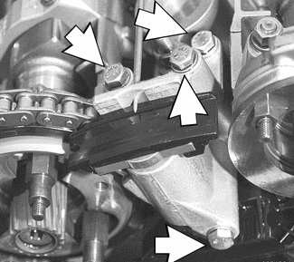

- Remove primary chain sprocket mounting studs (arrows) on exhaust camshaft.

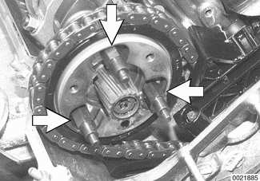

- Lift primary chain sprocket off exhaust camshaft. Remove sprocket from chain.

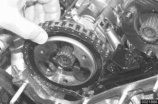

- Place timing chain on end of exhaust camshaft.

- Remove locating studs (arrows) from intake camshaft. Lift off intake camshaft thrust spacer (A) and impulse wheel (B).

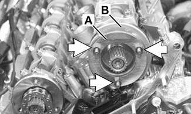

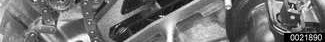

- Do not remove end spline retaining screws from camshafts (arrows).

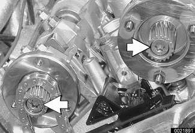

- Remove cylinder head cover mounting studs (arrows) from center of cylinder head.

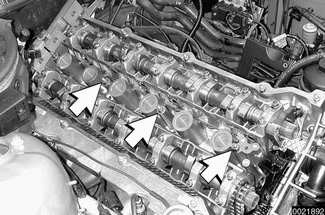

- Remove flywheel locking tool from transmission bellhousing so that crankshaft is no longer secured.
- Lift primary chain and hold under tension, then rotate engine against direction of rotation (counterclockwise) approximately 30°.

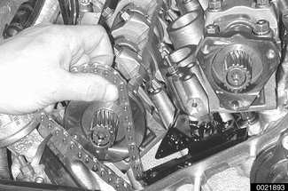

> **CAUTION!**
> - To prevent damaging valves while working on camshafts, no pistons should be in the TDC position.

- Remove BMW special tools 11 3 240 and 11 3 244 from rear of cylinder head.
- Remove retaining nuts (arrows) and bearing cap 1 of intake camshaft.

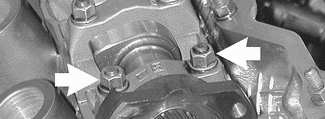

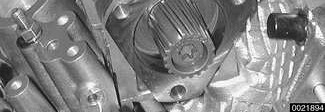

> **CAUTION!**
> - Intake camshaft bearing cap 1 is centered with adapter sleeves. To avoid camshaft damage, it must be removed before any other caps.

- Fit BMW special tools 11 3 260 (A) and 11 3 270 (B) to cylinder head and screw long bolts (arrows) into spark plug threads. Tensioners will align with the bearing caps on the intake camshaft.

> **CAUTION!**
> - Do not over torque bolts into spark plug holes.

- Turn eccentric shaft of special tool to pretension intake camshaft bearing caps. Remove nuts on remaining bearing caps.

- Release tension on eccentric shaft and remove BMW special tools 11 3 260 and 11 3 270. Remove bearing caps and set aside in order.
- Remove camshaft and store safely.
- Repeat procedure for exhaust camshaft.
- Secure hydraulic lifters in lifter bores using BMW special tool 11 3 250, or remove lifters using a magnetic pick-up tool. With lifters secure or removed, lift out camshaft bearing carriers from cylinder head.

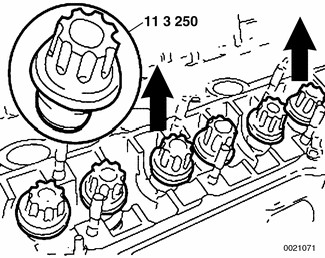

> **CAUTION!**
> - Do not let the hydraulic lifters fall out as the camshaft carrier is removed.
> - Hydraulic lifters should be stored in an upright position.
> - Used hydraulic lifters must be replaced into original lifter bores.

## Cylinder head assembly, removing

- Remove exhaust manifolds. See [180 Exhaust System].

- Remove intake camshaft position sensor (arrow) from side of cylinder head.

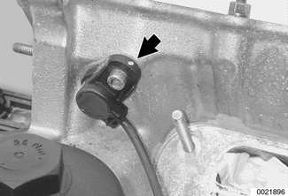

- Remove secondary chain lower guide bolts (arrows). Remove chain guide. The bolt on the intake camshaft side is a long bolt that extends into the lower timing chain cover.

- Remove screws (arrows) holding lower timing chain cover to cylinder head. (Photo shows camshafts in place).

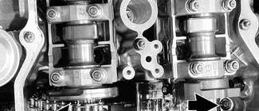

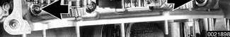

- Using BMW special tool 11 2 250 or equivalent, loosen cylinder head bolts in several stages in sequence shown. Discard head bolts.

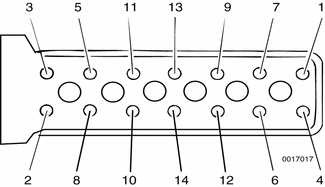

> **Note:**
> - BMW special tool 11 2 250 is a thin-walled Torx E12 socket with an extended reach. The cylinder head bolts are recessed into the head below the camshaft towers with little working space.

- Lift off cylinder head. Refer to [116 Cylinder Head and Valvetrain] to evaluate the head.
