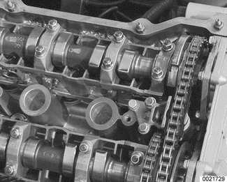
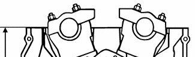
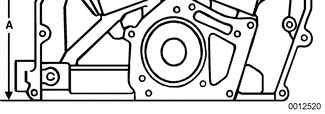
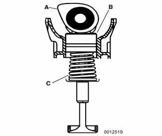
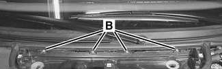
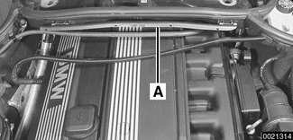
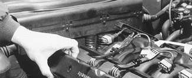
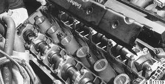
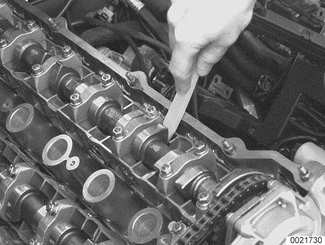

# Cylinder Head

> Source: BMW 3 Series (E46) Repair Manual, section 116-2, Cylinder Head and Valvetrain chapter (PDF pages 206–210 of 1252).

This section provides the specifications and special reconditioning information necessary to repair the cylinder heads covered by this manual.

The disassembled cylinder head should be inspected for warpage and cracks. Check the valve guides and valve seats for wear before machining a warped head. Always decarbonize and clean the head before inspecting it. A high-quality straight edge can be used to check for warpage.

Visually inspect the cylinder head for cracks. If a cracked cylinder head is suspected and no cracks are detected through the visual inspection, have the head further tested for cracks by an authorized BMW dealer or an ASE certified machinist. A cracked cylinder head must be replaced.

> **Note:**
> - When disassembling and inspecting the cylinder head on an engine, be sure to check the camshaft carrier bearing surfaces for warpage.

A warped cylinder head can be machined provided no more than 0.3 mm (0.012 in.) of material is removed. If further machining is required, the head should be replaced. Removing more than this amount will reduce the size of the combustion chamber and adversely affect engine performance. A 0.3 mm thicker gasket is available from an authorized BMW parts department for machined heads.

Before machining the head to correct for warpage, measure the total height (A) (thickness of the cylinder head). Minimum height specifications are given in [Table a].

**Table a.** Cylinder head height

| New | Minimum height (dimension A) |
|---|---|
| 140.0 mm (5.512 in) | 139.7 mm (5.500 in) |

## Valves, leak test

To test the valves for leakage, the cylinder head must be disassembled with camshafts and camshaft carriers removed. Install the valve assemblies and the spark plugs in each cylinder. Place the cylinder head on a workbench with the combustion chamber facing upward. Fill each combustion chamber with a thin non-flammable liquid, such as a parts cleaning fluid. After fifteen minutes, check the level of the fluid. If the fluid level in any cylinder drops, that cylinder is not sealing properly.

## Camshaft

Camshaft wear is usually caused by insufficient lubrication. Visually inspect camshaft lobes and journals for wear. Camshaft wear specifications are given in [Table b].

**Table b.** Camshaft wear specifications

| Axial play | Radial play (Plastigage) |
|---|---|
| 0.150-0.330 mm (0.0060-0.013 in.) | 0.020-0.054 mm (0.0008-0.0021 in.) |

> **CAUTION!**
> - If the camshaft is being replaced due to cam lobe wear, it is recommended that the corresponding lifters should also be replaced to avoid damaging the new camshaft.

## Hydraulic lifters, checking and replacing

Modern BMW 6 cylinder engines use self-adjusting hydraulic lifters to keep the valve clearances within a limited working range. (A) section view of camshaft, (B) hydraulic lifters are sealed units and require no maintenance, (C) valve with conical valve spring.

Under some circumstances, such as a cold start, the cam followers may become noisy. Hydraulic lifter noise is usually a high-pitched tapping or chattering noise. In most instances, this is considered normal as long as the noise goes away in a few minutes (maximum 20 minutes). If the noise does not go away, either the lifter is faulty or the oil pressure to the lifter is low. Hydraulic lifter replacement requires that the camshaft first be removed.

> **Note:**
> - Before checking hydraulic lifters, make sure engine oil is fresh and at the proper level.

- Run engine until it reaches normal operating temperature.
- Remove microfilter housing:
    - Remove microfilter for interior ventilation.

    - Open wiring harness loom (A), remove harness and lay aside.
    - Unfasten screws (B) and take off lower microfilter housing.

- Remove engine cover.
- Detach positive and ground connections from intake manifold and cylinder head cover, as necessary.

- Remove ignition coils.
    - Disconnect ignition coil harness connectors and lay harness aside.
    - Remove coil grounding straps.
    - Remove coils.

- Remove spark plugs.
- Remove cylinder head cover mounting fasteners and remove cylinder head cover.

> **Note:**
> - The cylinder head cover mounting bolt insulators and gaskets should be reinstalled in their original locations. Make note of their arrangement during removal.

- Remove oil baffle cover from above intake camshaft.

- Use a plastic or wooden stick to press down on top of lifter. If there is any noticeable clearance, the lifter is faulty and should be replaced.

> **Note:**
> - When checking a hydraulic lifter, make sure the corresponding camshaft lobe is facing up so that there is no valve spring pressure on the follower.

- To replace a hydraulic lifter, remove appropriate camshaft. Refer to camshaft removal procedures given in [113 Cylinder Head Removal and Installation].
- Once camshaft is removed, withdraw faulty lifter and replace with new one. Inspect lifter bores for wear and scoring.
- Camshaft, timing chain and cylinder head cover reassembly is reverse of disassembly.
