# Dashboard

> Source: BMW 3 Series (E46) Repair Manual, section 513-3, Interior Trim chapter (PDF pages 837–846 of 1252).

The E46 dashboard assembly includes the instrument cluster, passenger side airbag, glove compartment, fuse and relay panel, radio, IHKA control panel or on-board monitor (if equipped with GPS), front ashtray, shifter assembly, and window control switches. Dashboard removal is a complex operation. Read the procedures through before starting work.

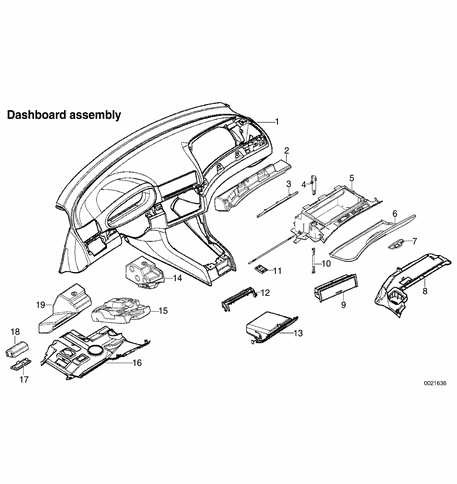

1. Dashboard
2. Passenger knee protector
3. Reinforcement
4. Damper piston
5. Glove compartment
6. Glove compartment door
7. Latch
8. Right top footwell trim panel
9. Storage compartment
10. Glove compartment door strap
11. Glove compartment hinge
12. Steering column cover
13. Left glove compartment (optional)
14. Center knee protector
15. Steering column knee protector
16. Left footwell (pedal cluster) trim panel
17. Footwell light cover
18. Footwell light socket
19. Left knee protector

## Glove compartment and right footwell trim panel, removing and installing

- Open glove compartment door.

- Snap out glove compartment light fixture and detach electrical harness connector.

To detach glove compartment:

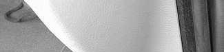

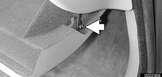

- Pull out retaining pin (arrow) for right side strap.

- Pull out pin from bottom of left side dampening rod.

- Remove glove compartment hinge mounting bracket screws (arrows). Lift glove compartment over mounting rod to remove.

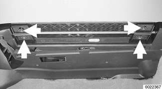

Remove glove compartment housing:

- Remove insert mounting screws (arrows).

- If necessary, release mounting pin (A) at right side of housing.

- Pull glove compartment housing down.

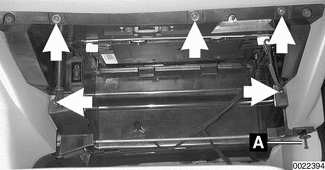

> **Note:**
> - Detach glove compartment electrical harness from guides while removing housing.

Remove right footwell trim panel (arrow) by pulling backward to detach from mounting points.

> **Note:**
> - Detach electrical harness connector(s) from panel while removing.

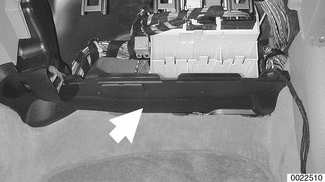

## Steering column trim, removing and installing

- Remove steering wheel as described earlier.

Fully lower and extend (arrows) adjustable steering column.

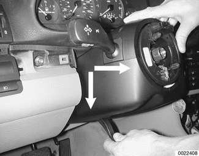

- Remove retaining screw from top of steering column upper trim cover.

Push in sides of upper trim cover (arrow) to release from lower trim. Pull back and up on upper trim.

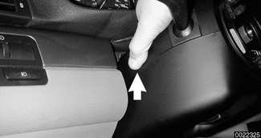

Pry gently to detach flexible cover from upper trim. Lift off trim.

- Remove left footwell (pedal cluster) trim panel. See [Left footwell (pedal cluster) trim panel, removing and installing].

To remove steering column lower trim, drive pins into expansion rivets (arrows) to release. Pull down on trim.

- Installation is reverse of removal. Replace any broken or missing fasteners.

## Left footwell (pedal cluster) trim panel, removing and installing

- Move steering column to maximum extended position.

Working at trim panel, remove screws (arrows) and expansion rivets (A). Clips (inset) must be rotated 90° to remove.

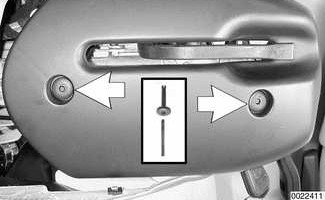

- If equipped detach electrical harness connectors from footwell light and warning chime.

- Release OBD II socket from panel and pull out.

Disconnect electrical harness connectors at left footwell trim panel and remove panel:

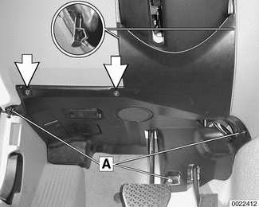

- Unplug connector at footwell interior light (A), if equipped.

- Slide lock at OBD II connector (B) in direction of arrow.

- Unplug connector at chime (C).

## Dashboard/shifter console assembly, removing and installing

- Disconnect negative (-) cable from battery and cover terminal with insulating material.

> **CAUTION!**
> - Prior to disconnecting the battery, read the battery disconnection cautions given at the front of this manual on page viii.

Using a plastic trim tool pry gently to remove left, center and right dashboard trim.

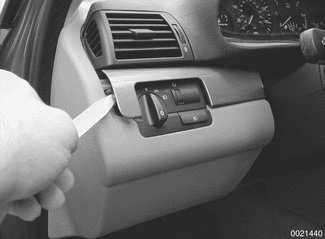

> **CAUTION!**
> - To avoid marring interior trim, work with a plastic prying tool.

> **Note:**
> - Left side shown. Center and right trim are similar. To remove center trim, right trim must be removed first.

- Remove steering wheel. See [320 Steering and Wheel Alignment].

- Remove left footwell trim panel as described earlier.

- Remove upper and lower steering column trim. Detach steering column stalk switch electrical connectors and remove stalk switch. See [612 Switches].

Remove shifter knob by pulling straight up.

> **Note:**
> - Apply approx. 90 lb. of force to pull off knob from shift rod.

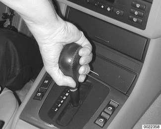

- Lift up and remove shifter bezel by prying gently.

- Unclip bottom of shifter boot from center console trim by pushing forward. Pull boot up around shifter.

- Remove center console as described earlier.

- Lift off switch carrier and detach electrical harness connectors to window switches.

- Remove glove compartment as described earlier.

To remove storage compartment below IHKA control panel:

- Open compartment door.

- Push upward on tabs (arrows), then pull out.

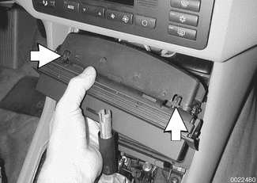

Remove A-pillar (windshield pillar) trim on left and right sides by prying out finishing strip.

> **CAUTION!**
> - The Head Protection Airbag is behind the A-pillar. Do not use sharp instruments to remove trim or finisher strip.

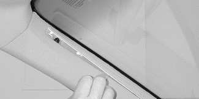

- Remove screws beneath finishing strip.

Carefully pull away A-pillar trim.

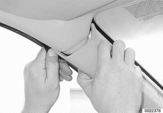

- Remove headlight switch. See [612 Switches].

- Remove instrument cluster. See [620 Instruments].

- Remove IHKA control panel and module. See [640 Heating and Air Conditioning].

- If applicable: Reach through IHKA control panel opening and disconnect solar sensor harness connector.

- Remove radio. See [650 Radio].

- Remove front passenger airbag. See [721 Airbag System (SRS)].

- Remove glove compartment as described earlier.

Remove right footwell trim panel (arrow) by pulling backward to detach from mounting points.

> **Note:**
> - Detach electrical harness connector(s) from panel while removing.

Remove dashboard mounting screw or expansion rivet (arrow) in lower right dashboard.

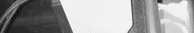

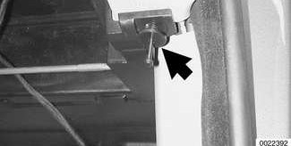

- Similarly, remove left side dashboard mounting screw or expansion rivet.

Remove dashboard mounting nut (arrow) at shifter console.

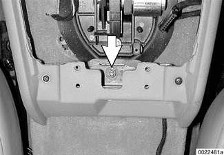

Remove mounting nuts and screw (arrows) at dashboard face.

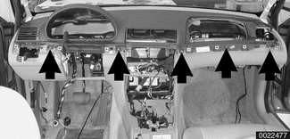

To remove dashboard:

- Pull up parking brake fully.

- Push seats fully back.

- Lift instrument panel off carefully, making sure all harness connectors and wiring are disconnected. Remove through passenger door.

- When installing, fit dashboard guide pin into locator slot at base of windshield in center.

- Install center console with dashboard mounting nuts loose. Align and center parts before tightening fasteners.
