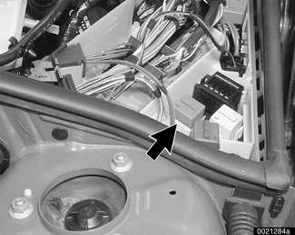
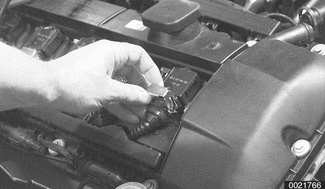
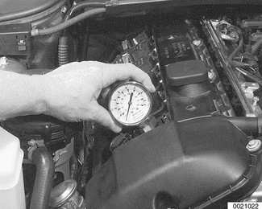

# Diagnostic Testing

> Source: BMW 3 Series (E46) Repair Manual, section 113-4, Cylinder Head Removal and Installation chapter (PDF pages 198–202 of 1252).

## Cylinder compression, checking

A compression gauge is needed to make a compression test. For accurate test, the battery and starter must be capable of cranking the engine at least 300 rpm, and the engine should be at normal operating temperature.

> **Note:**
> - Performing a compression test may cause a fault to set in the ECM and may illuminate the engine service light. The light can only be turned out using either BMW special service scan tools or an equivalent aftermarket scan tool. Disconnecting the battery will not erase the fault memory nor turn out the light.

- Disable ignition system by removing DME main relay (arrow) from the electronics box (E-box) in left rear of engine compartment

> **WARNING!**
> - The ignition system produces high voltages that can be fatal. Avoid contact with exposed terminals and use extreme caution when working on a car with the ignition switched on or the engine running.
> - Do not touch or disconnect ignition components while the engine is running or being cranked by the starter.

> **CAUTION!**
> - Failure to remove the DME main relay or attempting to disable the ignition system by other methods may result in damage to the engine control module (ECM).

- Remove housing for interior ventilation microfilter.
    - Remove upper cover and microfilter.
    - Open wiring harness loom cover (A) and remove wires.
    - Unfasten screws (B) and remove lower microfilter housing.

- Remove oil filler cap.
- Remove engine cover over ignition coils. Replace oil filler cap.

- Remove ignition coils.
    - Pull up on spring clips to disconnect ignition coil harness connectors.

    - Remove coil grounding straps.
    - Remove coils.
- Remove spark plugs.

> **Note:**
> - Check the spark plugs for oil deposits that may indicate poor cylinder sealing, then set them aside in order. Used spark plugs should be reinstalled in the same cylinder from which they were removed.

- Install compression gauge in first cylinder's spark plug hole, tight enough to form a good seal.

- With parking brake set, transmission in PARK or NEUTRAL, and accelerator pedal pressed to floor, crank engine with starter. Record highest value indicated by gauge.

> **Note:**
> - The compression gauge reading should increase with each compression stroke and reach near its maximum reading in about 4-6 strokes.
> - All cylinders should reach maximum compression in the same number of strokes. If a cylinder needs significantly more strokes to reach maximum compression, there is a problem.

- Release pressure at compression gauge valve, then remove gauge from spark plug hole. Repeat test for each cylinder and compare results with values given below.

Compression pressures

| Minimum | Maximum difference between cylinders |
|---|---|
| 10 - 11 bar (142 - 156 psi) | 0.5 bar (7 psi) |

- Compression readings may be interpreted as follows:
    - Low compression indicates a poorly sealed combustion chamber.
    - Relatively even pressures that are below specification normally indicate worn piston rings and/or cylinder walls.
    - Erratic values tend to indicate valve leakage.
    - Dramatic differences between cylinders are often the sign of a failed head gasket, burned valve, or broken piston ring.
- Reinstall spark plugs and ignition coils.

> **Note:**
> - Used spark plugs should be reinstalled in the same cylinder from which they were removed.

- Remainder of installation is reverse of removal. Be sure to reinstall all wires disconnected during test, especially ground wires at coils and cylinder head cover (where applicable).

Tightening torque

| Component | Tightening torque |
|---|---|
| Spark plug to cylinder head | 25 Nm (18 ft-lb) |

## Wet compression test

To further help analyze the source of poor compression, a wet compression test is the next step:

- Repeat compression test, this time with about a teaspoon of oil squirted into each cylinder. (The oil will temporarily help seal between piston rings and cylinder wall, practically eliminating leakage past rings for a short time.)
- If this test yields higher compression reading than "dry" compression test, there is probably leakage between piston rings and cylinder walls, due either to wear or to broken piston rings.
- Little or no change in compression reading indicates other leakage, probably from valves.

## Cylinder leak-down test

The most conclusive diagnosis of low compression symptoms requires a cylinder leak-down test. Using a special tester and compressed air, each cylinder, in turn, is pressurized. The rate at which the air leaks out of the cylinder, as well as where the air leaks out, can accurately pinpoint the magnitude and location of the leakage. Before attempting any repair that requires major engine disassembly, use a leak-down test to confirm low compression.
