# Door Handles and Locks

> Source: BMW 3 Series (E46) Repair Manual, section 515-3, Central Locking and Anti-Theft chapter (PDF pages 863–884 of 1252).

Any time a door lock is removed and reinstalled, be sure to check and reset:

- Unlocking of rotary latch
- Outside door handle overtravel

These adjustments and measurements must be made by closing the door lock rotary latch with a screwdriver, then attempting to open it with the outside door handle. Both adjustment procedures are described below, under [Rotary latch adjustments].

> **CAUTION!**
> - Do not close the door before resetting rotary latch adjustment. The door may lock and be unopenable from outside.

## Rotary latch adjustments

> **CAUTION!**
> - Carry out rotary latch checks and adjustments with the door open. If the door is closed with the incorrect latch setting, it may not be possible to open the door without destroying the inner door panel.

Door lock and handle assembly

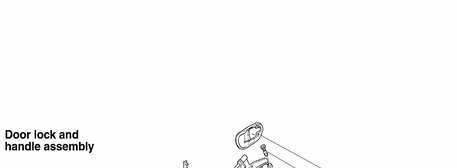

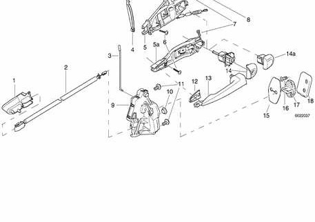

1. Inside door lock release
2. Inside door release Bowden cable
3. Lock button and rod
4. 9/2000 and later models: Bowden cable bracket
5. 9/2000 and later models: Door handle inner mechanism
5a. Models to 9/2000: Door handle inner mechanism
6. Inner handle mounting bolt
7. Key cylinder mounting bolt (Torx)
8. Gasket
9. Door lock with rotary latch
10. Plug
11. Bolt M6 (always replace) tighten to 9 Nm (80 in-lb)
12. Gasket
13. Outer door handle
14. Driver's door: Door lock cylinder and cover
14a. Rear or right door: Outer handle rear anchor
15. Door striker cover
16. Torx bolt M8 tighten to 24 Nm (18 ft-lb)
17. Door lock striker
18. Lock plate

## Rotary latch unlocking, resetting

With door open, close rotary latch.

- Lock car with key or lock button.

- Unlock car.

- Open rotary latch using outside handle.

- If latch unlocks, adjustment is correct.

If latch fails to unlock:

- Remove latch adjuster access hole cover.

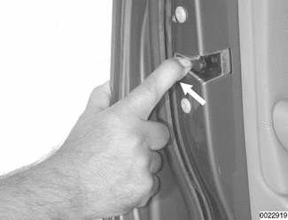

- Use 4 mm Allen wrench to loosen adjustment screw, then retighten. Carry out check again.

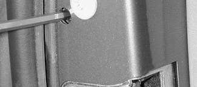

> **Note:**
> - The right side latch adjusting screw is threaded left-handed.

Tightening torque

| Component | Torque |
|---|---|
| Door lock adjustment screw | 3 + 2 Nm (27 + 18 in-lb) |

## Outside handle overtravel, resetting

- With door open, close rotary latch with a screwdriver.

- Open rotary latch with outside door handle.

Measure additional distance (A) handle can travel once rotary latch releases.

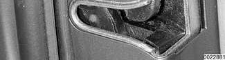

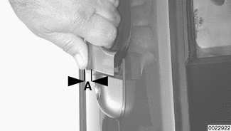

- If measurement A is obtained, rotary latch adjustment is correct.

- If measurement A is not obtained, readjust rotary latch through access hole, as described above, and check handle overtravel again.

- If measurement A is still not obtained, replace door lock.

Outside door handle overtravel

| Measurement | Value |
|---|---|
| Measurement A | min. 2 mm (0.08 in.) |

## Door lock, removing and installing

The front and rear door locks for all E46 models are similar. Early production cars, up to 9/2000, use a lock actuator with an external lever which couples with the outside door handle mechanism. Cars produced from 9/2000 use a Bowden cable to attach the outside door handle to the lock release mechanism.

- Remove front door trim panel, air bag, and vapor barrier as described in [411 Doors] and [721 Airbag System (SRS)].

Detach window from window regulator rails:

- Reattach battery. Move window to approx. 140 mm (5.5 in.) from bottom.

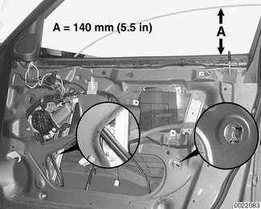

- Remove window retaining screws (insets) at window regulator rails.

> **WARNING!**
> - Once the window is positioned correctly, disconnect harness connector from power window motor to prevent accidental operation of the window.

> **Note:**
> - Be prepared to retrieve the captured nut corresponding to the retaining screw on the back side of the window rail. It may fall to the bottom of the door.

- Be sure to separate plastic lug at base of window from rail.

- Raise window to top.

> **CAUTION!**
> - Guide the window up manually in order to avoid binding.

Remove window regulator rear rail:

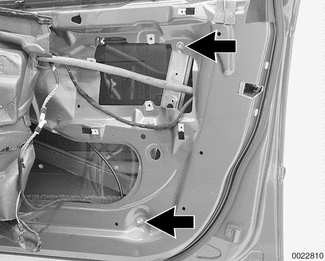

- Remove top and bottom rail mounting fasteners (arrows).

- Slide rail down, allowing it to hang to the side out of the way.

> **WARNING!**
> - E46 cars are fitted with side-impact airbags in the front doors. When servicing the door locks on cars with front side-impact airbags, always disconnect the negative (-) battery terminal. See [721 Airbag System (SRS)] for cautions and procedures relating to the airbag system.

- Driver's door: Remove door lock cylinder as described later.

- Models produced from 9/2000: Carefully pry outside door handle Bowden cable off lock assembly.

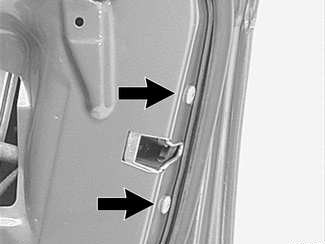

- Remove lock mounting bolts (arrows) from rear edge of door. Support lock to prevent it from falling into bottom of door.

- Disconnect harness connector from lock assembly.

- Remove lock assembly, complete with lock-button linkage.

- Installation is reverse of removal, noting the following:

    - Insert lock button up through inner door plate, taking care to avoid bending linkage.
    - On models produced to 9/2000: Tilt lock assembly outward while lifting it into position inside the door. This is done to make sure lock lever is inserted between outside door handle pawl and outer door skin.
    - Use new door lock mounting bolts.
    - Use new self-locking mounting bolts when reinstalling side-impact airbag to door (where applicable).
    - Secure wire harnesses with wire ties, as applicable.
    - Be sure to check unlocking of rotary latch and outside door handle overtravel as described above under [Rotary latch adjustments].
    - Check function of window mechanism before reinstalling vapor barrier and inner door panel.

Tightening torques

| Component | Torque |
|---|---|
| Airbag to door (replace screws) | 8.5 Nm (75 in-lb) |
| Door lock to door M6 bolt (always replace) | 9 Nm (80 in-lb) |
| Window guide to door | 9 Nm (80 in-lb) |
| Window to guide | 8 Nm (71 in-lb) |

## Driver's door lock cylinder, removing and installing

Only the driver's door is equipped with a lock cylinder. The procedure for removing the door handle rear anchor on the other three doors is similar to that for removing the driver's door lock cylinder.

- Open door and remove plastic plug (Sedan or Sport Wagon shown in illustration) or rubber covering (Coupe or Convertible) at lock cylinder mounting bolt access hole in upper rear door edge.

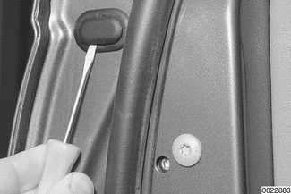

> **Note:**
> - On Sedan or Sport Wagon: Remove inner plug by prying with screwdriver, then peel off outer (oval) plastic trim.

- Remove lock cylinder mounting screw (arrow).

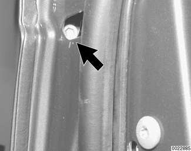

- Pull out lock cylinder.

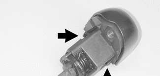

> **Note:**
> - Use key in cylinder to help pull cylinder out.

- Use a small screw driver to pry cylinder cover locking tabs (arrows). Slide cover off cylinder gently to avoid breaking tabs.

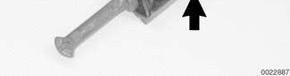

- Installation is reverse of removal.

On Sedan or Sport Wagon: Replace cylinder mounting bolt access hole trim cover if necessary.

## Door handle, removing and installing (to production date 9/2000)

- On driver's door: Remove door lock cylinder as described earlier.

- Other doors: Remove door handle rear anchor. Procedure is similar to removing driver's door lock cylinder described earlier.

Pull handle out as far as it will go, then backward approx. 2 mm (0.08 in.).

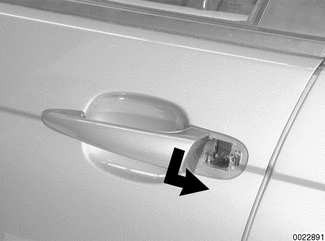

- Push handle in slightly (approx. 4 mm/0.16 in.).

- Remove door handle from door by angling out of door cavity.

> **Note:**
> - Make sure the lock release pawl at the rear of the handle and the mounting guide at the front of the handle are intact. Before reinstalling, insert screwdriver through access hole in edge of door to push lock release lever (arrow) outward.

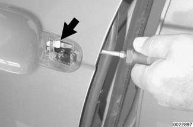

- Insert outside handle and snap forward until a click is heard.

- Be sure to check unlocking of rotary latch and outside door handle overtravel as described above under [Rotary latch adjustments].

## Door handle, removing and installing (from production date 9/2000)

- On driver's door: Remove door lock cylinder as described earlier.

- On other doors: Remove door handle rear anchor. Procedure is similar to removing driver's door lock cylinder described earlier.

Pull outside door handle out and wedge BMW special tool 00 9 322 under handle.

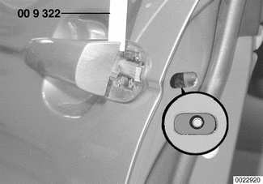

- Working in lock cylinder mounting bolt access hole, tighten down screw (counterclockwise direction). Lock is now in "installation position". Remove special tool 00 9 322.

Tightening torque

| Component | Torque |
|---|---|
| Outside handle to lock (left-hand thread) | 2.0 ± 0.4 Nm (18 ± 3.5 lb-in) |

- Pull outside door handle outward and unhook from front guide.

> **Note:**
> - Make sure the lock release bore at the rear of the handle and the mounting guide at the front of the handle are intact.

- Before reinstalling handle, make sure lock mechanism is in "installation position" as described earlier:

    - Distance between inner door handle lever and outer door skin must not exceed measurement A.
    - If measurement exceeds specification, pull lever outward with fingers until measurement is correct.

Installation distance: inner door handle lever to door

| Measurement | Value |
|---|---|
| Measurement A | less than 8 mm (0.32 in.) |

- Insert handle and snap into place.

> **Note:**
> - Take care that the door handle base gasket is not deformed when the handle is installed.

- Be sure to check unlocking of rotary latch and outside door handle overtravel as described above under [Rotary latch adjustments].

## Door handle inner mechanism, removing and installing (to production date 9/2000)

- Remove door lock and outside door handle as described earlier.

- Remove front door trim panel, air bag, and vapor barrier as described in [411 Doors] and [721 Airbag System (SRS)].

- Remove outside handle base seals.

- Loosen inner handle mounting bolt (arrow).

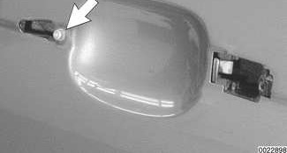

- Working inside door opening, slide inner handle toward front and remove.

- Installation is reverse of removal.

> **Note:**
> - Inspect mounting bolt and replace if necessary.

## Door handle inner mechanism, removing and installing (from production date 9/2000)

- Remove outside door handle as described earlier.

- Remove outside handle base seals.

- Remove front door trim panel, air bag, and vapor barrier as described in [411 Doors] and [721 Airbag System (SRS)].

- Lever out Bowden cable from door handle with screwdriver.

- On Sedan or Sport Wagon: Slide Bowden cable out of guide.

> **Note:**
> - Foam insulation on bowden cable must be placed in original position during reinstallation.

- On Coupe or Convertible: Remove inner door guide (plastic) to gain access to Bowden cable.

> **Note:**
> - Take care to not damage inner door guide during removal and installation.

- Loosen handle mounting bolt.

- Working inside door opening, slide inner handle toward front and remove.

- Installation is reverse of removal.

> **Note:**
> - Inspect handle mounting bolt and replace if necessary. Bowden cable end must be correctly fitted in lock actuator.

## Door striker, replacing

- Remove striker plastic cover.

Remove striker top mounting bolt (A). Screw M8 stud into top bolt hole to keep striker backing plate from falling down into B-pillar cavity. Remove lower bolt (B).

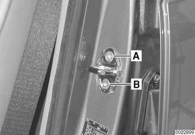

- Remove and reinstall striker and gasket while holding on to stud. Install striker mounting bolts finger-tight.

Position striker bar approx. 90° to inside edge of door frame. Leave striker mounting bolts finger-tight.

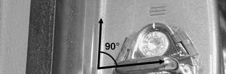

Set position of striker:

- When closed, rear edge of front door must be even with front edge of rear door (Sedan or Sport Wagon) or with rear quarter panel (Coupe or Convertible). Maximum deviation allowed measured at A.
- When closed, shoulder of front door must be flush to shoulder of rear door (Sedan or Sport Wagon) or with top of rear quarter panel (Coupe or Convertible). No deviation is allowed at measurement B.
- When door is closed, striker must not contact lock housing.
- With door closed, there must be no in/out movement of door.

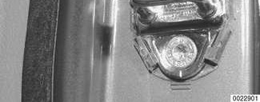

- Torque striker bolts. Recheck door alignment. Reinstall plastic cover.

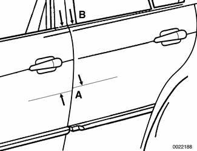

Door striker position

| Measurement | Value |
|---|---|
| Deviation from parallelism of closed door (A) | max. 1 mm (0.04 in.) |
| Deviation from flush at door shoulder (B) | 0 |

Tightening torque

| Component | Torque |
|---|---|
| Striker plate to body pillar | 24 Nm (18 ft-lb) |

## Trunk locking mechanism

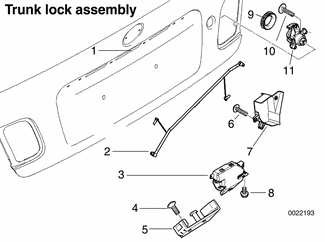

Trunk lock assembly

1. Trunk release microswitch
2. Connecting rod
3. Lock with microswitch
4. Torx screw M6
5. Striker plate
6. Trim screw
7. Lock cover
8. Torx bolt M6
9. Lock cylinder gasket
10. Self-threading screw
11. Lock cylinder

The trunk can be unlocked by using:

- Central locking button
- Left door key
- FZV remote entry system
- Trunk lock cylinder in the trunk lid right side taillight assembly
- Trunk release in the driver's footwell, if equipped
- Microswitch in the center of the license plate light strip

The trunk lock cylinder does not actuate central locking control.

To remove the trunk lock microswitch:

- Remove licence plate light strip.
- Separate electrical harness connector from strip.
- Separate microswitch from strip.

To access trunk lock cylinder or lock:

- Raise trunk lid.
- Open tool kit and remove screws attaching tool kit to trunk lid (white arrows). Unclip retaining strap at trunk lid and remove tool kit.

- Remove insulating liner expansion rivets (black arrows) and remove trunk liner. Expansion rivets are released by prying upper portion out (inset).
- Lift off trim panel.

To remove trunk lock cylinder:

- Remove right taillight socket from trunk lid. See [630 Lights].
- Remove right tail lens mounting nut (A) and detach tail lens from trunk lid.

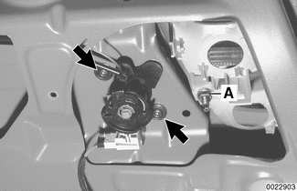

- Remove lock cylinder cover mounting screws (arrows). Slide cover to right to remove.

> **Note:**
> - On Convertible models: Remove third brake light to access trunk lock mechanism.

- Use new self-tapping screws to reinstall trunk lock cylinder.

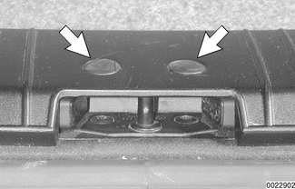

- Pry out rear trunk edge trim caps (arrows) to access mounting screws to remove trunk lock striker.

When reinstalling, or to adjust trunk lid alignment, adjust position of trunk lock striker with mounting bolts finger tight. Set gap measurements as listed below. Check trunk lid lock operation with lid open. Also see [412 Trunk Lid, Tailgate].

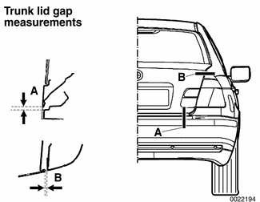

Trunk position gap adjustment

| Gap | Value |
|---|---|
| Trunk lid / trunk panel (A) | 5 ± 1.5 mm (0.2 ± 0.06 in.) |
| Trunk lid / rear fender (B) | 4.25 ± 0.75 mm (0.17 ± 0.03 in.) |

> **Note:**
> - Do not lubricate lock or lock striker with grease.

## Tailgate lock, emergency release

The Sport Wagon tailgate can be unlocked using the central locking switch, the left door key or the FZV remote entry system. The tailgate can be opened by pushing the tailgate release button in the left front kickpanel or by pressing the microswitch in the center of the license plate light strip. There is no key lock cylinder in the tailgate.

In case of electrical failure, there is an emergency tailgate lock release. The release is located in the rear cargo area, along the lower edge of the rear apron behind a small access cover. Remove access cover and push release in direction of arrow to open tailgate.

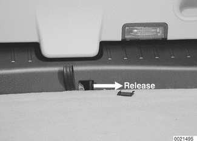

## Tailgate and rear window locking mechanism

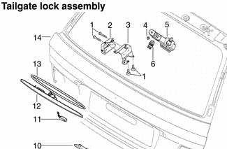

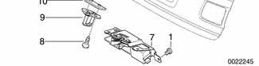

Tailgate lock assembly

1. Torx bolt M6
2. Rear window lock
3. Rear window lock cover
4. Nut M6
5. Rear window striker mounting bracket and wiper pivot
6. Rear window lock striker
7. Tailgate lock
8. Torx bolt M8
9. Tailgate lock striker
10. Lock plate
11. Tailgate release microswitch
12. Tailgate grip
13. Tailgate grip gasket
14. Tailgate

To remove tailgate lock microswitch:

- Remove license plate light strip.
- Separate electrical harness connector from strip.
- Separate microswitch from strip.

To remove tailgate lock:

- Open tailgate and remove tailgate rear panel trim.
- Mark position of lock on rear panel.
- Remove lock mounting bolts (arrows).

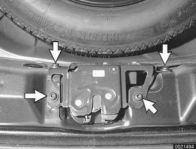

- Detach lock mechanism electrical harness connector.
- Electric lock actuator and emergency release lever can now be separated from tailgate lock mechanism.

To remove tailgate lock striker:

- Open tailgate and pry out lock striker trim from bottom of tailgate.
- Remove one striker mounting screw (arrows).

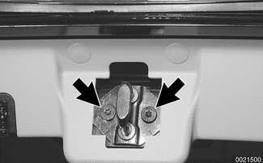

- Thread in M8 stud to keep striker lock plate from falling inside door.
- Remove second screw and striker.
- Reinstall striker bolts finger tight. Adjust striker position before tightening bolts.

To adjust striker position:

- Close tailgate slowly, allowing striker to center itself on lock.
- Striker must not touch lock housing.
- Tighten striker mounting bolts, then check tailgate to body gaps as shown below.

> **Note:**
> - Do not lubricate lock or lock striker with grease.

To remove rear window lock striker:

- Adjust striker height by loosening lock nut A, then turning striker in or out.

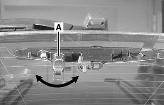

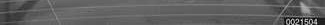

- Retighten lock nut.

To remove rear window lock:

- Open tailgate. Remove tailgate trim panel.
- Detach window lock electrical harness connector (A).
- Remove lock mounting screws (arrows).

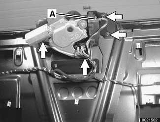

- Slide lock out from under rear window wiper motor.
- Reinstall lock mounting bolts finger tight. Adjust lock position before tightening bolts.

To adjust lock position:

- Close window slowly, allowing lock to center itself on striker.
- Tighten striker mounting bolts, then check rear window to body gaps as shown below.
- Tighten lock mounting bolts.

When reinstalling, or to adjust tailgate or rear window alignment, adjust position of tailgate striker or window lock with mounting bolts finger tight. Set gap measurements as listed below. Also see [412 Trunk Lid, Tailgate].

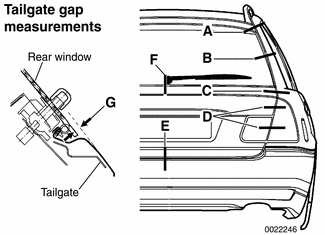

Tailgate and rear window position gap adjustment

| Gap | Value |
|---|---|
| Rear spoiler / side panel (A) | 3.75 ± 1.3 mm (0.15 ± 0.05 in.) |
| Rear window / side panel (B) | 3.5 ± 1.4 mm (0.14 ± 0.06 in.) |
| Tailgate / side panel (C) | 3.6 mm ± 0.75 mm (0.14 ± 0.03 in.) |
| Tailgate / side panel (height) | flush to 2 mm (0.08 in.) lower |
| Tailgate light / corner light (D) | 4.25 ± 0.75 mm (0.17 ± 0.03 in.) |
| Tailgate / rear bumper (E) | 5 ± 1 mm (0.2 ± 0.04 in.) |
| Rear window / tailgate (F) | 4 ± 1 mm (0.16 ± 0.04 in.) |
| Rear window / tailgate (G) | 5.4 ± 1 mm (0.21 ± 0.04 in.) |
