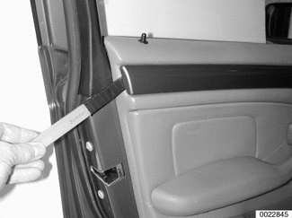
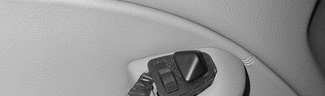
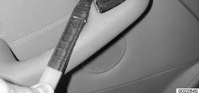
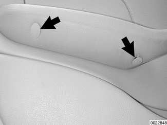
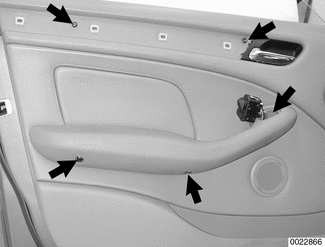
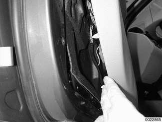
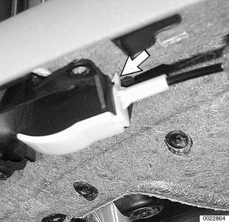
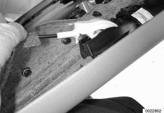
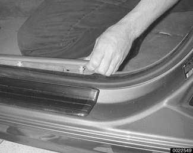

# Door Panels

> Source: BMW 3 Series (E46) Repair Manual, section 411-3, Doors chapter (PDF pages 760–765 of 1252).

> **WARNING!**
> - E46 cars are fitted with side-impact airbags in the front doors and as an option on 4-door models. When servicing doors on cars with front side-impact airbags, always disconnect the negative (-) battery terminal. See [721 Airbag System (SRS)] for cautions and procedures relating to the airbag system.

## Door trim panel, removing and installing

- Disconnect negative (-) battery cable.

> **CAUTION!**
> - Prior to disconnecting the battery, read the battery disconnection cautions given at the front of this manual on page viii.

Gently pry off door panel trim strip.

Carefully pry out mirror adjustment switch and disconnect harness connector from switch.

- For rear trim panel: Pry out window switch at top of armrest.

Pry off concealing plugs (arrows) from under armrest.

Remove door panel retaining screws (arrows).

Unclip door panel from door perimeter using a trim panel tool. Pull panel retaining clips off one at a time.

Pry off inside door release Bowden cable at end of clip (arrow).

- Pull off panel: Detach cable from interior door release lever.

- Disconnect radio speaker harness connector.
- Installation is reverse of removal, noting the following:
    - Replace any damaged plastic parts or clips.
    - Renew vapor barrier if it is damaged.
    - Use new mounting bolts when reinstalling side-impact airbag to door.
    - When installing door panel, align metal retainers on window sill with openings on top of door panel.
    - Check door-lock mechanism and window for ease of movement.

## Rear side trim panel, removing and installing (Coupe model)

- Remove rear seat cushion. Remove rear backrest side section. See [520 Seats].
- Using a trim tool, gently pry up door threshold trim. Starting at A-pillar, press radius of trim downwards while sliding trim forward off trim clips. Remove clips from body using pliers. Save for installation.

- Remove trim plugs on armrest. Remove panel mounting screws.
- Gently pry off panel using trim tool.
- Disconnect electrical harness connectors as necessary. Remove side panel by lifting up and toward interior.
- Installation is reverse of removal. Replace any damaged plastic parts or clips.

## Rear side trim panels, removing and installing (Convertible model)

- Remove rear seat cushion. Remove rear backrest side section. See [520 Seats].
- Lower side windows; open convertible roof.
- Remove side panel insert:
    - Remove trim plugs on side panel armrest. Remove insert panel retaining screws.
    - Gently pry side panel insert from upper and lower side panels.
    - Disconnect electrical harness connectors as necessary.
- Remove upper side trim panel:
    - Remove trim retaining rivet from upper corner at door. Pull trim cap upwards from weather-stripping.
    - Unhook spring from linkage at convertible top.
    - Remove retaining screws from lower edge of upper panel.
    - Gently pull weather-stripping from rear edge of upper panel as necessary.
    - Pry up on upper panel and remove.
- Remove lower side trim panel:
    - Gently pry lower side trim panel from body.
    - Make sure to feed lower front corner of side trim panel out from door threshold trim.
- Installation is reverse of removal. Make sure to replace any broken trim clips.
