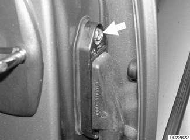
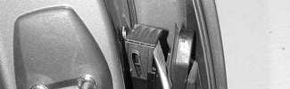
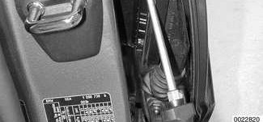
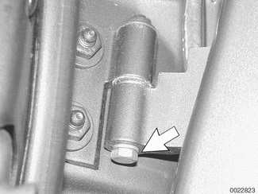
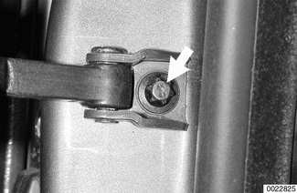
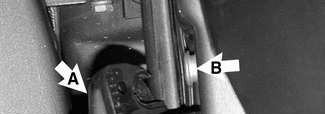
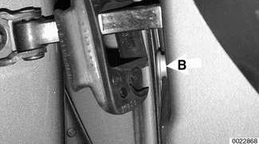
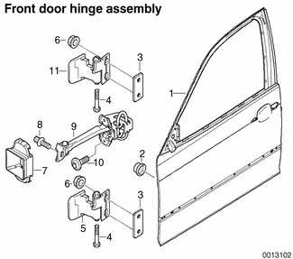

# Doors

> Source: BMW 3 Series (E46) Repair Manual, section 411-2, Doors chapter (PDF pages 754–759 of 1252).

> **WARNING!**
> - E46 cars are fitted with side-impact airbags in the front doors. When servicing doors on cars with front side-impact airbags, always disconnect the negative (-) battery terminal. See [721 Airbag System (SRS)] for cautions and procedures relating to the airbag system.

## Front or rear door, removing and installing

- If working on a door with side-impact airbag, disconnect negative (-) battery cable.

> **CAUTION!**
> - Prior to disconnecting the battery, read the battery disconnection cautions given at the front of this manual on page viii.

Remove harness connector mounting bolt (arrow) at door pillar.

Pull up on locking clip and separate connector.

With door fully open, remove pin bolts (arrow) from top and bottom door hinges.

Remove door check mounting bolt (arrow).

- Remove door by lifting up off lower hinge halves.

> **CAUTION!**
> - Be careful not to damage door or other painted body surfaces. Make sure no load is placed on wiring harness.

- Installation is reverse of removal. Keep in mind the following:
    - On 4-door models, mount and align rear doors first, followed by the front doors.
    - Align door so that panel gaps are equal on either side, as described later. If necessary, adjust door hinges as described later.
    - Adjust door striker so that trailing edge of front door is slightly higher (1 mm / 0.04 in.) than leading edge of rear door. See [515 Central Locking and Anti-theft].
    - Repair any paint damage and paint any exposed metal.

> **CAUTION!**
> - In 2-door models, removing and installing the door may upset the adjustment and alignment of the window. Window adjustment, as described in [512 Door Windows], must be carried out after installation to prevent damaging the glass.

| Door adjustment |  |
|---|---|
| Front fender to front door gap approx. | 4.25 mm ± 0.25 mm (0.17 ± 0.01 in.) |
| Front door to rear door gap approx. | 4.5 mm ± 0.25 mm (0.18 ± 0.01 in.) |
| Rear door to rear fender approx. | 4.0 mm ± 0.25 mm (0.16 ± 0.01 in.) |
| Permissible deviation from parallel | 1.0 mm (0.04 in.) |

| Tightening torque |  |
|---|---|
| Door hinge to door | 20 Nm (15 ft-lb) |

## Door check, replacing

> **WARNING!**
> - E46 cars are fitted with side-impact airbags in the front doors and as an option on 4-door models. When servicing doors on cars with front side-impact airbags, always disconnect the negative (-) battery terminal. See [721 Airbag System (SRS)] for cautions and procedures relating to the airbag system.

- Close door window completely.
- Disconnect negative (-) battery cable.

> **CAUTION!**
> - Prior to disconnecting the battery, read the battery disconnection cautions given at the front of this manual on page viii.

- Remove interior door panel as described later.
- Where applicable, remove side-impact airbag from door. See [721 Airbag System (SRS)]
- Remove door vapor barrier.

Remove door check mounting bolt (arrow).

Remove rubber cover (A) and bolts (B) from door check lockplate on door.

- Remove door check from inside door.

- Installation is reverse of removal.
    - Lubricate door check before installing.
    - Use new mounting bolts when reinstalling the side-impact airbag to the door (where applicable).

| Tightening torque |  |
|---|---|
| Door check to door | 24 Nm (16 ft-lb) |

## Door hinge adjustment

If the installed door is uneven or out of parallel, shims can be used to correct its position. The shims are placed behind the hinge plate and are available in two different thicknesses (0.5 mm and 1.0 mm).

1. Door
2. Protective cap
3. Spacer plate
4. Hex bolt
5. Lower door hinge
6. Hex nut with plate
7. Door check gasket
8. Torx bolt with washer
9. Door check
10. Torx bolt
11. Upper door hinge

Front and rear doors are similar.

| Tightening torques |  |
|---|---|
| Door hinge to door | 20 Nm (15 ft-lb) |
