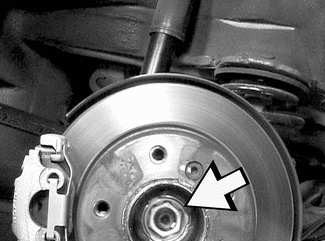
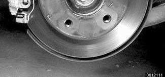
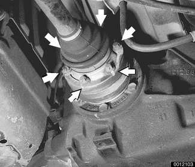
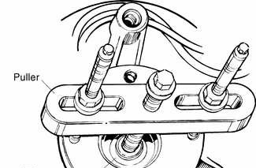
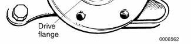
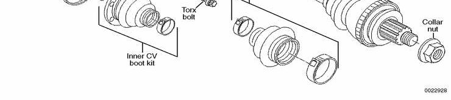
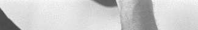
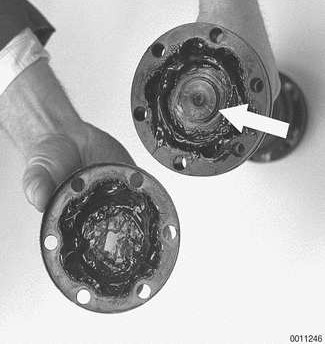
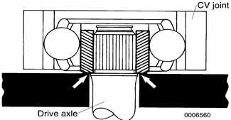
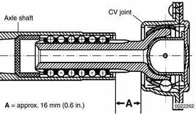

# Drive Axles

> Source: BMW 3 Series (E46) Repair Manual, section 331-2, Rear Axle Final Drive chapter (PDF pages 658–664 of 1252).

The drive axles use constant-velocity (CV) joints on both ends. Two different styles of CV joints have been supplied with E46 vehicles. Refer to the accompanying illustration:

- **Ball cage CV joint.** Traditional design CV joint with thick metal housing (approx. 40 mm/1.6 in. thick). Balls slide in non-parallel grooves.
- **Slip sleeve CV joint.** Thin bolt-on flange (approx. 15 mm/0.6 in. thick). CV joint has splined shaft that slides into end of axle.

For replacement parts, only CV joints boots or complete axles are offered by BMW. To replace a CV joint boot, the drive axle must be removed from the car. The rear axle shafts are different in length. The shorter of the two shafts is located on the left side, the longer shaft on the right.

## Rear drive axle, removing and installing

- With an assistant applying brakes, break free staked collar nut (arrow) at center of rear wheel hub. Do not remove completely.

> **Note:**
> - The drive flange collar nut is tightened to a torque of over 250 Nm (184 ft-lb). Make sure the car is firmly on the ground.

- Raise rear of car. Remove rear wheel.

> **WARNING!**
> - Make sure that the car is firmly supported on jack stands designed for the purpose. Place the jack stands beneath a structural chassis point. Do not place jack stands under suspension parts.

- Detach rear stabilizer bar anchor bolts from rear subframe and tilt stabilizer down.
- Working on left axle: Detach rear of exhaust system and tilt down. Support rear muffler securely.
- Remove drive axle to differential mounting bolts (arrows). Detach drive axle from drive flange. Suspend drive axle from chassis using stiff wire.

- Press drive axle from wheel bearing housing using an appropriate puller.

- Installation is reverse of removal. Apply a light coating of oil to contact face of collar nut and install it loosely.
- Install road wheel and lower car to ground.
- With an assistant applying brakes, tighten drive axle collar nut to its final torque.
- Stake and caulk collar nut.

Tightening torques

| Component | Tightening torque |
|---|---|
| **Drive axle collar nut to drive flange** | |
| M24 | 250 Nm (184 ft-lb) |
| M27 | 300 Nm (221 ft-lb) |
| **Drive axle to differential flange** | |
| M10x20 mm Torx bolt | 83 Nm (61 ft-lb) |
| M10x46 mm bolt (black) | 100 Nm (74 ft-lb) |
| M10x46 mm bolt (silver) (always replace) | 80 Nm (59 ft-lb) |
| Road wheel to hub | 100 ± 10 Nm (74 ± 7 ft-lb) |

Rear drive axle assembly

## CV joint boots

> **Note:**
> - When replacing a CV joint boot, use a complete CV joint boot repair kit. The kit will include a new boot, clamping bands, special lubricant, and a new inner CV joint circlip. The kit is available from an authorized BMW dealer parts department.
> - The outer CV joint cannot be removed from the axle shaft. In order to replace the outer CV boot, it is necessary to remove the inner joint and boot first.
> - If the CV joints are worn or defective, a complete rebuilt axle shaft is available from an authorized BMW dealer parts department.

Working with axle shaft at bench, cut off old boot clamps and remove boots. Clean old grease off joints and shafts. Use new grease from CV joint boot kit.

### Ball cage CV joint boot

Lift off dust cover from inner CV joint and remove circlip (arrow) retaining joint inner hub to axle shaft.

Support inner hub at arrows when pressing axle shaft out of joint.

- Clean all old lubricant off shaft splines and inner joint's splines.

> **CAUTION!**
> - If the CV joint must be disassembled for cleaning and inspection, be sure to matchmark inner and outer race and intermediate ball cage. This allows reassembly of parts in their original positions.

> **Note:**
> - To inspect a CV joint, clean away the grease and look for galling, pitting and other signs of wear or physical damage. Polished surfaces or visible ball tracks alone are not necessarily cause for replacement. Discoloration due to overheating indicates lack of lubrication.

- Apply Loctite® 270 or an equivalent heavy-duty locking compound to drive axle splines. Position new CV joint on shaft so that raised or taller side of hub is facing shaft.

> **WARNING!**
> - Do not let the locking compound contact the balls in the joint. Apply only a thin coat to cover the splines.

- While supporting axle shaft, press inner hub of CV joint onto shaft. Install new circlip.

> **Note:**
> - Do not let the ball hub pivot more than 20 in the outer ring of the joint. The balls will fall out if the hub is pivoted too far.
> - Before installing each small boot clamp be sure to "burp" the boot by flexing the CV joint as far over as it will go. A small screwdriver inserted between the boot and the axle shaft will help the process.
> - BMW recommends Bostik®1513 or Epple®4851 adhesive, and Epple®39 or Curil®T sealer.

| CV joint lubricant capacity | |
|---|---|
| Wheel hub end | 80 gram (2.8 oz.) |
| Differential end | 85 gram (3.0 oz.) |

- Use sealing gel to seal dust cover to CV joint prior to reinstallation.

### Slip sleeve CV joint boot

- Pull CV joint partially out of axle shaft. Matchmark relative position of joint to shaft.

> **CAUTION!**
> - If the joint and shaft are not reassembled in their original position the assembly may be out of balance and vibrate during operation.

When reinstalling joint, push joint into shaft as far as it will go, then pull it out to measurement A (16 mm / 0.6 in.).

> **Note:**
> - This step insures uniform lubrication of the CV joint.

- Keep joint in position while installing inner (small) boot clamp.
- Make sure sealing lip of joint and boot are free of grease. The boot could otherwise slide off when boot clamp is tightened.

| Slip sleeve joint boot lengths | |
|---|---|
| Inner boot | 65 mm (2.6 in.) |
| Outer boot | 55 mm (2.2 in.) |

> **Note:**
> - On the differential end CV joint, position large boot clamp so that crimp in clamp faces rivet on CV joint flange.

- Install large clamps of inner and outer CV joints so that the crimps are offset by 180°.
