# Drive Axles

> Source: BMW 3 Series (E46) Repair Manual, section 311-2, Front Axle Final Drive chapter (PDF pages 568–580 of 1252).

The front drive axles for all wheel drive equipped models use two different types of constant-velocity (CV) joint. The outer CV joints are a traditional design that allows power to be delivered from the axle to the joint continuously through rotation.

The inner CV joints are triple roller bearing joints. This design minimizes the amount of vibration and noise transmitted back through the vehicle drivetrain, while also allowing the axle to move in and out to compensate for suspension travel.

To replace a CV joint or dust boot, the drive axle must be removed from the car.

## Drive axle, removing and installing

> **Note:**
> - If removing the drive axle for service, it is a good idea to replace the drive axle radial seal while the axle is removed from the vehicle.

- Carefully remove center cap from wheel.
- Break free staked collar nut (arrow) at steering arm.

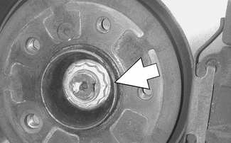

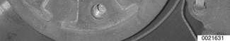

- Lift vehicle and support safely.

> **WARNING!**
> - Make sure the car is stable and well supported at all times. Use a professional automotive lift or jack stands designed for the purpose. A floor jack is not adequate support.

- Remove front wheel.
- Remove splash shield from below engine compartment.
- If working on right side, remove right side heat shield from front axle support.
- Remove ABS sensor (arrow) from steering arm.

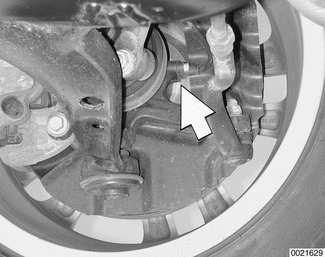

- Unclip brake hose from mounting bracket.
- Unbolt brake caliper and suspend from body using stiff wire.
- On vehicles equipped with Xenon lighting, detach headlight vertical aim sensor from control arm.
- Unfasten stabilizer link from stabilizer bar.
- Remove collar nut from drive axle at steering arm.
- Using BMW special tool 33 2 111/116/117, or similar tool, press outboard end of axle out from drive flange at steering arm.
- Remove inner ball joint mounting bracket bolts (arrows) from subframe.

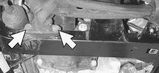

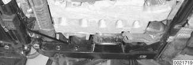

- Support control arm. Working at rear of subframe, remove control arm rear bracket mounting bolts (arrows).

- Tilt steering arm to one side, out of the way.
- Using BMW special tool 31 1 170 or equivalent pry bar, pry inboard CV joint out of front differential or bearing pedestal.

> **Note:**
> - Be prepared to catch oil drips from differential or right side bearing pedestal.

- Installation is reverse of removal, noting the following:
    - Replace drive axle radial seal before replacing drive axle.
    - Before installing drive axle, replace inboard CV joint spring clip (arrow).
    - When pressing drive axle into front axle differential or bearing pedestal, be sure to press axle beyond resistance of spring clip. Spring clip must snap audibly into place.
    - Replace bolts holding control arm bushing bracket to front axle subframe.
    - Be sure to restake new collar nut at outboard end of drive axle after tightening to correct torque specifications. Caulk axle threads.
    - Top up differential fluid. See [Front differential oil, checking and filling]

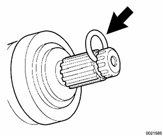

Tightening torques

| Component | Tightening torque |
|---|---|
| Brake caliper to steering arm | 110 Nm (81 ft-lb) |
| Control arm bushing bracket to front axle subframe (replace bolts) | 59 Nm (44 ft-lb) |
| Drive flange collar nut to front hub | 420 Nm (310 ft-lb) |
| Inner ball joint bracket to front axle subframe | 77 Nm (57 ft-lb) |
| Road wheel to hub | 100 ± 10 Nm (74 ± 7 ft-lb) |
| Stabilizer link to stabilizer bar | 65 Nm (48 ft-lb) |

## Drive axle radial seal, replacing

> **Note:**
> - If only replacing drive axle radial seal, the axle does not need to be completely removed from the vehicle. Only the inboard CV joint needs to be removed from either the front axle differential or the right axle bearing pedestal. The front suspension may be partially disassembled for radial seal replacement.

- Lift vehicle and support safely.

> **WARNING!**
> - Make sure car is stable and well supported at all times. Use a professional automotive lift or jack stands designed for the purpose. A floor jack is not adequate support.

- Remove splash shield from below engine compartment.
- Remove inner ball joint mounting bracket bolts (arrows) from subframe.

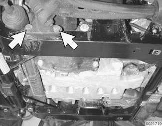

- Support control arm. Working at rear of subframe, remove control arm rear bracket mounting bolts (arrows).
- Tilt steering arm to one side, out of the way.
- Using BMW special tool 31 1 170 or equivalent pry bar, pry inboard CV joint out of front differential or bearing pedestal.

> **Note:**
> - Be prepared to catch oil drips from differential or right side bearing pedestal.

- Pry radial seal out of differential housing or bearing pedestal using a flat screwdriver.

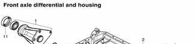

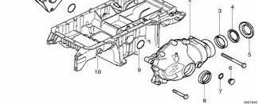

| No. | Part |
|---|---|
| 1 | Right axle bearing pedestal |
| 2 | Front differential |
| 3 | Input shaft seal |
| 4 | Small dustcover |
| 5 | Large dustcover |
| 6 | Differential plug |
| 7 | Plug sealing ring |
| 8 | Drive axle radial seal with lock ring, left |
| 9 | O-ring |
| 10 | Engine oil pan |
| 11 | Drive axle radial seal with lock ring, right |

> **Note:**
> - Remove protective sleeve from new drive axle radial seal before installing seal and save for use during drive axle installation. Drive axle radial seal is equipped with protective covering to prevent sealing lip from damage during installation.

- Using BMW special tool 31 5 130 or equivalent drift, drive radial seal into differential housing or bearing pedestal.
- Coat sealing lip of radial seal with transmission fluid.
- Drive radial seal into differential or bearing pedestal.
- Insert protective sleeve into radial seal.
- Insert inboard end of drive axle partially into differential housing or bearing pedestal.
- Withdraw protective sleeve from sealing lip, cut protective sleeve and remove sleeve.
- Continue installing drive axle until spring clip snaps audibly into place.

> **Note:**
> - Always replace spring clip on inboard end of drive axle before reinstalling into differential housing or bearing pedestal.

- Installation is reverse of removal, noting the following:
    - Make sure inboard end of drive axle audibly snaps into place.
    - Replace control arm bracket bolts.
    - Top up differential fluid. See [Front differential oil, checking and filling]

Tightening torques

| Component | Tightening torque |
|---|---|
| Inner ball joint bracket to front axle subframe | 77 Nm (57 ft-lb) |
| Brake caliper to steering arm | 110 Nm (81 ft-lb) |
| Control arm bracket to front axle subframe (replace bolts) | 59 Nm (44 ft-lb) |

## Outer CV joint boot, replacing

> **Note:**
> - When replacing CV boots, use complete boot repair kits. A kit will include a new boot, clamping bands, special lubricant, and a new outer CV joint axle circlip. A kit is available from an authorized BMW dealer parts department.

- Remove drive axle from vehicle as described earlier.
- Release retaining clamps from both ends of outer CV boot.
- Using a hammer, pound outer CV joint off drive axle.
- Using a flat blade screw driver, pry spring clip off drive axle splines.
- Clean all old lubricant off axle splines.

> **Note:**
> - To inspect a CV joint, clean away grease and look for galling, pitting and other signs of wear or physical damage. Polished surfaces or visible ball tracks alone are not necessarily cause for replacement. Discoloration due to overheating indicates lack of lubrication.

- Place new clamping bands and CV boot over drive axle.
- Replace spring clip on splined end of drive axle.
- Apply Loctite® 270 or an equivalent heavy-duty locking compound to drive axle splines.

> **WARNING!**
> - Do not let locking compound contact balls in joint. Apply only a thin coat to cover splines.

- Pack outer CV joint with fresh grease. Tap CV joint onto splined end of drive axle until spring clip snaps audibly into place.

CV joint lubricant capacity

| CV joint | Capacity |
|---|---|
| Outer CV joint | 80 gram (2.8 oz.) |

- Using clamp pliers, secure retaining clamp into position tightly sealing large end of boot against CV joint.

> **Note:**
> - Before installing each small boot clamp be sure to "burp" boot by flexing CV joint as far over as it will go. A small screw-driver inserted between boot and axle-shaft will help the process.

- With outer CV boot full of grease, and any air eliminated from boot, secure small end of CV boot onto CV joint by securing clamp with pliers.
- Installation is reverse of removal, noting the following:
    - Make sure inboard end of drive axle audibly snaps into place.
    - Replace control arm bracket bolts.
    - Be sure to restake new collar nut at outboard end of drive axle after tightening to correct torque specifications. Caulk axle threads.
    - Top up differential fluid. See [Front differential oil, checking and filling]

Tightening torques

| Component | Tightening torque |
|---|---|
| Ball joint bracket to front axle subframe | 77 Nm (57 ft-lb) |
| Brake caliper to steering arm | 110 Nm (81 ft-lb) |
| Control arm bushing bracket to front axle subframe | 59 Nm (44 ft-lb) |
| Drive flange collar nut to front hub | 420 Nm (310 ft-lb) |

## Inner CV joint boot, replacing

> **Note:**
> - When replacing CV joint boots, use complete boot repair kits. A kit will include a new boot, clamps, special lubricant, and a new inner universal joint circlip. A kit is available from an authorized BMW dealer parts department.

- Remove drive axle from vehicle as described earlier.
- Release retaining clamp on both ends of inner CV boot. Pull back inner boot and detach inner CV joint housing.
- Remove circlip retaining triple roller bearing to drive axle and remove triple roller bearing.
- Slide boot off drive axle. Separate inner CV joint boot adapter from boot.
- Clean all old lubricant off axle splines and triple roller bearing splines.
- Install new inner CV joint boot:
    - Attach boot to boot adapter.
    - Slide retaining clamps and boot over drive axle.
    - Secure retaining clamp using clamp pliers, tightly sealing small end of boot against drive axle.
- Install triple roller bearing with flat edge of joint facing retaining circlip.
- Replace inner CV joint housing shaft circlip.
- Pack triple roller bearing and inner CV joint boot with fresh grease.

CV joint lubricant capacity

| CV joint | Capacity |
|---|---|
| Inner CV joint | 85 gram (3.0 oz.) |

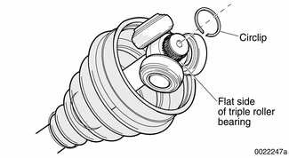

- Insert triple roller bearing into inner CV joint housing.
- Secure boot connection to boot adapter using clamp supplied with boot kit.
- Installation is reverse of removal, noting the following:
    - Make sure inboard end of drive axle audibly snaps into place.
    - Replace control arm bracket bolts.
    - Be sure to restake new collar nut at outboard end of drive axle after tightening to correct torque specifications. Caulk axle threads.
    - Top up differential fluid. See [Front differential oil, checking and filling]

Tightening torques

| Component | Tightening torque |
|---|---|
| Ball joint bracket to front axle subframe | 77 Nm (57 ft-lb) |
| Brake caliper to steering arm | 110 Nm (81 ft-lb) |
| Control arm bushing bracket to front axle subframe (replace bolts) | 59 Nm (44 ft-lb) |
| Drive flange collar nut to front hub | 420 Nm (310 ft-lb) |

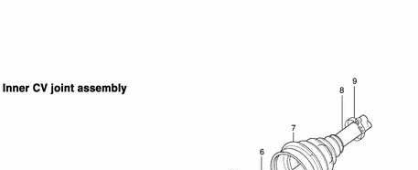

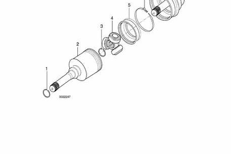

Inner CV joint assembly

| No. | Part |
|---|---|
| 1 | Spring clip |
| 2 | Inner CV joint housing |
| 3 | Circlip |
| 4 | Triple roller bearing |
| 5 | Inner CV joint boot adapter |
| 6 | Clamp |
| 7 | Inner CV joint boot |
| 8 | Drive axle shaft |
| 9 | Clamp |
