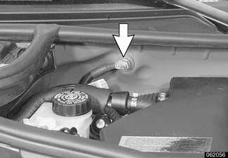
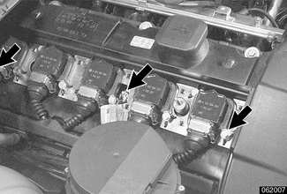
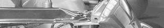
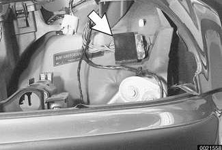
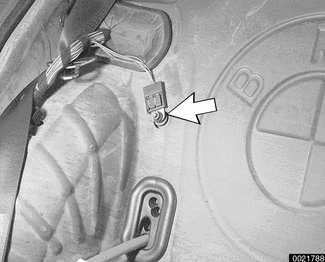

# Driveability Troubleshooting

> Source: BMW 3 Series (E46) Repair Manual, section 100-2, Engine–General chapter (PDF pages 128–131 of 1252).

The Siemens systems are sophisticated self-diagnosing OBD II systems. These systems continuously monitor components and record and store valuable diagnostic information. If the 'Check Engine' or 'Service Engine Soon' light [also known as the malfunction indicator lamp (MIL)] is illuminated, the first diagnostic test should be to hook up a BMW-compatible scan tool and check the fault memory.

The powerful diagnostic capabilities of these systems have the potential to save hours of diagnostic time, incorrect component replacement and possible damage to system components. See [OBD On Board Diagnostics] at the back of this manual.

Two of the most common causes of driveability problems are system voltage levels and poor grounds.

## System voltage

The DME system requires that the system (battery) voltage be maintained within a narrow range. Voltage levels outside the operating range can cause havoc. When troubleshooting an illuminated MIL, make sure the battery is fully charged and capable of delivering all its power to the electrical system.

To make a quick check of the battery charge, measure the voltage across the battery terminals with all cables attached and the ignition off. A fully charged battery will measure 12.6 volts or slightly more, compared to 12.15 volts for a battery with a 25% charge.

Even a fully charged battery cannot deliver power unless it is properly connected to the electrical system. Check the battery terminals for corrosion or loose cable connections. If the battery does not maintain the proper voltage, the charging system may be at fault. See [121 Battery, Alternator, Starter].

If a battery cable connection has no visible faults, but is still suspect, measure the voltage drop across the connection. A large drop indicates excessive resistance, indicating that the connection is corroded, dirty, or damaged. Clean or repair the connection and retest.

> **Note:**
> - For instructions on conducting a voltage drop test and other general electrical troubleshooting information, see [600 Electrical System–General].

The DME system operates at low voltage and current levels, making it sensitive to small increases in resistance. The electrical system is routinely subjected to corrosion, vibration and wear, so faults or corrosion in the wiring harness and connectors are not uncommon. Visually inspect all wiring, connectors, switches and fuses in the system. Loose or damaged connectors can cause intermittent problems, especially the small terminals in the ECM connectors. Disconnect the wiring harness connectors to check for corrosion, and use electrical cleaning spray to remove contaminants.

## Main grounds

Good grounds are critical to proper DME operation. If a ground connection has no visible faults but is still suspect, measure the voltage drop across the connection. A large voltage drop indicates high resistance, indicating that the connection is corroded, dirty or damaged. Clean or repair the connection and retest.

> **Note:**
> - For instructions on conducting a voltage drop test and other general electrical troubleshooting information, see [600 Electrical System–General].

Below is a listing of the main grounds for the fuel and ignition circuits of the DME system.

Main ground (arrow) for engine management system in left rear of engine compartment on bulkhead behind E-box.

Main grounds for ignition coils (arrows).

Main chassis ground harness connection (arrow) in left front of engine compartment, behind left headlight assembly (headlight assembly shown removed).

Main fuel pump ground (arrow) behind right rear seat back rest.

