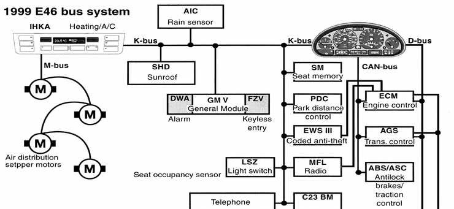
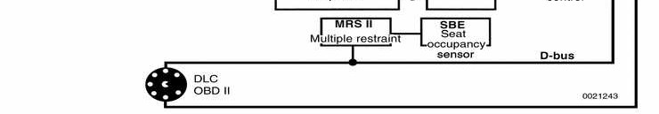
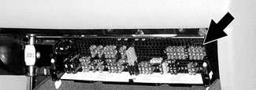
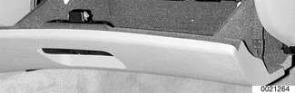
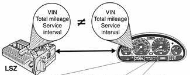
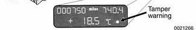

# E46 Electrical System

> Source: Bentley *BMW 3 Series (E46) 1999–2005 (M3) Repair Manual*, section 600-2 (PDF pages 943–952 of 1252).

E46 cars are electrically complex. Many vehicle systems and subsystems are interconnected or integrated. In addition, the requirements of second generation On-Board Diagnostics (OBD II) are such that there are now many more circuits and wires in the vehicle than ever before. The components must exchange large volumes of data with one another in order to perform their various functions.

The use of dedicated data lines for each link in the system has reached the limits of its capabilities. On the one hand, wiring harnesses now must be so complex that they become unmanageable. In addition, the finite number of pins on conventional connectors becomes a limiting factor in electronic control module development.

The solution has been found in the use of specialized, vehicle compatible serial bus systems. The E46 bus system is summarized in [Table a].

Table a. E46 busses

| Bus | Circuits covered |
|---|---|
| K-bus | Driver information systems (instrument cluster, Check Control, on-board computer) Central Body Electronics (ZKE V) General Module (GM V) Seat memory (SM) Sunroof (SHD) Rain sensor (AIC) Telephone and sound system Headlight module (LSZ) Coded anti-theft (EWS III) and anti-theft (DWA) Remote entry (FZV) Park distance control (PDC) |
| M-bus | Heating and air conditioning (IHKA) components |
| CAN-bus | Engine management system (DME) Transmission control (AGS) Antilock brakes (ABS) Traction control (ASC) Dynamic stability control (DSC) |
| D-bus | Data link connector (DLC) OBD II connector Multiple restraint system (MRS II) |

**1999 E46 bus system, diagram**

## Voltage and polarity

The vehicle electrical system is a 12-volt direct current (DC) negative-ground system. A voltage regulator controls system voltage at approximately 12-volts. All circuits are grounded by direct or indirect connection to the negative (-) terminal of the battery. A number of ground connections throughout the car connect the wiring harness to chassis ground. These circuits are completed by the battery cable or ground strap between the body and the battery negative (-) terminal.

## Wiring, fuses and relays

Electrical components connect using one of the following:

- Heavy cables with lug-type connectors (battery and starter)
- Electrical harnesses with keyed, push-on connectors that lock into place
- Busses with modular connectors

With the exception of the starter and the charging system, most electrical power is routed from the ignition switch or the battery through the main relay panel in back of the glove compartment or the main fuse box (arrow) above the glove compartment. Fuses are color coded to indicate current capacities.

The relays and control modules are mounted in various places throughout the vehicle. See [610 Electrical Component Locations].

## Central Body Electronics (ZKE V)

E46 vehicles are equipped with an integrated complex of electronic modules connected mostly via K-bus. This system, called ZKE V, is primarily controlled by the General Module (GM V).

These functions are controlled directly by the GM V:

- Windshield wiper/washer system, with optional Rain Sensor Interface. See [611 Wipers and Washers].
- Central locking, power trunk release, keyless entry (FZV). See [515 Central Locking and Anti-theft].
- Power window control. See [512 Door Windows].
- Car Memory/Key Memory. See [515 Central Locking and Anti-theft].
- Interior lighting. See [612 Switches].
- Alarm system (DWA). See [515 Central Locking and Anti-theft].
- Electronic consumer sleep mode, described later in this section

Other functions are not directly controlled by the GM V but interconnected:

- Rain sensor (AIC). See [611 Wipers and Washers].
- Sunroof operation (SHD). See [540 Sunroof].
- Seat memory (SM) and electrical operation. See [520 Seats].
- Outside rear-view mirror control and heating. See [510 Exterior Trim, Bumpers].
- Windshield washer jet heating. See [611 Wipers and Washers].

## Redundant data storage

The following vehicle information is stored redundantly in the instrument cluster and the light switch module:

- Vehicle identification number (VIN)
- Total mileage
- Service interval data

This redundancy means that the instrument cluster or light module may be replaced without loss of stored data.

The data between the two units is compared each time the ignition is switched on (KL 15 on). If the data does not match, the tamper warning dot (arrow) in the mileage display will be illuminated. Under certain circumstances a fault code (DTC) will be set.

Resetting and resynchronizing of codes and data requires the use of BMW scan tools DIS or MoDiC.

## Car Memory/Key Memory

A number of features and functions can be customized to the driver(s) preference. The identity of the vehicle user is provided by a signal from the keyless entry system (FZV).

Car Memory and Key Memory are actually two separate functions, although they are marketed as a combined feature. See [515 Central Locking and Anti-theft] for further details.

## Electrical consumer sleep mode

Central body electronics (ZKE V) is designed to bring the vehicle electrical consumers into "sleep mode" after 16 minutes of inactivity.

In order to test sleep mode:

- Switch ignition off.
- Close all doors, trunk and hood.
- Lock vehicle using central locking.
- Wait 16 minutes.

If one of a number of inputs into the General Module (GM V) is activated before the vehicle is in sleep mode, the 16 minute cycle starts again. Once the vehicle is in sleep mode, the GM V will "wake up" if it receives a change of signal from one of the following sensors:

- K-bus
- Door jamb sensors
- Trunk lid lock cylinder microswitch
- Interior trunk lid release push-button microswitch
- Central locking button
- Engine hood latch microswitch
- Trunk key position switch
- Interior light switch
- Internal motion sensor
- Tilt sensor
- Driver's door lock sensors

> **Note:** If an interior light is accidentally left on, the GM V will override the signal from it after 16 minutes and implement sleep mode.

## Electrical system safety precautions

Please read the warnings and cautions in this section before doing any work on your electrical system.

> **WARNING!**
>
> - An airbag unit houses an explosive powerful charge. Making repairs without the proper knowledge and special test equipment may cause serious personal injury. See [721 Airbag System (SRS)].
> - The ignition system of the car operates at lethal voltages. People with pacemakers or weak hearts should not expose themselves to the ignition system electric currents. Extra caution must be taken when working on the ignition system or when servicing the engine while it is running or the key is on. See [120 Ignition System] for additional ignition system warnings and cautions.
> - Keep hands, clothing and other objects clear of the electric radiator cooling fan when working on a warm engine. The fan may start at any time, even when the ignition is switched off.

> **CAUTION!**
>
> - Always turn off the engine and disconnect the negative (-) cable from the battery before removing any electrical components. Disconnecting the battery may erase fault code(s) stored in control module memory. Check for fault codes using special BMW diagnostic equipment.
> - Prior to disconnecting the battery, read the battery disconnection cautions given at the front of this manual on page viii.
> - Connect and disconnect ignition system wires, multiple connectors and ignition test equipment leads only while the ignition is off.
> - Do not disconnect the battery with the engine running.
> - Do not quick-charge the battery (for boost starting) for longer than one minute, and do not exceed 16.5 volts at the battery with the boosting cables attached. Wait at least one minute before boosting the battery a second time.
> - Do not use an analog meter. Use only a digital multimeter.
> - Many of the solid-state modules are static sensitive. Static discharge will permanently damage them. Always handle the modules using proper static prevention equipment and techniques.
> - To avoid damaging harness connectors or relay panel sockets, use jumper wires with flat-blade connectors that are the same size as the connector or relay terminals.
> - Always switch a digital multimeter to the appropriate function and range before making test connections.
> - Do not try to start the engine of a car which has been heated above 176F/80C, (for example, in a paint drying booth). Allow it to cool to normal temperature.
> - Disconnect the battery before doing any electric welding on the car.
> - Do not wash the engine while it is running, or anytime the ignition is switched on.
> - Choose test equipment carefully. Use a digital multimeter with at least 10 megaohm input impedance, or an LED test light. An analog meter (swing-needle) or a test light with a normal incandescent bulb may draw enough current to damage sensitive electronic components.
> - An ohmmeter must not be used to measure resistance on solid state components such as control units or time delay relays.
> - Always disconnect the battery before making resistance (ohm) measurements on the circuit.
