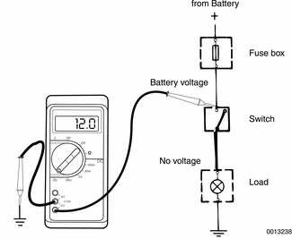
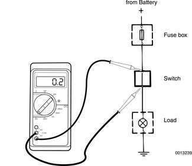
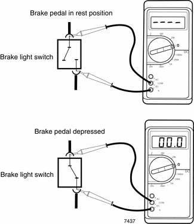

# Electrical Troubleshooting

> Source: Bentley *BMW 3 Series (E46) 1999–2005 (M3) Repair Manual*, section 600-4 (PDF pages 958–965 of 1252).

Four things are required for current to flow in any electrical circuit: a voltage source, wires or connections to transport the voltage, a load or device that uses the electricity, and a connection to ground.

Most problems can be found using a digital multimeter (volt/ohm/amp meter) to check the following:

- Voltage supply
- Breaks in the wiring (infinite resistance/no continuity)
- A path to ground that completes the circuit.

Electric current is logical in its flow, always moving from the voltage source toward ground. Electrical faults can usually be located through a process of elimination. When troubleshooting a complex circuit, separate the circuit into smaller parts. General tests outlined below may be helpful in finding electrical problems. The information is most helpful when used with [Wiring Diagrams].

Be sure to analyze the problem. Use wiring diagrams to determine the most likely cause. Get an understanding of how the circuit works by following the circuit from ground back to the power source.

When making test connections at connectors and components, use care to avoid spreading or damaging the connectors or terminals. Some tests may require jumper wires to bypass components or connections in the wiring harness. When connecting jumper wires, use blade connectors at the wire ends that match the size of the terminal being tested. The small internal contacts are easily spread apart, and this can cause intermittent or faulty connections that can lead to more problems.

## Voltage and voltage drops

Wires, connectors, and switches that carry current are designed with very low resistance so that current flows with a minimum loss of voltage. A voltage drop is caused by higher than normal resistance in a circuit. This additional resistance actually decreases or stops the flow of current. A voltage drop can be noticed by problems ranging from dim headlights to sluggish wipers. Some common sources of voltage drops are corroded or dirty switches, dirty or corroded connections or contacts, and loose or corroded ground wires and ground connections.

A voltage drop test is a good test to make if current is flowing through the circuit, but the circuit is not operating correctly. A voltage drop test will help to pinpoint a corroded ground strap or a faulty switch. Normally, there should be less than 1 volt drop across most wires or closed switches. A voltage drop across a connector or short cable should not exceed 0.5 volts.

> **Note:**
> - A voltage drop test is generally more accurate than a simple resistance check because the resistances involved are often too small to measure with most ohmmeters. For example, a resistance as small as 0.02 ohms would result in a 3 volt drop in a typical 150 amp starter circuit. (150 amps x 0.02 ohms = 3 volts).
> - Keep in mind that voltage with the key on and voltage with the engine running are not the same. With the ignition on and the engine off (battery voltage), voltage should be approximately 12.6 volts. With the engine running (charging voltage), voltage should be approximately 14.0 volts. Measure voltage at the battery with the ignition on and then with the engine running to get exact measurements.

## Voltage, measuring

Connect digital multimeter negative lead to a reliable ground point on car.

> **Note:** The negative (-) battery terminal is always a good ground point.

- Connect digital multimeter positive lead to point in circuit you wish to measure.
- If a reading is obtained, current is flowing through circuit.

> **Note:** The voltage reading should not deviate more than 1 volt from voltage at the battery. If voltage drop is more than this, check for a corroded connector or loose ground wire.

## Voltage drop, testing

Voltage drop can only be checked when there is a load on the circuit, such as when operating the starter motor or turning on the headlights. A digital multimeter should be used to ensure accurate readings.

Connect digital multimeter positive lead to positive (+) battery terminal or a positive power supply close to battery source.

- Connect digital multimeter negative lead to other end of cable or switch being tested.
- With power on and circuit working, meter shows voltage drop (difference between two points). This value should not exceed 1 volt.

> **Note:** The maximum voltage drop in an automotive circuit, as recommended by the Society of Automotive Engineers (SAE), is as follows: 0 volts for small wire connections; 0.1 Volts for high current connections; 0.2 volts for high current cables; and 0.3 volts for switch or solenoid contacts. On longer wires or cables, the drop may be slightly higher. In any case, a voltage drop of more than 1.0 volt usually indicates a problem.

## Continuity, checking

Continuity tests can be used to check a circuit or switch. Because most automotive circuits are designed to have little or no resistance, a circuit or part of a circuit can be easily checked for faults using an ohmmeter. An open circuit or a circuit with high resistance will not allow current to flow. A circuit with little or no resistance allows current to flow easily.

When checking continuity, the ignition should be off. On circuits that are powered at all times, the battery should be disconnected. Using the appropriate wiring diagram, a circuit can be easily tested for faulty connections, wires, switches, relays and engine sensors by checking for continuity.

For example, to test brake light switch for continuity:

- With brake pedal in rest position (switch open) there is no continuity (infinite Ω).
- With pedal depressed (switch closed) there is continuity (0 Ω).

## Short circuits

Short circuits are exactly what the name implies. The circuit takes a shorter path than it was designed to take. The most common short that causes problems is a short to ground where the insulation on a positive (+) wire wears away and the metal wire is exposed. When the wire rubs against a metal part of the car or other ground source, the circuit is shorted to ground. If the exposed wire is live (positive battery voltage), a fuse will blow and the circuit may possibly be damaged.

Shorts to ground can be located with a digital multimeter. Short circuits are often difficult to locate and may vary in nature. Short circuits can be found using a logical approach based on current path.

> **CAUTION!**
>
> - On circuits protected with high rating fuses (25 amp and greater), wires or circuit components may be damaged before the fuse blows. Always check for damage before replacing fuses of this rating.
> - When replacing blown fuses, use only fuses having the correct rating. Always confirm the correct fuse rating printed on the fuse/relay panel cover.

### Short circuit, testing with ohmmeter

- Remove blown fuse from circuit and disconnect cables from battery. Disconnect harness connector from circuit load or consumer.

Using an ohmmeter, connect one test lead to load side of fuse terminal (terminal leading to circuit) and the other test lead to ground.

- If there is continuity to ground, there is a short to ground.
- If there is no continuity, work from wire harness nearest to fuse/relay panel and move or wiggle wires while observing meter. Continue to move down harness until meter displays a reading. This is the location of short to ground.
- Visually inspect wire harness at this point for any faults. If no faults are visible, carefully slice open harness cover or wire insulation for further inspection. Repair any faults found.

### Short circuit, testing with voltmeter

- Remove blown fuse from circuit. Disconnect harness connector from circuit load or consumer.

> **Note:** Most fuses power more than one consumer. Be sure all consumers are disconnected when checking for a short circuit.

Using a digital multimeter, connect test leads across fuse terminals. Make sure power is present in circuit. If necessary turn key on.

- If voltage is present at voltmeter, there is a short to ground.
- If voltage is not present, work from wire harness nearest to fuse/relay panel and move or wiggle wires while observing meter. Continue to move down harness until meter displays a reading. This is the location of short to ground.
- Visually inspect wire harness at this point for any faults. If no faults are visible, carefully slice open harness cover or wire insulation for further inspection. Repair any faults found.
