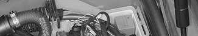
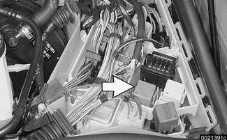
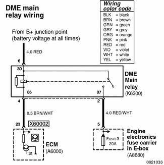
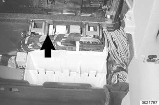
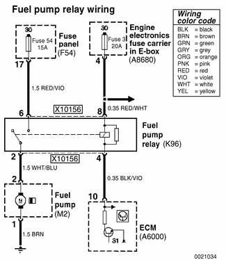
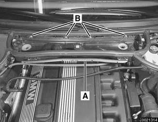
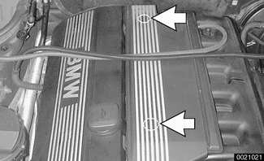
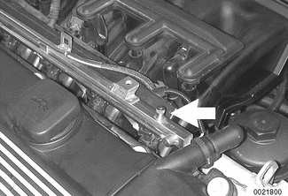

# Electrical Checks and Component Testing

> Source: BMW 3 Series (E46) Repair Manual, section 130-2, Fuel Injection chapter (PDF pages 326–331 of 1252).

Troubleshooting and fault diagnosis on OBD II cars is best performed using an electronic scan tool. However, it may be necessary to perform basic tests of the engine management main components, fuel system or wiring.

> **CAUTION!**
> - The tests in this section may set fault codes (DTCs) in the ECM and illuminate the MIL. After all testing is completed, access and clear DTC fault memory using a BMW compatible scan tool. See [OBD On Board Diagnostics] at the back of this manual.
> - Only use a digital multimeter for electrical tests.
> - Relay positions can vary. Be sure to confirm relay position by identifying the wiring in the socket using the wiring diagrams found at the rear of this manual.

## DME main relay, testing

The DME main relay is energized via the engine control module (ECM) and supplies battery positive (B+) power to many of the engine management components and subsystems. If this relay is faulty, the engine will not start.

- With ignition off, remove main relay (arrow) in electronics box (E-box) at left rear of engine compartment.
    - Check for voltage at terminal 6 of main relay socket (30- red wire).
    - If battery voltage is present continue testing.
    - If battery voltage is not present, check large red wire in relay socket. See [Electrical Wiring Diagrams].
    - Reinstall relay and turn ignition on. Gain access to underside of relay socket and check for ground at terminal 4 (85- brown/white wire).
    - If ground is present continue testing.
    - If ground is not present, signal from ECM (connector X60002, pin 23) is missing. Check wire between ECM and relay.
    - With ignition on and relay installed, check for battery voltage at terminal 2 (87- red/white wire).
    - If battery voltage is present, relay has energized and is functioning correctly.
    - If battery voltage is not present and all earlier tests are OK, relay is faulty and should be replaced.

## Fuel pump relay, testing

The ECM energizes the fuel pump relay by providing the coil side of the relay with ground. During starting, the fuel pump runs as long as the ignition switch is in the start position and continues to run once the engine starts. If the relay is faulty the fuel pump will not run.

- Fuel pump relay (arrow) is located behind glove compartment. Remove glove compartment. See [513 Interior Trim].
- Remove fuel pump relay from socket.

- With ignition in START position, check for battery voltage at relay connector (X10156) terminals 6 and 8 (red/violet and red/white wires).

> **CAUTION!**
> - Ensure that manual transmission vehicles are not in gear, and automatic transmission vehicles are in Park or Neutral prior to operating ignition in START position.

- With ignition in START position, use digital multimeter to check for ground at terminal 4 (black/violet wire).

> **Note:**
> - The ground at terminal 4 is switched by the ECM. The ECM harness must be connected to check the switched ground connection.

- If no faults are found up to this point, turn ignition key off. Using a fused (14 gauge) jumper wire, connect relay connector terminal 6 to terminal 2. The fuel pump should run.
    - If pump runs and all other tests are as specified, fuel pump relay is probably faulty.
    - If pump does not run, test fuel pump operation as described in [160 Fuel Tank and Fuel Pump].

> **CAUTION!**
> - The jumper wire should be 1.5 mm² (14 ga.) and include an in-line fuse holder with a 15 amp fuse. To avoid fuse/relay panel damage from repeated connecting and disconnecting, also include a toggle switch.

## Fuel delivery and fuel pressure

Checking fuel delivery volume and fuel pressure is a fundamental part of troubleshooting and diagnosing the engine management system. Fuel pressure directly influences fuel delivery. Procedures for measuring the fuel pressure and fuel volume are given in [160 Fuel Tank and Fuel Pump].

## Relieving fuel pressure

The fuel system retains fuel pressure in the system when the engine is turned off. To prevent fuel from spraying on a hot engine, system fuel pressure should be relieved before disconnecting fuel lines. One method is to tightly wrap a shop towel around a fuel line fitting and loosen or disconnect the fitting.

Cleanliness is essential when working with fuel circuit components. Thoroughly clean the unions before disconnecting fuel lines.

> **WARNING!**
> - Gasoline is highly flammable and its vapors are explosive. Do not smoke or work on a car near heaters or other fire hazards when diagnosing and repairing fuel system problems. Have a fire extinguisher available in case of an emergency.
> - When working on an open fuel system, wear suitable hand protection. Prolonged contact with fuel can cause illnesses and skin disorders.

- Remove interior ventilation microfilter housing.
    - Remove upper cover and microfilter.
    - Open wiring harness loom (A) and move wiring out of way.
    - Unfasten screws (B) and remove lower microfilter housing.

- Remove fuel rail cover by prying off nut covers (arrows) and removing nuts.

- Unscrew schraeder valve cap (arrow) from fuel rail. Unscrew fuel tank cap to release pressure to vent tank.

- Using a brief burst of compressed air (maximum of 3 bar or 43.5 psi) blow fuel back through return line into fuel tank.

> **WARNING!**
> - Fuel in fuel line is under pressure (approx. 3 - 5 bar or 45 - 75 psi) and may be expelled under pressure. Do not smoke or work near heaters or other fire hazards. Keep a fire extinguisher handy. Before disconnecting fuel hoses, wrap a cloth around fuel hoses to absorb any leaking fuel. Catch and dispose of escaped fuel. Plug all open fuel lines.
> - Always unscrew fuel tank cap to release pressure in the tank before working on the tank or lines.
