# Electronic Brake and Stability Control Systems

> Source: BMW 3 Series (E46) Repair Manual, section 300-2, Suspension, Steering and Brakes — General chapter (PDF pages 481–504 of 1252).

All E46 vehicles are equipped with an Antilock Braking System (ABS). Early production models featured ABS with Automatic Stability Control (ABS/ASC). Later models came equipped with ABS and Dynamic Stability Control (ABS/DSC). DSC builds upon the existing ABS/ASC system to provide electronic control of drive and braking systems to insure vehicle stability.

This manual will refer to these systems as ABS. ASC or DSC will be specified when necessary. See the accompanying illustrations for individual system identification.

## E46 Electronic braking and stability control systems

### ASC

1999 - 2000 Automatic Stability Control Teves MK 20 ASC

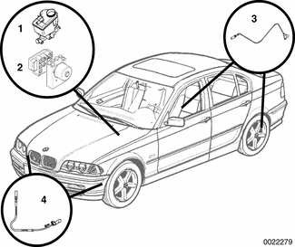

| No. | Component |
|---|---|
| 1 | Brake master cylinder and fluid reservoir, left rear of engine compartment |
| 2 | ASC control module and hydraulic unit, left rear of engine compartment under master cylinder |
| 3 | Rear wheel speed sensor, at each rear wheel hub |
| 4 | Front wheel speed sensor, at each front steering arm |

### DSC

1999 - 2000 Dynamic Stability Control Teves MK 20 DSC

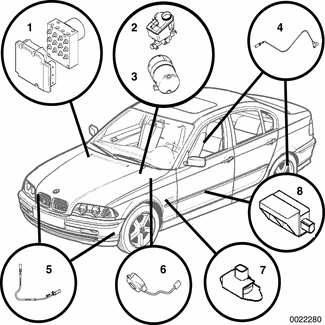

| No. | Component |
|---|---|
| 1 | DSC control module and hydraulic unit, right rear of engine compartment |
| 2 | Brake fluid reservoir, master cylinder and DSC brake pressure sensors, left rear of engine compartment |
| 3 | DSC precharge pump, left rear of engine compartment, under brake master cylinder |
| 4 | Rear wheel speed sensor, at each rear wheel hub |
| 5 | Front wheel speed sensor, at each front steering arm |
| 6 | Steering angle sensor, at base of upper steering column |
| 7 | Lateral acceleration sensor, behind driver's kickpanel |
| 8 | Rotational acceleration (yaw) sensor, under driver's seat, underneath rug |

2001 rear wheel drive Dynamic Stability Control Teves MK 60 DSC

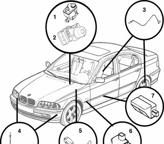

| No. | Component |
|---|---|
| 1 | Brake fluid reservoir and master cylinder, left rear of engine compartment |
| 2 | DSC control module and hydraulic unit, left rear of engine compartment, under brake master cylinder |
| 3 | Rear wheel speed sensor, at each rear wheel hub |
| 4 | Front wheel speed sensor, at each front steering arm |
| 5 | Steering angle sensor, at base of upper steering column |
| 6 | Lateral acceleration sensor, behind driver's kickpanel |
| 7 | Rotational acceleration (yaw) sensor, under driver's seat, underneath rug |

> **Note:**
> - There is no precharge pump in this system.

2001 all wheel drive Dynamic Stability Control Bosch DSC III 5.7

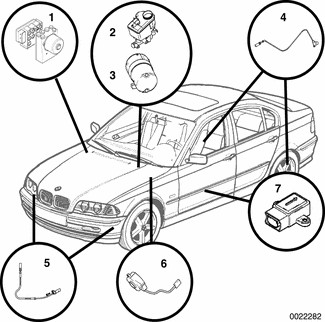

| No. | Component |
|---|---|
| 1 | DSC control module, hydraulic unit and DSC brake pressure sensor, right rear of engine compartment |
| 2 | Brake fluid reservoir and master cylinder, left rear of engine compartment |
| 3 | DSC precharge pump, left rear of engine compartment, under brake master cylinder |
| 4 | Rear wheel speed sensor, at each rear wheel hub |
| 5 | Front wheel speed sensor, at each front steering arm |
| 6 | Steering angle sensor, at base of upper steering column |
| 7 | Lateral acceleration sensor and rotational acceleration (yaw) sensor, under driver's seat, underneath rug |

## ABS system description

The electronically controlled ABS maintains vehicle stability and control during emergency braking by preventing wheel lock-up. ABS provides optimum deceleration and stability during adverse conditions. It automatically adjusts brake system hydraulic pressure at each wheel to prevent wheel lock-up.

The system's main components are the wheel speed (pulse) sensors, the ABS/ASC or ABS/DSC control module, and the hydraulic control unit.

The wheel speed sensors continuously send wheel speed signals to the control module. The control module compares these signals to determine, in fractions of a second, whether any of the wheels are about to lock. If any wheel is nearing a lock-up condition, the module signals the hydraulic unit to maintain or reduce pressure at the appropriate wheel(s). Pressure is modulated by electrically-operated solenoid valves in the hydraulic unit.

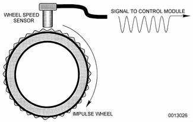

## Automatic Stability Control (ASC)

The Automatic Stability Control (ASC) system works in conjunction with the Antilock Brake System (ABS) and the engine management system to enhance vehicle control. The main function of the ASC system is to maintain the rolling contact between the tires and the road surface under all driving conditions. This is achieved through exact application and management of braking and drivetrain forces.

> **Note:**
> - The traction control system referred to as ASC (Automatic Stability Control) may also be referred to as ASC+T (Automatic Stability Control+Traction).

The ASC system improves traction by electronically applying the rear brakes when the rear drive wheels are spinning at a faster rate than the front wheels. The combined ABS/ASC control module, operating through the ABS hydraulic control unit, modulates braking force at the rear wheels.

In addition, ASC will deactivate individual fuel injectors and override the motor driven throttle to reduce engine torque and maintain vehicle traction. Because the throttle is controlled electronically the driver cannot increase the engine power output during ASC intervention regardless of how far the accelerator pedal is pushed.

The components that comprise the ASC system also function to replace the limited slip differential available in previous models. Even with the ASC system turned off, if the ASC control module senses a difference in wheel speed (one wheel spinning) the control module will apply modulated braking force to the slipping wheel until traction is regained, but will not override fuel injection function.

Traction control also comes into operation during deceleration. Decelerating on snowy or icy road surfaces can lead to rear wheel slip. If a rear wheel starts to drag or lock up, the ASC system can limit the problem by adjusting throttle, fuel injection and ignition timing.

A switch on the center console is used to toggle the ASC on or off.

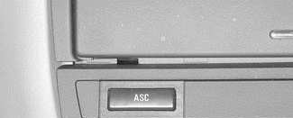

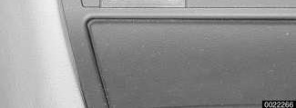

The ASC system is designed to be maintenance free. There are no adjustments that can be made. Repair and troubleshooting of the ASC system requires special test equipment and knowledge and should be performed only by an authorized BMW dealer.

Table c. ASC indicator lamp function lists the conditions indicated by the ASC indicator light in the instrument cluster.

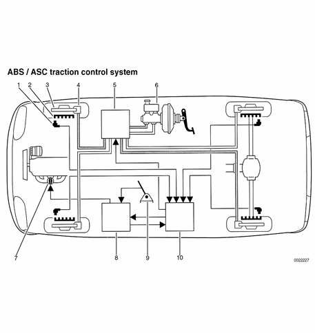

| No. | Component |
|---|---|
| 1 | Wheel speed sensor |
| 2 | Wheel speed pulse wheel |
| 3 | Brake disk |
| 4 | Brake caliper |
| 5 | ABS/ASC hydraulic unit |
| 6 | Brake master cylinder |
| 7 | Throttle valve |
| 8 | Engine control module |
| 9 | Accelerator pedal |
| 10 | ABS/ASC control module |

Table c. ASC indicator lamp function

| Indicator lamp | Condition | Action / Use |
|---|---|---|
| Light on | Normal ASC start-up | Automatic ASC self-test |
| Light off | ASC monitoring mode | Automatic ASC operation |
| Press ASC button, light comes on | ASC off (disabled) | Rocking the car to get out of snow or other loose surface Driving with snow chains |
| Press ASC button, light goes out | ASC monitoring mode | Automatic ASC operation |
| Light flashes | ASC active mode | Normal ASC operation as it controls wheel speed |
| Light stays on after start up or comes on while driving | Defect in ASC | Consult BMW dealer for diagnosis/repair (vehicle operation remains normal) |

## Dynamic Stability Control (DSC)

Dynamic Stability Control (DSC), standard in 2000 and later E46 models, utilizes many principles and components of the ASC traction control system. DSC is active throughout the driving experience, unlike ASC which is only active during acceleration and braking. DSC helps stabilize the vehicle in cornering and avoidance maneuvers by adjusting engine controls such as throttle, ignition, fuel injection and the application of brake pressure to the wheels individually.

The DSC control module uses various inputs to determine vehicle instability during braking, cornering, or reduced traction situations. Based upon these inputs the ABS/DSC control module sends outputs to the engine control module and the ABS/DSC hydraulic unit to activate torque reduction protocols and braking intervention.

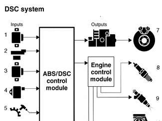

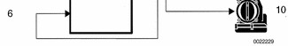

Inputs

1. Lateral acceleration sensor
2. Steering angle sensor
3. Rotational rate (yaw) sensor
4. Brake pressure sensor
5. ABS wheel speed sensors
6. Engine control module

Outputs

7. ABS/DSC hydraulic system
8. Ignition (spark)
9. Fuel injection
10. Throttle valve

The DSC system can be toggled on and off by a switch mounted on the center console. Turning off the DSC system does not disable ABS or ASC functions.

## Vehicle stability parameters

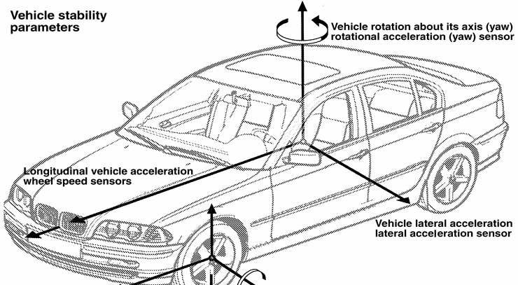

## System functions

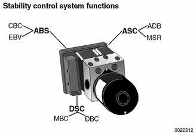

Each of the electronic braking and stability control systems include sub-systems which use the hydraulic unit/control module and sensors to carry out additional system functions. The foundation of the stability control systems is Antilock Braking System (ABS) with the following basic functions:

- Cornering brake control (CBC)
- Electronic brake proportioning (EBV)

The Teves MK 20 ASC system functions as a basic ABS system, but adds additional system functions:

- Brake intervention (ADB)
- Drag torque reduction (MSR)

All of the dynamic stability control systems are based on the ABS/ASC system, but add DSC system functions:

- Dynamic brake control (DBC)
- Maximum brake control (MBC)

### Cornering brake control (CBC)

Cornering brake control reduces brake pressure build up on the inside rear wheel brake circuit during cornering if activation threshold values are exceeded.

### Electronic brake proportioning (EBV)

Electronic brake proportioning adjusts braking force to the rear wheels based upon the vehicle's loading, front to rear, to maximize the vehicle's braking power. Using wheel speed sensors, the control module compares individual wheel deceleration rates as the brakes are applied. If the difference in wheel speeds exceeds the programmed threshold values, EBV is activated. EBV activation modulates inlet valves to the rear wheels to regulate braking force.

### Brake intervention (ADB)

Brake intervention is applied to the individual drive wheel which is losing traction by activating the rear brake calipers in three phases:

- Pressure build
- Pressure hold
- Pressure release

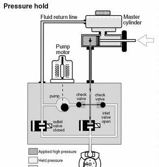

When intervention is necessary:

- The changeover valve in the hydraulic unit energizes and closes inlet valves for the two front wheels and the rear wheel with traction.
- The rear brake circuit intake valve is energized and opened to rear wheel without traction.
- Return/pressure pump is activated and draws in brake fluid from the master cylinder and delivers pressurized brake fluid to wheel without traction.
- Pressure hold and pressure release cycles are run by cycling inlet and outlet valve to rear brake caliper without traction.

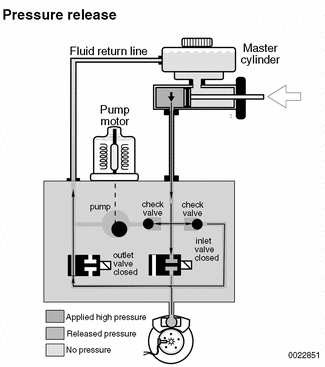

### Drive torque reduction

In low traction conditions, the ABS control module request is sent to the engine control module (ECM) via the CAN-bus. The ECM accomplishes torque reduction by implementing the following measures:

- Reducing throttle opening angle
- Retarding ignition
- Cutting off individual cylinder fuel injectors

### Drag torque reduction (MSR)

During deceleration and engine braking conditions engine drag torque can cause the rear wheels of a vehicle to lock on low traction surfaces, especially in high speed, low gear driving. This can lead to loss of traction in the rear. When drive wheel speed is slower than front wheel speed the ECM will suspend vehicle coasting by increasing throttle opening angle and engine torque.

### Dynamic brake control (DBC)

The DBC function provides increased braking pressure, up to ABS threshold, during emergency braking situations. The DSC control unit will implement DBC function when brake pressure builds rapidly with application of the brake pedal.

DBC triggering conditions:

- Brake light switch on
- Brake pressure in master cylinder above ABS threshold
- Brake pressure build up speed above threshold
- Vehicle road speed above 3 mph
- Pressure sensor self test completed and sensors OK
- Vehicle travelling forward
- Not all wheels in ABS regulation range

When DBC function is activated, braking pressure will increase at all wheels up to the ABS regulation point. DBC will continue until the driver releases the brake pedal, brake pressure drops, or the vehicle slows to under 3 mph.

### Maximum brake control (MBC)

Maximum brake control is designed to assist in stability control by increasing rear brake pressure when the front wheels are under ABS regulation. MBC intervention is triggered when the brakes are applied too slowly to reach DBC threshold.

MBC triggering conditions:

- Both front wheels in ABS regulation
- Vehicle speed above 3 mph
- DBC and pressure sensor self test completed and OK
- Vehicle travelling forward
- Rear wheels not under ABS regulation

MBC will activate the return pump to increase rear wheel pressure build up. The function will be terminated under the following conditions:

- Front wheels drop out of ABS regulation
- Driver releases brake pedal
- Brake pressure falls below threshold
- Vehicle road speed drops below 3 mph

## Teves MK 20 ASC diagram

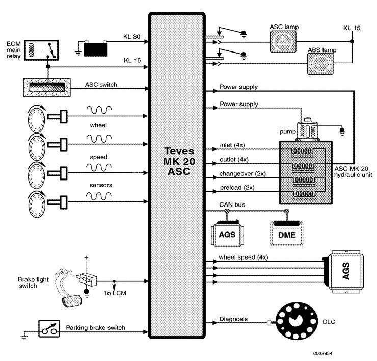

## Teves MK 20 DSC Diagram

## Vehicle network

The hydraulic unit/control module communicates with some sensors and many other control modules over the CAN-bus. The CAN-bus is a system of wiring that functions like a computer network, allowing different components to communicate over the same data line, at the same time, by varying electronic signals.

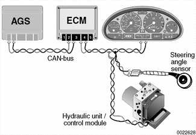

Component communication dialogs take place between multiple control units and sensors over the CAN-bus:

- Engine control module (ECM) provides current engine torque to ABS control module.
- ABS control module provides wheel speed sensor signals (vehicle speed) to other modules
- ABS control module signals ECM to increase/reduce torque, ECM adjusts motor driven throttle (MDK/EDK)
- ABS control module commands transmission control module (AGS) to suppress shifts during ASC/DSC regulation
- DSC receives yaw, lateral acceleration & steering angle sensor information
- ABS control module receives signal from ASC/DSC switch on dash.
- ABS control module signals turn instrument cluster warning lamps on during ASC/DSC regulation.

## Hydraulic unit/control module

The hydraulic unit is mounted in conjunction with the control module. While the hydraulic unit and control module function as one unit, they are replaceable individually. All ABS/ASC or ABS/DSC processing functions are performed by the control module. The control module is linked to the vehicle's engine control module (ECM) and transmission control module (AGS) (if applicable) by the CAN-bus network.

## Wheel speed sensors

Wheel speed sensors are a crucial component in every ABS system. Control modules use these sensor inputs to determine overall vehicle speed and individual wheel speed for both ABS braking and stability control functions.

Three different types of wheel speed sensor are used in the E46 electronic braking and stability control systems:

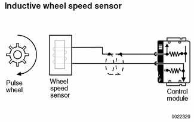

- 1999 - 2000 Teves MK 20 ASC / DSC: Inductive

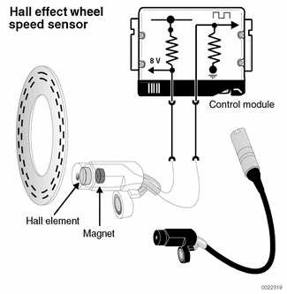

- 2001 Bosch DSC III 5.7: Hall effect

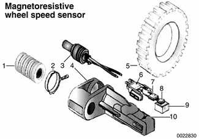

- 2001 Teves MK 60 DSC: Magnetoresistive

| No. | Part |
|---|---|
| 1 | Fastening element |
| 2 | Ground contact |
| 3 | Sensor wiring |
| 4 | Sensor housing |
| 5 | Metal pulse wheel |
| 6 | Sensor element support |
| 7 | Evaluation module |
| 8 | Sensor element |
| 9 | Magnet |
| 10 | Pick-up surface |

> **CAUTION!**
> - The magnetoresistive and the Hall effect sensor for the rear wheel are physically interchangeable. However, the electronic properties are not the same and they must not be interchanged.

## DSC lateral acceleration sensor

The lateral acceleration sensor provides the DSC control module with an input signal based on the degree of lateral acceleration (g forces) that the vehicle experiences. Based on a 5 volt reference voltage, the sensor will return an output voltage that ranges between 0.5 and 4.5 volts to the DSC control module, with 1.8 volts as a standing voltage. This input, along with other DSC inputs, determines the amount of DSC regulation needed to maintain vehicle stability.

## Teves MK 60 DSC diagram

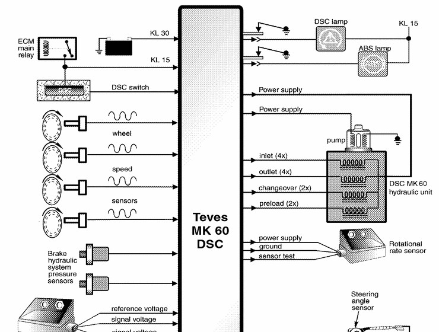

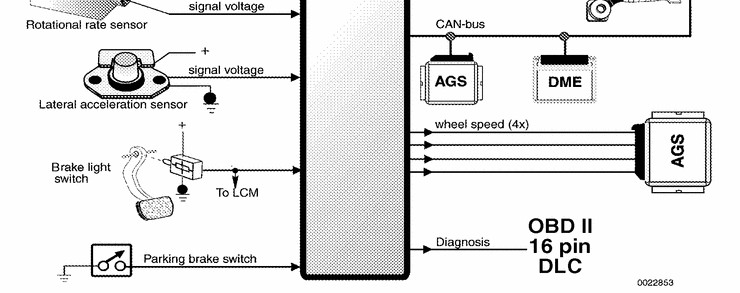

## Bosch DSC III 5.7 diagram

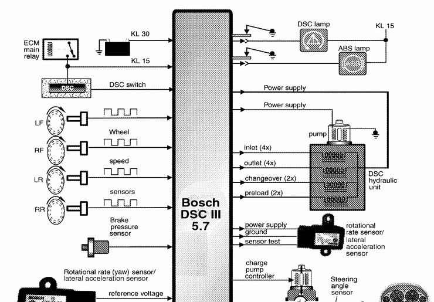

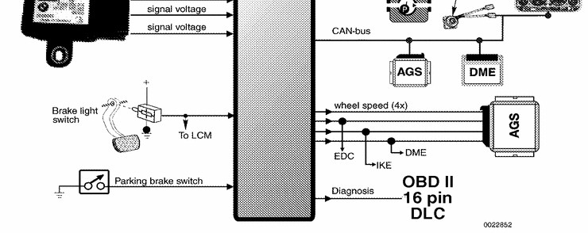

## DSC rotational rate (yaw) sensor

The rotational rate sensor provides an analog voltage signal to the DSC control module to indicate the rotational speed (yaw) of the vehicle on its vertical axis. The control module supplies a 5 volt reference voltage to the sensor. The sensor returns a voltage between 0.25 and 4.65 volts based on the amount of yaw. If the vehicle's yaw exceeds preset parameters, the DSC control module will activate a DSC regulation cycle to increase vehicle stability while cornering. In case of failure the sensor will send a constant voltage to the DSC control unit.

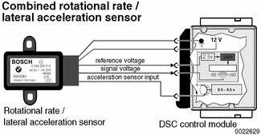

## DSC steering angle sensor

Using two potentiometers, the steering angle sensor determines the steering angle and the rate of steering change. The sensor processes the two potentiometer outputs and provides a digital signal to the DSC control unit via the vehicle's CAN-bus network. Sensor recalibration is required after steering angle sensor replacement or repairs to the steering column. This recalibration is performed using either the DIS or MoDiC BMW scan tools.

## DSC pressure sensor

The DSC pressure sensor(s) provides the ABS/DSC control module an analog voltage signal in proportion to brake pressure in the master cylinder.

The DSC MK 20 and MK 60 systems use two switches installed at the brake master cylinder.

The Bosch DSC III 5.7 system uses one switch installed at the DSC hydraulic unit.

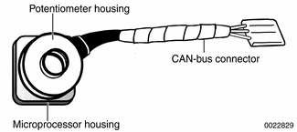

## DSC precharge pump

The DSC precharge pump is used in the Teves MK 20 DSC and Bosch DSC III 5.7 systems (1999 - 2000 DSC and 2001 all wheel drive equipped vehicles).

The DSC precharge pump provides the hydraulic unit with the necessary supply of hydraulic brake fluid. When the DSC system is activated, the precharge pump delivers brake fluid from the reservoir to the hydraulic unit at 10 bar (150 psi).

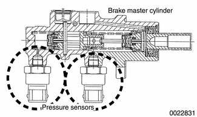

## Switches and indicators

### ASC/DSC control button

The control button is used to deactivate the stability control functions of either the ASC system or the DSC system.

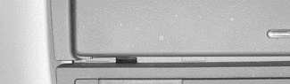

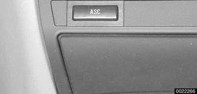

### Brake light switch

The brake light switch input signal is used by the control module to determine which stability control routine is necessary. The control module will interrupt Automatic Stability Control (ASC) functions if the brake pedal is depressed during ASC operation. On vehicles equipped with DSC, DSC operation is not cancelled during braking situations.

> **Note:**
> - Bosch DSC III 5.7 control module compares input from the brake light switch with pressure sensor value. The pressure sensor must not detect more than 5 bar when the brake light switch is not actuated.

### Parking brake switch

The switch for the parking brake warning lamp is used to signal the control module if the parking brake is engaged. This signal is used in stability control system logic to cancel system functions.

### Brake fluid level switch

The reed-type brake fluid level switch monitors the level of brake fluid available in the brake fluid reservoir. When an adequate amount of fluid is present, the switch completes a ground circuit for the control module. When fluid level is too low, the circuit is broken and the ASC/DSC functions are turned off. Normal braking and ABS remains unaffected.

## Warning lamps

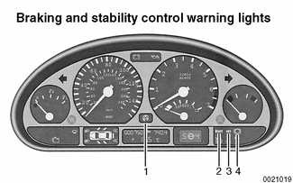

Braking and stability control warning lights

1. ASC/DSC warning light. Illuminates solidly when ASC/DSC system has been turned off, or blinks when ASC/DSC system is active.
2. Brake warning light. Indicates when the parking brake is engaged, or when brake system hydraulic fluid level is low.
3. Antilock brake system (ABS) warning light. Indicates that the ABS system has been deactivated, or when there is an ABS system malfunction.
4. Brake pad wear warning light. Indicates worn brake pads.

> **WARNING!**
> - If the brake warning lamp, ABS warning lamp, and ASC/DSC warning lamp are all illuminated at the same time, there is an ABS and stability control system failure. Do not drive vehicle without diagnosing the problem.
