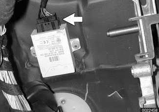
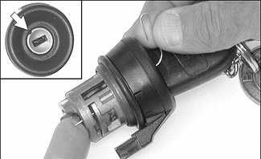

# Electronic Immobilization (EWS)

> Source: BMW 3 Series (E46) Repair Manual, section 515-4, Central Locking and Anti-Theft chapter (PDF pages 885–888 of 1252).

E46 cars are equipped with a passive theft-prevention system. The Electronic Immobilization System (EWS 3.3) makes it impossible to start the engine using any means other than the special keys furnished with the vehicle.

> **Note:**
> - EWS is sometimes also referred to as Driveaway Protection.
- If a vehicle key is lost or stolen, the electronic authorization for that key can be cancelled using the BMW scan and diagnostic tools DIS or MoDiC.
- Force applied to a key can damage the electronic circuitry. A damaged key will not start the engine.

In the EWS system, the ignition key is embedded with a computer chip and permanently coded. The key communicates with the vehicle using a transponder in the key and a ring antenna surrounding the steering lock cylinder.

A primary code is programmed into the key and into the vehicle itself. A secondary code is changed every time the vehicle is started. If the key code and EWS control module code do not match, the engine management control module and the starter are disabled. EWS ignition keys cannot be duplicated.

The system is designed to have up to ten keys. Only an authorized BMW dealer can provide replacement keys.

> **Note:**
> - It is possible to damage the electronic circuitry in the key, rendering it unusable. In that case, a new key should be purchased and initialized by an authorized BMW dealer.
- Starting with 2000 models, the battery in the FZV ignition key is recharged while the key is in the ignition switch. Therefore there is no need to replace the key battery.

## EWS control module, replacing

- Disconnect negative (-) cable from battery.

> **CAUTION!**
> - Prior to disconnecting the battery, read the battery disconnection cautions given at the front of this manual on page viii.

- Lower left footwell (pedal cluster) trim panel.

- Remove screws (A).

- Remove fasteners (B).

- Disconnect electrical harness connectors at left footwell trim panel and remove panel:
    - Unplug connector at footwell interior light (A), if equipped.
    - Slide lock at OBD II connector (B) in direction of arrow.
    - Unplug connector at speaker if equipped (C).

- Remove EWS control module harness connector (arrow).

- Remove module mounting screws. Remove module.

> **Note:**
> - The EWS module should be identified with EWS markings.

- Installation is reverse of removal.

## Ring antenna

To remove the ring antenna using BMW special tool 61 3 300, it is necessary to remove the upper and lower steering column trim. Alternatively, remove the ignition switch key cylinder.

With ignition key in "ON" position (60° from "LOCKED"), insert a thin piece of stiff wire into opening (arrow) in lock cylinder and pull lock cylinder out.

- Detach ring antenna harness connector.

- Gently work ring antenna off key cylinder.
