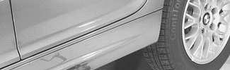
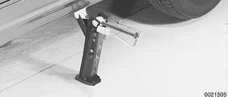
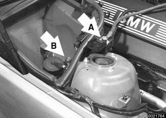
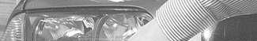
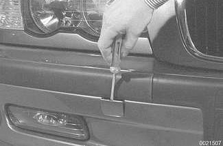
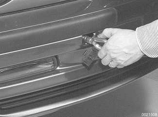

# Emergencies

> Source: BMW 3 Series (E46) Repair Manual, section 010-8 (PDF pages 20–27 of 1252).

## Changing a tire

- Stop car on as flat a surface as possible, in a place where you can be easily seen by other drivers. Avoid stopping just over the crest of a hill.
- Turn on emergency flashers, and set out flares or emergency markers well behind car. Chock wheel (wheel chock located in trunk) diagonally opposite to the one being changed. Passengers should get out of car and stand well away from road.

> **WARNING!**
> - If a tire goes flat while driving, pull well off the road. Changing a tire on a busy street or highway is very dangerous. If necessary, drive a short distance on the flat tire to get to a safe place. It is much better to ruin a tire or rim than to risk being hit.

- Take jack and tools from tool area beneath trunk mat. Remove spare tire from tire storage tray.
- Loosen wheel bolts while car is on ground, but leave them a little snug.

Place jack in lifting point nearest wheel being changed. Use a board to provide a firm footing for jack if ground is soft. Raise car only far enough so that wheel is fully off ground and then remove wheel nuts and wheel.

- Install spare wheel. Install wheel nuts and tighten them hand tight using lug nut wrench.
- Lower car. With all wheels on ground, fully tighten nuts in a crisscross pattern. Torque wheel nuts when installing wheel. Check inflation pressure of spare tire.

Tightening torque

| Component | Tightening torque |
|---|---|
| Wheel to wheel hub | 100 ± 10 Nm (74 ± 7 ft-lb) |

## Car will not start

If the engine turns over slowly or not at all, especially on cold mornings, the battery may not be sufficiently charged. Jump-starting the battery from another car may help.

> **CAUTION!**
> - On cars with manual transmission, push starting (or tow starting) a car is not recommended by BMW.

If the engine is turning over at normal speed with the starter motor, the battery and starter are fine. If the starter will not operate, see [121 Battery, Alternator, Starter] for information on the starter and starter immobilization systems.

Check to make sure that there is fuel in the tank. Do not rely on the fuel gauge as it may be faulty. Instead, remove the gas filler cap and rock the car. If there is gas in the tank, you should hear a sloshing sound at the filler neck. See [OBD On Board Diagnostics] at the rear of this manual for diagnostic code reading procedures.

## Jump starting

Cars with discharged or dead batteries can be jump-started using the good battery from another car. When jump-starting the engine, always note the following warnings.

> **WARNING!**
> - Battery acid (electrolyte) can cause severe burns, and will damage the car and clothing. If electrolyte is spilled, wash the surface with large quantities of water. If it gets into eyes, flush them with water for several minutes and call a doctor.
> - Batteries produce explosive and noxious gasses. Keep sparks and flames away. Do not smoke near batteries.
> - Do not jump-start the engine if you suspect that the battery is frozen. Trapped gas may explode. Allow the battery to thaw first.
> - Do not quick-charge the battery (for boost starting) for longer than one minute, and do not exceed 16.5 volts at the battery with the boosting cables attached. Wait at least one minute before boosting the battery a second time.

- Place cars close together, but do not allow them to touch each other.
- Turn off engine of car with good battery.
- Turn off ignition switch of car with discharged battery.

Connect one end of positive (+) cable to positive (+) post of good battery. Remove cover from the positive (+) junction post (A) in engine compartment and connect other end of the positive (+) cable to the junction post.

- Connect one end of negative (–) cable to negative (–) battery post of good battery. Connect opposite end of negative cable (–) to ground lug (–) in engine compartment (B).
- Start car with good battery and run engine at about 2,000 rpm, then start car with dead battery.
- With engine at idle, switch on blower motor and rear window defogger to avoid a damaging voltage surge from alternator.
- Carefully disconnect jumper cables, starting with negative cable on ground lug. Turn all electrical consumers off.

> **Note:**
> - The engine should be run for at least an hour to recharge the battery.

## Indicator and warning lights

Many of the vehicle systems are self-monitored both statically and dynamically while driving. Generally, a red warning lamp that comes on during driving should be considered serious. If you cannot immediately determine the seriousness of the warning light, stop the vehicle in a safe place and turn the engine off as soon as possible. Consult the owner's manual in the glove box for additional information on the warning lamp and the recommended action.

If the Malfunction Indicator Lamp (MIL), "Check Engine" or "SERVICE ENGINE SOON" warning light, comes on or flashes, it indicates that an emissions-related fault has occurred. Faults such as a faulty oxygen sensor or a faulty fuel injector can cause the exhaust or evaporative emissions to exceed a specified limit. When these limits are exceeded, the MIL will be turned on. The car can be safely driven with the light on, although the emission systems should be checked as soon as possible. See [OBD On Board Diagnostics] for more information on the MIL and the On-board diagnostic system.

## Towing

The cars covered by this manual should be towed with a tow truck using wheel lift or flat bed equipment. Do not tow the car on all four wheels except for very short distances to move it to a safe place.

> **CAUTION!**
> - Do not tow with sling-type equipment. The front spoilers and bumper covers may sustain damage.

To access threaded towing eye socket, pry open trim (arrow) on front or rear bumper.

> **Note:**
> - A towing eye is provided in the luggage compartment tool kit. The towing eye can be screwed into the front or rear bumper.

Install towing eye into threaded hole.

- Standard transmission: A maximum towing distance of 20 miles is acceptable with the rear wheels on the ground and the transmission out of gear. If the car needs to be towed further, have the rear wheels placed on dollies.
- Automatic transmission: If absolutely necessary, car can be towed with rear wheels on ground, but the tow should not exceed 25 miles (40 km), at speeds at or below 30 mph (48 km/h).
    - Be sure transmission fluid has been topped off before starting tow.
    - Always tow car with transmission lever in "N" (neutral). If tow must exceed 25 miles (40 km), add one quart of ATF to transmission, or better yet, remove driveshaft.
    - Be sure to drain or pump out added fluid once tow has been completed.

> **Note:**
> - ATF draining and filling is covered in [240 Automatic Transmission]. Be sure to read the filling and draining procedure, as special service equipment is required to check the fluid level.
> - Driveshaft removal is covered in [260 Driveshaft].

## Spare parts kit

Carrying a basic set of spare parts can prevent a minor breakdown from turning into a major annoyance. Many of the following items won't allow you to do major repair work on the car, but they will help in the event of the failure of something that can disable the car or compromise its safety.

**Spare parts kit – basic**

- Poly-ribbed drive belt(s)
- Engine oil (one or two quarts)
- Engine coolant (1 gallon of premixed 50/50 BMW anti-freeze and water)
- Fuse assortment (7.5A, 10A, 15A, 20A, 30A, 50A)
- Radiator hoses (upper and lower)

**Spare parts kit – additional contents**

- Exterior lighting bulbs (headlight, brake light, turn signal, and taillight)
- Wiper blades
- Brake fluid (new unopened bottle, DOT 4 specification)
- Main relay for DME system
