# Engine Compartment Maintenance

> Source: BMW 3 Series (E46) Repair Manual, section 020-5, Maintenance chapter (PDF pages 50–57 of 1252).

The information under this heading describes routine maintenance other than oil change done in the engine compartment. It is not necessary for the car to be raised and supported off the ground. Information on oil change is given earlier in this group.

## Accelerator linkage

The accelerator and throttle linkage should be lubricated periodically. Use a general purpose oil on the joints and bearings of the linkage. Use a multipurpose grease on the bearing points of the throttle plate.

## Air filter, replacing

The specified replacement intervals for the air filter are based on normal use. If the car is operated primarily in dusty conditions, the air filter should be serviced more frequently.

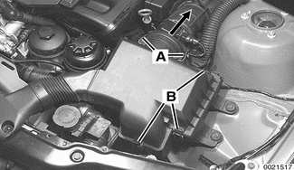

- Release mass air flow sensor clips (A) and pull sensor assembly out of air filter upper housing (arrow).
    - Release upper air filter housing clips (B).
- Lift air filter upper housing, and then remove filter element insert from cartridge.

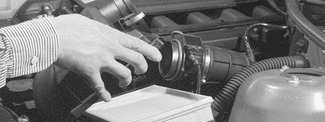

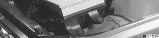

    - On installation, install O-ring for mass air flow sensor (arrow) into retaining clips in air filter upper housing.

## Cooling system service

Routine cooling system maintenance consists of maintaining the coolant level and inspecting hoses. Because the coolant's anti-corrosion and anti-freeze additives gradually lose their effectiveness, replacement of the coolant every four years is recommended.

> **CAUTION!**
> - Use only BMW approved phosphate-free anti-freeze when filling the cooling system. Use of anti-freeze containing phosphates is considered to be harmful to the cooling system.

The float in the radiator tank indicates coolant level, and should be inspected while the coolant is cold. When the upper mark on the float is level with the top of the filler neck, coolant is at the minimum allowable level. When the lower mark on the float is level with the top of the filler neck, the coolant is at the maximum level.

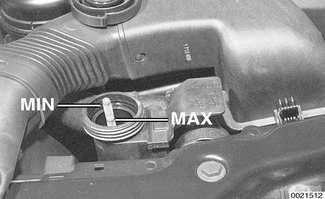

Hose connections should be tight and dry. Coolant seepage indicates either that the hose clamp is loose, that the hose is damaged, or that the connection is dirty or corroded. Dried coolant has a chalky appearance. Hoses should be firm and springy. Replace any hose that is cracked, that has become soft and limp, or has been contaminated by oil.

As a preventive measure, replacement of the cooling system hoses every four years is also recommended. The illustration shows examples of damage to coolant hoses. Any of conditions shown is cause for replacement. (Courtesy of Gates Rubber Company, Inc.)

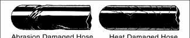

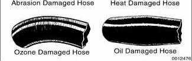

## Engine drive belt service

Drive belts and pulleys transfer power from the engine crankshaft to various accessories. E46 models use two poly-ribbed (serpentine) belts:

- The outer belt only turns the A/C compressor
- The inner, longer belt activates the alternator, coolant pump and power steering.

Automatic belt tensioners are used to keep the belts tensioned properly. Unless a tensioner mechanism malfunctions, the poly-ribbed belts do not require tension adjustment.

Inspect drive belts with the engine off. If the belt shows signs of wear, cracking, glazing, or missing sections, it should be replaced immediately. To reduce the chance of belt failure while driving, replacement of the belts every four years is recommended.

> **Note:**
> - When belts are replaced with new ones, store the old set in the luggage compartment for emergency use.

To remove drive belts:

- Use long-handled wrench to turn A/C belt tensioner release lug (A) clockwise (against spring tension). Remove A/C belt.

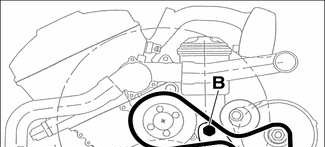

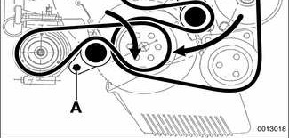

- Similarly, turn main engine drive belt tensioner lug (B) clockwise and remove belt.

> **WARNING!**
> - Observe care when replacing belts. Personal injury could result if a tensioner springs back into position uncontrollably.

> **CAUTION!**
> - Mark drive belt rotation direction if removing and reusing an old belt.
> - When installing a new belt, gently pry it over the pulleys. Too much force may damage the belt or the accessory.

## Idle speed

Engine idle speed can change due to a number of factors, including normal wear. The idle speed in E46 models is electronically adaptive and non-adjustable. See [130 Fuel Injection] for more information.

## Oxygen sensors

The engine management system in E46 models is equipped with multiple oxygen sensors. A regulating sensor is mounted before each catalytic converter and a monitoring sensor downstream of each converter. The regulating sensor monitors engine combustion efficiency and helps to control the fuel injection system and exhaust emissions. The monitoring sensor is used by the on-board diagnostic (OBD II) system to monitor the function of the catalytic converter.

OBD II enhanced emission standards require the engine control module (ECM) to monitor the oxygen content in the exhaust both before and after the catalytic converter. This allows for tighter control of the tail pipe emissions and also allows the ECM to diagnose converter problems. If the ECM detects that catalytic converter or oxygen sensor efficiency has degraded past a certain pre-programmed limit, it will turn on the Check Engine light, and store a diagnostic trouble code (DTC) in the ECM. See [OBD On Board Diagnostics] in the rear of this manual for more information on OBD systems.

Replacement of oxygen sensors at the specified intervals ensures that the engine and emission control system will continue to operate as designed. Extending the replacement interval may void the emission control warranty coverage. See [180 Exhaust System] for information on replacing the oxygen sensors.

Tightening torque

| Component | Tightening torque |
|---|---|
| Oxygen sensor to exhaust manifold | 50 Nm (37 ft-lb) |

> **Note:**
> - A special socket for replacing the oxygen sensor is available from most automotive parts stores. The socket has a groove cut down one side to allow the sensor to be installed without damaging the wire harness.

## Power steering fluid, checking level

To check power steering fluid level in fluid reservoir:

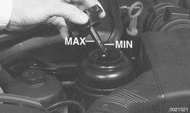

- Park car on level ground with engine off.
- Level is correct if it is between MIN and MAX marks on dipstick.
- If level is below MIN mark, start engine and add fluid to reservoir to bring level up.
- Stop engine and recheck level.
- Hand-tighten reservoir cap.

| Power steering fluid | Recommended fluid |
|---|---|
| | Dexron III® ATF |

## Spark plugs, replacing

E46 engines use a "coil-over" configuration, with one ignition coil above each spark plug.

- Remove microfilter housing:
    - Remove microfilter for interior ventilation. See [Ventilation microfilter, replacing].
    - Open wiring harness loom (A), remove harness and lay aside.
    - Unfasten screws (B) and take off lower microfilter housing.

- Remove engine cover over ignition coils:
    - Remove oil filler cap.
    - Remove plastic trim covers (arrows).

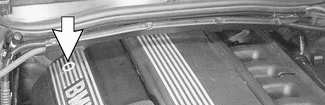

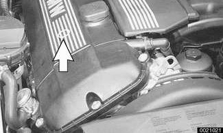

    - Remove cover hold down bolts.
- Remove ignition coil grounding harnesses (arrows).

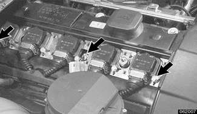

- Remove ignition coils:
    - Pull up on spring clips to disconnect ignition coil harness connectors.

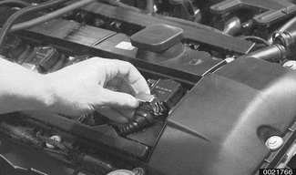

    - Remove coil mounting bolts.
    - Remove coils.
    - Remove spark plugs.
- Installation is reverse of removal, bearing in mind the following:
    - Lightly lubricate new spark plug threads with copper-based anti-seize compound.
    - Thread plugs into cylinder head by hand to prevent cross-threading.
    - Be sure to reinstall coil grounding harness.

Spark plug recommendations

| Manufacturer | Spark plug |
|---|---|
| Bosch | FGR7 DQP |
| NGK | BKR6 EQUP |

Tightening torque

| Component | Tightening torque |
|---|---|
| Spark plug to cylinder head | 25 Nm (18 ft-lb) |

## Ventilation microfilter, replacing

Working at cowl housing inside engine compartment, twist microfilter cover retainers (arrows) 90° each and pull cover up.

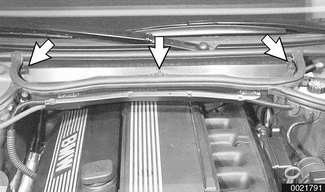

Pull filter out and replace.

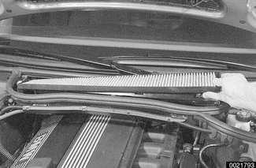
