# Engine Hood

> Source: BMW 3 Series (E46) Repair Manual, section 410-3, Fenders, Engine Hood chapter (PDF pages 746–751 of 1252).

## Hood, raising to service position

> **CAUTION!**
> - Do not switch on the windshield wipers with the engine hood raised. As a precaution, remove the wiper motor fuse. See [610 Electrical Component Locations].
> - The hood is heavy. Before removing the hood supports, be sure to have an assistant help support the hood.

Open hood fully. With the help of a partner, support hood and remove retaining clips (arrow) on upper end of pressurized lifting struts. Pull struts off hood.

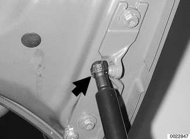

- Raise hood higher and install BMW special tool 51 2 160 in between hood lift struts and hood brackets to hold hood in service position.

## Hood, removing and installing

Raise hood:

- Disconnect washer fluid hose (A) from washer nozzles.

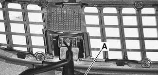

- Where applicable, disconnect electrical harness connector (B) from heated nozzles.

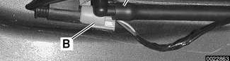

- Detach gas-charged hood supports from hood.

> **CAUTION!**
> - The hood is heavy. Before removing the hood supports or hood retaining bolts, be sure to have an assistant help support the hood.

Loosen upper hood hinge bolts (A). Remove ground strap (B) and remove lower hinge bolts (C). Lift hood off carefully.

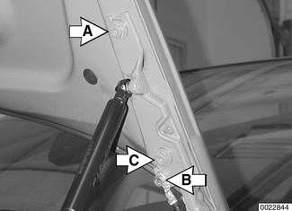

- Installation is reverse of removal.
    - Repair any paint damage and paint any exposed metal.
    - Check hood alignment as described next.

> **Note:**
> - The hood was fitted and attached to an unfinished body at the factory. Unfinished surfaces exposed by this procedure must be touched up with paint.

## Hood, aligning

When installing the hood, align the hinges as close to the original painted surface as possible. Movement of the hood on its attaching hardware may require touch-up paint.

The hood should be aligned so that gap (arrows) to fender is as even as possible.

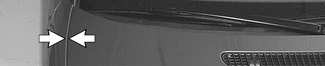

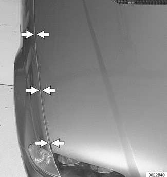

| Clearance specification |  |
|---|---|
| Hood edges to adjoining body panel (gap) | 5.5 mm (0.216 in.) |

If height adjustment at rear of hood cannot be completed using upper hinge, loosen lower hinge bolts (arrows) and reposition as necessary.

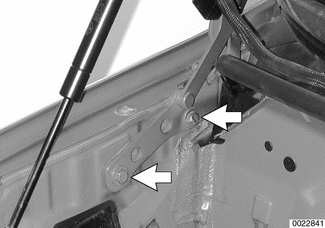

Plastic coating on top of hinge stop screw must not be damaged or missing.

Stop disk for front of hood (arrow) is eccentric, and is marked 0-10. Initial setting is with the 0 setting forward, for minimal clearance. Turn stop disk to move hood front stop further out.

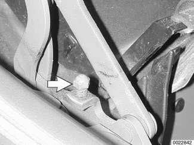

- Height at front of hood is set using spring pins and rubber stop buffers.

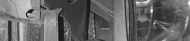

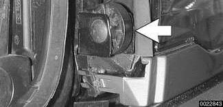

## Hood release cable and spring pins, adjusting

Before adjusting hood pins, be sure the hood is aligned evenly to fenders and front panel.

- Make sure bowden cable, which connects both hood locks together, is seated in lock guide on both left and right locks.

Loosen hood spring pin bolts (A) and retaining hook bolts (B) at hood on left and right sides only enough to allow movement.

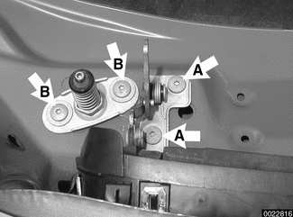

- Turn rubber stop buffers over headlights inwards to provide clearance.
- Lower (but do not fully latch) hood several times so pins on hood center themselves in lower locks.

> **CAUTION!**
> - Do not let hood lock with latch bolts loose.

- Tighten hood spring pin bolts and latch bolts when alignment is correct.
- Remove one screw from each side, clean and coat with Loctite®270 or equivalent, and reinstall.
- Unscrew rubber stop buffers above headlight assemblies until they support hood when closed without movement.
- Test hood for correct closure and opening. If hood does not spring open, lengthen spring pins.

To lengthen spring pin, loosen locknut (arrow) with wrench inserted through spring, then turn pin counterclockwise.

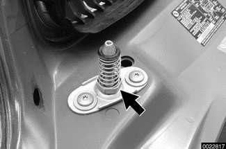

## Hood latch components, assembly

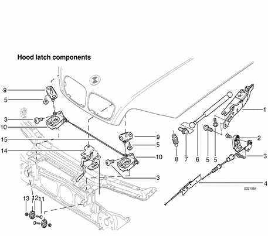

1. Hood hinge
2. Hood release lever
3. Torx bolt
4. Bowden cable, main
5. Hex bolt
6. Gas pressurized strut
7. Ball pin
8. Stop buffer
9. Spring pin
10. Lower hood lock
11. Saucer head screw
12. Eccentric wheel
13. Hex nut with plate
14. Hood catch
15. Bowden cable, center
