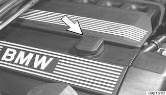
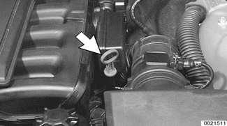
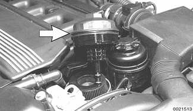
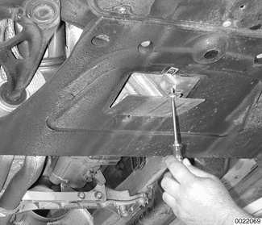
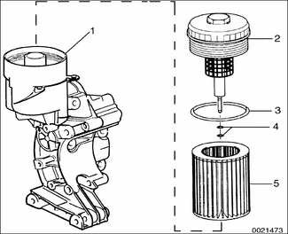

# Engine Oil Service

> Source: BMW 3 Series (E46) Repair Manual, section 020-4, Maintenance chapter (PDF pages 45–49 of 1252).

With the introduction of synthetic oil and extended oil change intervals, a new oil filter with improved filter paper design was introduced. The new filter paper resists deterioration caused by high oil temperatures over an extended time.

> **Note:**
> - Early style oil filter numbers with BMW part numbers 11 42 1 427 908 or 11 42 1 745 390 should not be used in the 1999 and later BMW models.

Use any synthetic low viscosity oil to top off the engine oil level between oil changes, as long as it meets the API classification SH. Castrol is now the supplier of both the mineral based oil used in earlier models and the synthetic based oil used from model year 1999.

Oil recommendation

| Oil | Viscosity |
|---|---|
| BMW High Performance Synthetic (part number 07 51 0 017 866) | 5W-30 |

> **Note:**
> - The use of engine oil additives is not recommended when using BMW High Performance Synthetic engine oil.
> - BMW is constantly upgrading recommended maintenance procedures and requirements. The information contained here is as accurate as possible at the time of publication. If there is any doubt about what procedures apply to a specific model or model year, or what intervals should be followed, remember that an authorized BMW dealer has the latest information on factory-recommended maintenance.

## Engine oil, checking level

Engine oil level is checked with a dipstick (arrow) in engine block. Check oil level with car on a level surface, after engine has been stopped for at least a few minutes. Check level by pulling out dipstick and wiping it clean. Reinsert it all way and withdraw it again. Oil level is correct if it is between two marks near end of stick.

Add oil through filler cap (arrow) on top of cylinder head. Add only amount needed to bring oil level to MAX mark on dipstick, using an oil of correct viscosity and grade. Too much oil can be just as harmful as too little.

## Engine oil and filter, changing

A complete oil change requires new oil, a new oil filter insert kit, and a new drain plug sealing washer. The tools needed, a 17 mm drain plug socket or box wrench and a drain pan (8 - 10 US qt. capacity), are described in [010 General].

> **Note:**
> - If using a "fast-lube" service facility for oil changes, make sure the technician hand-starts and torques the engine oil drain plug using hand-tools. Power tools can strip the threads of the plug and the oil pan.

- Run engine for a few minutes to warm engine oil. Shut engine off.
- With car on level ground, place drain pan under oil drain plug.

Using a 36 mm wrench, loosen and remove oil filter housing cover (arrow). Remove filter cartridge and discard any O-rings.

On Coupe or Convertible model: Remove oil drain plug access panel in center of front end reinforcement plate below engine.

Using a socket or box wrench, loosen drain plug at oil drain pan. Remove plug by hand and let oil drain into pan.

> **CAUTION!**
> - Pull the loose plug away from the hole quickly to avoid being scalded by hot oil. It will run out quickly when the plug is removed. If possible, use gloves to protect your hands.

- When oil flow has diminished to an occasional drip, reinstall drain plug with a new metal sealing washer and torque plug.

Tightening torques

| Component | Tightening torque |
|---|---|
| Engine oil drain plug (M12 bolt) | 25 Nm (18 ft-lb) |

Working at oil filter housing: Lubricate and install new oil filter O-rings. Install a new filter cartridge and housing cover. Tighten cover.

1. Filter housing
2. Filter housing cover - tighten to 25 Nm (18 ft-lb)
3. O-ring (always replace)
4. O-rings (always replace)
5. Filter element

Tightening torque

| Component | Tightening torque |
|---|---|
| Oil filter cover filter housing | 25 Nm (18 ft-lb) |

- Refill crankcase with oil. Approximate oil capacity is listed in [Table d]. Use dipstick to check correct oil level.
- Start engine and check that oil pressure warning light immediately goes out.
- Allow engine to run for a few minutes to circulate new oil, then check for leaks at drain plug and oil filter. Stop engine and recheck oil level.
